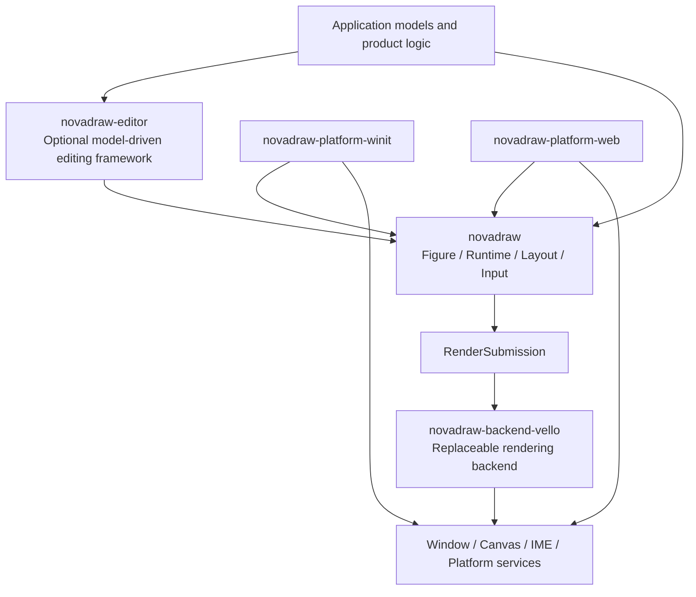

# Novadraw

**English** | [简体中文](README.zh-CN.md)

Novadraw is a cross-platform 2D Figure runtime and graphical editing framework built in Rust.
It provides lightweight Figures, layout, connections, events, and model-driven editing, with
independently composable boundaries for the core runtime, editor framework, platform adapters,
and rendering backends.

> **Project status: actively developed.** The current workspace version is `0.1.0`, and the
> public API does not yet carry a 1.0 compatibility guarantee. The project is currently
> distributed as a source workspace; refer to the in-repository documentation, examples, and
> verification suites for the latest supported behavior.

## Features

- Lightweight Figure trees, generational node identities, Z-ordering, and a unified box model
- Layout, coordinate transforms, clipping, incremental invalidation, and damage repair
- Pointer and keyboard input, focus, capture, tooltips, and accessibility snapshots
- Viewports, scrolling, zooming, connection anchors, routing, and decorations
- Text, images, borders, common Figures, and an animated presentation layer
- A model-driven editor with selections, tools, requests, policies, commands, undo, and redo
- A backend-independent render submission protocol with Vello, Winit, and Web adapters
- Headless contract tests, Native/Web examples, and layered verification suites

See the [product deliverables](engine/novadraw/doc/roadmap/product-deliverables.md)
and [platform support matrix](engine/novadraw/doc/roadmap/platform-support-matrix.md)
for the complete capability and verification status.

## Quick Start

A stable toolchain with Rust 2024 edition support is required. Running Native examples also
requires a compatible graphics driver for the host platform; consult the platform support
matrix for the verified platform scope.

```bash
git clone https://github.com/yezhang/novadraw.git
cd novadraw/engine/novadraw

cargo check -p novadraw --lib
cargo run -p shape-app
```

Minimal Core usage:

```rust
use novadraw::figure::RectangleFigure;
use novadraw::geometry::Rectangle;
use novadraw::runtime::Runtime;
use novadraw::tree::FigureTree;

let mut tree = FigureTree::new();
let root = tree
    .builder()
    .set_contents(Box::new(RectangleFigure::new(0.0, 0.0, 640.0, 480.0)))
    .expect("valid FigureTree construction");
let runtime = Runtime::new(tree);

assert_eq!(
    runtime.tree().figure_bounds(root),
    Ok(Rectangle::new(0.0, 0.0, 640.0, 480.0)),
);
```

See the [examples directory](engine/novadraw/examples/README.md) for more runnable
scenarios.

## Architecture



Core does not depend on a window system or a specific GPU backend, and the Editor is optional
for applications that only need a Figure tree. Platform adapters normalize input and host
lifecycle events, while rendering backends consume only stable submission packages.

The top-level `client/` and `engine/` directories are retained from an earlier repository
layout. They do not imply that the current runtime must use a "main-thread Client + Web Worker
Engine" deployment. A Web Worker is an optional Web hosting strategy, not the basis of the
Core/Platform/Backend boundaries. See
[repository layout and threading boundaries](docs/repository-layout.md) for details.

## Workspace

The active Rust workspace is located at `engine/novadraw/`.

| Package | Responsibility |
|---|---|
| `novadraw` | Platform-independent Figures, Runtime, layout, input, connections, and rendering protocol |
| `novadraw-editor` | Model-driven graphical editing framework |
| `novadraw-inspector` | Read-only diagnostics and runtime observation |
| `novadraw-backend-vello` | Native/Web Vello rendering backend |
| `novadraw-platform-winit` | macOS, Windows, and Linux host adapter |
| `novadraw-platform-web` | Browser input, text editing, and resource bridge |

## Documentation

| Audience or purpose | Entry point |
|---|---|
| Application development and extension | [Novadraw Application Development and Extension Guide](engine/novadraw/book/user/src/README.md) |
| Principles, models, and algorithms | [Understanding Novadraw](engine/novadraw/book/internals/src/README.md) |
| Contributing to the project | [Novadraw Contributor Guide](engine/novadraw/book/contributor/src/README.md) |
| Specifications, ADRs, roadmaps, and verification evidence | [Engineering documentation](engine/novadraw/doc/00-index.md) |
| Repository history and directory boundaries | [Root documentation index](docs/README.md) |

Normative designs, current status documents, and historical material carry different levels of
authority. Read the engineering documentation index before changing the architecture; do not
infer current contracts from archived proposals, old experiments, or individual examples.

## Development and Verification

Run the following commands from the Rust workspace directory:

```bash
cargo fmt --all -- --check
cargo check --workspace
cargo clippy --workspace -- -D warnings
cargo test --workspace
```

Discover and run cross-tool verification suites with:

```bash
cargo xtask list
cargo xtask verify <suite-id>
```

For documentation-only changes, run at least:

```bash
cargo xtask docs
git diff --check
```

## Contributing

Before opening an Issue or Pull Request, read the
[contribution workflow](engine/novadraw/book/contributor/src/01-contribution-workflow.md).
The project requires behavioral contracts, state ownership, and failure models to be defined
before implementation details. Changes to shared protocols require corresponding negative tests
and verification evidence.

## License

Third-party reference materials in this repository retain their respective copyrights and
licenses.

Novadraw's original code is licensed under the [MIT License](LICENSE).
