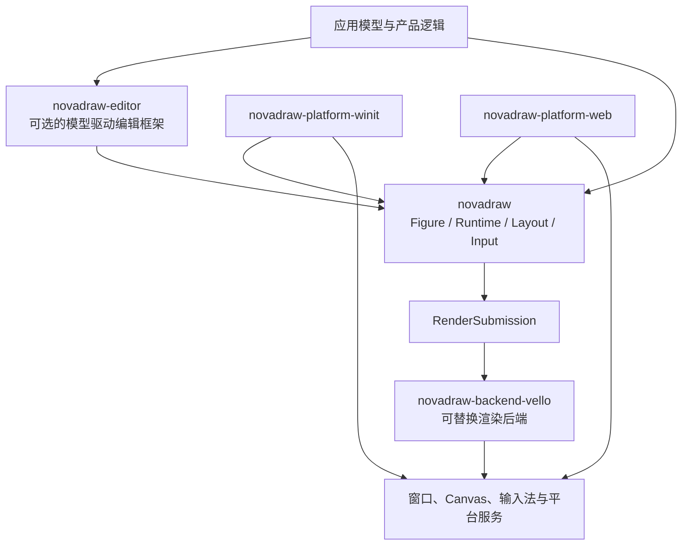

# Novadraw

[English](README.md) | **简体中文**

Novadraw 是一个使用 Rust 构建的跨平台二维 Figure 运行时与图形编辑框架。它提供
轻量 Figure、布局、连接、事件和模型驱动编辑能力，并将核心运行时、编辑框架、
平台适配与渲染后端拆成可独立组合的边界。

> **项目状态：积极开发中。** 当前工作区版本为 `0.1.0`，公共 API 尚未承诺
> 1.0 兼容性。现阶段项目以源码工作区交付，请以仓库内的文档、示例和验证套件为准。

## 特性

- 轻量 Figure 树、代际节点身份、Z-order 与统一盒模型；
- 布局、坐标变换、裁剪、增量失效与 damage repair；
- Pointer、键盘、焦点、capture、tooltip 与 accessibility 快照；
- Viewport、滚动、缩放、连接锚点、路由与装饰；
- 文本、图像、边框、常用 Figure 与动画表现层；
- 模型驱动的 Editor：选择、工具、请求、策略、命令和撤销重做；
- 后端无关的渲染提交协议，以及 Vello、Winit 和 Web 适配包；
- Headless 契约测试、Native/Web 示例和分层验证套件。

完整能力与验证状态见
[产品交付清单](engine/wasm_rust/novadraw/doc/roadmap/product-deliverables.md)和
[平台支持矩阵](engine/wasm_rust/novadraw/doc/roadmap/platform-support-matrix.md)。

## 快速开始

需要支持 Rust 2024 edition 的稳定工具链。运行 Native 示例还需要当前平台可用的
图形驱动；已验证的平台范围以平台支持矩阵为准。

```bash
git clone https://github.com/yezhang/novadraw.git
cd novadraw/engine/wasm_rust/novadraw

cargo check -p novadraw --lib
cargo run -p shape-app
```

最小 Core 用法：

```rust
use novadraw::figure::RectangleFigure;
use novadraw::geometry::Rectangle;
use novadraw::runtime::Runtime;
use novadraw::tree::FigureTree;

let mut tree = FigureTree::new();
let root = tree
    .builder()
    .set_contents(Box::new(RectangleFigure::new(0.0, 0.0, 640.0, 480.0)))
    .expect("valid FigureTree construction");
let runtime = Runtime::new(tree);

assert_eq!(
    runtime.tree().figure_bounds(root),
    Ok(Rectangle::new(0.0, 0.0, 640.0, 480.0)),
);
```

更多可运行场景见[示例目录](engine/wasm_rust/novadraw/examples/README.md)。

## 架构



Core 不依赖窗口系统或具体 GPU 后端；Editor 也不是使用 Figure 树的前置条件。
平台适配器负责规范化输入和宿主生命周期，渲染后端只消费稳定的提交包。

顶层 `client/` 与 `engine/` 来自早期仓库结构，不代表当前运行时必须采用
“主线程 Client + Web Worker Engine”。Web Worker 是 Web 宿主可选择的部署策略，
不是 Core/Platform/Backend 分层成立的原因。详细说明见
[仓库结构与线程边界](docs/repository-layout.md)。

## 工作区

当前有效的 Rust workspace 位于 `engine/wasm_rust/novadraw/`。

| Package | 职责 |
|---|---|
| `novadraw` | 平台无关的 Figure、Runtime、布局、输入、连接与渲染协议 |
| `novadraw-editor` | 模型驱动的图形编辑框架 |
| `novadraw-inspector` | 只读诊断与运行时观测 |
| `novadraw-backend-vello` | Native/Web Vello 渲染后端 |
| `novadraw-platform-winit` | macOS、Windows、Linux 宿主适配 |
| `novadraw-platform-web` | 浏览器输入、文本编辑与资源桥接 |

## 文档

| 读者或目的 | 入口 |
|---|---|
| 应用开发与扩展 | [《Novadraw 应用开发与扩展指南》](engine/wasm_rust/novadraw/book/user/src/README.md) |
| 原理、模型与算法 | [《深入理解 Novadraw》](engine/wasm_rust/novadraw/book/internals/src/README.md) |
| 参与项目开发 | [《Novadraw 贡献者指南》](engine/wasm_rust/novadraw/book/contributor/src/README.md) |
| 规范、ADR、路线图与验证证据 | [工程文档入口](engine/wasm_rust/novadraw/doc/00-index.md) |
| 仓库历史与目录边界 | [根文档入口](docs/README.md) |

规范性设计、当前状态和历史材料具有不同事实层级。修改架构前请先阅读工程文档入口，
不要从归档方案、旧实验目录或单个示例反推现行契约。

## 开发与验证

在 Rust workspace 目录执行：

```bash
cargo fmt --all -- --check
cargo check --workspace
cargo clippy --workspace -- -D warnings
cargo test --workspace
```

跨工具验证套件通过以下命令发现和运行：

```bash
cargo xtask list
cargo xtask verify <suite-id>
```

纯文档修改至少运行：

```bash
cargo xtask docs
git diff --check
```

## 贡献

提交 Issue 或 Pull Request 前，请先阅读
[贡献工作流](engine/wasm_rust/novadraw/book/contributor/src/01-contribution-workflow.md)。
项目要求行为契约、状态所有权和失败模型先于实现细节；共享协议变化需要相应的负向
测试和验证证据。

## 许可

仓库中的第三方参考材料保留其各自版权和许可证。

Novadraw 自有代码使用 [MIT License](LICENSE)。
