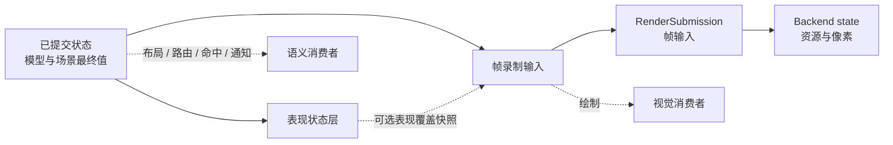
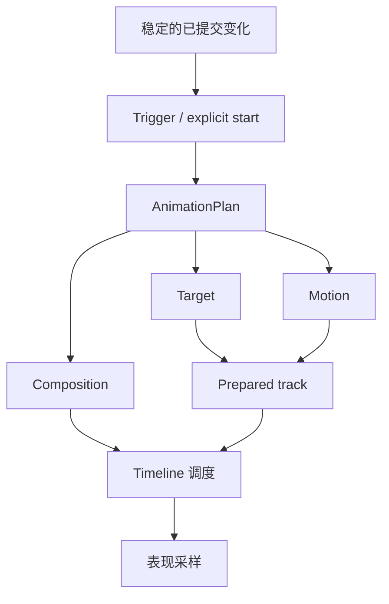
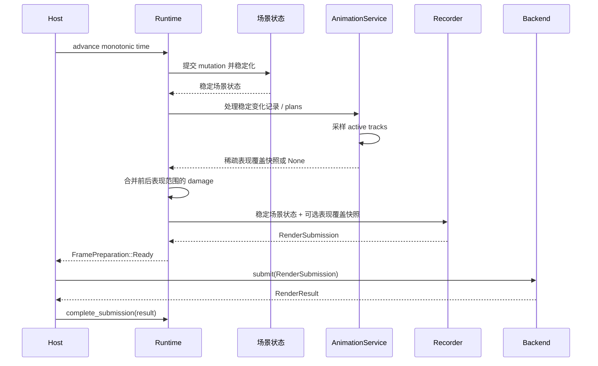

# 9. 动画与表现状态层

> **本章解决的问题**：如何让属性、布局、连接和视口产生连续视觉过渡，同时保证模型、
> Figure、布局、命中、通知和撤销仍然只认同一份最终事实？

动画最容易破坏一致性的地方，不是插值公式，而是状态归属。若每一帧都修改 Figure
bounds、连接路径或业务属性，布局、通知、命中、撤销和重放都会把视觉中间值误认为
新的事实。

核心结论是：

> 权威状态立即提交最终结果；动画只在 Runtime 拥有的表现状态层
> （Presentation Plane）中生成可丢弃的表现覆盖值。

## 9.1 为什么逐帧修改源状态是错误模型

考虑把节点从 A 移到 B，并播放 300 毫秒动画。若每一帧都调用一次 `set_bounds`：

- 布局器会把中间位置当作新输入；
- 连接路由可能每帧重新计算；
- 属性观察者收到大量不代表业务操作的通知；
- CommandStack 无法判断一次移动对应多少次修改；
- 取消动画时必须猜测应该恢复哪个值；
- 不同刷新率会产生不同状态序列。

动画真正需要的是“最终事实已经是 B，但当前画面暂时显示在 A 与 B 之间”。这要求把
状态分成不同层次，而不是让一个字段承担两种时间语义。

## 9.2 已提交状态、表现状态与后端状态

这三类状态具有不同所有者和生命周期：



### 已提交状态

这是模型和场景最终值的权威集合：

- Figure topology、bounds、style 和 content；
- layout 与 route 的最终结果；
- Viewport 的逻辑 origin 和 scale；
- model、selection 与 command history；
- accessibility role、state 和 action。

源事务必须先完成验证和派生状态收敛。动画不能延迟业务提交。

### 表现状态层

表现状态层是 Runtime 在稳定场景状态与帧录制之间维护的可丢弃状态边界。它包含：

- 当前 opacity、transform 和内容等表现覆盖值；
- 布局边界或连接路径的采样表现几何；
- 不进入 Figure 树的动画临时绘制项；
- 表现覆盖的所有者和生命周期信息；
- 计算重绘区域所需的保守视觉包围范围。

`PresentationSnapshot` 是当前帧的表现覆盖快照。它只保存活动 Figure 的稀疏覆盖和
动画临时绘制项，不是完整 Figure 树或另一份场景。没有活动表现覆盖时，
`AnimationService::snapshot()` 返回 `None`，帧录制直接读取稳定场景状态。

表现状态不产生 FigureMoved、业务属性通知、route notification 或 undo entry。清除
覆盖后，画面直接显示已经存在的已提交最终状态。

### 图形准备结果

`FigurePresentation` 是图形准备结果，包含受检测量、视觉边界和不可变绘制数据。普通
Figure 准备、动画内容覆盖和动画临时绘制项都可以复用它，因此它不等同于表现覆盖快照，
也不专属于动画。

`PresentationBinding<V>` 是表现准备绑定。它读取类型化当前值，并把同一家族的有效值
准备成图形准备结果；Runtime 仍负责通道采样和帧录制。

### 后端状态

后端只消费 RenderSubmission，并管理 GPU 或软件资源。后端可以优化表现值的降低方式，
但不能定义动画时间、取消语义或最终状态。

## 9.3 正交模型

动画由四个相互独立的问题组成：

| 维度 | 回答 | 不负责 |
|---|---|---|
| Target | 哪个 subject 的哪个表现通道变化 | 时间曲线 |
| Motion | 给定时间如何采样值 | 查找 Figure、提交帧 |
| Trigger | 何时创建或 retarget plan | 插值与组合 |
| Composition | Track 如何并行、顺序、错峰或重复 | 修改源状态 |



显式调用直接创建 Plan，不需要构造一个虚假的 ExplicitTrigger。Trigger 属于可选的
AnimationBehavior，用于观察稳定 fact 后创建 Plan。两条入口最终进入同一 admission、
通道所有权和采样管线。

## 9.4 Target 与动画表现通道

Target 由 subject identity 和类型化动画表现通道 identity 组成。常见通道包括：

- opacity、local transform、Color 或 Paint；
- layout result 的 child 表现边界；
- Connection route 表现值；
- Viewport pan、zoom 和 fit transform；
- dash phase 和 route visual progress；
- 动画临时绘制项的 `TemporaryVisual`：只有绝对 opacity 与 node-local transform
  两个通道，不携带完整 `FigurePresentation`；
- 外部 Figure 声明的类型化 `PresentationBinding<V>`。

表现通道不是覆盖所有 Figure 私有状态的中心枚举。Core 提供通用通道；Connection、
Viewport 和外部 Figure 可以通过类型化 descriptor 增加领域通道。

同一 subject/表现通道同时只有一个 owner。

## 9.5 Motion 只负责采样

Motion 把时间映射为值：

- Tween：start/end 与 easing；
- Keyframes：有序 key time/value；
- Spring/Decay：具有终止预算的 simulation；
- Procedural：在 start 与 end 之间按周期插值，分为有限（`finite`，到达 end 一次）
  与连续（`continuous`，每个周期结束后重启）两种。

Motion 不能：

- 读取墙钟；
- 查询或修改 Runtime；
- 请求重绘；
- 修改 Figure 或模型；
- 决定表现通道冲突；
- 返回后端专有类型。

同一绝对时间必须产生确定结果。掉帧后直接采样新的单调时间，而不是循环补做每个中间
刷新步。

## 9.6 Composition 与 Timeline

Composition 组织 Track 时间：

```text
Parallel
Sequence
Stagger
Delay
Repeat / Reverse
```

Sequence 和 Stagger 使用稳定 child 顺序。有限动画必须能证明结束时间；Spring 和
Decay 需要 settle tolerance 与最大时长；无限 Procedural 只能位于允许 continuous 的
根组合中，不能阻塞 Sequence 的后续节点。

Pause 是 active timeline 的运行状态，不是与 Delay 重复的 composition node。

## 9.7 Runtime 拥有时间与服务

Runtime 独占 AnimationService：

```text
Runtime
├── FigureTree / UpdateManager
├── Layout / Connection / Input services
└── AnimationService
    ├── mode
    ├── active timelines
    ├── 表现覆盖值
    ├── 动画临时绘制项
    └── next wakeup
```

Host 只通过统一单调时间入口驱动 Runtime。动画不创建第二个 run loop、线程、全局 clock
或 Figure 私有 timer。

`AnimationMut::sample_version()` 只读取基础 Motion 缓存的身份：
尚未 advance 时，`time` 为 `None`（Unanchored）；成功推进后，记录最后接受的单调时间。
同时间重复 advance 不再次调用 Motion，也不增加采样计数。准入、retarget 或终止会改变
`active_revision`，因此相同时间可以对应不同活动集合。这个基础身份不代表完整几何
版本或已录制帧；ADR-046 的完整 E 还需要冻结合法源依赖。

`AnimationMut::stats()` 返回 `AnimationStats { clock_advances, tracks_sampled }`，
只用于诊断，不包含表现快照或几何内容。

active set 为空时：

- 不扫描 FigureTree；
- 不请求持续 wakeup；
- 不产生 animation damage；
- 不提交空帧。

因此，没有使用动画的应用不承担持续帧成本。

## 9.8 一帧中的因果顺序



已提交状态的通知只依赖源事务已经稳定，不依赖动画是否完成，也不依赖当前帧是否
Presented。后端失败不能回滚源状态；动画失败也只能清除表现覆盖并显示最终值。

## 9.9 Stable Fact 与 AnimationBehavior

Core 默认不为普通 mutation 安装隐式动画。普通属性变化仍直接显示最终静态结果。

应用可以安装 AnimationBehavior：

```text
Behavior {
    scope,
    trigger,
    plan_factory,
    reduced_motion_fallback,
}
```

Behavior 在 source transaction 稳定后消费合并后的已提交变化。factory 读取同一
stable epoch 的变化记录与 `StableSceneQuery`，返回 Plan 或不采取动作。

Behavior 不能作为普通 listener 回调重入 Runtime，也不能在 Motion 采样阶段重新解释
Trigger。Trigger 只决定“何时建计划”，不决定“如何插值”。

## 9.10 Before/After Capture

属性 Tween 可以显式提供 start/end value。布局、换父和生命周期过渡则需要真正的旧几何，
不能在 mutation 后从新状态反推。

```text
capture_figures(受检 FigureId 列表)
-> 得到 FigureTransitionCapture（namespace + 已提交 bounds）
-> 提交 source mutation
-> 收敛新的稳定场景状态
-> transition_bounds 比较 before / after
-> admission
-> 建立视觉过渡
```

上述流程是旧 affine bounds 过渡。`FigureTransitionCapture` 是 Runtime-scoped、one-shot 的拥有值，只保存 Runtime
命名空间和 `(FigureId, Rectangle)` 列表，不保存连接路径、绘制数据或完整图形准备结果。
捕获要求目标属于当前 Runtime、不得重复且列表非空；使用前再次校验目标身份。

真实 bounds 过渡改用 `capture_geometry()` 返回的 `GeometryCapture`。它同时保存父关系、
子顺序和当前采样时刻的完整表现几何；`transition_layout_bounds` 校验拓扑变化，并以
`GeometryTopologyChanged` 拒绝不再适用的捕获。两种 capture 都不锁住 FigureTree，
也不承诺 source rollback。

### 当前采样与完整几何分别拥有版本

Runtime 采样版本 S 表示最后一次成功 `advance_time(t)` 接受的时间及基础 Motion 值。
完整表现版本 E 同时记录 S、活动集合和合法冻结源输入。成功 advance 后，旧 E 不再
代表当前表现；显式 capture 或帧准备在同一 S 补齐几何，不能重新采样 Motion。
首次 Scheduled 还没有时间锚点，capture 使用准入起点，不虚构零时刻。

因此，录制零时刻后 advance 到 50 毫秒，即使尚未录制下一帧，反向和滚动接管也使用
50 毫秒的 bounds、world/clip 和 origin。普通 `geometry()` 查询只读取已准备缓存；
缓存不匹配当前版本时返回错误。Retry、设备 session reset 和旧提交包完成都不能把
当前采样回退到旧帧。

### 真实 bounds 与冻结内容共用绘制协议

`GeometryBinding<LayoutBounds>` 改变父内容域中的 placement 和本地 border/client box，
不生成宽高比缩放。四侧 insets、显式 local transform、child transform 和祖先裁剪
继续按统一坐标协议组合。`PresentedVisibility` 只保留本次操作合法显示的节点；
外部 hide 更新遮挡来源，不能被旧动画覆盖。

文字、字体资源和样式在稳定边界冻结。sampled width 改变标题位置与裁剪，不改变
glyph advance、baseline 或字号，也不逐帧 shaping。外部 Figure 可通过
`BOUNDS_SNAPSHOT` 注册有界自绘；边框使用同样的冻结输入和 sampled size。

几何派生 `GeometryProvider<V>` 查询声明的节点与 typed 输出，Core 按依赖图执行；
`GeometryDrawingBuilder` 校验线段数与不可变 drawing。Tree 的 Normal/Hanging 静态
布局与动画共用端点算法，动画只发布 drawing，不逐帧修改 Lines 或运行布局。
同底层 Rectangle 的不同语义仍用不同类型身份，名称不承担 owner 身份。

### 视口输入接管整个动画组

Tree 的 bounds、可见性、线条和 `ViewportOrigin` 属于同一原子计划。origin 在 Viewport
的 child transform 中应用一次；跟踪被操作标题时，provider 在内容坐标域求位置，
双轴 clamp 后发布 origin。最终 RangeModel 值只在启动边界提交。

wheel、scrollbar 和公开增量写入先物化当前 E，再预检输入。成功后取消整个关联组，
并从当前表现 origin 接续；预检失败则保留旧组及采样。旧 contents transform owner
与新 origin 计划冲突时拒绝候选，避免叠加平移。

若 transition admission 失败：

- source mutation 保持已提交；
- 不创建半个 timeline；
- 不留下通道 owner、表现覆盖值或 wakeup；
- 没有有效旧组时显示已提交最终状态；替换候选失败而旧依赖仍有效时，保留旧组及其
  冻结输入，完成后显示最新已提交状态。

## 9.11 Damage 与视觉包络

每次采样必须同时给出前后保守视觉包围范围：

```text
damage =
    union(old_visual_envelope,
          new_visual_envelope)
```

包络需要覆盖：

- stroke 与 shadow outset；
- transform 后的保守范围；
- Connection decoration；
- 动画临时绘制项的创建、移动和删除；
- cancel 后当前表现与已提交最终视觉的差异。

只有表现覆盖值而没有保守视觉包围范围的效果不能进入可见管线。后端可以优化实际绘制，
但不能缩小 Core 无法证明安全的 damage。

## 9.12 Channel 冲突与 Retarget

当前公开 `InterruptionPolicy` 支持两种处理：

- Replace：从当前表现值原子 retarget；
- Ignore：保留现有 owner；

准入结果使用 `AnimationStart` 三态：`Running(AnimationId)` 新建时间线并拥有通道，
`Existing(AnimationId)` 因 `Ignore` 保留既有 owner，`Suppressed(AnimationSuppression)`
没有创建活动时间线。抑制原因包括 `Disabled`、`ReducedMotionStaticFallback` 与
`NoVisualDelta`（计划没有时间视觉区间，或前后值相同）。

已接受设计还定义了 Queue 和 Additive，但当前公开 API 尚未实现。Queue 需要显式等待
当前 owner 结束；Additive 还要求通道声明组合代数。书稿不能把这两项写成当前可用策略。

交互状态通常使用 Replace。Retarget 从最后成功时间对应的缓存值构造起点，先完成
replacement 预检与整组初始采样，再转移 owner。初始采样不能推迟到旧 owner 被取消后。
每次基础采样也先收集整组受检值，再一次发布；不会把已通过的前半组写入后才发现
后半组失败。若候选失败，旧计划原样继续。

## 9.13 Cancel 不回滚事实

取消动画的默认语义是：

1. 移除 track、动画临时绘制项和 wakeup；
2. 清除表现覆盖值；
3. 显示已经存在的已提交最终状态；
4. damage 覆盖当前表现与最终视觉范围。

“停在当前值”会让没有 owner 的表现状态永久残留，因此不能作为普通 cancel mode。
若要从当前值继续，必须 retarget；若要回到历史起点，必须创建以历史值为目标的新
source operation 或新 Plan，而不是回滚已提交状态。

## 9.14 Disabled、Enabled 与 ReducedMotion

| 模式 | 行为 |
|---|---|
| Disabled | 不创建或保留 timeline，直接显示已提交最终状态 |
| Enabled | 执行显式 Plan 与已安装 Behavior |
| ReducedMotion | 使用声明过的短时、离散或静态 fallback |

全局 Disabled 高于局部请求。切换到 Disabled 时，Runtime 原子终止 active plan、清理
表现覆盖值和动画临时绘制项，并重算 damage 和 wakeup。

通用 `start` 在 Disabled 或使用静态 fallback 的 ReducedMotion 模式下，只检查
channel 身份和最终值，不冻结动画绘制输入，也不执行几何 provider 或 Motion 采样。
Behavior 在 ReducedMotion 下声明的专用 fallback 仍通过正常准入执行。

切回 Enabled 不自动复活已终止计划。模式切换只有在像素实际变化时才请求帧。

## 9.15 Suspension 与不可见状态

Surface suspended 或 target effectively hidden 时，每个计划需要明确策略：

- Advance：逻辑时间继续，恢复时采样当前绝对时间；
- Pause：恢复后平移 local time；
- Finish：清除表现覆盖值，直接显示已提交最终状态。

持续 Connection 效果通常使用 Pause；短时业务 transition 通常使用 Advance。不能由
每个 Figure 私自实现另一套隐藏计时规则。

## 9.16 交互与 Accessibility

公共协议声明三种交互几何策略：

- Committed：命中使用最终几何；
- Presentation：命中使用当前采样几何；
- NonInteractive：对象不参与输入或 accessibility。

当前 Figure 动画的命中仍使用已提交几何。`bind_figure` 和
`bind_presentation` 只接受 `Committed`；传入 `Presentation` 或 `NonInteractive`
会返回 `UnsupportedInteractionGeometry`。`Presentation` 策略保留在公共协议中，
现有 Figure 绑定尚未实现基于采样表现几何的命中。

`TemporaryVisual` 是树外动画临时绘制项，默认不参与命中或 accessibility。Viewer 的
Overlay、Handle 和 Feedback 则是 Figure 树中的临时 Figure 子树所有权机制，继续使用
Figure 树的坐标、裁剪、重绘和销毁协议。

未来若启用采样表现几何命中，绘制和命中必须消费同一表现覆盖快照。Accessibility 的
role、state 和 action 仍来自稳定场景状态；是否报告采样表现边界必须由平台合同明确。

## 9.17 领域能力如何接入

### 属性过渡

已提交属性立即变成最终值；Track 只覆盖 opacity、transform、Color 等动画
表现通道。未安装 Behavior 时保持静态行为。

### Layout result transition

LayoutManager 只计算一次 final bounds。基础切片 `transition_layout_bounds` 已能消费
`capture_geometry()` 采样的完整几何，在拓扑与依赖不变时把真实 bounds 过渡到新的稳定
源边界；`LayoutBounds` 使用独立 typed binding，尺寸端点允许为零。

Tree 消费者通过同一协议实现展开与折叠，包括兄弟重新排布、非零后代收拢终点、
可见性保留及 Viewport 跟踪。静态布局只计算最终结果，表现层不修改源 bounds。

### Connection route transition

Router 只计算 final route。兼容 topology 可以插值；不兼容 topology 使用旧动画临时
路径与新路径的 opacity crossfade，不伪造通用 path morph。

已落地的绑定入口是 `bind_connection_route`（`CONNECTION_ROUTE_PRESENTATION`，
`PointList`）与 `bind_connection_dash_offset`（`CONNECTION_DASH_PRESENTATION`，
`f64`）。两者都通过 `PresentationBinding<V>` 家族准备，只接受 `Committed` 交互几何。

### Viewport transition

已提交 origin/scale 先到最终值，表现变换再过渡。直接用户输入默认抢占自动
pan/zoom；auto-expose 仍是输入控制器，不伪装成固定 Tween。

### 持续效果

Dash flow、moving pulse 等使用 Procedural track，共享 Runtime clock。它们不修改 route、
通知、history 或 hit-test，并受 active-track 与动画临时绘制项预算约束。
`start_connection_pulse` 是已落地的 Connection 脉冲入口，返回 `AnimationStart`；
其半径必须有限，预算与冲突策略和普通 plan 相同。

## 9.18 失败语义

Animation admission 在修改任何表现所有权前验证：

- 单调时间；
- duration、key time、value 和 simulation 参数；
- target namespace 与 generation；
- 表现通道 capability 与冲突策略；
- interaction geometry；
- 保守视觉包围范围；
- active track 和动画临时绘制项预算。

失败边界：

- admission 失败不创建 ID、owner、表现覆盖值、wakeup 或 damage；
- retarget 失败保留旧计划；
- sample/provider error 终止当前计划并显示已提交最终状态；
- provider panic 沿 Runtime fault boundary 处理；
- target dispose 同一事务清理 track、动画临时绘制项和 wakeup；
- backend 不支持时在提交前拒绝或使用已声明 fallback。

动画失败从不回滚已经提交的模型、布局或路由。

## 9.19 复杂度与确定性

动画热路径应按 active animation 数量增长，而不是按 FigureTree 大小增长：

```text
advance/sample = O(active tracks)
表现覆盖查找 = O(animated subjects/channels)
damage merge = O(sampled visual effects)
```

所有随机数、时钟和平台尺寸必须作为显式输入。Headless 用固定 MonotonicTime 重放时，
相同计划、相同输入和相同时间点必须产生语义等价的表现覆盖快照。

性能降级不能改变最终已提交状态。预算耗尽只拒绝新计划，不能驱逐无关 active
plan 或静默修改组合语义。

`AnimationMut::limits()` 与 `set_limits()` 管理活动 owner、活动轨道、候选轨道和几何
工作容量。`reservations()` 返回存活 owner 的准入预留；容量不会随单次采样少用而释放。
新 plan 检查总预留加候选，替换检查扣除旧组后的净预留。配置下调低于存活预留时原子
拒绝；staging 不足只拒绝候选，原 owner、缓存值和 wakeup 保留。

几何容量使用 `AnimationWork` 的六个独立维度：nodes（含只读祖先的几何节点）、edges
（声明的依赖边）、calls（Motion 与派生 provider 调用）、items（派生几何输出项）、
bytes（源与峰值表现存储）和 operations（矩阵、裁剪与包络操作）。`AnimationLimits`
分别持有 `active_work` 与独立 `staging_work`；替换候选从不借用旧 owner 的预留，全部
维度使用 checked arithmetic。节点输出容量、冻结输入与快照留存通过同一准入预检，
实施状态与退出证据见 P2 backlog。

### 冻结几何、绘图与留存容量

ADR-046 的几何协议使用独立的 `LayoutBounds` typed binding：
尺寸只决定 border/client box，不生成宽高比缩放；旧 `BoundsTransition` 继续使用
原有 affine 语义。`RuntimeAnimation::capture_geometry()` 稳定源状态后，读取最后
接受时间的缓存样本，冻结 world、clip、可见性与 envelope；普通 `geometry()` 查询
只读缓存，当前版本未物化时返回 `GeometryNotPrepared`。

`AnimationPlan::geometry_track()` 显式声明独立的表现终点，例如后代标题保留宽高并
收拢到操作标题中心。它只接受 GeometryBinding 注册的通道；完成或取消仍清除
覆盖，显示已提交几何。普通 `track()` 继续要求最终值等于 committed 值。

几何 binding 与 provider 的值使用 `AnimationValue + Copy`，固定表示及其 Arc 分配
计入留存字节；需要图像、字体或动态 drawing 的输出经专门的冻结内容通道保留资源。

`GeometryProvider<V>` 与 Motion 分工明确。几何 provider 按声明的依赖顺序产生
typed 值与几何 patch；drawing provider 在全部几何输出发布后读取更新后的坐标。
几何 provider 不能依赖 drawing 输出，避免阶段循环。外部消费者使用同一构造和
错误通道，Core 不识别 Tree 类型。

provider 回调只捕获固定 `Copy` 配置，配置本体、依赖容器容量、调度临时表和输出表
均计入峰值预留。引用或句柄只能标识不可变外部输入，不能隐藏未计账的拥有数据。
拓扑调度使用稳定发现顺序的线性队列。每个声明依赖提供八次查询或坐标操作额度，
输出另有八次额度；重复查询逐次计数，忽略查询越限错误也不能发布结果。

drawing provider 声明最大线段数，通过 `GeometryDrawingBuilder` 生成不可变线条。
builder 检查有限端点、描边和 envelope，数量越限时保存失败，即使回调忽略返回错误，
也不能发布截断 drawing。`AnimationMut::failure()` 在有界终态历史内保留组失败；
`ProviderOutputExceeded` 给出 Figure、语义类型、声明上限及实际请求数量。
共享分配失败返回准备错误，保留合法活动组；输出违约清除所属整组。静态修复不
再次调用失败 provider，同次重建复用无关组已成功的派生结果。

owned capture 另持留存凭证，由 `AnimationLimits::capture_bytes` 限制几何集合、
子顺序、源依赖集合与字符串的存活额度。静态几何缓存与 capture 共享留存责任，
最后一个持有者释放后才归还额度；共享同一几何
对象的多个 capture 分别承担留存责任，不能借用活动组下一次物化的额度。额度不足
只拒绝新 capture，配置下调也不能撤回存活 capture 的额度。不可变几何数据由 Arc
共享，无关源 epoch 变化只更新版本包装；capture 在没有动画时同样检查依赖闭包上限。

`FigureContentSnapshot` 通过 typed `CONTENT_SNAPSHOT` capability 提供已准备内容的
不可变副本。Label 与外部 Figure 共用该入口：capture/admission 冻结 drawing，之后
采样只改变 placement 与 clip，不再次 shaping 或读取当前 Figure 内容。内容 revision
变化取消关联组；布局位置或尺寸变化可以继续使用原冻结内容。该接口要求实现者返回
不可变输入。Runtime 在准入边界将它录制为不可变命令，不保留不透明绘图回调中的
可变数据；录制继承冻结的解析样式，并在追加命令时检查存储上限。命令引用的精确
字体、图像 revision 由快照保留，不排空资源同步前缀。同一冻结源内的资源 payload
去重计入字节上限；资源 revision 变化会取消旧组，独立 capture 释放后才释放其引用。

提交包通过 `RenderSubmission::retention` 保留几何与精确资源，并独立占用
`AnimationLimits::submission_bytes`。提交包副本、in-flight 与 Retry 恢复前缀共享
一份留存责任，最后一个持有者释放后才归还额度。准备新提交前先取得新额度，再消耗
帧编号和资源同步前缀；不足时保留活动组和恢复前缀。成功准备后才移交恢复责任。
damage 基线只保留旧版本及已计算的 surface envelope，不再持有整份绘制内容。

按采样尺寸自绘的 Figure 通过 `FigureBoundsSnapshot` 与 typed `BOUNDS_SNAPSHOT`
注册冻结描述。`BoundsDrawing::new` 接收固定 `Copy` 输入和函数指针，声明命令存储上限；
每次几何物化按 sampled border box 生成受检命令，录制阶段复用它，不调用可变 Figure。
矩形、椭圆、线条边框、SchemeBorder 及复合边框共用该模型，描边宽度保持原值。没有尺寸描述的普通自绘
在捕获时录制为固定内容；需要随尺寸改变内容的扩展必须提供尺寸描述。
几何视图和节点视图只供借用，独立留存通过 owned capture 或提交包取得额度。

`BoundsDrawing::recorded` 保存不可变命令和固定 placement 输入。TitleBarBorder 通过它
冻结排好的字形，并按采样宽度调整标题位置；不缩放字体，也不重新排版。边框入口同时
冻结解析后的前景色、背景色；复合边框将这些颜色传给子边框。描述引用的精确字体和
图像版本在准入时取得资源快照，资源变化使旧组失效，独立 capture 与提交包继续持有
其原版本。尺寸描述的资源存储按持有者保守计账。

capture 在分配候选几何和录制尺寸相关内容之前，检查冻结源与候选集合同时存活的
峰值上限；检查覆盖合并后的节点、父链、child order、值存储和命令声明。活动计划
同样预留冻结源、当前缓存、Motion 几何、provider 阶段重建及下一次物化共存的容量。
容量不足拒绝新工作，保留合法活动组。

`PresentationGeometry::materialization_work()` 返回该次几何遍历实际访问的节点、
child order 项、矩阵操作、裁剪交集和包络计算数。缓存查询不增加这些计数。
几何遍历在发布前核对逐节点上界；capture 同时核对合并闭包的工作上限。

旧 typed 轨道也承担存储预留。`AnimationValue::storage_bytes()` 的默认值适用于
内联数据；拥有堆数据的扩展必须报告完整存活容量。PointList 包含 Vec 容量。
Motion 冻结全部端点和当前值的最大存储量，逐次采样核验；超过该声明时返回
`TrackStorageExceeded` 并清除所属组。

Tree 的端点、Viewport 输入与 Native GPU 像素退出证据由 `animation.tree` 统一编排。
真实窗口 surface present 与 GPU retained texture 验证分别记录，后者不代表前者通过。

## 9.20 必须保持的不变量

1. 已提交状态是模型、布局、路由、通知和历史的最终值来源；
2. 表现状态由 Runtime 拥有且可随时丢弃；
3. 动画采样不产生 source mutation 或 derived-state work；
4. 所有时间来自同一 Runtime 单调时间入口；
5. 每个可见 sample 都提供保守 old/new envelope；
6. 同一 subject/表现通道的 owner 唯一；
7. Cancel 清除表现覆盖并显示已提交最终状态；
8. Retarget 失败时旧计划原样继续；
9. 交互几何策略必须显式；
10. 无 active animation 时不持续扫描、唤醒或提交。

## 9.21 常见错误设计

### 每帧修改 Figure bounds

中间值污染布局、连接、通知和撤销历史。

### 每个 Figure 创建 timer

多个时钟无法统一暂停、重放、取消和资源清理。

### Backend 自行推进动画

Core 无法统一 damage、Headless 结果、ReducedMotion 和取消语义。

### Cancel 保留当前表现覆盖值

Timeline 已结束但表现状态仍存在，形成没有 owner 的第二权威。

### Layout 动画每帧重新运行 LayoutManager

动画帧率改变布局计算次数，源状态和最终结果不再确定。

### 用字符串 property path 找目标

值类型、命名空间和外部扩展边界只能在运行时猜测。

### 把动画临时绘制项当作 Overlay

两者具有不同所有者和树归属。`TemporaryVisual` 不进入 Figure 树；Overlay、Handle 和
Feedback 由 Viewer 管理，并继续使用 Figure 树的交互协议。

## 9.22 与前后章节的关系

第 8 章定义稳定场景状态、damage、RenderSubmission 和 Runtime acknowledgement。
本章在不改变已提交场景状态的前提下，为帧录制增加可选的稀疏表现覆盖快照。

下一章从平台输入进入场景。当前输入命中读取已提交几何；`Presentation` 策略已经进入
公共协议，但现有 Figure 绑定仍会拒绝该策略。第 11 章的 Viewport 和 Connection 是
表现状态层的领域消费者。

## 9.23 思考题

1. 为什么布局动画不能每帧调用 LayoutManager？
2. 源状态已经是最终值时，取消动画为什么不需要回滚？
3. Retarget 为什么必须在替换 owner 前完成预检？
4. 未来启用 Presentation 命中时，输入系统必须共享什么快照？
5. 不兼容 Connection route 为什么应 crossfade，而不是强行逐点插值？
6. Disabled 模式为什么仍需要清理旧表现覆盖值和 damage？
7. active set 为空时，如何证明动画服务没有持续成本？
