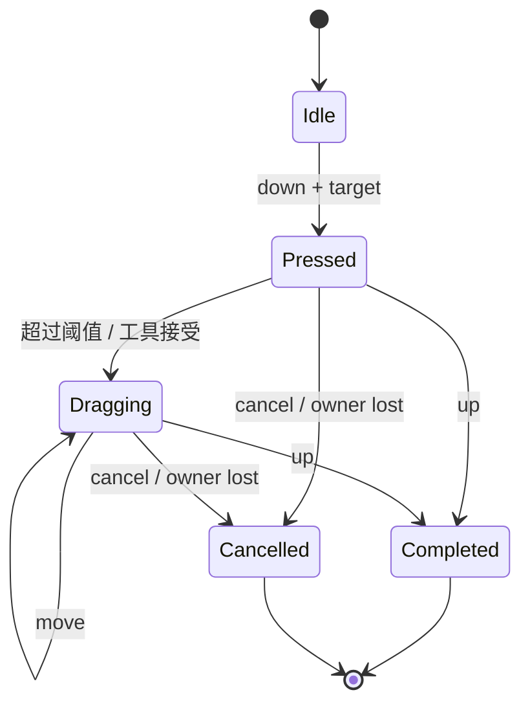

# 10. 命中、输入与交互状态

> **本章解决的问题**：平台产生的离散事件，怎样被解释成具有稳定目标、捕获规则和取消
> 语义的交互会话？

一次拖拽由多个事件组成。按下时命中的对象可能在移动中离开指针，视口可能滚动，目标
甚至可能被删除。如果每个事件都重新独立判断，用户感知到的手势就会断裂。

核心结论是：

> 单次事件没有完整交互语义；交互必须由持有明确身份和取消路径的状态机解释。

## 10.1 平台输入归一化

平台适配层把设备事件转换为 Core 可解释的逻辑事件。Core 的 `Event` 是五种事件的
枚举，而不是统一的 `PointerEvent`：

```text
Event =
    Mouse(MouseEvent {
        kind: Pressed | Released | Moved | Dragged | Hover |
              DoubleClicked | Entered | Exited,
        x, y, button, entry_point,
    })
  | Wheel(WheelEvent {
        x, y, delta_x, delta_y, delta_kind,
        phase, modifiers, session_id, entry_point,
    })
  | Zoom(ZoomEvent {
        x, y, scale_factor, phase, modifiers, session_id, entry_point,
    })
  | Key(KeyEvent { kind, key, modifiers })
  | Focus(FocusEvent { kind: Gained | Lost, related_target })
```

归一化负责：

- 物理像素到逻辑表面单位；
- 鼠标、滚轮与缩放事件携带入口节点坐标域点；`entry_point()` 保留该点，
  引擎投递给 target 前调用 `with_target_point()` 生成 target/source 的 node-local 点；
- 按键与修饰键语义；
- 窗口焦点和指针离开/取消事件；
- 文本输入与键盘按键分离；IME 组合属于 Editor 的文本输入会话，不进入 Core `Event`。

平台层不执行 Figure 命中，也不决定 Editor 意图。

## 10.2 命中顺序

命中使用绘制顺序的镜像：

1. 从根开始检查祖先可见性和裁剪；
2. 把表面点转换到当前节点本地；
3. 按 children 逆序检查；
4. 若没有 child 成为目标，再判断节点自身；
5. 按事件角色选择命中查询，得到单个目标 Figure。

最晚绘制的可命中对象应最先获得机会。命中必须读取稳定树和同一坐标链。

## 10.3 几何命中与事件目标

“几何上包含该点”不一定等于“成为事件目标”。

容器可能：

- 允许 child 成为目标；
- 把 child 命中折叠为容器目标；
- 自身透明但 children 可命中；
- 因禁用状态拒绝交互。

Core 的命中结果是单个 `FigureId`，不是公开的 `HitPath`。不同事件角色使用不同查询：

```text
find_mouse_event_target_at  - 鼠标 pressed/released/moved 的目标
find_cursor_target_at       - 光标图标目标
find_hover_source_at        - hover/tooltip 来源
find_gesture_target_at      - wheel/zoom 会话目标
```

`dispatch_to_target(target, event)` 在投递前把入口点转换到 target 的 node-local 域。
局部坐标随事件进入回调，但不以“路径对象”公开；祖先链判断由容器命中规则在引擎层完成。

## 10.4 Hover

hover 表示当前无捕获条件下，指针位于哪个目标上。pointer move 时：

1. 若已有 capture，新的鼠标目标直接是 capture owner，不再重算命中；
2. 否则计算新的命中目标，并同步记录 cursor target 与 hover source；
3. 比较旧的 `mouse_target` 与新的目标；
4. 目标变化时，只对单个旧目标发 `Exited`，对单个新目标发 `Entered`；
5. 对最终目标生成 move 或 hover 事件；
6. hovered 状态在全局集合中更新，回调效果在分发结束后统一提交。

Core 不计算旧路径与新路径的最长公共前缀，也不对整条祖先链发 leave/enter。
`hover_source` 是独立于 `mouse_target` 的 tooltip 来源，允许与事件目标不同。

对象销毁、隐藏、裁剪变化或视口滚动也可能改变 hover，即使物理指针没有移动。

## 10.5 Pointer capture

capture 把后续 pointer 事件锁定到手势所有者。它解决拖拽中指针离开目标或窗口边界的
问题。

当前 `InteractionState` 的每个 `PointerState` 保存：

- `target`：当前事件目标；
- `cursor_target`：当前光标目标；
- `captured`：当前捕获 owner。

捕获不额外记录 session 或 version；session 身份属于 `WheelEvent`/`ZoomEvent` 上的
`GestureSessionId`，按下/拖拽会话由 press/release 生命周期隐含。`DispatchContext`
的 `mouse_target()`、`cursor_target()` 与 `captured()` 目前都读取
`PointerId::PRIMARY`，因此公开分发面只实现主指针捕获。

捕获目标被销毁、窗口失焦、平台发送 cancel 或设备序列中断时，状态机必须终止会话。
不能把后续事件重新命中给另一个对象并继续原手势。

## 10.6 Focus

focus 表示键盘和文本输入的逻辑接收者。它不同于 hover 和 capture：

- hover 随指针位置变化；
- capture 属于一个 pointer 会话；
- focus 可以跨多个事件长期保持；
- 文本输入通常依赖 focus，但不是 key event 的字符拼接。

结构化变化时，`InteractionState::forget_figures` 会清空已被销毁的 `focus_owner`，
`retired_focus_lost` 向该节点投递 `FocusEventKind::Lost`。隐藏或禁用不会自动把焦点
转移给相邻节点，也不会自动清空；需要宿主显式 `request_focus` 或 `release_focus`。
焦点遍历由 `FocusTraversalPolicy` 决定，Core 默认实现是
`TreeOrderFocusTraversal`：在给定 scope 的子孙顺序中寻找下一个可遍历节点，返回
`FocusTraversalOutcome::Moved(FigureId)` 或 `Boundary`。`FocusError` 区分未知/外来
Figure、detached、隐藏、禁用与不可聚焦等失败原因。

## 10.7 手势状态机

一个基本 pointer 手势可表示为：



状态保存按下目标、初始坐标、当前 pointer、capture owner 和输入会话身份。当前
`GestureState` 的实际字段是 `target`、`scroll_controller` 与 `zoom_controller`；
按下/拖拽状态由 `hovered`、`pressed`、`captured` 和 `GestureSessionId` 共同表达。
它不能只靠“当前鼠标是否按下”推断。

## 10.8 Down、Move、Up

### Pointer down

1. 归一化到逻辑表面事件；
2. 刷新鼠标目标并解除旧 capture 影响；
3. 向目标投递 `Pressed`，引擎把入口点转换到 node-local 域；
4. 若目标返回 handled，引擎把 capture 设为该目标并标记 pressed；
5. 若目标允许直接聚焦，引擎请求 focus；
6. 若未被 Core 消费，交给 Editor Tool；
7. 建立会话并锁定目标身份。

### Pointer move

1. 若存在 capture，优先路由给 capture owner；
2. 否则重新计算 hover；
3. 将入口点转换为会话需要的坐标域；
4. 状态机产生预览或其他效果；
5. 分发结束后统一应用效果。

### Pointer up

1. 发送给当前 capture owner 或命中目标；
2. 状态机决定完成或拒绝；
3. Editor 可生成最终命令；
4. 清除 pressed 与 capture，再刷新 hover；
5. 清理临时反馈。

顺序很重要：如果先释放 capture 再路由 up，目标可能错误地变成指针下方的另一个对象。

## 10.9 Cancel 不是 Up

cancel 表示不能再把当前会话解释为成功完成。原因包括：

- 平台取消触摸序列；
- 窗口失去焦点；
- capture owner 被删除；
- 工具切换；
- 模型 revision 使目标语义失效；
- Runtime 进入故障状态。

取消应清理反馈、捕获和临时资源，但不执行最终业务命令。把 cancel 当作 up 会在用户
未确认时提交修改。

## 10.10 回调效果队列

事件回调可能请求：

- 记录或清除 pressed 状态；
- 激活可点击能力；
- 改变 cursor；
- 提交组件或能力更新；
- 发出属性或坐标通知；
- 请求重绘或 invalidate；
- 增删子树。

其中大部分请求通过 `EventEffects` 记录为延迟 `RuntimeEffect`，而不是在遍历和分发中
立即执行。实际可记录的 effect 包括 `Repaint`、`Notification`、`Invalidate`、
`Mutation`（组件/能力/子树更新）、`SetPressed`、`SetKeyboardPressed` 与
`ActivateClickable`。capture 与 focus 不是回调 effect：dispatch 层在目标返回 handled
后统一设置 capture，并在允许时请求 focus。

```text
冻结目标路径
-> 调用处理器并收集 EventEffects
-> 完成当前分发
-> 按发生顺序应用 effect
-> 验证目标仍有效
-> Runtime 提交
```

这避免回调删除当前节点、改变父链或重入第二次分发。

## 10.11 Core 与 Editor 的仲裁

Core Figure 可能拥有自身交互，例如滚动条、文本选择或内嵌控件。Editor Tool 则处理
业务编辑，如移动节点和创建连接。

Core 分发结果由 `DispatchOutcome` 表达：

```text
target   - Some(FigureId) 表示实际接收事件的 Figure
handled  - Figure 处理器或 Runtime fallback 是否处理了事件
capture  - 分发后主指针的 capture owner，可能为 None
```

Core 不再用四态枚举区分 Consumed/Propagate/Captured/Rejected。`handled == false`
表示可继续交给 Editor 层；`capture` 与 `target` 共同说明后续事件归属。“回调是否
返回 true”不足以表达捕获和后续事件归属，因此引擎在内部仍维护独立的 capture 状态。

## 10.12 键盘、文本与 IME

键盘事件描述物理或逻辑按键，文本事件描述用户输入的字符，IME 描述组合中的临时文本。
三者不能合并。

一个中文输入过程可能是：

1. focus owner 开始 composition；
2. 多次 preedit 更新临时字符串和选区；
3. 用户确认 composition；
4. 平台发送最终 commit text；
5. 编辑器生成一次文本模型命令。

按键事件可以用于快捷键，但不能通过 key code 自行拼接最终文本。迟到的 preedit 若
session 或 focus 已变化，必须拒绝。

Core `Event` 只包含 `Key`，不包含 Text 变体。文本 commit 与 composition 由 Editor
的 `TextInputEvent` / `SessionTextInputEvent` 和平台文本输入宿主承载，见第 13 章。

## 10.13 坐标与滚动

手势期间视口可能自动滚动。状态机应保留逻辑来源和当前入口点，每次更新通过最新坐标链
重新求目标域位置。

滚轮与缩放使用 `GestureSessionId` + `GesturePhase` 绑定会话：

```text
GesturePhase = Begin | Update | End | Cancel | Impulse
```

`Begin` 建立 gesture target；`Update`、`End`、`Cancel` 使用同一 target；`End` 与
`Cancel` 清除会话。`Impulse`（`GestureSessionId::IMPULSE`）表示独立的单次事件，
不建立会话。滚轮 fallback 通过 `apply_scroll_fallback` 找到最近的
`ScrollPaneFigure`，并在会话期用 `pin_scroll_controller` 固定控制器；缩放 fallback
通过 `apply_zoom_fallback` 找到最近可缩放对象与其 Viewport，锚点由 `entry_point()`
转换到 Viewport 局部域并扣除 insets。

若只累加 pointer delta，滚动造成的内容位移不会进入计算，反馈会与指针分离。相对量
也必须注明在哪个坐标域中计算。

## 10.14 对象销毁

当 hover、capture 或 focus owner 被销毁：

1. Runtime 在身份失效前识别关联会话；
2. 向状态机发送明确取消原因；
3. 清除反馈和平台 capture；
4. 使旧视觉区域进入 damage；
5. 代际 ID 失效；
6. 后续迟到事件被拒绝。

不能依赖下一次事件查询失败后“顺便清理”，因为平台和视觉状态可能已经泄漏。

结构变化后的引用校正由两处完成：`forget_figures` 清空已销毁的 focus owner；
`reconcile_non_focus` 按 attached、effectively visible 与 effectively enabled 过滤
target、cursor target、capture、hovered、pressed 和 gesture controller。隐藏或禁用
只影响非焦点引用，不会自动迁移焦点。

## 10.15 多指针

`InteractionState` 用 `HashMap<PointerId, PointerState>` 保存多个指针的 target、
cursor target 与 capture，并提供 `pointer_target`/`pointer_capture` 查询。但当前
`DispatchContext` 的公开分发面只读写 `PointerId::PRIMARY`；hovered 是一个全局集合，
gesture 则按 `GestureSessionId` 独立保存。因此“每个 pointer 拥有完全独立的
hover/capture/gesture 状态”目前只是部分实现，不能写成已完成的端到端能力。

需要全局仲裁的手势，例如双指缩放，可以通过 `GestureSessionId` 显式接管多个输入序列，
并取消它们原有的单指针候选会话。

## 10.16 必须保持的不变量

1. 所有 pointer 坐标先归一化到逻辑表面域；
2. 命中顺序与绘制顺序互为镜像；
3. 手势目标由稳定身份锁定；
4. capture、focus 和 hover 是不同状态；
5. 回调副作用在分发结束后提交；
6. cancel 不产生最终业务命令；
7. 迟到事件不能作用于新 session 或复用身份。

## 10.17 常见错误设计

### 每个 move 都重新选择拖拽目标

指针离开原对象后手势跳到别的节点。

### Figure 回调直接删除自己

当前目标路径和遍历借用立即失效。

### 用 key down 生成文字

无法正确处理输入法、组合文本和平台键盘布局。

### 只有全局 hover 和 dragging

多指针、嵌套控件和捕获语义无法表达。

### 把 cancel 当作 up

窗口失焦或目标销毁时错误提交业务修改。

## 10.18 与后续章节的关系

本章建立了 Core 输入会话。第 11 章会说明视口滚动和跨节点连接如何影响同一会话的坐标
与反馈；第 13 章则把未被 Core 消费的输入进一步解释为 Request、Policy 和 Command。

## 10.19 思考题

1. 为什么 hover 在指针不动时也可能变化？
2. pointer up 路由前为什么不能先释放 capture？
3. Figure 销毁时，输入会话应在哪个时刻取消？
4. 自动滚动期间为何不能只使用累计 pointer delta？
5. IME preedit 和最终文本命令分别属于哪类状态？
