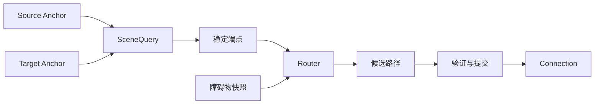

# 11. 图层、视口与连接

> **本章解决的问题**：当一个结果依赖多个节点、祖先变换或可见范围时，如何追踪来源、
> 安排重算，并避免缓存与 Runtime 当前场景状态失配？

图层、视口和连接看起来是独立功能。它们的共同点是：结果不能只由当前节点自身决定，
而要读取其他节点或祖先状态，因此必须成为可追踪的派生系统。

核心结论是：

> 跨节点能力不应缓存未知来源的几何；它们必须通过可追踪查询读取稳定场景状态，并在
> 查询依赖项变化后重新计算。

## 11.1 语义图层

图层是带稳定键的普通容器，而不是一组固定角色：

- `LayerKey` 是任意非空字符串标识，Core 不提供“内容层/连接层/反馈层”等内置角色常量；
- `LayerPlacement::{Last, Before(LayerKey), After(LayerKey)}` 决定新图层的叠放位置；
- 应用按需创建内容、连接、反馈、手柄或辅助层，它们都走同一 `LayeredPane` /
  `FreeformLayeredPane` 机制。

图层仍服从 Figure 树、坐标链、裁剪和生命周期。它的特殊性来自接纳规则、叠放位置和
更新策略，不来自一套平行渲染系统。

## 11.2 为什么反馈单独成层

反馈是交互临时状态，不应写入业务 Figure。单独反馈层可以：

- 保证预览位于内容之上；
- 在取消时整体清理；
- 使用逻辑表面域或内容域中的几何；
- 独立产生 damage；
- 不改变业务模型和稳定视图。

反馈层仍应由 Viewer 或 Runtime 拥有，Tool 只提交反馈描述。

## 11.3 Freeform 内容范围

自由画布的内容范围通常由 children 变换到容器坐标域后的范围并集得到：

```text
content_extent =
    union(transform_to_container(child.visual_bounds))
    expanded_by(margin)
```

它是派生状态，不是由每个 child 增量写入的全局矩形。删除、移动和缩小 child 都可能
让范围缩小，因此只做“向外扩展”会永久积累旧区域。

正确实现可以增量维护索引，但语义必须等价于对当前稳定 children 重新求并集。

## 11.4 Range model

视口通常使用 range model 表示一维滚动状态：

```text
minimum
maximum
extent
value
```

它必须满足：

```text
minimum <= value
value + extent <= maximum
extent >= 0
```

当内容范围、视口尺寸或缩放变化时，旧 value 可能不再合法。Runtime 应在同一事务中
归一化，而不是让滚动条和内容分别修正。

`DefaultRangeModel` 的每次 mutation 返回 `RangeChangeSet`，并保持 Draw2D 的监听顺序：

```text
Maximum -> Extent -> Minimum -> Value
```

`RangeModelSnapshot::is_enabled()` 用 `maximum - minimum > extent` 判断滚动是否可用。
扩展只改变一个属性时，仍通过同一 `normalize_range` 重新夹取 extent 与 value。

## 11.5 Viewport 与 ScrollPane

Viewport 负责裁剪和内容偏移；ScrollPane 负责组合 viewport、滚动条和交互策略。二者
不应混成一个拥有所有行为的巨大 Figure。

Viewport 的滚动值进入子内容变换。`ScrollPaneLayout` 每轮 layout 基于
`LayoutSceneQuery` 重新计算 viewport 与滚动条的可见性和 bounds，而不是依赖范围变化
监听；`ScrollBar` 只读取 `RangeModel::snapshot()` 并绘制当前状态。滚动条修改 range
model，再由统一视口路径改变内容变换。

这样程序滚动、滚轮、拖动滚动条和自动暴露共享同一事实。

`ScrollBar` 把普通子部件按 `ScrollBarPart` 分为五个角色：`Decrement`、
`PageDecrement`、`Thumb`、`PageIncrement` 与 `Increment`。应用可以通过
`ScrollBarBuilder::with_part` 替换任一部件，也可以挂载 `ScrollBarValueConsumer`；
值变化回调与其他 Figure 回调一样通过 `EventContext` 提交受检 effect。整组部件可用
`ScrollBarSubtree::into_subtree` 一次性发布。

## 11.6 Scalable pane

缩放容器对内容施加比例变换。缩放会影响：

- 内容到逻辑表面域的坐标变换；
- 可见内容范围；
- 指针降域；
- 连接与反馈位置；
- damage 的表面覆盖。

缩放不应直接重写每个 child 的业务 bounds。业务逻辑坐标保持稳定，比例进入祖先
变换链。

### ZoomManager 的权威状态

`ZoomManager` 组合共享缩放句柄、viewport 句柄、滚动策略与离散级别。当前 zoom 从缩放
句柄读取，不在管理器中重复保存。离散级别必须非空、有限、为正且严格递增；min/max
边界由该级别序列的首尾值确定。默认级别是 `DEFAULT_ZOOM_LEVELS`（0.5 到 4.0 的八档）。
放大、缩小、直接设值和程序适配都通过 Runtime 作用域修改同一缩放状态，不能让滚轮和
工具栏分别保存倍率。

滚动策略是显式的 `ZoomScrollPolicy`：`DefaultScrollPolicy` 保持既有滚动位置，
`MouseLocationZoomScrollPolicy` 让鼠标位置对应的内容点在缩放前后保持不动；滚轮缩放
路径使用后者。

以某个表面点为锚缩放时，要同时调整 viewport range，使该点对应的内容位置在缩放前后
保持不动：

```text
anchor_content = surface_to_content(anchor_surface, old_zoom, old_scroll)
new_zoom = clamp(requested_zoom)
new_scroll = solve(anchor_content, anchor_surface, new_zoom)
```

先改 zoom、下一帧再修 scroll，会让锚点短暂跳动，也会让当前拖拽读取不一致坐标。

### Fit 的计算边界

适配缩放读取内容范围和 viewport 可用尺寸：

```text
fit_all    = min(viewport_width / content_width,
                 viewport_height / content_height)
fit_width  = viewport_width / content_width
fit_height = viewport_height / content_height
```

这些公式是概念计算，前提是内容尺寸和 viewport 可用尺寸均为有限正值。当前 fit 对空
内容或零尺寸返回 `ZoomError::InvalidZoom`。它使用客户区尺寸，并在要适配的轴上把滚动
位置归到 range minimum；单轴 fit 保留另一轴的滚动位置。

Core 当前提供 `fit_all`、`fit_width` 和 `fit_height`，没有内置 `fit_selection`。
现有 fit 读取整个内容范围，不能把 selection 当成参数直接传入。外部 Editor 操作若要
适配选择，应先解析本 Viewer 的选中 Part，再计算它们在同一内容域中的稳定范围，复用
上述计算原理，最后通过公开缩放和 viewport mutation 入口应用结果。

带四周留白的选择适配可用以下概念伪代码表达。`selection_bounds` 是选中几何变换到共同
内容域后的并集，`margin` 属于 viewport 逻辑域：

```text
available_width  = viewport_width  - 2 * margin
available_height = viewport_height - 2 * margin
zoom = clamp(min(available_width / selection_bounds.width,
                 available_height / selection_bounds.height))
scroll = zoom * selection_bounds.center - viewport_size / 2
```

scroll 的公式只适用于内容先缩放、再在 viewport 域平移的约定。具体操作必须使用统一
坐标查询与滚动策略，最后由 range model 归一化。触及范围边界时，居中结果可能被夹取；
留白耗尽客户区、选择为空或选区退化为零宽高时，也必须先定义处理策略。

计算过程中若模型或 Part 身份变化，应重新取得稳定范围或取消。这样选择仍归 Viewer
所有，ZoomManager 不需要依赖 Editor 身份，也不需要维护一份选择缓存。

### 不同缩放级别的视觉策略

缩放变换默认会同时缩放几何、描边和文字。某些应用希望线宽保持屏幕像素稳定，或在
低倍率隐藏标签、改用简化 Figure。这些是显式的 Figure、样式或应用策略，不是
ZoomManager 自动执行的统一规则。

策略必须说明哪些事实随 zoom 改变：

- 只改变祖先变换时，业务 bounds 和文本排版保持不变；
- 屏幕恒定描边会改变本地等效线宽和 visual bounds；
- 标签显隐或替换 Figure 会改变场景源状态和 damage；
- 文字若重新选择字号，会触发重新测量，不再是纯视口变换。

缩放动画遵循第 9 章的顺序：先提交最终 zoom 和 range model，再从变化前后的状态采样
临时 viewport 表现覆盖。已提交状态始终保留最终值，中间帧不逐帧改写业务 bounds。

不过临时 viewport 表现覆盖属于 ADR-046 T-3，当前尚未完成验收；现有可用能力是已提交
zoom/range 的原子归一化，不应把 viewport 动画写成已交付功能。

## 11.7 自动暴露

拖拽接近视口边缘时，Editor 可能请求自动滚动。每个 tick：

1. 根据表面 pointer 与 viewport 边缘计算滚动意图；
2. Range model 归一化新 value；
3. Viewport 内容变换更新；
4. 当前手势用同一表面 pointer 重新计算内容位置；
5. 按新的内容变换重新计算反馈和目标命中；
6. damage 覆盖旧新反馈区域。

不能先按旧坐标更新反馈，再异步滚动，否则预览会跳动。

## 11.8 Connection 的三层含义与四个角色

“连接（Connection）”在模型、Editor 和图形核心中表示三个相关但不同的对象：

| 层次 | 身份 | 表达的事实 | 长期所有者 |
|---|---|---|---|
| 业务模型 | `ModelConnection` 或领域连接 ID | 哪两个业务对象存在何种关系 | 应用模型 |
| Editor 视图 | `ConnectionPartId` / `EditPartId` | 当前 Viewer 如何控制这条关系的视图 | Viewer |
| 图形核心 | Connection Figure / `ConnectionId` | 端点如何依附、路径如何路由和绘制 | Runtime |

三层对象按因果顺序建立：

```text
业务连接
-> Viewer 解析 source/target Part
-> `ConnectionPartId` 构建连接视图
-> Core Connection 解析 anchor 并计算路径
```

业务连接是可撤销、可持久化的事实。`ConnectionPartId` 是单个 Viewer 中的控制器角色。
Core Connection 是可重建的场景对象和派生路径。删除或暂时无法解析 Core 路径，不等于
删除业务连接；反过来，预览中画出一条临时路径，也不等于已经创建业务关系。

本章后文单独使用 Connection 时，指图形核心中的连接能力。它可拆为四个角色：

### Anchor

根据一个拥有者和查询上下文计算端点。Anchor 描述“端点如何依附”，不拥有目标 Figure。

### SceneQuery

提供受限、可追踪的场景查询，如 bounds、坐标转换和可见性。每个场景数据项都关联身份
与版本。

### Router

根据端点、约束和障碍物计算候选路径。Router 是纯计算策略。

#### 路由算法不是同一种折线

当前内置路由器覆盖六种不同约束：

| 路由器 | 输入重点 | 输出语义 |
|---|---|---|
| Direct | 两个端点 | 端点间直线路径 |
| Bendpoint | 端点和显式折点 | 按给定顺序经过折点 |
| Manhattan | 端点和正交约束 | 只含水平、垂直线段的路径 |
| Fan | 同组连接与稳定次序 | 为重合连接分配可辨识偏移 |
| ShortestPath | 端点和显式障碍物快照 | 在当前障碍约束下寻找合法短路径 |
| VisibilityGraph | 端点和可见性图 | 在障碍可见图中搜索折线路径 |

手动自由路径可以由 Bendpoint 的显式控制点表达；曲线路由可以由外部 Router 实现。二者
仍必须返回统一的受检路由输出，不能在 Connection 绘制阶段私自改路径。

`ShortestPath` 只消费本次不可变障碍物快照。障碍物集合及其 revision 由 SceneQuery
提供，路由器不能扫描可变 Figure 树，也不能缓存 Figure 引用。障碍变化后，依赖追踪
使连接重新路由。

路由输出使用 `PointList`。点序固定为 source 到 target，首点和尾点必须与本次解析的
anchors 匹配，中间点表达折点。Runtime 还要验证所有坐标有限、相邻线段合法，并按具体
算法检查正交或障碍约束。

无法找到无障碍路径时，`ShortestPath` 返回 `NoObstacleFreePath`。Runtime 将连接发布
为 unresolved，而不是沿用旧路径、退化为穿过障碍物的直线，或把失败伪装成空
`PointList`。

### Connection

保存端点描述、路由策略和当前派生路径，并作为 Figure 绘制。



## 11.9 依赖追踪

SceneQuery 在计算端点时同时记录 `DependencyObservation { subject, generation }`。
`DependencySubject` 当前有八种：

```text
PreparedScene(FigureId)
FigureMeasurement(FigureId)
FigureMeasurementSource(FigureId)
FigureGeometry(FigureId)
FigureVisibility(FigureId)
NamedAnchorRegion(FigureId, AnchorGeometryKey)
RelativeTransform(CoordinateSpace, CoordinateSpace)
Topology(FigureId)
```

节点移动、换父、缩放、隐藏或销毁时，Runtime 根据依赖使对应连接失效。连接不需要
订阅所有 Figure 的泛化通知。障碍物快照属于一次分组路由的不可变输入，不是全局
`DependencySubject`；Router 配置或绑定的变化走单独的连接 revision。

查询依赖项必须来自实际读取或明确声明，不能靠路由器私下保存未知对象引用。

## 11.10 路由稳定化

连接路由进入第 6 章的工作列表：

1. 等待端点节点布局稳定；
2. 通过 SceneQuery 解析 anchors；
3. 构造不可变路由输入；
4. Router 计算候选 path；
5. Runtime 验证有限数值、端点连续性和 source epoch；
6. 原子替换路径；
7. 合并旧新 visual damage；
8. 若路径影响容器范围，继续传播。

连接不能在端点仍布局中时提前发布。

## 11.11 分组路由

某些路由器同时协调多条连接，例如避免重叠或分配公共通道。此时计算单元是 connection
group，而不是单条连接。

分组路由必须定义：

- 分组键：`RoutingGroupScope::{None, AnchorPair, RoutingDomain}`；
- 稳定成员顺序：`RouteGroupInput::members` 由 Runtime 按稳定顺序提供；
- 输入 revision 与障碍物快照：`RouteGroupInput::obstacles`；
- 批量输出：`RouteGroupOutput` 携带 `(ConnectionId, RouteOutput)` 全集；
- 一个成员失败时的原子策略：输出不完整或身份不匹配时返回
  `RouteError::InvalidGroupOutput`。

`RoutingGroupScope::AnchorPair` 按无序 source/target anchor 对分组；
`RoutingDomain` 按同一 routing domain 内使用同一 `RouterId` 的成员分组。Runtime 在
帧准备时通过 `required_route_groups` 收集需要批量求解的组。

逐条提交会让后计算连接读取前一条新路径，结果依赖遍历顺序。

## 11.12 自环

source 与 target 指向同一 Figure 时，普通两端点直线路由可能退化为零长度。自环需要
明确语义：

- 两个 anchor 是否允许选择不同侧；
- 最小环绕范围；
- 与节点 visual bounds 的间距；
- 在缩放和旋转下如何变换到连接图层坐标域。

自环仍使用同一 Anchor、SceneQuery 和 Router 协议，不应成为绘制阶段的特判。

## 11.13 Unresolved 状态

端点可能暂时不存在，例如模型连接先于目标视图出现，或目标正在被删除。连接状态由
`ConnectionResolution` 表达：

```text
Dirty { revision }          - 输入已变化，需要重新路由
Resolved { generation }     - 已成功计算当前路径
Unresolved(UnresolvedConnection)
```

`UnresolvedConnection` 区分 `MissingSource`、`MissingTarget`、`RouteFailed`、
`InvalidGeometry`、`LocatorFailed`、`DecorationFailed`、`InvalidLocatorChild` 与
`PreparationInvalidated`。

Unresolved 不等于沿用旧路径。框架可以选择隐藏连接、绘制诊断反馈或等待下一 revision，
但必须避免把旧几何误认为当前事实。Dirty 表示输入已经变化、但新路径尚未准备好；
它同样不能继续消费旧路径作为当前结果。

## 11.14 三个事件的共同传播

### 节点移动

节点 bounds 变化 -> anchor 依赖失效 -> router 重算 -> connection damage -> 按当前
祖先变换重新计算反馈和手柄。

### 视口滚动

业务 bounds 不变 -> ancestor transform 变化 -> 可见区域和表面几何变化 -> 连接与反馈
无需改本地路径语义，但需重新生成表面提交。

### 内容缩放

逻辑路径可保持 -> 重新计算表面视觉包围盒、描边策略和命中容差 -> damage 覆盖旧新
表面范围。

这三个事件说明“几何值变化”和“几何所依附的坐标变换变化”都可以触发可见结果更新。

## 11.15 图层间坐标

连接层和内容层可能是 siblings。连接锚点不能假设两者共享本地坐标。正确流程是：

```text
source local -> common surface/root -> connection layer local
target local -> common surface/root -> connection layer local
```

统一 SceneQuery 选择公共域并处理坐标根。手写“减去父位置”在嵌套视口和缩放后必然
失效。

## 11.16 必须保持的不变量

1. 图层仍属于统一 Figure 树；
2. freeform extent 等价于当前稳定 children 的范围；
3. range model 始终满足边界约束；
4. 滚动和缩放进入统一坐标链；
5. 跨节点查询记录身份与版本依赖；
6. Router 只返回候选路径，Runtime 提交；
7. unresolved 不复用未经证明的旧几何；
8. 业务连接、`ConnectionPartId` 和 Core Connection 不互相冒充身份；
9. zoom、range model 和锚点缩放在同一事务中归一化；
10. 路由输出从 source 指向 target，失败不会伪装成合法空路径。

## 11.17 常见错误设计

### 连接缓存端点 Figure 引用

目标删除或换父后引用和坐标上下文失效。

### 滚动直接修改所有 child bounds

视口滚动污染已提交业务几何，命令和持久化失去稳定含义。

### Freeform 范围只增不减

删除或移回节点后滚动范围永久过大。

### 反馈直接挂在业务节点下

预览改变布局、裁剪或业务层叠放。

### 单条顺序提交分组路由

最终路径依赖遍历顺序，无法确定性回放。

### ZoomManager 自动改写 Figure 视觉策略

缩放倍率、标签显隐、屏幕恒定描边和文字重排被混成一个隐式副作用，失效范围无法证明。

### 避障失败时退化为直线

画面看似仍有连接，却违反了调用者选择避障路由的合同，旧障碍依赖也被掩盖。

## 11.18 与后续章节的关系

至此，图形核心已经形成从树、坐标、布局、damage、输入到跨节点派生状态的闭环。下一
部分进入 Editor：业务模型如何确定性派生为这些 Figure，以及连续交互如何最终产生
模型命令。

## 11.19 思考题

1. 为什么 freeform extent 不能只在 child 变大时更新？
2. 视口滚动后，连接的逻辑 path 和表面几何分别发生什么变化？
3. SceneQuery 为什么既要返回值，也要记录依赖？
4. 分组路由为何需要批量原子提交？
5. unresolved 连接在什么条件下可以自动恢复？
6. Core Connection 暂时 unresolved 时，为什么不能直接删除业务连接？
7. 以表面点为锚缩放时，为什么 zoom 和 scroll 必须一起提交？
8. `fit_selection` 为什么应由 Editor 解析选择，再复用 Core fit 计算？
9. `ShortestPath` 为什么必须读取显式障碍物快照？
