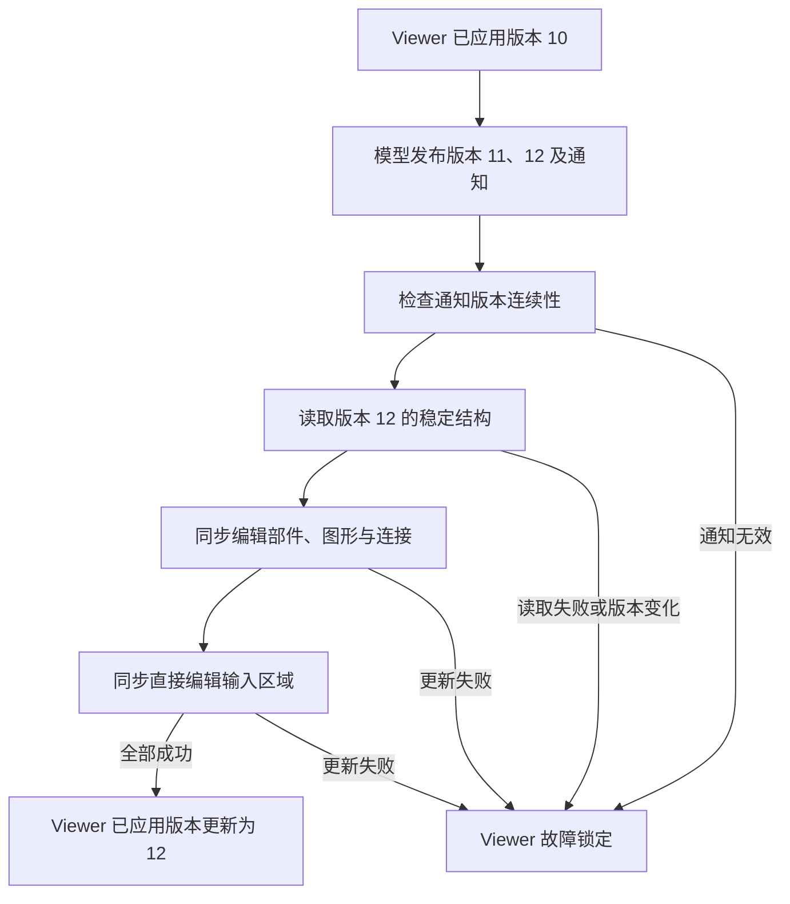

# 附录：revision 如何约束编辑一致性

模型已经变化，视图却可能还没有更新。编辑框架需要知道模型发布到了哪一步，也需要
知道 Viewer 是否完整同步到了这一步。版本（revision）为这两个边界提供可比较的身份。

本附录补充[模型与视图派生](12-model-view-derivation.md)和
[编辑协议](13-editing-protocol.md)中的版本关系。理解这些关系后，可以判断一次
失败发生在模型发布、视图同步还是后续渲染阶段。

## 模型版本与 Viewer 同步进度

模型版本（`ModelRevision`）表示应用模型已发布的稳定版本，由应用的模型适配器
推进。Viewer 已应用版本（`applied_revision`）表示 Viewer 最近一次完整同步成功的
模型版本，由 Viewer 更新。

| 版本身份 | 所属域 | 生命周期与更新条件 |
|---|---|---|
| `ModelRevision` | 应用模型的发布序列 | 模型发布变化时前进，同步与撤销都不能将其回退 |
| `applied_revision` | 单个 Viewer 的同步进度 | 初次构建成功时建立，后续完整同步成功后更新 |
| `InteractionRevision` | EditorDomain 的输入和请求序列 | 每次输入或工具刷新分配，随事件和请求传播 |
| 直接编辑的 `source_revision` | 草稿依赖的模型前提 | 会话开始时保存，提交时与当前模型版本比较 |

Viewer 已应用版本和直接编辑的源版本都使用模型版本类型，没有独立的计数器。
交互版本属于另一版本域，不能与模型版本直接比较。

## 从模型发布到视图同步

假设 Viewer 已同步到模型版本 10，应用随后发布版本 11、12。版本之间的关系按以下
顺序建立；图中的数值是用于解释协议的假设示例。

Viewer 首先检查通知是否从已应用版本的下一版本连续前进。同一模型版本可以携带
多个有序事件，例如一次发布同时改变父节点和子节点。模型版本因此不等于事件数量，
也不与命令数量一一对应。

通知批次的最终版本必须等于模型当前稳定版本。版本 10 后直接收到版本 12，说明
通知版本存在缺口；收到已经应用过的旧版本，则说明通知过期。没有通知且模型版本
未变时，同步可以正常结束；模型版本已变却没有通知时，Viewer 必须拒绝继续同步。

连续通知通过校验后，Viewer 读取稳定结构，再更新已有视图。版本校验只检查模型
发布序列，不能由此推出事件 payload 已被逐条应用。

## 多次读取必须属于同一模型版本

构建视图需要分别读取子节点和连接。若读取子节点后模型变化，再读取连接，两次
结果可能拼成一个从未存在过的结构。

Viewer 在读取结构前保存模型版本，在读取结束后再次比较。版本变化时，拒绝接受
这份结构快照。快照版本还必须与通知批次的最终版本一致。

版本检查依赖模型适配器的稳定读取和发布契约。共享模型仍需要提供一致的读取边界；
计数器本身不提供锁或完整数据快照。如果应用静默修改数据，却没有推进版本和发布
通知，Viewer 无法仅凭版本发现这次修改。同一版本包含多条事件时，版本也不能证明
每条事件内容都没有丢失或重复。

## 完整同步成功后才接受版本

模型提交与视图同步有各自的完成边界。命令可能已经成功修改模型，随后创建图形或
更新连接却失败。此时模型版本已经前进，Viewer 已应用版本仍停在上次成功的位置，
Viewer 进入故障锁定状态。

旧的已应用版本记录上次完整同步成功的位置。失败前部分已有视图可能已经变化，
它不能保证失败后的全部内部视图仍保持旧版本。恢复时，应根据已知模型状态重建
Viewer；手工推进同步进度会把失败伪装成成功。

Viewer 接受模型版本后，Runtime 仍可能需要完成布局和其他派生计算，后端也可能尚未
呈现对应像素。模型版本、稳定 epoch、后端 session 和 frame ID 描述不同阶段，
其关系见[核心概念关系图](appendix-concept-map.md#四种版本域)。

## 拒绝命令要保持模型发布前缀

编辑会话开始前，Viewer 先同步已有外部通知，使后续命令建立在已同步的模型版本上。
命令成功后，会话校验新通知并同步视图；可恢复拒绝则要求模型、版本和待发布通知
保持不变。

如果命令返回拒绝，却发布了新的模型版本，历史与业务内容就可能产生分歧：命令栈
认为本次操作失败，模型却已经变化。框架必须将这种契约破坏升级为故障。

版本检查只能验证可观察的发布行为。命令实现仍需保证失败不修改模型；保持计数器
不变不能替代这个责任。

## 草稿与交互请求需要不同版本身份

文本直接编辑保存开始时的模型版本。提交草稿时，如果当前模型版本已经变化，
旧草稿的前提就失效了。框架拒绝提交并保留草稿，避免直接覆盖新的业务内容。
当前检查采用整个模型版本，因此其他模型对象的变化也可能使文本会话过期；
属性级冲突判断和自动重基需要另外定义契约。

交互版本用于标记输入和请求的先后。拖拽过程中，指针移动不断产生新请求和预览，
业务模型却可以一直不变；释放鼠标执行命令后，模型才发布变化。

`InteractionRevision` 随输入和 Request 传播，提供交互更新的先后身份。它没有模型
通知那样的通用连续性校验，也不能直接证明某个预览仍基于当前模型。预览去重、
异步结果淘汰和模型冲突检测都需要各自的验证规则。

## 撤销恢复内容，发布版本继续前进

撤销使业务内容回到过去的状态，但这次恢复仍是新的模型变化，应发布更大的模型版本。
内容相同不意味着属于同一次发布。

命令栈通过历史身份保存当前位置和保存点。undo、redo 可以移动历史位置，模型版本
则持续前进。因此，文档是否 dirty 由命令历史判断，不能仅根据模型版本判断。

这些边界使排查有明确起点：先比较模型版本与 Viewer 已应用版本，再检查通知连续性、
读取一致性和同步结果。若 Viewer 已接受版本而画面仍未更新，则应继续检查场景稳定化
与帧提交阶段。
