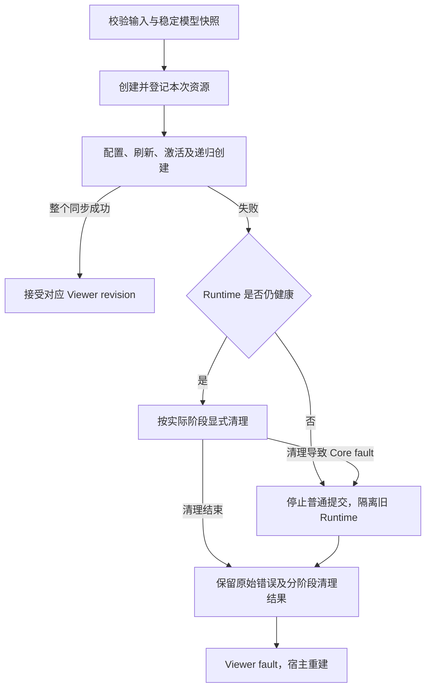

# ADR-037：Editor 增量视图失败隔离与 Overlay 批量校验

类型：`architecture-decision`

## 状态

修订 1，已接受并完成验证（2026-10-15）。承接 P2-S06；行为契约不变，
验证矩阵修订 2 的组合证明和 Native GPU 队列宿主范围已获用户接受。
最终 full 通过，R06/TC-08 按[完成记录](../verification/reviews/p2-s06-failure-isolation-completion-2026-10-15.md)
关闭，完整 Editor 计数耗尽集成和平台保留项不因此记为已执行。设计复核依据见
[修订 1 复核](../verification/reviews/adr-037-revision-1-review-2026-10-15.md)。

本次按[首轮评审](../verification/reviews/adr-037-draft-review-2026-10-14.md)的
S06-DR01–DR05 修订 dispose 阶段、fault 清理权限、路由结果分类、生命周期顺序
及关闭流程。修订对应关系见本文 §10；实现与验证结果以独立完成记录为准。

本决策补充
[Editor 架构](../design/editor/architecture.md) 的失败边界，并澄清
[G5.1](../design/editor/g5-connection-projection.md) 中“原子协调”的范围。
现行规范中的快照预检、单项关系更新及 Runtime 候选提交保证继续有效；
完整 synchronize 不因此获得全局回滚保证。

`api_semantics`：`figure.tree`、`figure.lifecycle`、`damage.repaint`、
`notification.ancestor`、`connection.figure`、`connection.anchor`、`connection.router`。Editor 对应 G2 Viewer、
G3 Selection/Targeting、G5.1 Connection；采用来源见
[GEF 账本](../parity/gef/api-coverage.md)。

## 1. 问题与证据

[机制必要性复核](../verification/reviews/p2-s06-mechanism-necessity-2026-10-14.md)
已确认两个反例：新建子树的后续 factory 拒绝后，新父 Part 及其 Figure/registry
残留；Overlay 删除批次含重复 FigureId 时，第一次删除后第二次才拒绝。
Connection 已有 activation 失败清理，但尚无完整的晚期 route/binding 和清理失败证据。

这三条路径需要不同的保证。子树创建需要集中管理本次新增资源；Overlay 的非法输入
需要完整预检；Connection 需要补齐既有清理路径。具名 Plan 或 Batch 不是验收目标。

### GEF 对标

参考仓库：`/Users/bytedance/Documents/code/GitHub/gef-classic`，
版本 `4463d9d0ce13c19d10fbe769d29f28b7345a8cba`。
仅使用 `org.eclipse.gef/src/org/eclipse/gef/editparts/`：

| 源码 | 行为与定位 | 本草案采用的语义 |
|---|---|---|
| `AbstractEditPart.java` | `addChild`（209）：插入 children、设置 parent、添加 visual、addNotify、activate、通知 | 保留组合与生命周期顺序；不把已挂载 callback 改造成 detached 构建 |
| 同上 | `addNotify`（256）、`register`（829）：登记后创建 policy、刷新子树 | 创建期间存在可观察登记，不能声称“从未发布” |
| 同上 | `activate`（166）、`deactivate`（297） | 记录实际完成的激活步骤，清理不能假定所有步骤均已成功 |
| 同上 | `refreshChildren`（769） | 保留增量复用与重排，不要求整个 synchronize 恢复旧快照 |
| 同上 | `removeChild`（882）、`removeNotify`（956） | 清理涉及生命周期、selection/focus、visual 和 registry |
| `AbstractConnectionEditPart.java` | `addNotify`（100）、`deactivateFigure`（119）、`removeNotify`（257） | Connection 清理同时覆盖连接层和两端 anchor |
| 同上 | `setSource`（286）、`setTarget`（307） | 两端关系与连接生命周期统一管理，self-loop 仍有两端职责 |

上述 Java 方法没有通用异常补偿协议。Novadraw 保留扩展语义，并为 Rust fallible
callback 明确新增资源清理保证；这一保证不能由 GEF 自动推得。不使用 Zest。

## 2. 所有权与保证单位

Viewer 继续拥有 Part、关系索引、Overlay owner 和生命周期协调；Runtime 继续拥有
attached Figure、anchor、订阅及 scene mutation。不得新增第二套 owner 或 registry。

**失败隔离单位是一次新建 Part 子树，或一次新建 Connection。**
它覆盖该次调用新增的资源及附属登记，不覆盖完整 synchronize 的成功前缀。
已存在 Part 的 refresh、重排、退役及端点更新仍遵守各自的既有契约。

内部实现须记录已取得资源和生命周期进度。可以使用现有递归调用返回值或私有记录；
是否新增私有类型由实现证据决定，不向消费者要求公共 Plan、lease、guard 或新 Context。
Figure 的复合 content pane、安装时产生的子 Figure 和订阅也属于其新增资源范围。
清理只处理本次取得的资源，不按模型 ID 扫除既有对象。

图中 revision 接受发生在整个同步成功后；子树创建成功不单独推进 Viewer revision。

## 3. Part 子树失败清理

创建路径保留现有 factory、visual configuration、registry、refresh 和 activation
扩展点。任一步返回可恢复拒绝且 Runtime 仍健康时：

1. 停止后续创建和激活，保留原始拒绝原因；
2. 按下述 Editor 与 Core 各自的生命周期规则，清理本次取得资源和成功激活前缀；
3. 清除本次新增的 policy/behavior 登记、订阅、selection/focus/capture 关联，
   Part/model/visual registry 和 Figure，包括复合 visual 的附属资源；
4. Runtime 保持健康时继续清理不依赖失败步骤的资源；若清理导致 Core fault，
   转入 §6 的隔离退出路径，不继续要求普通 Runtime mutation 成功；
5. 返回失败及清理结果；失败同步不接受新的 Viewer revision。

只有显式清理完成且未进入 fault 退出路径时，才保证本次新增结构和登记全部清除。
清理被拒绝或发生 panic 时，分别报告实际已退休的资源、仍存活的资源和未完成 callback，
不把它们统称为“回滚失败”。正常拒绝不允许静默遗留资源后继续使用 Viewer。

### 3.1 Editor 生命周期与 Core disposal 分开协调

Viewer 按既有 Part/Connection 移除规则清理反馈、selection/focus、成功激活的
Part/policy/subscription、映射及 Figure。关联 Connection 的退休先于 endpoint
Part 的生命周期退休和所属 layer 的 disposal。失败清理不改变正常 Part
removal 的既有顺序；“资源反向依赖”不能替代各领域的生命周期规则。

Figure disposal 继续遵循
[Figure 生命周期 §3](../design/architecture/figure-lifecycle.md#3-dispose-的准备与提交)：

| 阶段 | 可观察事实 | 失败后的处理 |
|---|---|---|
| prepare 未通过 | 该次删除尚未提交，FigureId 和结构仍有效 | 记录拒绝；Runtime 健康时可清理其他独立资源，不自动重试该项 |
| engine commit 已完成 | 节点移出 arena，绑定已清除，旧 ID 失效，旧 damage 已冻结 | 不再次 dispose，不将 callback 未完成报告成节点仍存活 |
| component completion/release | 结构已退休，按 descendant-before-parent 执行 Figure lifecycle | callback panic 进入 Core fault；保留已退休事实及 callback 进度 |

engine commit 不运行用户代码，不能发生可恢复的中途结构失败。
Figure deactivation 使用旧关系只读快照，不能提前到 Core commit 之前，也不能通过
已失效 ID 查询旧树。Viewer 的 Part/policy callback 与 Figure lifecycle 分别记录，
不得混成一个统一的反向 callback 列表。

### 3.2 激活与清理尝试只记录一次

成功完成的 activation 步骤只安排一次 deactivate。未进入或未成功完成的步骤不得被
当成已激活步骤统一调用 deactivate。若一个外部 callback 在返回 Err 前已取得外部资源，
该 callback 必须自行释放其部分取得资源；引擎只知道其已登记资源和成功完成的前缀。
调用 deactivate 前记录“已尝试”，正常返回再记录“已完成”。panic 或清理拒绝不能
把步骤恢复为未尝试；显式清理和 Viewer 关闭共用该进度，不自动再次调用。
`EditPolicy::deactivate` 保持 ADR-034 的 `()` 签名，失败注入使用 panic；
只有已有 fallible prepare/cleanup 入口才返回 Err，不新增 fallible deactivate API。

发生 panic 的 callback 实例不再驱动。引擎登记可在现有权限允许时清理，但不能据此
声称外部实现的内部状态恢复；Core 已 fault 的资源按 §6 退出。
结构已退休的资源 ID 立即失效，后续重建分配新身份。不得复活旧 ID。
局部失败清理不得删除失败子树以外的既有兄弟、父节点、policy 或订阅；
随后关闭整个旧 Viewer/Runtime 属于宿主退出，不能混同于局部清理。

## 4. Connection 晚期失败

新建 Connection 复用已有 removal/cleanup 路径，覆盖：

- Part、model/visual registry、连接层 Figure 和附属 visual；
- source/target endpoint 索引与本次新增 anchor 注册；
- routing dependency observation 和本次新增订阅；
- 已完成的 activation/policy 步骤。

验证必须在“一个 anchor 已登记”“两端已登记”“binding admission”
和“activation 部分完成”等位置注入失败，而不只测试最早的 admission。
两端属于同一 Part 的 self-loop 也须按各端实际登记清理，不重复释放共享资源。
未变化的既有连接、端点和 anchor 不得被清理。

route/binding 的结果以 Runtime 的提交阶段与结果分类，不按错误名称判断：

| Runtime 结果 | Viewer 动作 |
|---|---|
| binding/结构 admission 拒绝，未取得对应资源 | 清理此前已取得的新增资源，遵循 §3 与 §6 |
| 已接受 Connection，成功提交 resolved | 保留连接，继续同步 |
| 已接受 Connection，成功提交 unresolved | 保留 Part、anchor binding 与恢复依赖，Viewer 不因路由原因进入 fault |
| Runtime 提交失败或 Core extension panic | 按实际结构阶段报告，进入 §6 的 fault 边界 |

[Connection routing](../design/architecture/connection-routing.md)与 ADR-014 规定，
运行期 route batch 的非有限 point、geometry/locator 预检失败等可被 Runtime
转换为稳定 unresolved：清空该批旧 points/reservation，保留恢复依赖。
该结果仍属于可恢复状态，不能仅因原因是非法路径值就删除 ConnectionPart。
纯 Router 计算的 Err、binding admission 拒绝和已经提交的 unresolved 是不同结果；
Viewer 不自行重解释或改写 Runtime 的分类。

上述 unresolved 不使 Viewer fault 的前提是其余模型视图同步成功；它不能掩盖独立的
factory/activation 失败或模型通知不一致。

既有 Connection 重连或 refresh 的失败不升级为本 ADR 的“新建资源隔离”：
继续执行现行单项候选校验/提交规则；无法保持一致性时 fault，不能隐式宣称回滚
完整连接快照。

## 5. Overlay 完整预检

现有批量入口保留。删除前须读取同一份有效拓扑，校验整个批次后才开始写入：

| 输入 | 结果 |
|---|---|
| 健康 Viewer 上的空批次 | 成功，无写入、通知或 damage |
| 重复 FigureId | 拒绝；不去重，不删除成功前缀 |
| 同批次祖先与后代 | 拒绝；不隐式合并，不依赖输入顺序 |
| foreign、stale 或不属于当前 owner 的 Figure | 拒绝 |
| 删除根所覆盖的后代含其他 owner 的资源 | 拒绝，不越权递归删除 |
| 全部合法 | 按现有删除及生命周期规则执行 |

错误归因应能指出批次输入位置、相关身份及领域原因。重复或拓扑重叠先于写入发现；
同一非法批次应稳定返回同一首个违规项。实现不得依赖 hash iteration 顺序。

新增 Overlay 在任何 Figure 挂载或 owner 登记前，检查本批全部 owned Figure、
style 和现有 admission 规则。候选不可由写入时才发现的输入错误导致成功前缀残留。
若安装/lifecycle callback 在预检后失败，则按 §3 的实际阶段及 §6 的 Runtime
权限处理本次新增资源，报告 Viewer fault。

删除阶段须区分 prepare 拒绝与结构退休后的 lifecycle panic，不承诺重建已删除
Figure 或恢复原 ID。完整批量输入校验不等于整批 lifecycle 不可失败；
每次 Core engine commit 仍保持不可发生可恢复中途失败的保证。
不改变 P2-S04 typed Tool/Handle ownership，外部 Handle/Feedback 使用同一入口。

### 5.1 实施选择：一次调用内的 Figure 批量准入

Editor 无权自行构造 Core capability registry。整批新增通过
`Runtime::add_figures` 提交父 Figure、owned Figure 和可选局部 style；
Core 在分配任何 Figure 身份前检查全部输入，并私有保存已登记的 capability
descriptor，每项只登记一次。单项与批量挂载共用同一 Figure 准入实现。
同一 single-child parent 的批内占用也参与校验；有限 alpha 继续沿用原有 clamp，
非有限 alpha 在挂载前拒绝。

该 API 是即时操作，不返回可持有的 Plan、lease 或 guard。拒绝指出输入位置和
原始领域错误。预检后安装 callback panic 仍可留下真实挂载前缀并导致 Core fault；
Editor 按实际 Figure 身份记录存活状态，不能把这个 API 当成全局回滚机制。
typed Handle 与反馈批次共用 Editor 的安装与故障记录入口。

## 6. 错误、模型/history 与恢复

| 情形 | Viewer 与恢复 | 模型与 history |
|---|---|---|
| 健康 Viewer 上 Overlay 输入预检拒绝 | 保持健康，调用方可更正输入 | 不变 |
| 稳定模型无法完成视图同步，新建资源已清理 | Viewer fault；不接受目标 revision，需重建 | 已成功命令及其 history/dirty/save point 按模型事实保留 |
| Viewer-only panic，Runtime 仍健康 | Viewer fault；不再驱动发生 panic 的实例，仅在现有权限内清理其他已知资源 | 不伪造模型回滚；视图 callback panic 不自动表示模型状态未知 |
| Core 已 fault，或健康清理过程中进入 Core fault | Viewer fault；停止普通 Runtime mutation，隔离旧 Runtime；保留已退休事实、存活资源及 callback 进度 | 不伪造模型回滚；模型状态未知时按既有 CommandStack fault 规则处理 |
| Runtime 健康但 cleanup prepare 拒绝 | Viewer fault；记录该项未退休，继续其他独立清理，不重试失败项 | 已成功模型命令保留 |
| 已提交的 unresolved route | 其余同步成功时 Viewer 健康，保留可恢复连接 | 不变 |

一次模型命令成功之后，视图失败必须分别呈现“模型提交成功”和“视图同步失败”。
不得从 history 中删除该命令，自动执行 undo，或仅因视图失败把 CommandStack 标成
模型状态未知。正常的模型通知、CommandStack 状态和保存点语义仍由其既有 owner 管理。
S06 不统一所有扩展错误枚举；S09 仍负责一般 source/error 协议。

### 6.1 清理与 fault 退出的权限

每次显式清理前检查 Runtime 状态。Viewer 扩展 Err、Viewer-only panic 与
Core fault 分开报告；callback panic 的发生位置决定哪些 owner 已 fault。
Runtime 仍健康时沿用现有清理入口，Core fault 后不得通过普通 mutation、
Connections 或 Observations 继续提交清理操作。

Core fault 路径保留其已经完成的结构退休；未退休资源隔离在旧 Runtime 中，随
现有 owner 退出协议释放 owned 存储，不继续驱动发生 panic 或已经尝试的 callback。
本 ADR 不新增 fault 后可提交的公共 cleanup 权限，不临时清除 fault，也不承诺
在旧 Runtime 存活期间清除所有残留。若实现证明现有退出路径不能满足隔离、资源释放
或禁止重复 callback 的要求，回到 Design 评估，不隐式增加 Core 恢复机制。

清理失败不得覆盖最初的失败。诊断必须能区分原始阶段、清理失败阶段、结构存活资源
及结构已退休但 callback 未完成的资源；
原有错误类别及原因保留，不能只报告最后一次 dispose 错误。
扩展 panic 沿现有 fault boundary 隔离；不承诺捕获 abort 或恢复任意外部副作用。
清理 callback 再次失败时不循环重试，也不由 Drop 隐式重复调用。

### 6.2 停止新工作与关闭旧宿主

Viewer fault 后停止正常编辑、输入分派和新 `prepare_submission`，不接受成功
同步 revision。诊断读取及旧生产者退出不属于新帧驱动。
按 [ADR-029](adr-029-structured-render-backend-failure.md)与 ADR-014 处理已有提交：

- Runtime 仍健康时，允许沿既有 completion 入口结清旧 in-flight submission；
  completion 不表示失败同步成功，不提升 Viewer 接受的模型 revision。
- Runtime 已 fault 时，completion 仍返回既有结构化 fault 错误，不为结清而解锁 Runtime；
  宿主停止旧生产者，按既有协议排空或撤销旧提交，隔离旧会话资源。
- 旧 Viewer/Runtime 退出前不让新生产者复用其仍在使用的 backend 资源；
  新 Runtime 接管以 `Snapshot + Full` 建立基线，迟到旧 completion 按身份与会话规则拒绝。

宿主可读取诊断与已提交模型，关闭旧 Viewer/Runtime 后按模型重建；
重建成功才恢复编辑。未完成清理的旧 Runtime 不可直接复用。
这些规则由 Viewer/宿主驱动层落实，不修改递归渲染主循环。

## 7. 通知、damage 与身份

预检拒绝须满足零写入：树、registry、owner、生命周期计数、身份分配、notification
和 damage 均无变化。此保证只适用于所有写入之前的拒绝。

创建后失败即使清理成功，仍可能已消耗 ID、记录 journal、产生 attach/detach 通知、
invalidation 和 damage。不得倒退 revision/epoch 或修改通知计数以假装操作未发生。
各次挂载、移动和删除继续遵守 Runtime 的既有通知规则，禁止重复清理导致双重通知。
damage 必须包含本次实际改变区域的新旧表面包围盒；不能因为对象最终删除就清空
damage。fault 场景不承诺继续呈现旧 Runtime，但须保留其真实变化诊断。

稳定观察者只看到遵守 Runtime 稳定发布规则的状态。Viewer 不把失败同步标记为目标
模型 revision 的成功视图；callback 已看到暂时登记并不等于宿主已获得成功结果。

## 8. 外部消费者证据

以下为外部消费者验收要求；公开 API integration fixture 与独立 typed
Tool/Handle consumer 的实际结果及限制见
[完成记录](../verification/reviews/p2-s06-failure-isolation-completion-2026-10-15.md)：

1. 独立 consumer crate 使用现有公开 factory/behavior/policy API，创建包含复合
   visual 的外部 Part 子树；后代 factory 拒绝后，新增资源清除，既有兄弟保持有效；
2. 外部 policy/behavior 的成功 activation 前缀在健康清理时各尝试一次 deactivate，
   失败后关闭 Viewer 也不重复；失败 callback 自己管理部分外部资源；
   Core fault 时登记与 callback 进度按隔离退出契约报告；
3. 外部 Connection 及 Router/binding 在晚期失败时使用与内置连接相同的清理、
   错误和 unresolved 语义；
4. 外部 typed Tool/Handle 提交重复、祖孙重叠及跨 owner Overlay 批次，获得与
   内置实现相同的拒绝和零写入保证；
5. 消费者不修改 Core、不访问内部 registry，也不新增公共事务包装。

## 9. 取舍与实施边界

不采用全局 detached Plan、完整 synchronize 快照回滚、通用事务或 Drop 回滚。
这些方案扩大 callback 与身份契约，且无法撤销任意外部副作用。
代价是失败期间已发生的局部变化可被诊断观察，Viewer 需要明确重建。

接受后按三个切片实施：Part 新建子树清理；Connection 晚期失败覆盖及必要修复；
Overlay 完整预检与失败报告。每个切片先写反例测试，再改实现；只有发现现有 owner
无法承载必要进度时才新增私有记录。未证明的领域改造进入 hold，不扩大本批。

详细断言、suite 映射和关闭条件见
[S06 验证计划](../verification/plans/p2-s06-incremental-failure-isolation.md)。
Design 阶段的文档门禁和既有失败探针不作为整改完成证据。

## 10. 首轮评审修订对应关系

以下记录文本修订；五项已完成设计复核，不作为实现完成证据。

| 评审项 | 修订位置 | 验证要求 |
|---|---|---|
| S06-DR01 | §3.1、§3.2、§5、§6.1 | P04/O07 拆分 prepare 拒绝与退休后 panic；关闭后不重复清理 |
| S06-DR02 | §2 流程、§3、§6.1 | P05/C05 区分 Viewer-only 与 Core fault；覆盖清理时进入 Core fault |
| S06-DR03 | §4、§6 错误表 | C02 拆分 binding admission 与非法 route 转 unresolved；验证恢复 |
| S06-DR04 | §3.1 | P03 分别验证 Part/policy 与 Figure retire/lifecycle 顺序 |
| S06-DR05 | §3.2、§6.2 | deactivation panic 不新增 Result API；F03 区分新帧禁止与旧提交退出 |
