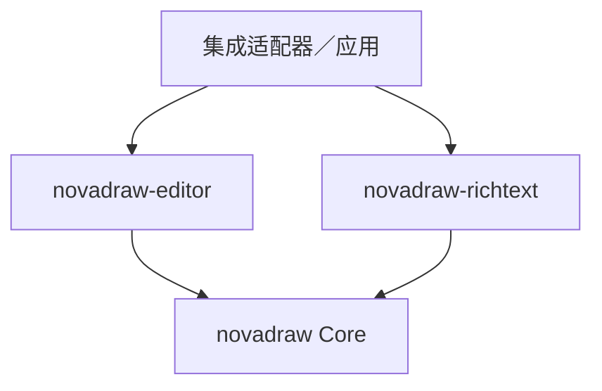

# ADR-061：统一编辑会话协调与专用编辑控制器边界

类型：`architecture-decision`

能力归属：Editor 拥有编辑会话协调、输入仲裁与文档命令历史；
`novadraw-richtext` 拥有专用文本编辑机制与不可变文本几何；
Core 拥有 Figure 场景、输入基础协议、布局与渲染发布；
应用拥有业务模型和持久化，platform 桥接原生输入与候选窗。

状态：已接受（`accepted`），2026-11-06，修订 2；公开协议与样例已实施，
定向自动验证通过，平台组合与完整性能验收仍开放。
用户明确指示“执行 ADR-061”，授权本决策与关联设计的实施。接受不代表验收完成。
实施协议见[专用控制器设计](../design/editor/specialized-edit-controller.md)，
验收见[验证矩阵](../verification/plans/specialized-edit-controller.md)。
实际改动、测试和成本见[实施记录](../verification/reviews/specialized-edit-controller-2026-11-06.md)。
本稿在 [ADR-015](adr-015-editor-framework-boundary.md) 的分层边界上提出可替换编辑机制，
不替代其模型、命令、Core／Editor 分层边界。

## 问题

`RichTextFigure` 将整份富文本文档作为组件内容处理，不把字符、样式 span、段落或
排版行展开成 Figure／EditPart 子树。它需要专门处理字素移动、文本选区、
样式编辑、组合文字和长文档草稿；这些操作的身份与成本模型不同于图形对象编辑。

当该组件进入图形编辑场景时，文本编辑又必须与对象选择、节点拖动、连线、
焦点切换、撤销重做和文档保存协作。如果 richtext 与 Editor 分别建立独立的
活动会话、IME owner 和持久化历史，同一次输入可能被重复消费，结束与提交也可能失配。

另一条路径是把富文本编辑全部纳入现有 Editor 文本实现。这会使 Editor 依赖具体
文档结构，或者要求 richtext 先 flatten 为 plain text／TextFlow，再建立另一份
草稿、布局和反馈。这样既限制组件复用，也可能抵消富文本内部结构带来的收益。

需要决定的是：统一的编辑协调与专用的文档编辑机制如何分工，如何共享一个
活动会话，以及组件独立使用时是否必须依赖 Editor。

### 讨论前提

富文本的独立性在于文档结构、排版编排和内部文本位置，不在于另建渲染系统。
正文快照仍通过 `RichTextContentFigure` 的 preparation 与 drawing 进入 Core Runtime，
使用同一场景变换、裁剪、资源和帧提交；组件不另建 GPU 设备或提交循环。

Editor targeting 也不要求每个内部 Figure 都注册 EditPart。一个富文本对象可以
对应一个 EditPart，文本编辑目标再通过稳定的文档／段落／feature 身份表达。
渲染树与编辑目标树不必逐节点对应。

以上边界分别来自现有 [richtext 方案](../design/architecture/rich-text-figure-proposal.md)、
[Editor 架构](../design/editor/architecture.md)和
[直接文本编辑契约](../design/editor/p2-direct-text-edit.md)。
当前直接编辑契约主要面向 plain Unicode draft，不据此认定富文本接入已经具备。

## 决策

采用**统一编辑会话协调，专用编辑控制器可替换**的边界。

Editor 负责决定当前编辑对象、会话生命周期和输入归属；richtext 提供专用控制器，
负责该会话中的文本编辑机制。控制器接入 Editor 后是当前会话的参与者，
不建立另一个并行的全局编辑会话。

### 会话协调与控制器的含义

“会话协调”包括启动、切换、提交、取消、失效，以及会话与 Viewer／Tool／host
输入权的关系。它不要求 Editor 理解段落存储、样式结构或具体排版算法。

“专用编辑控制器”是可复用的编辑对象，持有当前编辑草稿、文本选区、
composition 和领域操作状态。它调用 richtext 的文档及文本几何能力，
不等同于把这些可变编辑状态保存在 Figure 中。

Editor 中的会话记录持有控制器身份、活动目标、版本条件和输入 lease 的关联，
不复制控制器的草稿、光标、选区或 composition。协调器与控制器共同组成一次会话，
两者分别拥有协调状态与领域状态。

单一活动会话的范围沿用 Viewer；共享同一 host 文本输入资源的 Viewer 还必须
遵守该资源的 lease 互斥。它不表示所有窗口和所有 FigureTree 共用一个全局会话。
同一个控制器实例同一时刻只能绑定一个活动会话，不能在两个 Viewer 间共享可变草稿。

### 状态所有权

| 状态／能力 | 唯一 owner | 接入边界 |
|---|---|---|
| 活动编辑目标、会话身份与切换规则 | Editor Viewer 会话协调 | 通过公开协议启动、结束或失效控制器 |
| 图形 Tool 与文本编辑的输入仲裁 | Editor | 根据当前会话及消费结果路由，不重复分发 |
| 业务 feature 与提交版本条件 | Editor 会话关联及应用模型契约 | 关联目标和控制器，不暴露长期模型可变借用 |
| 文档草稿、文本光标／选区、composition | richtext 专用控制器 | 单一领域状态实例，受所在会话生命周期约束 |
| 字素、段落和样式编辑算法 | richtext | 使用文档身份与位置，不创建字符级 Part |
| 已提交的业务文档与持久化规则 | 应用模型 | Command 修改模型，模型通知刷新 Figure |
| 文档级撤销重做与保存点 | EditorDomain 的 CommandStack／应用 | 不在控制器中另建竞争的文档历史 |
| 不可变文档／布局快照与文本几何 | richtext 文档与排版结果 | 同版位置查询，失配时拒绝或重新计算 |
| Figure 变换、clip、damage 与帧提交 | Core Runtime | 正文和反馈进入同一场景发布边界 |
| 原生输入、候选窗与 host 资源 | platform adapter | 执行会话输入 lease 对应的 effect |

IME 状态需要区分三个对象：Editor 关联并协调输入 lease，platform 执行 lease
对应的原生输入 effect，richtext 控制器持有 composition 文本。三者不是三个
独立的 IME owner；迟到输入必须按会话／lease 身份拒绝。

### 独立使用与嵌入使用

richtext 专用控制器可以在独立宿主中使用。独立宿主承担启动、结束、输入权和
提交协调；组件无需为此依赖整个 Editor 框架，也不使用全局协调器。

嵌入 Editor 时，由集成适配器把控制器接入统一会话协议。依赖方向为：

Editor 不硬编码 richtext 的段落、样式或排版类型。richtext 基础包不反向依赖
Editor；适配器可以在应用或后续明确归属的集成模块中实现，本决策不要求新建空 crate。

独立宿主沿用现有组件 typed source update 时，组件源快照可以继续作为唯一提交事实。
嵌入 Editor 的应用模型模式则以业务模型为事实源，Figure 持有已发布的不可变投影。
两种模式必须显式选择，不能同时维护两个可独立修改的持久事实源。

### 开放扩展与身份

专用控制器通过统一的类型化身份、descriptor／payload 和注册协议接入，
遵守 [ADR-027](adr-027-open-figure-capability-registry.md)。
已有 plain-text 编辑机制与外部 richtext 控制器应使用相同的发现、激活、
输入、结束和失败路径，不为内置文本编辑保留特权分支。

会话身份、模型／feature 身份、Figure／EditPart 身份和文档／布局位置身份分域。
控制器内部的段落与字符位置不转成 FigureId；持久化 Command 不保存活会话、
Figure、EditPart、布局快照或平台输入句柄。

精确 trait、注册 API 与错误类型由后续 design 定义。本稿约束它们必须表达的
边界，不把概念接口当作已存在的公开 API。

## 生命周期、提交与反馈约束

### 激活与输入

Editor 激活新编辑对象前，先按既定 policy 提交或取消旧会话。可恢复的提交拒绝
保留旧会话及输入归属，并拒绝本次切换；状态未知错误则进入既有 fault／清理路径。
两种结果都不允许先激活第二个控制器再处理旧会话。

活动文本会话优先消费其负责的键盘、文本与文本选择输入。节点拖动、连线等
互斥操作必须先完成会话切换。滚动、zoom、resize 和祖先变换本身不等于结束文本编辑，
但必须使反馈及候选窗使用新的同版几何。

### 草稿与模型提交

普通输入和 IME Commit 首先修改控制器草稿。IME Commit 不等于接受整个编辑会话，
也不自动为每次 composition 事件生成持久化 Command。

接受会话时，控制器提供受检的修改结果，由应用 policy／adapter 构造模型 Command，
经 EditorDomain 执行。模型通知刷新正文 Figure，控制器与反馈随后按统一结束协议释放。
现有直接编辑契约对执行 Command 前的反馈清理和输入释放顺序继续有效；
本决策不另建一条绕过 Viewer 模型事务的提交通道。

模型提交后若投影刷新失败，应按既有失败隔离协议处理；不能把旧草稿重新写回
模型，伪装成提交从未发生。

空变化不增加历史。取消丢弃未提交草稿，保留已提交模型。未来若需要长时间编辑中的
增量提交，必须在 design 中明确事务分组、版本检查与撤销语义，不能把该需求隐式
塞入 IME Commit 或每次按键回调。

控制器可以提供会话内的草稿撤销，但它与文档级 CommandStack 是不同范围。
快捷键路由、accept／cancel 后的处置和容量限制必须明确，草稿历史不能伪装成
已经提交的文档历史。

### 冲突、失败与清理

外部模型变化必须检查会话保存的源版本。版本失配时，明确拒绝提交、取消或进入
经设计定义的恢复流程；默认不自动合并，不以旧草稿覆盖新模型。

目标 Part retire、Viewer dispose、输入 lease 丢失或不可恢复的会话失败时，
Editor 触发统一失效与清理。控制器释放 composition、反馈引用和临时资产，
platform 释放对应输入资源；迟到事件不能修改新会话或复活旧目标。

可恢复拒绝、状态未知错误及扩展 panic 沿用 Editor 既有失败区分。
“状态未知”不能包装成未处理输入再继续分发给图形 Tool。
具体恢复顺序需与 [增量失败隔离](../design/editor/incremental-failure-isolation.md)
及 [Viewer 模型事务](../design/editor/viewer-edit-session-and-drive.md)共同核对。

### 反馈与渲染

草稿正文、选区、caret 和 preedit 的位置都来自同一份有效文本布局。
可由控制器生成专用的不可变反馈结果，再由 Editor 管理其挂载、发布和清理。
不得因为复用 Editor 反馈机制，就把富文本文档 flatten 成另一份 plain-text
TextFlow 并建立竞争的排版真源。

稳定正文与草稿反馈的显隐、旧新 damage、clip、scroll、transform 和 DPI 组合
必须有统一设计。接入 Editor 不改变 Core 的唯一渲染发布边界，
不授予控制器另建窗口、GPU 服务、全局 timer 或提交循环的权限。

## 采用理由

统一协调能使文本输入、图形操作、IME 与目标生命周期使用一致的切换规则。
例如，在文本选择过程中请求节点拖动时，Editor 可以先结束文本会话，
避免同一指针事件同时改变文本选区和节点位置。

专用控制器保留富文本文档及位置模型。字符级编辑不要求创建 Part／Figure，
领域实现可以独立评估草稿共享、段落失效、几何查询和增量排版。
组件也可以在独立文本宿主与图形编辑器中复用。

提交仍进入同一业务模型和文档历史，因此文本修改可以与图形移动、连接修改共同
遵守保存点、撤销和模型通知规则。Editor 的协调机制无需随每种文档结构持续扩张。

这些是边界选择的预期收益，不是已验证的性能结论。统一会话不会自动消除当前
richtext 编辑中的全文快照构造，也不表示增量排版已经实现。

## 替代与代价

| 替代 | 可以简化什么 | 不采用为统一方案的原因 |
|---|---|---|
| richtext 与 Editor 各自建立独立活动会话 | 组件初次接入较少改动 | 输入权、切换、IME 清理和文档历史会出现竞争 |
| Editor 内置所有富文本编辑机制 | 单一实现集中维护 | Editor 依赖具体领域结构，组件复用受限，外部消费者难以替换 |
| 每个段落／字符建立 Figure 或 EditPart | 可复用图形目标遍历形式 | 混淆文本位置与图形身份，增加拓扑、投影和生命周期成本 |
| 每次输入直接修改已挂载 Figure | 快速形成组件修改演示 | 嵌入应用模型后会绕过草稿、CommandStack 与模型通知 |
| 只保留完全独立的文本编辑器 | 独立宿主边界清晰 | 无法覆盖同一图形文档中的编辑互斥和统一事务需求 |

采用可替换控制器需要维护协调协议与领域协议之间的适配。版本、输入消费、
反馈发布、错误传播和释放时机都需要显式验证；只有依赖图分层并不足以保证正确。

跨层调用、descriptor 和 lease 检查也有实际成本。性能验证必须拆开会话协调、
文本修改、草稿布局、反馈发布、模型提交、投影刷新与 backend 成本，
不能只测控制器内部就宣称完整 Editor 编辑性能达标。

## 对既有决策的效力

- ADR-015 的应用模型权威、模型命令与 Figure 投影边界保持不变。
- ADR-027 的内置／外部同模型与类型化开放注册保持不变。
- [ADR-014](adr-014-extensibility-and-lifecycle-boundaries.md) 的失败和生命周期约束，
  [ADR-025](adr-025-unified-graphics-and-glyph-preparation.md) 的统一绘制边界，
  [ADR-038](adr-038-query-identity-and-failure-semantics.md) 的受检身份与失败语义继续有效。
- 本决策接受后，现有 Editor 规范中“Editor session 拥有 draft／selection／composition”
  应细化为：会话可以通过受控的专用控制器持有领域状态，协调记录不得再复制这些状态。
  plain 契约已同步引用专用控制器设计。
- 现有独立 richtext 样例仍是组件直接修改基准，不因本 ADR 存在就改记为
  Editor 集成或完整文本编辑能力完成。

## 评审与实施条件

边界评审应首先确认单一会话与领域状态的所有权、依赖方向、模型提交和失败语义。
实施前需在 design 中补齐可替换会话参与者、richtext 适配、反馈发布和测试矩阵，
核对现有 plain-text draft 的具体耦合。不得先把现有实现视为通用接口已经落定。
若确认缺少必要 Core 依赖，应按仓库的 GEF → Draw2D → Core 证据链提出独立增补，
先解决依赖再推进 Editor；richtext 自身的领域接口缺口则由该扩展组件承担。

最低验证范围包括：

| 验证主题 | 必须证明的结果 |
|---|---|
| 独立与嵌入消费 | 同一 richtext 控制器可供两类宿主使用，基础包无需依赖 Editor |
| 内置与外部扩展 | plain-text 与 richtext 使用同一公开接入路径，无内置特权分支 |
| 输入与切换 | 文本选择、节点拖动、连线和焦点切换不重复消费互斥输入 |
| composition 生命周期 | 取消、切换、删除目标与迟到事件不会留下第二个输入 owner |
| 模型与历史 | 接受、取消、NoChange、外部版本冲突与撤销重做保持模型／视图一致 |
| 文本几何与反馈 | 多行、Emoji、双向文本、scroll、resize、zoom 与 DPI 使用同版位置 |
| 扩展失败 | 可恢复拒绝、状态未知错误和 panic 分别进入既定恢复或 fault 路径 |
| 成本与容量 | 长文输入、选择、提交和退出的分阶段成本及临时资产留存有测量证据 |

性能比较使用相同文本、字体、宽度和资源条件，区分组件基线、Editor 接入成本与
GPU／屏幕延迟。不能把平台输入未采证记为 Core 能力缺失，也不能把组件基准通过
记为整个编辑链路验收通过。

精确 API、事务分组、草稿撤销策略、预算与控制器留存容量仍需详细设计裁决。
本 ADR 的接受、接口实施、生产启用和性能验收分别记录，不自动合并为一个完成状态。

## 关联设计与证据

- [Editor 总体架构](../design/editor/architecture.md)：当前模型、会话与编辑目标归属。
- [直接文本编辑](../design/editor/p2-direct-text-edit.md)：plain-text draft、IME、反馈及 accept／cancel。
- [Viewer 会话与驱动](../design/editor/viewer-edit-session-and-drive.md)：模型事务与同步边界。
- [Tool／Request／Handle](../design/editor/tool-request-handle-protocol.md)：开放交互与输入消费。
- [RichTextFigure 方案](../design/architecture/rich-text-figure-proposal.md)：组件模型、内部排版与统一发布。
- [当前编辑样例验证](../verification/reviews/richtext-figure-edit-app-2026-11-06.md)：组件成本与未完成范围。
- [P2 执行队列](../roadmap/p2-delta-backlog.md)：后续状态的唯一入口；本稿不新增并行 Execute。
