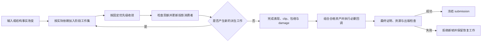

# FigureTree 内容、布局与投影分离

类型：`proposal`

能力归属：Core FigureTree／Runtime 拥有变更分类、依赖传播、局部资产、
坐标与帧发布；Core Graphics 拥有中立绘制表达；backend 拥有编码、
设备资源和实际栅格；platform 拥有输入与呈现。Editor 消费当前几何，
本方案不新增 Editor 能力。

日期：2026-11-05；2026-11-06 按总体评审修订。状态：用户已确认复审通过，
接受总体设计及受检 child transform 的行为合同，并授权按方案实施。
精确公开 API、错误传播及预算在实施前冻结；整体验收未完成。
用户要求将纯投影分离的设计范围明确为整个 FigureTree。
既有文本采样是首个问题入口，不能作为通用 FigureTree 的验收证据。
设计阶段从需求与现行坐标／更新契约推导；已有实施按授权定向审阅 Rust 实现。
本次修订只读取设计与验证文档，未扫描 Rust 实现，也未重新运行性能或像素验证。

2026-11-06 的[原总体评审](../../verification/reviews/figure-tree-projection-design-review-2026-11-06.md)
合并整树方案与受检 child transform 的评审意见：保留总体方向，补齐阶段资格、
依赖与发布合同后复审；受检 child transform 候选尚不建议接受。
本次评审不改变已授权切片、已有合同及总体未验收状态。
本次修订的[复审记录](../../verification/reviews/figure-tree-projection-revision-review-2026-11-06.md)
建议通过总体设计及受检投影的行为合同；用户随后明确“方案已经评审通过，
按方案推进吧”，构成本轮接受与实施授权。精确 API、预算配置和后续
录制／索引／backend 接入仍按各自门禁冻结与验证，授权不代表总体完成。
本文末尾给出 FT01–FT10 的修订定位与验证要求，供复审使用，不记为发现已关闭。
执行状态只由 [P2 backlog](../../roadmap/p2-delta-backlog.md)维护；
既有结果与各轮不利采样由
[实施记录](../../verification/reviews/figure-tree-projection-implementation-2026-11-05.md)维护。

`api_semantics`：`figure.tree`、`figure.box.client_area`、`layout.manager`、
`coordinate.conversion`、
`validation.protocol`、`notification.ancestor`、`notification.layout_update`、
`paint.protocol`、`damage.repaint`、`viewport.scroll_zoom`、
`connection.figure`、`frame.preparation`、`render.backend_session`。

## 目标与现行依据

纯投影分离必须适用于任意合格 Figure 子树：形状、图片、文本、组合容器、
连接和外部 Figure 使用同一机制。已经生成且输入有效的局部内容，
不应仅因显示位置改变而重新生成。measurement、layout、preparation、projection、
drawing 与 backend 资产分别取得复用资格；内容生成可省略时，当前投影、资源、
设备和最终发布检查仍可能需要执行。

[坐标 SSOT](../coordinates/coordinate-system.md)已规定 bounds 属于 parent content
domain；移动 parent 不改写后代 bounds，只使 world transform 和 projected bounds
失效。[UpdateManager](../rendering/update-manager.md)也已区分 layout、transform、
style 有效性，并要求按实际 child measurement 依赖传播布局失效。
本方案将这些语义落实为通用成本与复用目标，不替换坐标来源。

Draw2D 的只读参考见[树坐标分析](../../reference/draw2d/figure/tree-coordinates.md)：
`Figure.setBounds` 区分 translate 与 resize；局部坐标根移动时，
`primTranslate` 通知坐标系统变化而不改写 children bounds。
Draw2D 仍可能重绘可见图形，这些事实不证明 GPU 合成或恒定帧耗时。

## 分开的状态及依赖

下表是职责分类，不是拟议的封闭公开枚举。
公开扩展继续采用 typed identity、payload trait 与 registry。

| 状态 | 包含什么 | 何时重算 |
|---|---|---|
| 局部内容与绘制资产 | shape/path、图片引用、glyph、border、局部 drawing 与命中形状 | 实际内容、样式、资源或已观察输入改变 |
| 布局与局部几何 | 尺寸、baseline、child placements、inline、约束相关布局 | 实际测量／布局依赖改变 |
| 场景投影 | edge transform、world transform、有效 clip、surface 包络 | placement、ancestor transform、viewport origin 或 clip 改变 |
| 坐标消费者 | 命中、选区、焦点、连接锚点、范围查询 | 其实际投影或几何依赖改变 |
| backend 状态 | 编码结果、设备资源、可选栅格资产 | 对应内容、设备、surface、资源或栅格条件改变 |

“场景几何改变”不能自动等于“局部内容改变”。但同一个值可能被多个消费者使用：
位置既可影响投影，也可被自定义布局、Freeform extent 或 Router 读取。
这些消费者仍需更新，不能因为事件叫拖动就跳过。

局部资产的复用依据必须覆盖完整实际输入、注册身份、约束及失败行为。
不能直接从现有 key 中删去 origin、component revision 或 bounds；
只有证明输出独立于这些字段，才允许将它们归入另一依赖域。
读取外部私有状态而未提供完整有效性依据的扩展继续保守重读。

## 各阶段的复用资格

下表是总体候选合同。已有布局、输入与 Graphics 专题继续定义其已接受范围；
本表不从已有 proof 推导新的 callback 省略权。资格绑定具体阶段及具体资产，
不保存一个能赋予整棵子树所有缓存权的布尔值。

| 阶段／资产 | 准入条件与完整输入 | 依赖与检查点 | miss 与失败行为 |
|---|---|---|---|
| measurement | 对选中的测量分支有明确复用承诺；完整 Figure／manager／service 身份、内容、解析样式、资源、约束、baseline 及实际私有输入均受检 | 保存实际 child measurement 和传递 proof；返回、布局采用及帧最终检查 | 历史输入不同则重新测量；未知回调仍执行；读取或结果校验错误沿 Layout 错误链传播 |
| layout | 当前专题允许省略 invalidate／layout 的条件均成立；parent、children 身份与顺序、约束、测量结果、受限 effects 和私有输入完整 | 依赖声明只限制失效范围；实际读取证明另存；LayoutOutput 采用与最终检查 | 拓扑、条件或输入不同则重算必要范围；缺声明保持原传播；失败不安装不完整 placements |
| preparation 内容资产 | producer 明确承诺纯计算与完整输入；局部几何、内容、样式、资源和阶段服务身份有效 | 输出携带资源闭包、实际读取和测量 proof；消费、批次及最终检查 | 内容 miss 重建；未知 preparation 继续执行；准备错误保留原原因 |
| projection contribution／world prefix | 已准入受检 projection，或两类边仅含 Core 值；实时 child transform 所在前缀不获跨查询复用权 | 两类边分别记录版本；实际祖先贡献和 input proof 随消费传递；整次查询或帧最终检查 | 历史差异重算；本次首次值冲突拒绝；错误不降级到实时回调 |
| 局部 drawing | painter 显式承诺纯计算与完整输入；进入 PaintContext 的状态、局部 bounds、内容、样式和资源闭包均有效 | 录制完成检查状态栈；消费时验证进入状态与资源；帧出版仍检查 Graphics 和 backend capability | 状态不匹配重录；未知 paint 必要调用仍执行；Graphics 错误拒绝帧 |
| backend 编码／可选栅格 | 由 backend 声明独立资格；编码输入、资源 revision、session 和设备条件完整；栅格另含比例、像素相位、clip、surface 与效果条件 | 编码接收与提交前检查；session／device 恢复按 backend 合同 | 普通淘汰可重建；不支持或非法输入显式拒绝；不凭 Core 命中取得栅格复用权 |

preparation 要区分局部内容生成与当前 placement、clip、资源、session 的检查。
复用前者不能省略后者。drawing 的“不再调用 paint”和“不深复制命令”也分别验收。

拟议外部消费者在同一混合容器中提供与位置无关的受检布局、受检 shape 资产，
并包含读取进入状态或产生 effect 的未知 painter。平移时布局与独立 shape 资产可复用，
该 painter 仍按现行顺序执行。保守范围从未知回调实际可影响的资产推导；
能隔离时只重算对应资产，无法隔离的跨节点 effect 才扩大范围。
Figure 类型、上一帧成功与“没有 observation”均不能替代完整声明。

## 实际依赖的登记、替换与收敛

Core 按“消费者身份、阶段、资产代次”保存读取集，并维护输入 subject 到消费者的
反向索引。subject 使用完整 Figure／资源／注册身份及 typed 属性身份，
包含 namespace 和 generation；字符串只用于诊断。读取登记发生在受检入口，
空集合、合法 None 和条件判断所读取的值也进入依赖集。

| 依赖事实 | 必须记录的范围 |
|---|---|
| 节点值与关系 | 实际读取的 origin、size、insets、local transform、约束及 parent 关系；身份存在性单独记录 |
| children 与搜索 | 集合成员、顺序、筛选条件及查询范围的结构 generation；空查询也依赖该范围，不能只记返回的节点 |
| 样式 | 所读解析属性、继承来源与继承路径；reparent 或继承来源替换使相应依据失效 |
| 资源与扩展 | 资源 kind／revision／状态、provider／capability 准入身份、服务绑定与注册存活 |
| 私有与条件输入 | owned 不可变值由 component revision 覆盖；共享／内部可变值通过 typed reader 保存完整首次值，嵌套读取保留传递依赖 |

成功计算先验证完整候选及预算，再同时安装输出、读取集和反向索引。
条件分支切换时，新读取集整体替换旧集；仅在旧输出及所有消费它的候选退出后，
才删除对应旧依赖。失败保留旧资产及其失效来源；本次失败读取的存在性／注册事实
用于诊断与重试，不作为新成功资产的证明。回滚按原恢复边界恢复资产与读取集，
不能留下新输出配旧依赖，或旧输出失去反向索引。

reparent 重新验证 parent、作用域和继承路径；卸载但仍存活的身份保留必要资产，
其 attachment 依赖失效。真正退休删除 live 索引，旧输出或 in-flight 所持有的
不可变数据按 lease 留存；槽位复用不复活旧身份。能力新增、替换或移除原子更新
准入来源和相关工作，旧 provider 依赖待旧消费退出后退役。已知结构、anchor、
locator 及 input 嵌套环仍提前拒绝，累计预算只限制工作，不能代替环检测。

变更按实际反向依赖形成现行 committed facts，并进入相应 typed worklist。
调度继续遵守[派生状态收敛](derived-state-convergence.md)：
intrinsic → layout → geometry propagation → routing group → post-route geometry，
工作集排空后才完成 presentation。后置提交产生高优先级工作时回到该阶段。
Freeform 极值变化、RangeModel clamp、anchor、route 或 locator 的真实依赖仍更新；
同一有效 viewport chain 内的表现平移不反向触发 content-domain route。

验收反例包括删除／新增极值 child、children 重排、空查询变为有结果、
条件依赖 A 切换到 B、失败后恢复、reparent 与能力替换，以及跨子树连接。
分别核对输出、反向依赖清理和必要工作，不能仅验证 world transform。

## 不同拖动的行为

| 操作 | 应复用什么 | 仍须处理什么 |
|---|---|---|
| 固定 viewport 内平移整棵树 | 子树局部内容、布局、局部命中形状 | 投影、clip、可见范围、damage、当前坐标消费者和绘制 |
| 移动固定尺寸的节点或组合节点 | 合格节点及后代的局部内容、与位置无关的布局 | 新 placement、parent 的真实依赖、Freeform extent、受影响连接 |
| Editor 拖动预览 | 已有局部资产 | 表现投影和依赖的预览几何；正式提交仍遵守模型／命令契约 |
| resize、重新排列、reparent | 输入未变的资产部分 | 新约束／拓扑下的必要布局、坐标和路由 |
| post-layout visual transform | 满足完整资格的局部布局与绘制资产 | 投影、clip、命中映射及设备条件 |

ScalablePane／Zoom 的 scale 会参与 preferred size、child-content 可用尺寸和
RangeModel 反馈。不能把所有缩放直接归为最后一行；
只有实际布局约束保持不变的表现变换才有这种资格。
固定 viewport 的 pan 与窗口 resize 也属于不同输入。

移动节点时，连接不能整体套用同一个平移：跨子树连接的另一端可能不动，
Router 可能依赖其他障碍。应更新实际受影响的路由依赖；
无关节点的文本、图片与 shape 内容继续复用。

## 通用更新路径



此图省略各领域内部的测量、路由和 range 反馈；其顺序与失败恢复由现行专题负责。
纯投影路径只省略已经取得对应阶段资格且输入未变的计算。
它更新变换边及其版本；后代的组合坐标按当前祖先版本按需计算或在实际访问时复用，
不先逐节点改写全部 descendants bounds，也不为每个输入事件全树展开 world 矩阵。
这种按需策略不能返回旧坐标，不能压缩或丢弃现行必需通知。

空间／包络索引应与局部资产和投影版本对应。移动整个索引域时，应尽可能更新域的
映射而保留域内局部索引；节点局部位置改变时，更新实际受影响的索引项。
未知墨迹、overflow、重叠和 clip 无法可靠转换时仍保守遍历或绘制。
不能以估计可见性遗漏像素或命中目标。

录制复用与布局复用是独立条件。只有 drawing 的完整输入、资源依赖和失败行为
有效时，才可复用已有局部绘制表达，避免再次执行同一 paint callback 或深复制。
未知 paint callback 仍执行；不能从“上一帧成功”推断下一帧必然无副作用或无错误。
既有 RenderSubmission 和 Graphics 边界保持；本方案不默认采用休眠的
DisplayList 协议，也不默认将整树缓存为一张纹理。

Frame preparation 的 input proof、资源与 session 检查、事务回滚及提交后通知继续
遵守[派生状态收敛](derived-state-convergence.md)。
要减少跨帧全量重读，必须有完整、可观察的实际变更与依赖依据；
一个全局 epoch 或通用“projection-only”布尔值不能赋予任意扩展免检查资格。

## 局部 drawing 的录制与组合候选

此节在录制接入前独立复核，不随受检 projection 接受而自动生效。
具体候选 API、完整状态、文字统计效果限制、命令容器迁移与峰值计费，
见[局部绘制录制专题](figure-drawing-recording.md)及
[验证矩阵](../../verification/plans/figure-drawing-recording.md)；两份均待独立复核。
局部 drawing 使用 node-local border-box 坐标，child 的 drawing 保持各自 node-local
坐标；parent content 到各节点的映射在组合时应用。资产不烘焙当前 world placement，
也不包含 Runtime session／frame 身份。

为保留现行 `PaintContext` 的状态读取语义，本候选采用完整进入状态 proof：
记录 transform、有效 clip 及其坐标域、opacity、paint／stroke 等可读状态，
并记录传入 bounds 和实际服务输入。仅当进入状态有效且 painter 有纯计算承诺时
省略回调。transform 改变后，读取 surface transform 的 painter 必须重录。
若后续采用受控的 identity 录制环境，须另行明确外部 painter 的 opt-in 与状态语义，
不能静默改写现行回调看到的值。
完整进入状态 proof 可能使平移后的 drawing miss；本候选不承诺所有合格布局都能
省略 paint。位置无关的局部录制资格须在录制专题中明确证明，分别测量实际命中范围。

资产保存不可变命令段、glyph backing、资源闭包、状态前后边界及依赖证明。
每个录制段有独立 state-stack floor，完成时检查平衡；失败复原栈并保留首个
`GraphicsError`，不安装部分命令。组合顺序保持 self → children 的正常绘制顺序
→ border；各段进入时按现行 clipping 和状态继承规则建立环境，退出后恢复。
未知 self／child／border 回调在原位置执行，其 effect 不得因相邻资产复用丢失。

录制器分别保存进入状态和回调追加的局部操作序列，状态查询仍返回其组合结果。
submission 组合只应用一次进入映射，再回放段内局部状态操作，
不能重复应用烘焙的 world transform，也不能用矩阵求逆剥离进入状态。
有限奇异变换仍按现行绘制合同处理；无法分开表示的命令不能取得这项局部组合资格。

Runtime 在内部以不可变段引用和当前 transform／clip 包装组装 submission，
不在组装时递归 clone 每段 command 或 glyph 数组。该引用必须由 submission 的
owned lease 保活，保持 backend-neutral Graphics 表达；现行 RenderSubmission
若需内部表示迁移，随录制切片冻结并验证所有 backend 消费或拒绝路径，
不恢复 DisplayList proposal，也不另建公开出版入口。
资源闭包在采用时核对完整身份和 revision，帧冻结时绑定当前资源因果前缀。

验收用外部 painter 核对进入状态读取、资源替换、错误恢复、栈越界与组合顺序。
工作量分别计数 paint 调用、命令和 glyph 生成／深复制字节、段引用复制与分配；
净成本同时记录 cold、warm、state miss 和淘汰后的重建，不能用调用减少替代复制证明。

## 空间索引的范围与包络候选

此节在索引接入前独立复核。每类索引独立声明 root／routing domain 及完整身份。
绘制与命中子树索引采用 root 的 child-content 坐标，root 自绘及 border 的
node-local 包络单独组合；layout／Freeform 汇总和路由障碍保留各自领域坐标，
不直接复用视觉索引。域到 logical surface 的映射及 clip 单独带投影版本。
只有域内相对几何与包络依赖不变时，才能保留域内索引而更新域映射。
节点 placement 改变、reparent 或包络改变时更新对应项和极值汇总；
跨域汇总须保存所用变换依赖，不能只转换矩形后丢弃来源。

| 索引用途 | 包络来源与依赖 | 候选之后仍执行什么 |
|---|---|---|
| layout／Freeform extent | parent-content layout bounds、成员与极值事实；按现行 extent 语义聚合 | 必要布局与 range clamp，不能用视觉墨迹替代布局矩形 |
| 绘制可见候选 | 局部视觉墨迹、border、effect 外扩和 overflow，再组合有效 clip 与投影 | 实际绘制顺序、当前状态和资源检查 |
| 命中候选 | 局部命中形状与允许下降范围；visibility、clip 和投影独立 | 逆 Z-order、prune／accept、查询专属资格和精确命中 |
| 路由障碍 | routing domain 的已提交几何与障碍声明 | 当前 routing group 的真实依赖计算；不能由视觉索引直接替代 |

索引只返回保守候选，不改变
[树搜索](tree-search-and-focus.md)的顺序或资格。未知 overflow／墨迹使所属域保守
遍历和 damage；能隔离的不扩大到独立域。跨节点 effect 无法确定影响范围时，
扩大到共同受影响域，必要时 Full。clip 改变重新校验候选映射；
极值删除重建汇总，隐藏节点保留 stale 状态，恢复显示或重新进入 viewport 前
验证包络、资源和输入。不能因屏幕外而退役仍被路由或通知消费的依赖。

## 资产安装、稳定发布与留存预算

“内部工作提交”“stable 晋升”“submission 冻结”和 backend `Presented` 是不同边界。
以下候选表补充具体资产的安装位置，不替代现行事务或资源恢复规则。
同一帧采用的投影、包络、drawing 与资源必须来自相容的依赖闭包。

| 资产／状态 | 内部消费与缓存安装 | stable／出版边界 | 失败、退休与恢复 |
|---|---|---|---|
| metrics／layout／preparation | 完整返回或 output 采用检查成功后安装，输出与 proof 同步；按原阶段恢复边界提交工作状态 | 当前实际消费的证明进入帧最终检查；工作集及 presentation 完成后可晋升 stable | 失败不装部分输出，按已有回滚边界恢复证明；不撤销合法 source commit |
| projection contribution／world prefix | 独立查询只在整次成功后安装；Runtime 只安装事务候选，供同帧受检消费 | 当前贡献和祖先 proof 随坐标消费者进入最终检查；候选晋升不覆盖旧显示前缀 | 祖先、输入或后续阶段失败丢弃新候选；provider 退休不能解释成 miss |
| clip／索引／包络 | 完整构造并计费后与对应几何、投影版本一起安装；未知范围显式保守 | damage 新侧消费当前一致包络；旧侧保留上一成功显示前缀 | 失败保留旧前缀与待更新范围；淘汰后保守重建，不能混用新矩阵与旧包络 |
| 局部 drawing／组合段 | finish、栈与资源闭包检查后安装不可变段；采用时检查进入状态 | Graphics、全部传递 proof、资源与 backend capability 检查通过后冻结 submission，保留 in-flight lease | 录制失败拒绝帧；退休或替换不提前释放仍被稳定／在途段引用的 backing |
| damage／通知／显示前缀 | facts 分别进入 workset、damage 和 journal；独立查询不产生 Runtime facts | 通知遵守 stable flush；显示旧侧仅在对应 `Presented` 确认后前移 | 未显示新帧不覆盖旧显示位置；Retry／失败保留必要通知因果和重绘工作，不重复冒充新成功事实 |
| backend 编码／栅格／设备资源 | backend 根据独立完整键安装 | 资源同步、引用检查及编码接受后才报告 Presented | Retry 恢复准确资源前缀；SurfaceLost 同 session Full；DeviceLost 新 session Snapshot + Full，设备资产重建 |

资源的 pending、stable 和 in-flight 所有权继续遵守
[资源因果](resource-lifecycle.md)与
[Graphics 出版](../rendering/graphics-recording-and-publication.md)。
session reset 保留仍有效的 CPU 内容，但不赋予旧设备资产新 session 使用权；
迟到 completion 不能确认或释放当前帧。

| 预算范围 | 计费与释放候选规则 |
|---|---|
| 读取与依赖 | 父链遍历、reader、嵌套 proof 合并、反向索引构造按操作前计费；同时限制单查询与整帧累计量 |
| 缓存留存 | contribution、proof payload、索引项、包络、命令／glyph backing 和 metadata 均计入所属 owner 的 retained 预算；共享 backing 按实际 lease 归属计费 |
| 峰值同时占用 | 旧稳定／显示前缀、候选、失败恢复状态和 in-flight 同时存在时一起计费；不能只统计新资产 |
| 淘汰与拒绝 | 可淘汰不再被消费的可选缓存；重建仍受预算并保持正确；正在消费的 proof 与恢复旧侧不能提前释放，超预算显式拒绝 |
| 退休与设备恢复 | live 反向索引随退休清理，资源及在途 backing 待最后合法 lease 退出后释放；设备重建单独计费 |

数值上限、逻辑留存单位、超限错误及公开配置随各切片复核冻结，本文不预设数字。
未冻结这些项目不得接入相应资产。普通缓存不存在或淘汰是 miss；
读取、准入、注册退休和预算错误保持领域失败，不能吞成 miss。
验收覆盖局部／扩大保守路径、极值删除、隐藏恢复、viewport 重入、资源替换、
session 切换、候选预算拒绝和失败后重试。

## 为什么首次渲染完成仍不保证任意拖动很快

首次渲染可生成局部资产并预热部分资源，不会自动留存可复用的录制、编码和像素。
保留路径也仍有可见输出的栅格与合成成本。
平移会暴露新区域；新资源、设备恢复、复杂效果和大量重叠内容可能增加工作。

因此要分别压低内容生成、坐标维护、可见范围查询、录制、backend 编码和栅格成本。
“布局次数为零”只是其中一项，不能作为流畅拖动的充分条件。
大量可见图形仍可能 GPU 受限，即使没有重新生成任何局部内容。

合格路径的成本应主要随实际变化的变换边、实际坐标查询、依赖消费者、
实际通知、可见绘制候选及输出规模增长。无资格扩展的重读另计。
不能承诺与可见图形复杂度无关的 O(1) 帧耗时；也不应无故随所有屏幕外节点、
文字字节数或整树深复制增长。

成本分母同时记录节点数 N、最大深度 D、坐标查询数 Q、共享祖先数、
未知扩展比例、真实输入消费者与通知数、可见候选数及输出量。
world 缓存命中可能仍逐项重读祖先输入，不能直接按 O(1) 计费；
同一帧多个查询的父链、reader 与 proof 合并也计入累计预算。

| 可能包含全树工作的阶段 | 当前必要性与缩小范围的负责切片 |
|---|---|
| 派生回滚与活动交接 | 既有完整恢复边界保留；活动比较只保留 source rebase 所需状态，进一步缩小须由失效工作集切片证明 |
| 样式／scene／成员构造 | 借用内按实际查询延后构造；完整 source／revision 读取仍遍历实际范围，由输入构造切片维护 |
| input 重验与消费者发现 | 能力成员索引只回答谁拥有能力；实际 proof、未知扩展和必需通知仍检查，由依赖工作集切片缩小无关扫描 |
| world、clip 与可见范围 | 按访问维护前缀与独立索引域，完整祖先重读另计，由投影／索引切片验收 |
| 局部资产交接与 backend | 段引用、命令／glyph 深复制、编码和栅格分别测量，由录制及 backend 切片负责 |

固定可见规模增加屏幕外节点，并分别增加深度、查询数和共享祖先；再独立增加
可见输出量。屏幕外节点若包含真实通知、路由或私有输入消费者，其工作进入分母，
与无关扫描、结构构造、恢复复制分别归因。不得为得到局部复杂度删除原回滚机制。

## 原属性级方案的地位

[按属性依赖限定布局重验](property-scoped-layout-revalidation.md)是辅助机制：
解决 scrollbar 或其他组件内部布局变化不必要地使祖先布局失效的问题。
它可以被任意外部组件使用，但不能单独解决整树投影、局部绘制表达复用、
投影索引、坐标消费者和 backend 成本。

因此不将 `revalidate_layout_for_property` 当作所有移动的统一入口。
投影分离的主边界应建立在既有几何／坐标变更及实际依赖上，
而不是要求所有 Figure 为滚动值逐一登记白名单。
该辅助方案的具体合同已补齐，用户随后授权继续实施；通用布局输入已接入，
依赖声明、局部队列、真实事件与 ScrollBar／ScrollPane／Fill／Stack 消费者已接入；
晚期冲突恢复及构造期输入 session 已通过定向验证。
消费者净成本与混合 FigureTree 验收仍未完成，
证据见[实施记录](../../verification/reviews/figure-tree-projection-implementation-2026-11-05.md)。

## 下一布局切片的具体边界

保留此标题供既有引用定位；该布局切片已获授权并接入，具体合同由
[布局私有输入复核](property-scoped-layout-revalidation.md#定向复核布局私有输入必须进入证明链)
与[公开 API](public-api-contract.md#31-context-阶段权限投影)维护。
即时请求、出队范围与内部 child resize 输出保留同一隔离事实；
非目标输入 guard 与布局实际消费的完整 proof 分开。缺少完整声明或输入依据时
仍按原范围传播，没有 preparation capability 的普通 Figure 也使用同一受检布局输入。

输入检查的构造只在同一次不可变 tree 借用内复用结构与样式事实：
已提供 borrowed styles 时直接读冻结表，未提供时延后到实际样式查询构造。
普通成员查询沿当前父链按需确认；首次完整 source／revision 请求完整冻结实际
subtree 与 route 成员集合，之后仍重读 provider。成员缓存不保存 reader 值、
provider revision、route 结果或校验成功。root 外来源拒绝，root 祖先 route 的
影响仍覆盖相应范围；树修改、布局输出、reparent、退休或新借用重新建立依据。
查询、proof 和集合分配先计费，失败不安装部分集合，忽略错误仍拒绝发布。

历轮样式构造、borrowed styles 修正、成员构造与采样过程分别见实施记录的
[样式构造](../../verification/reviews/figure-tree-projection-implementation-2026-11-05.md#输入检查按需构造样式)、
[直接读取复核](../../verification/reviews/figure-tree-projection-implementation-2026-11-05.md#冻结样式直接读取的成本复核)与
[成员范围](../../verification/reviews/figure-tree-projection-implementation-2026-11-05.md#成员与-route-范围按需确认)。
定向正确性证据不扩张为消费者净成本或混合整树验收；
布局反馈切片不替代后续投影、录制与 backend 工作。

## 下一主线的公开合同候选：受检 child transform

本节行为合同已于 2026-11-06 经复审并获用户接受与实施授权，
精确接口及预算细节在实施前冻结，实现验证尚未完成。
实施已开始：typed registry、proof 与 reader scope 已按阶段参数化，
完整值、退休、合并和 lease 使用同一内核；活动 input 环与 reader 返回前的
嵌套失败检查已补入该内核。当前公开 preparation 入口保持兼容，
受检 projection 的类型、受限 scene 与 input registry 已落到代码，
查询缓存及 Runtime 帧接入仍在后续实施范围；
类型准入不代表坐标与帧已经采用新来源。验证由
[实施记录](../../verification/reviews/figure-tree-projection-implementation-2026-11-05.md#受检投影的共享输入内核)
维护。
此片处理 child-content 到 node-local 的变换来源、
world transform 和相关坐标消费者。clip 资产、录制与 backend 复用另行推进；
采用新来源后，既有 clip、命中、old/new damage 与必需通知必须在本片正确接入。

2026-11-06 帧接入合同冻结：每个 FigureTree 持有自己的临时 operation slot，
Runtime 在 source callback 前开启 RAII scope；嵌套稳定化和坐标会话共享首次输入、
累计预算及候选表。scope 不借用树，也不使用全局状态；退出或 panic 时清除 slot。
Core facts 只在每次不可变消费借用内校验，合法 source effects 后按新 facts
重新确认候选；共享私有输入的首次值则贯穿整个操作。派生状态采用前和录制完成后
重验实际消费闭包，候选仅在最外层成功边界发布。失败不消费 FrameId／resource
prefix，保留恢复所需脏区，并要求完整重绘。Prepared／Submitted 通知属于发布后
的下一轮输入，不向已经结束的 operation 追加读取。

局部 reader 返回 Core insets 与额外 container transform 的完整组合；
动画 GeometryInputs 继续去除 insets，GeometryPatch 再按现行次序恢复它。
world 与 presentation local transform 仍由各领域组合，不用 identity 代替动画
局部变换。表现快照已有覆盖路径承担录制接入，不修改递归渲染主循环。
合法裁剪为空、不可逆、route 未解析仍保留原有 None／领域状态；
输入退休、冲突、预算和数值错误沿各领域 error source 传播，不能转为空结果。

现行容器 `child_transform` 可以读取共享状态；仅有 Core 的 bounds 或
component revision，不能证明该回调此次仍返回原值。Viewport 的滚动位置与
ScalablePane 的 scale 都属于这类实际输入。上一帧成功、树没有 source mutation
或 world 矩阵尚未标脏，都不能给这个回调免检查资格。

建议增加可选 `FigureProjection` capability，通过现行 typed capability registry
准入，提供受检、纯函数形式的额外 child transform。内置容器与外部容器使用同一
公开 trait、input reader、错误和预算通道。projection 只准入拥有合法 container
能力的节点；两者在准入时验证关联，不能给非容器安装一个无来源的 children 映射。
已准入 projection 替代该容器旧的额外 child transform，不能同时调用两者或叠加两份
额外矩阵。只有合法缺失 projection 才执行原 `FigureContainer::child_transform`；
发现、读取、退休或预算错误向上传播。含实时回调的父链不获得跨查询的矩阵复用资格，
必要回调的次数、顺序与 effect 语义保持现行行为。
不按 Rectangle／Viewport／ScalablePane 类型推断资格。

下列类型名称及 producer 签名已冻结到公开 API SSOT；
坐标错误包装、完整依赖登记、来源切换与整帧预算在消费者接入前继续落定。

| 候选 API | 行为 |
|---|---|
| `FigureProjection` | 显式承诺 projection callback 为纯计算，返回额外 child transform |
| `ProjectionCapability` 与 `PROJECTION` key | 通过统一 registry 注册、解析和退休该 provider |
| `ProjectionScene` | 以 provider owner 的子树为 root，只暴露下表的局部事实与受检私有输入，记录实际依赖 |
| `ProjectionInputRegistry` 与 typed input key／payload | 注册接收受限 ProjectionScene 的 reader，复用通用首次值证明与 lease 机制 |
| `ProjectionContribution` | 持有 backend-neutral `ChildTransform`；client origin 仍由 Core insets 统一应用 |
| `ProjectionError` | 区分身份／范围、准入、注册退休、输入冲突、预算、无效变换及禁止的依赖；坐标查询保留具体错误来源 |

producer 签名为
`project(&self, scene: &ProjectionScene<'_>) -> Result<ProjectionContribution, ProjectionError>`。
它不执行布局、绘制或 mutation。返回值不包含 world transform，
也不将当前 bounds origin 烘焙进额外 child transform。
声明为纯计算意味着 Runtime 可以在输入仍有效时复用其返回值；
需要每次调用、可能产生 effect 的容器继续使用原实时回调。
有限但不可逆的变换保持现行坐标语义：正向查询可返回该矩阵，
逆向查询返回 `Ok(None)`；非有限输入、组合溢出和输入检查失败返回具体错误。
不能将不可逆统一改成新的 projection failure。

`ProjectionScene::input` 使用 `ProjectionInputRegistry`，复用 preparation 输入的
typed identity、payload、独立 reader scope、首次值证明与 lease 的通用实现。
旧 preparation reader 不能直接绑定到 projection registry；新 reader 的参数
只能是受限 `ProjectionScene`。共享实现不等于共享读取权限，也不复制一套 proof 算法。
provider 的独占不可变字段由完整
Figure 身份、capability 准入身份与 component revision 覆盖；
共享或内部可变字段必须通过 input reader 读取，不能用 component revision
代替共享模型的值。registry 本身、旧 descriptor 和旧 Figure 身份不能在退休后
重新获得读取权。
首次 snapshot 保存不可变的读取值；保存一个仍指向可变模型的共享 handle，
不能代替值快照或使后续比较获得有效性。

### 允许读取的事实与限制

2026-11-06 实施冻结：Core 读取证明分别保存完整 FigureId、parent、
有序 children（包括空集合）、origin、size、insets 与逐级原始样式。
成员检查经过的 parent 关系也登记；解析样式记录到根的全部继承路径，
因此相同解析值下的来源切换仍使历史证明失效。独立 reader 验证 scope
把 Core 事实和 typed input 一起合入消费闭包。历史不匹配返回未命中，
本次合并冲突通过 `ProjectionError::CoreChanged { figure, fact }` 拒绝。
此错误的 fact 仅用于诊断，内部行为身份由 Core 事实类型决定。
持有 owned 私有值的 provider 还依赖 owner 的 component revision。
字体 family、tooltip、children backing 和证明记录按分配前的字节预算计费；
这些证明尚未安装缓存时仅属本次计算，不能授予跨查询复用权。

provider 与 input reader 使用相同受限 scene。owner 子树 root 在 scene 建立时验证；
每个任意 ID 读取先验证 namespace、live slot 和 root 范围，再解释结果。
局部几何指当前已提交工作快照中的值，不触发新布局。跨子树共享值可经 owner
绑定的私有 input 读取，不能借此取得其他 subtree 的 Core 读取权限。

| 查询 | 允许范围 | 记录的实际依赖 |
|---|---|---|
| owner／节点身份与 parent ID | owner 及 root 内节点；owner 的 parent 只返回关系身份，不开放 root 外几何 | 完整身份、parent 关系及范围；root 无 parent 是合法 None |
| children／顺序 | root 内节点的直接 children；叶子为空仍登记 | 成员、顺序、结构 generation；不只记录返回节点 |
| bounds origin 与 size | owner 和 root 内其他节点的当前局部几何，分别读取和登记 | 对应属性、几何 generation；读 origin 即保留位置依赖，不能据此宣称纯投影免重算 |
| insets／local transform | root 内节点的 Core 局部值 | 对应属性与版本；返回 contribution 不重复应用 Core 的 placement 或 insets |
| 解析样式 | root 内节点的实际属性 | 属性、继承来源与继承路径；不向 reader 暴露原始 Figure |
| typed input | 当前 registry 中以 root 内 source 绑定的合法注册 | 注册 token、root／source／约束绑定、完整首次值及嵌套 proof |
| world／投影结果、命中、route、prepared drawing、嵌套 measurement | 均禁止 | 返回禁止依赖错误并锁存失败；不能递归依赖正在生成的 transform |
| 原始 tree／Figure／capability、mutation、完整 source revision 逃逸入口 | 均不提供 | 不通过未记录入口绕开范围或阶段检查 |

input 可嵌套读取其他合法 input，收集器合并传递 proof 并保留各 subject 的首次值。
同一 subject 值不同立即锁存冲突；递归读取同一活动 input 拒绝循环。
所有 nested reader、父链查询、合并及 payload 留存使用本次和整帧累计预算。
reader 返回错误后，即使 provider 忽略 Result 并返回 `Ok`，失败状态也不可清除。
注册弱引用、退休检查与 lease 沿用通用输入协议，不复制另一套 proof 算法。

受限 scene 只封住 Core 提供的入口；`&self` 仍可能持有共享状态。
纯计算、完整私有输入声明与稳定读取是扩展者的合同义务，
不能宣称 Rust 类型系统阻止了所有绕行读取。需要 effect 或无法履约的扩展保留实时路径。

### 两类变换边与来源切换

2026-11-06 冻结并实施的独立坐标查询接口：沿用五个 transform 方法，
`CoordinateQueryError::Projection(Box<ProjectionError>)` 保留投影领域 source；
该错误不再实现 `Copy`，调用者需要保留多份错误时使用 `Clone`。
`ProjectionError::Capability(CapabilityQueryError)` 保留准入描述符读取错误。
`FigureTree::with_projection_budget(PreparationBudget, retained_bytes)` 在构造时配置
单次查询的累计 work／allocation 与整树 contribution 的逻辑字节留存上限；
`new()` 沿用 PreparationBudget 的默认 10,000,000 work、2,000,000 allocation，
contribution 留存默认 2,000,000 字节。每个 input registry 另按显式上限维护
snapshot／proof lease，Core 事实、集合 backing、receipt 与缓存索引逻辑开销
由树的留存域计费。额度耗尽保留 Budget 或 Retention 原因，拒绝候选。
当前未实现缓存淘汰策略；这一缺口和 Runtime 整帧共享预算仍需后续完成。

独立查询的 contribution 缓存已经接入：各 owner 分别取得受限 scene，
操作共享 input 首次值日志与锁存失败，各 contribution 保留自己的最终消费集合。
历史资格读取完整旧 subject，差异触发重算；重算后旧消费集合退出最终复核，
资格读取的本次首次值继续约束后续消费者。只有正向／求逆结果和全部实际消费
证明检查成功，才一起安装本次 contribution；失败不安装部分新结果。
随后已接入按需 world prefix 和 Runtime 输入候选的最终安装；
Runtime 帧的实际消费／恢复及下表其他领域错误迁移仍未完成，
不能据此宣称整帧一致性或整树移动成本已经验收。

沿用[坐标 SSOT](../coordinates/coordinate-system.md#3-边变换)的列向量语义：

```text
node_local_to_parent_content(N)
    = Translate(N.bounds.origin) * N.local_transform

child_content_to_node_local(N)
    = Translate(N.insets.left, N.insets.top) * projection(N)

world(child)
    = world(parent)
      * child_content_to_node_local(parent)
      * node_local_to_parent_content(child)
```

此处 `projection(N)` 是当前唯一额外 child transform 来源：
已准入时为受检 contribution，合法缺失时为旧实时回调。
Core 原有 `local_transform` 不被替代；insets 也不合入 bounds origin。
前一类边依赖完整节点、parent、bounds origin 和 local transform；
后一类边依赖 insets、container／projection 准入来源、贡献版本及完整读取证明。
两类边分别版本化，world prefix 保存实际参与的边、祖先贡献与证明，
按当前父级组合版本更新访问前缀，不先重写 descendants bounds。

projection 新增或替换在完整准入成功后切换来源；替换失败保留原合法来源并报错。
显式移除成功后才成为合法缺失并恢复实时回调；退休旧 token 本身是错误，
不能自动被解释为移除。container 移除必须同时检查 projection 关联，
不能留下已失去 container 的 projection。每次合法切换都使相关边与消费者失效，
旧贡献在旧消费退出后退役。reparent、owned source mutation 与身份退休同样重验。

2026-11-06 来源更新 API 冻结：沿用统一的
`PreparedFigureUpdate::with_capabilities(FigureCapabilityBuilder)`，完整注册表与组件
一同准备。省略项是显式移除；准备阶段验证 provider／container 关联，
成功提交同时更新 component revision 与 typed 成员索引。
不在组件 commit 后重跑可能失败的注册回调。
现有 child policy 和其他附着领域对象的角色变更继续走子树事务，
不能借注册表替换绕开各领域的准入与退休协议；资源值变化继续声明 resource effects。
错误经现有 Runtime mutation 的 Graph／CapabilityRegistration 链返回。
精确调用面与限制见[公开 API SSOT](public-api-contract.md)。

按需 world prefix 现已保存当前父前缀身份、local placement 边与 incoming child-content
边；重复查询先受检消费 contributor，再比较前缀，仅省去相同边的矩阵组合。
父前缀变化时沿实际访问链建立新前缀，后代 bounds 不改写。
父引用为 weak，不持有递归释放链；前缀与 contribution 共用树的逻辑字节留存预算。
含任意未准入实时 container 的祖先链不安装或采用 world prefix，
保留原 bottom-up callback 顺序。
独立查询只在返回检查成功后安装；Runtime 输入操作先暂存候选，
末尾 Activity 与输入复核通过后一起安装。此处仅为查询／输入接入，
还不包含 Runtime 帧最终发布或表现层 local transform。

接受前验证非对称 insets、rotation、非均匀 scale 与 child placement 的非交换组合，
并覆盖 projection 新增、替换失败、移除及 container 关联变化。
有限奇异仍允许正向映射，逆向是 `Ok(None)`；非有限、逆结果不可表示及组合溢出
继续保留现行几何原因。

### 独立查询与 Runtime 帧的一致性

查询 session 是一次公开操作的输入证明作用域，区别于 backend session。
同一操作所有祖先、节点及嵌套 input 共用首次值收集规则：

| 情况 | 处理 |
|---|---|
| 历史资产 proof 与本次首次值不同 | 正常 miss，按本次首次值重算完整 contribution；不能用新 proof 接受旧输出 |
| 本次首次读取后再次读取或合并发现不同 | 输入冲突，拒绝本次候选，不改写 first proof |
| 历史与当前相等 | 可采用合格资产，但其证明仍进入本次消费与最终检查 |
| reader、身份、准入、注册或预算错误 | 保留原领域原因，锁存失败，不按 miss 或合法缺失处理 |

独立 FigureTree 操作先建立 session，按当前父链计算并暂存新前缀，
返回前统一验证全部贡献 proof、Core 依赖与预算。整次操作成功后才安装新缓存；
任一祖先、求逆、嵌套读取或最终检查失败，都不留下本次部分新前缀。
独立查询只维护查询缓存，不驱动 Runtime 工作、stable 晋升、damage 或通知。

Runtime 在回调和坐标消费开始前检查仍被采用的历史资产；历史差异使相关工作失效。
本次各坐标、命中、route／locator、clip、damage 和录制消费者携带所消费贡献的
实际 proof，合并到对应帧候选。不同消费者不能独立换一份 first proof 接受冲突值。
新旧输出替换遵守实际消费关系：只有新完整受检输出替换了旧输出，且其下游旧消费
全部退出，旧 proof 才退出候选闭包。正常收敛重算不能给仍在使用的旧结果补新证明。

局部结果检查成功后只安装事务内候选；全部工作收敛、presentation 与录制完成后，
在所有可能改变输入的普通扩展回调结束之后，Runtime 统一检查当前消费的投影、
布局、准备与录制证明。最终 verifier 本身也须满足纯且有界的输入合同，
不能改变已经检查的其他 subject。发现冲突或其他阶段失败，拒绝新 submission，
按现行恢复边界丢弃新投影候选；不覆盖上一成功画面，不让失败 contribution 被下次
直接消费。合法 source commit 和原有领域工作恢复规则保持不变。

继承[输入证明协议](flow-assembly-reuse.md#preparation-证明传递接口)的稳定读取前提：
外部状态在稳定化期间无并发写入，并在最终检查到返回／发布之间保持稳定；
最终检查后不再调用可能改变这些值的扩展。只比较首末值不能证明并发快照，
也不能识别未经协议记录的中途变化后恢复。异步外部写入域的稳定快照保证尚未实现，
本片不把它列为已有基础能力。panic 接续原回调诊断与 fault 边界，
不承诺回滚扩展的私有副作用。

### 查询与帧错误传播

坐标入口已经返回 Result，本片新增的是 projection／input 的失败原因和传播。
精确变体名在公开 API 复核时冻结；下表定义必须保留的错误来源与传播路径，
不将示意名称写成已存在的公开签名。

| 受影响入口／消费者 | 候选包装与返回行为 |
|---|---|
| FigureTree 的 `local_to_parent_transform`、`local_to_surface_transform`、`child_content_to_surface_transform` | 在现有 `CoordinateQueryError` 中组合 projection 原因并保留 source；继续返回 Result<Affine2D, _> |
| FigureTree 的 `parent_to_local_transform`、`surface_to_local_transform` | 同一坐标错误组合；继续返回 Result<Option<Affine2D>, _>，有限奇异为 Ok(None) |
| 命中及其事件 target／cursor／tooltip／gesture 路径 | 沿实际坐标调用保留 projection／input 原因，不能返回“未命中”掩盖失败；现有无错误通道的包装须随本片迁移 |
| Layout 中实际消费 child projection 的入口 | 经 `LayoutError` 的坐标／投影 source 传播，不返回默认尺寸；未消费该 projection 的布局不新增无关检查 |
| Route／locator／clip／damage 的坐标读取 | 经对应领域错误保留坐标 source；route 的合法 unresolved 恢复仍按所属专题处理，不把注册或预算错误吞成普通缺失 |
| `runtime.frames().prepare_submission(...)` | 经对应阶段原因到达 `FramePreparationError`，返回 `FramePreparation::Error`；不生成不完整 submission |

五个 transform 的名称沿用已有坐标入口；规范返回类别见
[查询协议](query-identity-and-failure.md#7-返回签名与错误组合)。
候选错误变体、间接消费者的精确签名及 API snapshot 迁移在本片实施前冻结并验证，
不能靠文档声明替代外部消费者编译证据。

消费者迁移的冻结返回类别如下；命中和事件传播已接入，
Runtime 帧中的投影消费仍待完成：
`hit_test`／`hit_test_with`／`hit_test_excluding` 返回
`Result<Option<(FigureId, Vec<FigureId>)>, CoordinateQueryError>`；
`hit_test_simple`／`find_mouse_event_target_at` 返回
`Result<Option<FigureId>, CoordinateQueryError>`。DispatchContext 的 mouse／cursor／
hover／gesture 定位同样返回坐标 Result。公开事件分发继续返回 DispatchOutcome，
增加 `error(&self) -> Option<&CoordinateQueryError>`，target／handled／capture
访问器改为借用 self，错误输出不实现 Copy。错误结果不报告已成功命中或 handled，
保留实际 capture 状态；已经提交的合法 source effects 不因此回滚。
事件内各定位及坐标消费共享本次首次值，在普通回调结束后复核，
不能只检查 hit-test 返回边界。
`LayoutError::Coordinate(CoordinateQueryError)` 与
`FramePreparationError::Coordinate(CoordinateQueryError)` 保留坐标 source；
RouteSceneQueryError 继续沿用现有 Coordinate 包装。各领域只检查实际消费的投影。
后续外部消费者同时验证这些返回类别、Error source 与失败后恢复。

Editor 的 `GraphicalViewer::target_at` 随命中入口返回
`Result<ViewerTarget, ViewerError>`，坐标错误通过现有
`ViewerError::Coordinate` 保留。`ToolHost::target_at`、`ToolContext::target_at`
及 `dispatch_mouse_pressed_without_selection` 同步传播错误，不能在失败后选择
Contents 或继续提交工具命令。`ViewerInputOutcome::dispatch` 和
`DomainPointerRelease::dispatch` 返回借用，后者取消 Copy。
这是 Core 查询返回类别迁移的 Editor 消费适配，不计作新增 GEF 能力。

单个事件使用独立的 owned 输入证据，短期坐标会话借用当前树；每次定位、投递
及 Runtime 返回边界共享首次值。不可变消费 scope 内复核 Core 事实，
回调后的合法 source effects 仍按既有协议提交；共享模型变化与 reader 退休
不能被后续回调或末尾 Activity 隐藏。公开 DispatchContext 通过
`begin_coordinate_operation` 和 `validate_coordinates` 划分操作边界，
`EventDispatcher::receive` 也返回坐标 Result。

### 共享输入的唤醒、damage 与通知

外部共享模型自身不唤醒宿主。模型修改后，应用必须通过既有 RuntimeFrames 的
full redraw 入口请求帧；在已授权事件中也可通过 `EventEffects::invalidate`，
或由 FigureActivity 在输入／时钟／帧边界检测并提交相应 effects。
full redraw 的 facade 归属见
[Runtime 子系统](runtime-subsystem-facade.md)，调度由
[UpdateManager](../rendering/update-manager.md#10-平台调度)请求
`PlatformHost.request_redraw()`。本片不要求将纯共享平移伪装成 component revision 变化，
也不新增后台轮询或全局 epoch。更精细的投影请求入口若需要，另行复核。

没有请求或 Runtime 推进时，独立查询可在稳定读取前提下返回当前共享值 B，
上次成功显示仍可为 A；这不表示 Runtime 已发布 B。稳定观察继续读已有 stable
快照，不以独立查询缓存替换 stable 或显示前缀。

收到帧请求后，即使 Core source revision 未变，仍检查实际被消费的共享输入。
贡献 A → B 时形成相应 `CoordinateSystemChanged`／geometry 事实，驱动真实依赖
消费者、有效 clip、命中、old/new damage 和必需坐标通知，直到工作集收敛。
本片必须接入这些既有正确性行为；clip 资产复用可后置。

damage 旧侧使用上一成功显示帧保存的投影、clip 和视觉包络，绝不调用当前 reader
重算旧侧；新侧使用当前受检候选。A → B 的失败帧保留 A 和待重绘范围，
修正后从 A 到新成功位置计算擦除。旧包络未知时按保守范围或 Full 处理。
stable 晋升不等于屏幕已显示，显示旧侧只在匹配的 `Presented` 确认后前移。
通知仍按现行稳定发布与因果顺序处理，独立查询不制造坐标通知。

实施先在独立 crate 中提供共享平移容器、普通未知容器和状态相关 painter，
验证统一准入与受检／实时混合行为。接受／实现验证分别覆盖查询内变化、
消费者之间变化、后续回调冲突、嵌套 proof／环、忽略错误、祖先变化、
非法阶段读取、reparent、退休／槽位复用、预算失败、来源切换及失败后重试。
另核对 source revision 不变的 A → B 唤醒、旧像素擦除、未知 overflow、
必需通知、失败帧保留画面和修正后恢复。

成本验证同时增加混合 shape／image／text 的组合移动和嵌套 viewport，
固定可见规模增加屏幕外节点，再增加可见输出规模。
分别记录实际 transform callback、input reader、矩阵组合、命中与通知次数，
以及无 tracing 的 input／stabilization／recording／frame 分位数。
读入完整私有输入的成本单列；不从新增缓存表或回调次数下降推断整帧收益。
本候选不改变未知 paint callback，也不授予 GPU 或栅格资产复用权。

## 实施拆分与验收

已授权并接入的范围包括活动源状态交接、能力成员索引、通用布局输入与属性局部
重验，以及输入检查的样式／成员构造调整。首片保留完整派生恢复前缀，
只减少活动比较中无关资产的复制；能力成员索引仍逐个检查并调用真实消费者，
不保存 callback 结果或私有输入有效性。卸载与真正退休的身份语义保持。
活动比较仅在活动成员及 pending mutation 都为空时省略。
实现与验证细节由[实施记录](../../verification/reviews/figure-tree-projection-implementation-2026-11-05.md)负责，
本次修订不将既有局部验证改判，也不将其扩张为总体完成。

先冻结通用变更与依赖边界，再定向核对实现；本轮不改渲染主循环。
后续拆分顺序是：失效分域与受影响工作集、按需投影及坐标消费者、
局部绘制表达与可见录制、backend 编码及可选栅格复用。
属性级局部重验按必要依赖插入，不能取代上述主线。
沿唯一 P2 backlog 单链推进，不新增并行 Execute。受检 projection 接受前复核
本片依赖的阶段资格、读取生命周期、坐标、session、发布及唤醒合同；
局部 drawing、索引及 backend 接入分别复核其具体协议、数值预算与消费证据。

验收至少包括混合 shape／image／text 的大树、单个大组合节点移动、
嵌套 viewport、Freeform 节点移动、跨子树连接、外部 Figure／布局／drawing、
resize／reparent、私有输入变化、注册退役、预算失败和设备恢复。
分别测试固定可见规模增加屏幕外节点，以及增加全部可见内容；
前者检查全树成本泄漏，后者评估真实输出瓶颈。

每个切片沿用冻结产物与匹配前后输入，记录关闭 tracing 的
input／stabilization／recording／encoding／GPU wait／端到端 P50、P95、P99。
Perfetto 单独核对受影响节点、measure／layout／prepare／paint 次数、
坐标访问、通知、分配、command／glyph 与 backend 工作量。
合格纯投影场景的未变化局部内容不再生产；真实依赖与不合格扩展仍正确更新。
文本专项采样和次数不能替代整树性能与正确性验收。

### 分层完成条件

每个切片按下列门禁独立裁决。具体延迟目标与可接受回退在匹配基线和场景确定后
冻结，不预设未经测量的数字；有尾部回退时保留原样本、配置和归因限制。

| 门禁 | 完成要求 |
|---|---|
| 正确性 | 确定输入下对照完整计算路径的像素、命中、坐标、route、clip、old/new damage 与通知；未知回调另核对必要调用顺序、effect 与错误行为 |
| 工作量 | 合格未变局部资产不再生成，submission 组装不深复制命令／glyph，无关节点不进入派生工作集；真实通知、路由和私有输入检查保留分母 |
| 净成本 | 关闭 tracing，在同配置、同输入的 cold／warm／miss／淘汰场景比较各阶段与端到端 P50／P95／P99，说明峰值留存与回退；阶段收益不代替整帧门禁 |
| Core 完成范围 | 分域依赖、按需投影、坐标消费者、局部资产与中立组合分别通过前述门禁；不据此宣称 backend 编码或 GPU 达标 |
| backend 编码完成范围 | 各启用 backend 的编码复用、资源／session／设备恢复及消费或拒绝合同通过独立验证，记录 encoding 与 GPU wait |
| 可选栅格完成范围 | 比例、像素相位、clip、surface、effect、暴露新区域与设备丢失均有正确性和成本证据；未启用该层不冒称其已完成 |
| platform／整体验收 | Native、Web、平台呈现与 GPU 完成证据按既有 roadmap 执行；后置项保持未完成，不因 Core 切片通过而删除 |

Core 总体关闭要求其范围内全部正确性、工作量与净成本门禁通过。
完整跨层目标关闭还需 backend 及 roadmap 所列平台验收；
可选栅格仅按实际启用范围验收，不作为所有后端的强制实现。
混合大树必须同时包含合格和未知 Figure／layout／painter，
覆盖嵌套 viewport、Freeform、跨子树连接、resize／reparent、私有变化、退休、
预算拒绝及设备恢复。既有两项混合平移定向测试只作为局部证据。

已有成本证据支持分别裁决阶段和整帧：完整成员修正的总基线中，
reuse DragMove active P50 为 23.0156 → 19.0363 ms，下降 17.29%，
同组 frame P99 上升 23.38%；后续 default 复验 Wheel active P50 下降 2.36%，
frame P99 上升 14.39%。两组配置与基线分别保留，不合并收益。
这里只引用[已有记录](../../verification/reviews/figure-tree-projection-implementation-2026-11-05.md)，
没有重新采样；净成本和整帧门禁仍未关闭。

## FT01–FT10 修订回应

以下各项均采纳，表中记录修订理由与后续验证，不宣称复审通过或实施完成。
原评审保留其被评版本、哈希与发现；总体及受检投影行为合同已获用户接受，
后续具体接入候选与未完成验证保持各自状态，执行队列仍在 backlog。

| 发现 | 修订章节与处理理由 | 复核／实施验证要求 |
|---|---|---|
| FT01 | [各阶段的复用资格](#各阶段的复用资格)：资格按阶段与资产判断，内容生成和当前条件检查分开 | 同一混合子树布局复用、未知 paint 实时执行，独立合格资产不无故扩大保守范围 |
| FT02 | [实际依赖](#实际依赖的登记替换与收敛)：覆盖空查询、结构和条件输入，成功原子替换、失败保留；沿固定工作集收敛 | 极值 child 增删、重排、空结果转有结果、条件切换、失败恢复与跨子树连接 |
| FT03 | [两类变换边](#两类变换边与来源切换)与[错误传播](#查询与帧错误传播)：保留 local transform 与 insets，明确唯一额外来源及五个坐标入口 | 非交换组合、能力新增／替换／移除、退休与准入失败；有限奇异及错误 source |
| FT04 | [读取限制](#允许读取的事实与限制)与[查询／帧一致性](#独立查询与-runtime-帧的一致性)：历史 miss、本次冲突与最终消费闭包分开，声明稳定读取前提 | 查询内及消费者间变化、后续回调、嵌套 proof／环、忽略错误、整次失败不装前缀与重试 |
| FT05 | [共享输入](#共享输入的唤醒damage-与通知)：既有入口请求工作，查询缓存不改画面；旧 damage 来自成功显示前缀 | source revision 不变的平移唤醒、擦除、overflow、通知、失败保留旧画面及恢复 |
| FT06 | [局部 drawing](#局部-drawing-的录制与组合候选)：完整进入状态 proof、资源闭包、栈和不可变段组合在接入前独立复核 | 外部状态读取与错误、资源替换、self／children／border 顺序；paint、command／glyph 复制及分配分别计数 |
| FT07 | [空间索引](#空间索引的范围与包络候选)与[资产预算](#资产安装稳定发布与留存预算)：分用途包络，显式安装／晋升／显示与峰值留存边界 | 局部及扩大保守路径、clip、极值删除、隐藏重入、资源／session 切换、淘汰、预算失败及恢复 |
| FT08 | [总体成本](#为什么首次渲染完成仍不保证任意拖动很快)：列出全树工作原因和负责切片，加入 N／D／Q、共享祖先、未知比例与真实消费者分母 | 固定可见规模扩节点及深度、多查询共享父链、完整 reader 成本与整帧累计预算 |
| FT09 | [分层完成条件](#分层完成条件)：正确性、工作量、净成本和 Core／backend／栅格／platform 独立裁决，保留不利采样 | 匹配基线的分位数与全场景矩阵；局部证据不替代整树或 GPU 完成，平台后置状态保留 |
| FT10 | 开头状态、[布局切片边界](#下一布局切片的具体边界)与[实施拆分](#实施拆分与验收)：正文保留当前条件，历轮构造与采样由既有记录承接，保留原锚点 | 文档链接和锚点检查；原始证据不改，授权、候选与未验收范围不混淆，backlog 仍为唯一队列 |

受检 child transform 复审先覆盖 FT03–FT05 与本片所依赖的 FT01／FT02；
FT06／FT07 在相应录制与索引接入前完成独立复核，FT08–FT10 随总体复审检查。
本次文档修订、后续设计接受、实施验证和总体关闭分别记录。
