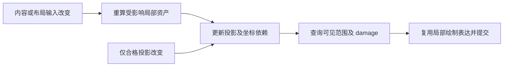

# FigureTree 内容、布局与投影分离

类型：`proposal`

能力归属：Core FigureTree／Runtime 拥有变更分类、依赖传播、局部资产、
坐标与帧发布；Core Graphics 拥有中立绘制表达；backend 拥有编码、
设备资源和实际栅格；platform 拥有输入与呈现。Editor 消费当前几何，
本方案不新增 Editor 能力。

日期：2026-11-05。状态：用户已授权按本文开始实施，整体验收未完成。
用户要求将纯投影分离的设计范围明确为整个 FigureTree。
既有文本采样是首个问题入口，不能作为通用 FigureTree 的验收证据。
设计阶段从需求与现行坐标／更新契约推导；授权后开始定向审阅 Rust 实现。

`api_semantics`：`figure.tree`、`figure.box.client_area`、`layout.manager`、
`validation.protocol`、`notification.ancestor`、`notification.layout_update`、
`paint.protocol`、`damage.repaint`、`viewport.scroll_zoom`、
`connection.figure`、`frame.preparation`、`render.backend_session`。

## 目标与现行依据

纯投影分离必须适用于任意合格 Figure 子树：形状、图片、文本、组合容器、
连接和外部 Figure 使用同一机制。已经生成且输入有效的局部内容，
不应仅因显示位置改变而重新测量、布局、准备或复制。

[坐标 SSOT](../coordinates/coordinate-system.md)已规定 bounds 属于 parent content
domain；移动 parent 不改写后代 bounds，只使 world transform 和 projected bounds
失效。[UpdateManager](../rendering/update-manager.md)也已区分 layout、transform、
style 有效性，并要求按实际 child measurement 依赖传播布局失效。
本方案将这些语义落实为通用成本与复用目标，不替换坐标来源。

Draw2D 的只读参考见[树坐标分析](../../reference/draw2d/figure/tree-coordinates.md)：
`Figure.setBounds` 区分 translate 与 resize；局部坐标根移动时，
`primTranslate` 通知坐标系统变化而不改写 children bounds。
Draw2D 仍可能重绘可见图形，这些事实不证明 GPU 合成或恒定帧耗时。

## 分开的状态及依赖

下表是职责分类，不是拟议的封闭公开枚举。
公开扩展继续采用 typed identity、payload trait 与 registry。

| 状态 | 包含什么 | 何时重算 |
|---|---|---|
| 局部内容与绘制资产 | shape/path、图片引用、glyph、border、局部 drawing 与命中形状 | 实际内容、样式、资源或已观察输入改变 |
| 布局与局部几何 | 尺寸、baseline、child placements、inline、约束相关布局 | 实际测量／布局依赖改变 |
| 场景投影 | edge transform、world transform、有效 clip、surface 包络 | placement、ancestor transform、viewport origin 或 clip 改变 |
| 坐标消费者 | 命中、选区、焦点、连接锚点、范围查询 | 其实际投影或几何依赖改变 |
| backend 状态 | 编码结果、设备资源、可选栅格资产 | 对应内容、设备、surface、资源或栅格条件改变 |

“场景几何改变”不能自动等于“局部内容改变”。但同一个值可能被多个消费者使用：
位置既可影响投影，也可被自定义布局、Freeform extent 或 Router 读取。
这些消费者仍需更新，不能因为事件叫拖动就跳过。

局部资产的复用依据必须覆盖完整实际输入、注册身份、约束及失败行为。
不能直接从现有 key 中删去 origin、component revision 或 bounds；
只有证明输出独立于这些字段，才允许将它们归入另一依赖域。
读取外部私有状态而未提供完整有效性依据的扩展继续保守重读。

## 不同拖动的行为

| 操作 | 应复用什么 | 仍须处理什么 |
|---|---|---|
| 固定 viewport 内平移整棵树 | 子树局部内容、布局、局部命中形状 | 投影、clip、可见范围、damage、当前坐标消费者和绘制 |
| 移动固定尺寸的节点或组合节点 | 合格节点及后代的局部内容、与位置无关的布局 | 新 placement、parent 的真实依赖、Freeform extent、受影响连接 |
| Editor 拖动预览 | 已有局部资产 | 表现投影和依赖的预览几何；正式提交仍遵守模型／命令契约 |
| resize、重新排列、reparent | 输入未变的资产部分 | 新约束／拓扑下的必要布局、坐标和路由 |
| post-layout visual transform | 满足完整资格的局部布局与绘制资产 | 投影、clip、命中映射及设备条件 |

ScalablePane／Zoom 的 scale 会参与 preferred size、child-content 可用尺寸和
RangeModel 反馈。不能把所有缩放直接归为最后一行；
只有实际布局约束保持不变的表现变换才有这种资格。
固定 viewport 的 pan 与窗口 resize 也属于不同输入。

移动节点时，连接不能整体套用同一个平移：跨子树连接的另一端可能不动，
Router 可能依赖其他障碍。应更新实际受影响的路由依赖；
无关节点的文本、图片与 shape 内容继续复用。

## 通用更新路径

纯投影路径不重新进入无变化节点的 measure、layout 和内容 preparation。
它更新变换边及其版本；后代的组合坐标按当前祖先版本按需计算或在实际访问时复用，
不先逐节点改写全部 descendants bounds，也不为每个输入事件全树展开 world 矩阵。
这种按需策略不能返回旧坐标，不能压缩或丢弃现行必需通知。

空间／包络索引应与局部资产和投影版本对应。移动整个索引域时，应尽可能更新域的
映射而保留域内局部索引；节点局部位置改变时，更新实际受影响的索引项。
未知墨迹、overflow、重叠和 clip 无法可靠转换时仍保守遍历或绘制。
不能以估计可见性遗漏像素或命中目标。

录制复用与布局复用是独立条件。只有 drawing 的完整输入、资源依赖和失败行为
有效时，才可复用已有局部绘制表达，避免再次执行同一 paint callback 或深复制。
未知 paint callback 仍执行；不能从“上一帧成功”推断下一帧必然无副作用或无错误。
既有 RenderSubmission 和 Graphics 边界保持；本方案不默认采用休眠的
DisplayList 协议，也不默认将整树缓存为一张纹理。

Frame preparation 的 input proof、资源与 session 检查、事务回滚及提交后通知继续
遵守[派生状态收敛](derived-state-convergence.md)。
要减少跨帧全量重读，必须有完整、可观察的实际变更与依赖依据；
一个全局 epoch 或通用“projection-only”布尔值不能赋予任意扩展免检查资格。

## 为什么首次渲染完成仍不保证任意拖动很快

首次渲染可生成局部资产并预热部分资源，不会自动留存可复用的录制、编码和像素。
保留路径也仍有可见输出的栅格与合成成本。
平移会暴露新区域；新资源、设备恢复、复杂效果和大量重叠内容可能增加工作。

因此要分别压低内容生成、坐标维护、可见范围查询、录制、backend 编码和栅格成本。
“布局次数为零”只是其中一项，不能作为流畅拖动的充分条件。
大量可见图形仍可能 GPU 受限，即使没有重新生成任何局部内容。

合格路径的成本应主要随实际变化的变换边、实际坐标查询、依赖消费者、
实际通知、可见绘制候选及输出规模增长。无资格扩展的重读另计。
不能承诺与可见图形复杂度无关的 O(1) 帧耗时；也不应无故随所有屏幕外节点、
文字字节数或整树深复制增长。

## 原属性级方案的地位

[按属性依赖限定布局重验](property-scoped-layout-revalidation.md)是辅助机制：
解决 scrollbar 或其他组件内部布局变化不必要地使祖先布局失效的问题。
它可以被任意外部组件使用，但不能单独解决整树投影、局部绘制表达复用、
投影索引、坐标消费者和 backend 成本。

因此不将 `revalidate_layout_for_property` 当作所有移动的统一入口。
投影分离的主边界应建立在既有几何／坐标变更及实际依赖上，
而不是要求所有 Figure 为滚动值逐一登记白名单。
该辅助方案的候选 API 需按通用方案重新复核，尚未接受或实现。

## 下一布局切片的具体边界

定向审阅确认，现行固定尺寸 bounds 平移已不直接调用普通 resize 失效；
多余布局反馈主要需要从实际消费者追踪，不能先把所有 bounds 变更改成局部请求。
当前验证队列出队会再次标记完整父链，布局输出中的 child resize 也会重新传播。
这两处与请求入口必须保留一致的范围事实，否则即时局部化不会产生持续收益。

现行布局读取记录还不足以给任意 callback 免重验资格：
`LayoutSceneQuery::children` 同时返回身份、顺序与完整 bounds；
manager 的 `invalidate` 可能清理私有状态；ScrollBarLayout 直接读取共享
RangeModel，而请求时的非 value guard 不覆盖实际布局使用的完整 value。
不能从“当前没有读取记录”推导“该输入与输出无关”。

因此下一片按[辅助方案的定向复核与执行顺序](property-scoped-layout-revalidation.md#定向复核布局私有输入必须进入证明链)
先给任意布局提供通用的受检私有输入读取，再实现静态依赖声明、局部队列和内部
输出边界。新输入查询复用既有 typed reader registry 与首次值证明；
没有 preparation capability 的 Figure 也必须能在 Runtime 布局中使用。
声明缺失、私有输入未被完整证明或条件变化时保留原传播。

这组新增公共查询和队列范围合同仍待具体确认，不等于总体实施重新等待授权。
它处理布局反馈，不替代后续按需投影、坐标消费者、局部绘制表达和 backend 工作。
外部混合容器与 ScrollBar 共用入口；验收分别保留纯投影与 resize、Freeform、
连接依赖的反例，不能从文字 cache hit 消失推断整个 FigureTree 已完成。

## 实施拆分与验收

2026-11-05 首片冻结为活动源状态交接：失败回滚仍保存完整派生前缀；
活动回调前的比较快照只保存参与 source rebase 的几何、布局版本、路由与
viewport 状态，不复制 preparation、输入证明或完整历史通知。
回调后直接比较当前节点，只将实际变化合并到原回滚前缀。
新增节点仍保存完整回滚状态，已删除身份不恢复；证明与 preparation
仍从原派生前缀恢复。这个切片不减少必需通知，不改变扩展输入检查有效区间，
也不将未知布局或 preparation 判为纯投影。
首片之后继续处理失效工作集；不得以交接复制下降关闭总体门禁。

工作集首步仅维护已准入能力的节点成员索引：以 descriptor 的 typed identity
为键，登记全部内置与外部 capability，随节点的保留、退休和准入失败更新成员。
活动和 clickable 查询从对应成员读取，仍检查当前 attachment、可见性和启用状态，
仍按原节点顺序调用每个真实消费者。索引不保存 callback 结果，不推断私有输入有效，
也不按节点类型跳过布局、preparation 或 invalidate。节点仅卸载时保留成员，
真正退休或准入失败时删除；重新使用 arena 槽位不能恢复旧身份。
Layout 之后若活动成员为空且没有待提交 mutation，就不构造活动源比较快照。
存在任一活动 descriptor 或 mutation 时仍保存该边界；
不从可见性、下次唤醒时间或 callback 曾经无 effect 推断此次也没有源写入。

先冻结通用变更与依赖边界，再定向核对实现；本轮不改渲染主循环。
后续拆分顺序是：失效分域与受影响工作集、按需投影及坐标消费者、
局部绘制表达与可见录制、backend 编码及可选栅格复用。
属性级局部重验按必要依赖插入，不能取代上述主线。
这不是新增并行 Execute，状态仍由唯一 P2 backlog 维护。

验收至少包括混合 shape／image／text 的大树、单个大组合节点移动、
嵌套 viewport、Freeform 节点移动、跨子树连接、外部 Figure／布局／drawing、
resize／reparent、私有输入变化、注册退役、预算失败和设备恢复。
分别测试固定可见规模增加屏幕外节点，以及增加全部可见内容；
前者检查全树成本泄漏，后者评估真实输出瓶颈。

每个切片沿用冻结产物与匹配前后输入，记录关闭 tracing 的
input／stabilization／recording／encoding／GPU wait／端到端 P50、P95、P99。
Perfetto 单独核对受影响节点、measure／layout／prepare／paint 次数、
坐标访问、通知、分配、command／glyph 与 backend 工作量。
合格纯投影场景的未变化局部内容不再生产；真实依赖与不合格扩展仍正确更新。
文本专项采样和次数不能替代整树性能与正确性验收。
