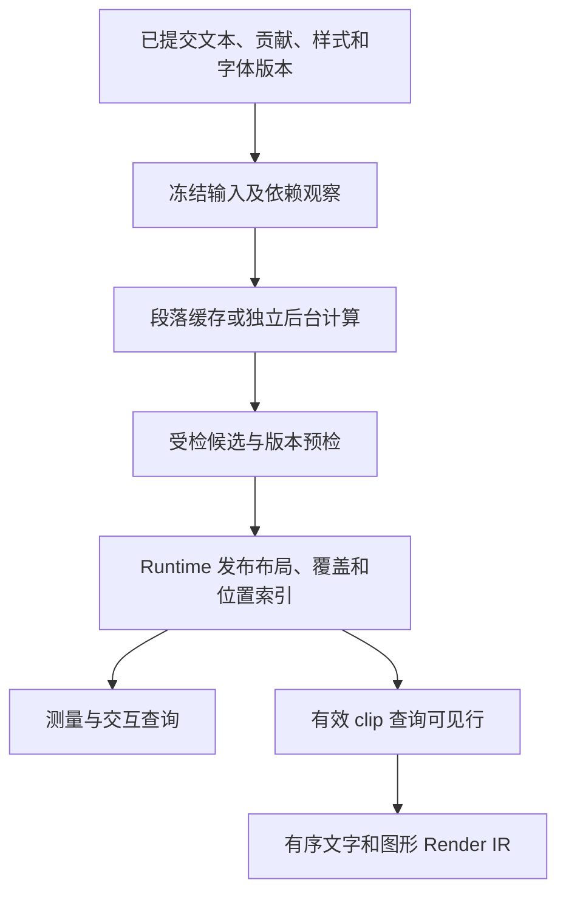
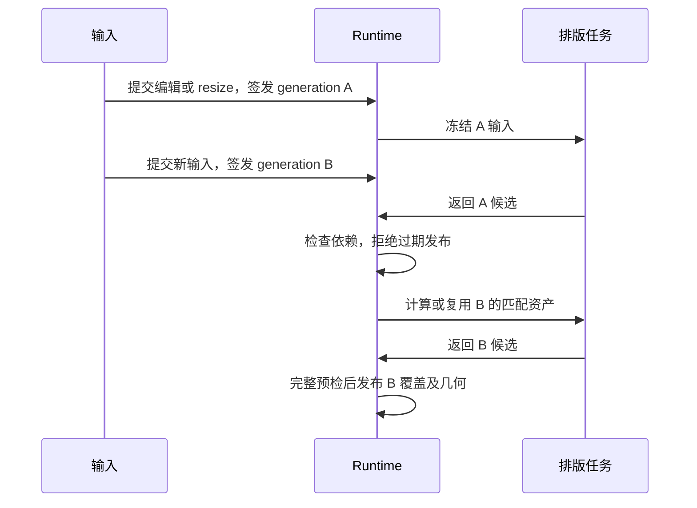

# 长文本性能优化方案

类型：`proposal`

日期：2026-10-27。修订：2。设计状态：LT-00～LT-03 复核通过。首批实施状态：`in_progress`。

用户已批准首批实施，当前契约增量见 [ADR-051](../../adr/adr-051-exact-flow-layout-reuse.md)，
状态与证据见[实施记录](../../verification/reviews/long-text-performance-implementation-2026-10-27.md)。
LT-04～LT-09 保持独立评审，本方案的性能目标与平台呈现验收尚未通过。

2026-10-28 的[滚动与 resize 优化提案](long-text-scroll-resize-optimization-proposal.md)
记录共享 IR、原生可见输出、宽度复用与后续调度的审核方案；
新增目标和实施顺序待用户审核，不改变本页首批授权或既有验收状态。

修订 2 按[方向评审](../../verification/reviews/long-text-performance-proposal-review-2026-10-27.md)
处理 LTP-R01～R05。方向有条件通过不等于整体实施批准；
本文“评审响应”记录设计处理，原评审结论和基线保持不变。

本方案从长文本需求、Draw2D 文字流契约和既有测量事实出发，定义目标架构与实施顺序。
方案编写阶段未重新扫描本项目 Rust 实现。本文拟定类型、接口角色和切片均不表示已经实现；
获批后再定向审阅实现、形成最小 ADR 增量并登记执行队列。

本文是长文本性能设计的当前提案入口，承接并取代
[10 月 23 日初步提案](textflow-performance-proposal-2026-10-23.md)的方案职责。
原始测量事实由[10 月 26 日分析报告](../../verification/reviews/textflow-large-performance-analysis-2026-10-26.md)
保存；当前已接受的运行时语义仍以 ADR 和规范文档为准。

## 目标与交付范围

目标是让文本工作的成本与真实变化和可见输出对应：
局部编辑只重算必要段落，纯滚动只查询和提交可见文字，后台任务不阻塞 UI，
已发布的布局、文字绘制和交互始终使用一致的来源与版本。

采用两种显式消费模式：

| 模式 | 消费场景 | 几何合同 | 交付顺序 |
|---|---|---|---|
| 精确文字流 | 官方样例、富文本标签、带真实内嵌 Figure 的文档 | 全文布局完成后发布；全文尺寸和来源几何精确 | 首批必交付 |
| 渐进文档视图 | 大型日志、代码或长篇阅读视图 | 已布局覆盖范围内精确；范围外显式未就绪，估算滚动高度另存 | 后续独立增量 |

两者共用受检布局资产、来源映射、可见绘制和错误通道。
渐进模式需要显式准入，不能通过文本长度自动改变原有 TextFlow 的测量语义。
精确模式也可以在后台计算，但需要完整结果才发布新稳定场景。

首批覆盖初始化、段落缓存、共享数据、来源索引、可见绘制与性能证据。
后续覆盖后台排版、渐进覆盖、位置摘要树、紧凑文档来源。
glyph atlas 或其他字体 shader 后端作为条件性研究项，不作为首批依赖。
富文本编辑器、剪贴板、搜索产品和平台原生文字控件不属于本方案交付；
既有 Editor/IME 只消费本方案提供的几何和版本合同。

## 基线与成本判断

10 月 26 日的 release 探针使用原样例工厂，未创建窗口/GPU。
环境为 Apple M1 Pro、macOS、rustc 1.94.1；同一进程内三个独立 Runtime。

| 指标 | TextFlowLarge 基线 |
|---|---:|
| 来源规模 | 40 段、501 个文字来源、51232 字节 |
| 输出规模 | 561 行、1022 个 styled run、4168 个 fragment |
| 场景构造 | 5.589–31.375 ms |
| 首次稳定布局 | 419.118–422.091 ms |
| 单字符追加并稳定布局 | 164.741–184.221 ms |
| 无变更稳定查询 | 1.818–2.244 ms |

debug 前两次首次布局约 11.6–11.8 秒，适合确认阻塞；
debug 场景曾并行运行，不能与顺序 release 场景计算严格加速比。
上述数据不是冷启动首帧、滚动帧或统计尾延迟。内部函数级耗时占比未测得。

已有源码分析指出全文测量重建、整页缓存失效、逐来源扫描全部片段、
按 run 复制整段文本和行指标、示例完整复制快照、重复 cluster 扫描及全文绘制。
这些是优化候选，实施前用分阶段计时与计数确定实际顺序。
不能因为字体文件较大就判定它主导了本次等待，也不能用 GPU 加速代替 CPU 成本分析。

## 核心决策

| 设计决定 | 采用方式 | 理由 |
|---|---|---|
| 文本来源与绘制单位分离 | 来源身份稳定；段落、行、run 是派生单位 | 保留跨来源 shaping、命中和生命周期，避免逐字符 Figure |
| 局部布局与页面位置分离 | 缓存段落局部结果，页面维护位置摘要 | 首段增高不重算其余段落 glyph |
| shaping 与换行可分离复用 | 支持该能力的引擎注册受检分阶段输出；其他引擎走完整布局 | resize 可复用，但不强迫所有引擎暴露内部状态 |
| 数据不可变共享 | 布局主体共享，绘制分片引用范围 | 避免每个 run 复制全文与全部行指标 |
| 记录前筛选可见内容 | 通用有效 clip 查询加段落/行索引 | GPU clip 无法消除此前的 CPU 生成成本 |
| 排版完成与场景发布分离 | 后台产出 owned 候选，Runtime 预检后发布 | 保护来源、几何、通知与帧因果顺序 |
| 精确与估算几何分离 | 精确覆盖快照与估算滚动摘要不同类型 | 避免估算位置进入交互和布局事实 |
| 文档规模与树规模分离 | 海量视图使用紧凑来源 provider，真实内嵌 Figure 仍有树身份 | 避免百万节点的全树成本 |

这里的分阶段能力与 provider 均通过 typed identity、payload trait 和实例 registry 注册；
内置和外部实现使用同一准入与受检输出，不按具体 Figure 或引擎类型选择特权路径。

## 状态所有权与因果顺序

| 状态 | 所有者 | 可写阶段 |
|---|---|---|
| 文本、样式、段落结构与真实 Figure 拓扑 | 当前 source owner；Figure 由 Runtime mutation 管理，外部文档由宿主模型管理 | 明确的源更新；外部模型更新经同步边界引入 |
| 冻结贡献及文档输入 | Runtime 范围的文字服务 | 捕获输入时创建，之后只读 |
| shaping、行布局和索引缓存 | Runtime 范围服务；后台 worker 有独立计算上下文 | 受检候选计算与缓存安装 |
| 稳定 Flow 快照、child placements 与依赖观察 | Runtime | 一次完整受检发布 |
| caret、selection、preedit 的源位置 | Editor session 或宿主控制器 | 输入/命令阶段 |
| 本帧可见集合 | 绘制阶段只读视图 | 从已发布快照查询，不修改布局 |
| glyph GPU 资产 | backend session | 后端同步、上传与释放 |

后台线程不持有附着树、Runtime 可变借用或源组件可变引用。
服务缓存不是第二份文本权威；它只保存已冻结输入与可丢弃派生结果。
外部文档的 revision 同步不会赋予 Core 任意模型写权限。

图 1 展示数据依赖。后台和前台使用相同候选合同，只有 Runtime 发布结果。



图 1：输入冻结、候选校验、场景发布和可见绘制按因果顺序分开；缓存完成不等于帧已呈现。

## 数据模型与来源身份

以下是拟定的内部数据角色，不冻结最终公共 struct 名称：

```text
FrozenFlowInput
  owner namespace + source revision + request generation
  persistent paragraph order
  per-paragraph contributions / style / border / inline dependencies
  immutable text slices + font resolution generation

ParagraphAsset
  validated input identity
  shared shaped glyph / cluster data
  local lines + source intervals + inline placements + border fragments
  local logical metrics + layout revision

InkAsset
  layout/glyph instance reference + outline provider revision
  checked local ink envelopes + bound provenance

PaintEnvelopeSnapshot
  ink/layout references + paint/coverage dependencies + projection generation
  checked conservative paint envelopes + overlapping interval summaries

PublishedFlow
  source revision + publication generation + dependency certificate
  persistent paragraph references + position summary
  matching ink/paint snapshots + culling index + old/new damage inputs
  exact coverage + source/paragraph lookup
  checked placement output for real attached Figures

VisibleTextView
  published snapshot lease + effective clip
  visible paragraph/line ranges + ordered paint pieces
```

段落身份不能只用 owner FigureId：同一 block 可能贡献多个段落。
采用 owner/provider 命名空间内的受检稳定段落 token，带来源代次。
外部 provider 能提交稳定 token；未声明稳定 token 的贡献路径允许保守重建，
不能推断其分段序号永远稳定。段落 split/merge 产生新身份并保留显式位置变换。

首批来源继续使用 ADR-042 的 FigureId 和 source-local UTF-8 offset。
来源移出、reparent、style inheritance 或字体依赖变化时重新验证相应范围。
旧快照保存的 ID 只是历史身份，重新进入 live query 时仍检查 owner 和代次。

海量文档另引入紧凑来源 provider：持有不可变文档快照，按范围贡献段落，
用受检逻辑来源身份保存 source-local UTF-8 位置。
其身份包含 provider owner、文档身份和代次，不能伪造 FigureId。
现有 Figure 来源通过同一 typed source resolver 接入；resolver 负责可选的事件目标、
tooltip、accessibility 和源位置转换。没有 Figure 目标是合法缺失，不凭空创建节点。
相关位置 API 需要独立 ADR 增量；首批不改变现有 FigureId 位置签名。

Rope 或 piece tree 可由 provider/模型自行采用，Core 接收共享只读切片，
不要求每个消费者增加第二份可编辑 Rope。若引擎需要连续段落文本，只在该段落
缓存未命中时拼接一次。读取文档与首次建立来源索引至少仍需处理实际输入字节，
首屏时间可通过范围 provider 改善，全文解析时间不会成为常数。

## 布局与失效模型

布局划分为贡献捕获、shaping、换行、段落片段生成和页面位置组合。
既有完整 styled layout 引擎可继续一次完成中间各步。
可分阶段引擎必须通过公开的受检资产构造器注册能力，不暴露 Parley 对象或无类型 blob。

| 层级 | 依赖键 | 不应进入该层键的输入 |
|---|---|---|
| 贡献捕获 | 局部来源/结构版本、继承样式观察、handler 版本、border 与内嵌测量依赖 | viewport origin、surface 大小 |
| shaping | 段落内容与顺序、script/bidi、字体解析与变体、影响 glyph 的 style、引擎算法版本 | 单纯文字颜色、全页 y、滚动位置 |
| 行布局 | shaping 资产、有效宽度、wrap、alignment、tab、行距、inline 实际尺寸和 baseline | 全页 y、与度量无关的 paint |
| 来源/边框局部几何 | 行布局、来源映射、边框度量及首尾关系 | 页面全局偏移 |
| 页面位置 | 段落顺序、局部高度、嵌套盒、margin 折叠和 padding | 字形数据内容复制 |
| 绘制样式 | glyph/fragment 引用、颜色、opacity、stroke、AA、绘制资源版本 | 不相关的布局输入 |
| ink 包络 | glyph 及实例变换、实际 outline/provider 版本、变体与 synthesis | 不影响轮廓的颜色及 clip |
| paint 包络与索引 | ink、描边/效果、border renderer、AA/设备覆盖规则、DPI 与相关变换 | 不影响覆盖的布局输入 |
| 可见查询 | 同次发布的 paint 索引、位置投影、当前有效 clip 和 transform | 内容重新 shaping |

宽度是否独立于 shaping 由引擎 capability 声明。
会按宽度改变 shaping 的引擎必须把宽度纳入相应键；无法证明可分离时使用完整布局。
同一能力必须能由外部引擎注册，不能为 Parley 硬编码宽度复用。

字体 key 先使用完整 font/fallback generation，保证正确失效。
后续若建立细粒度依赖，必须同时记录命中字形字体和曾参与 fallback 的查找缺失，
否则新增字体可能改变结果却未失效。后台上下文必须绑定相同集合和 fallback 顺序。
不同注册实例只在内容及实例语义证明确实相同时共享计算资产；
Render IR 的资源身份仍在发布时受检映射，不能跨 Runtime 直接复用 live FontId。

| 输入变化 | 必须重算 | 可以复用 |
|---|---|---|
| 首来源追加 | 所属语义段落及真实依赖的 shaping、行和局部映射 | 其他段落资产 |
| 颜色/opacity | 新绘制样式和对应 revision | 已证明不受影响的 glyph 位置和测量 |
| 宽度 resize | 受影响段落换行及 inline 二次测量 | 支持分离能力的 shaping |
| 纯滚动/平移 | 可见集合、surface 映射和 damage | 段落布局、来源片段、全文尺寸 |
| 字体完成/替换 | 依赖该解析集合的 shaping 与几何 | 无依赖段落；首版可保守失效全文 |
| reparent/段落 split/merge | 贡献结构、继承、受影响段落和边框 | 依赖未变化的其他段落 |
| 边框度量/inline 尺寸 | 所属段落和关联盒布局 | 无依赖段落与纯 paint 数据 |
| outline provider 替换，glyph/advance 不变 | ink、paint 包络、索引和 old/new damage | 布局、baseline、caret/selection |
| 描边、边框绘制扩张或效果改变 | paint 包络、索引和 old/new damage；影响度量时另重排 | 不受影响的 shaping/行布局 |
| AA/DPI/设备覆盖规则或相关变换改变 | 相应 paint 包络/投影、索引证书与 damage | 仍有效的逻辑布局及纯轮廓 |
| surface session reset | 后端资源与 GPU 资产 | 仍匹配字体版本的 CPU 布局 |

首段高度变化可以影响所有后续位置，但不要求所有后续文字重新 shaping。
嵌套 block、margin 折叠、跨段边框和真实 Figure 依赖会扩大位置/几何失效范围，
不能笼统承诺“任何编辑都只影响一个段落”。

同输入、同约束的测量和准备复用受检 ParagraphAsset。
测量返回 Dimension/MeasureConstraints 等领域结果，不发布 child bounds。
外部测量依赖观察必须随缓存证书保留，并在复用时参与 Runtime 的依赖准入；
不能因结果命中缓存而隐去实际读取的内嵌或路由依赖。

## 布局、墨迹与绘制包络的发布合同

LayoutAsset 指 ParagraphAsset 中的受检逻辑布局部分，
只证明逻辑尺寸、行断点、glyph 位置与交互映射。
InkAsset 描述实际选择的轮廓及实例变换后的范围。
PaintEnvelopeSnapshot 再包含描边、边框、效果和栅格覆盖扩张。
三类数据分别携带依赖证书；新 ink/paint 快照可以引用旧 layout，
不能因为 layout revision 未变就跳过视觉包络失效。

轮廓变化而 glyph ID/advance 保持相同时不重新 shaping。
如果 provider 改变了 glyph/advance 或布局度量，必须走文字引擎的布局更新合同，
不允许以纯 paint 更新掩盖。
外部 border renderer 的绘制版本和保守范围同样是依赖，
度量未变而绘制越界时只更新 paint；度量变化则还需更新行布局。

设备覆盖使用后端声明并通过准入的保守规则。
screen-space 栅格扩张按当前 surface/DPI/transform 解释；
不能把固定逻辑像素 padding 当作所有变换下的覆盖界。
规则不存在或无法可靠换算时，使用整个语义祖先 clip 或 active surface 作为保守范围，
并请求相应完整修复；不能以依赖旧窄包络形成的 damage 区域反推新包络。
无法得到有限保守范围时不做 CPU 剪枝，不保留已失效的窄索引继续筛选。

发布顺序为：

```text
捕获旧已发布包络、投影及 surface 输入
→ 复用或计算 layout，准备实际 ink 和 paint 候选
→ 构建或更新重叠包络索引
→ 校验范围、依赖与 provider/设备版本
→ 在 Runtime 当前输入前缀再次预检
→ 一起安装新包络、索引及对应 old/new damage
→ 稳定状态晋升后录制；按正常协议提交和确认帧
```

old damage 按旧包络的旧投影解释，new damage 按新投影解释，
再进入同一有效 surface 的 damage 合并；不以新 transform 重算旧区域。
surface 身份/尺寸变化沿现有完整修复合同处理，不合并不同 surface 的坐标。
索引与包络来自同一发布 generation，paint-only 更新也不能保留旧索引。
候选失败不安装其部分索引或 damage；已提交源 mutation 不承诺回滚。
已冻结的在途帧继续使用旧快照与 lease，不因后续更新而改写。

轮廓可见准备必须先有适用于实际 provider 的保守筛选依据。
已校验轮廓资产可直接给出 ink；可复用范围证书必须绑定同一 provider、
字体实例、glyph/变体与版本，并有受检几何或可验证的覆盖依据。
只检查声明数值有限，不能证明该范围包含尚未生成的任意替代轮廓。
没有有效证书时先准备该集合全部必要轮廓并取得范围，
或将未定范围保守标为不可剪枝、安排完整准备；尚未准备完成则返回 NotReady/领域失败。
不能先用默认字体轮廓过滤，再向可能生成更大轮廓的 provider 请求幸存 glyph。
实际轮廓越出声明证书时拒绝本候选并失效证书，不静默裁掉越界部分。
外部 outline provider 和 fragment border 使用相同规则。

R02 反例须覆盖纯 outline 替换、描边扩张/收缩、AA/DPI 覆盖变化、
外部边框越界及旧/新投影不同的更新。
对照不做 CPU 筛选的精确路径，检查新增墨迹出现、旧区域清理、
布局/交互未漂移及 Full/Partial 像素一致；结果仍待实施验证。

## 索引与共享资产

首批建立 source → 段落/fragment 范围、段落 → 行、行 → run/border、
source → inline placement 和 membership 索引。
构建时按真实输出扫描一次，查询时不为每个来源遍历全文。
fragment 顺序、祖先来源关系、空白区域和空段落身份保持原语义。
来源到行的定位区分 logical range 与 visual cluster，不能把 RTL 视觉顺序当作字节顺序。

glyph 数据、文本切片、行指标和交互 provider 使用不可变共享资产。
绘制分片保存共享资产及受检 run/glyph 范围、paint 与局部 origin，
不为每个 run 复制整段 TextLayout。切片不能切断 glyph 或 cluster 的语义映射。
外部引擎从同一受检构造器生成资产；首次构造验证完整输入，
后续切片只校验范围和资产证书，不重复验证整段全部 glyph。

cluster 索引记录 glyph 区间、source UTF-8 范围、方向和逻辑/视觉关系。
用单次扫描或受检索引查询生成跨行 run 的来源范围；
ligature、组合字符、双向重排和一对多映射不得以平均字宽或字节数推算替代。

40 段场景先用有序数组保存逻辑位置；二分仅用于逻辑位置/文字查询。
绘制候选不能由逻辑行二分加固定邻近窗口推出：
逻辑行有序不表示 ink/paint 区间的上下界有序。
字号、负 bearing、跨行边框与变换可能造成跨行、跨段重叠。

首批为稳定绘制序列建立层次包络索引。叶子记录 line/run、边框或其他绘制分片
的保守 paint envelope；内部摘要是所有后代包络的保守并集。
只有摘要与当前查询区域明确不相交，才能剪掉整个子树。
递归访问相交摘要的子节点，到叶子再检查范围，保留原绘制顺序。
未定范围使用不可剪枝标记；空范围与未知范围不是同一种状态。
段落级摘要必须包括跨段边框的实际归属和包络，不能先按段落逻辑盒排除它。

该索引支持重叠区间，不依赖 lower/upper bounds 单调。
数组规模较小时允许线性扫描全部 envelope，作为简单且正确的实现；
不将其描述为输出敏感算法。大型索引维护逻辑顺序与包络摘要，
更新时校验所有受影响祖先并集。高度摘要和 paint 摘要用途分开，
不能用累计行高代替绘制包络。

大量段落使用持久化的高度摘要树，每个摘要保存受检总高度、段落/行数量、
已布局覆盖及必要的边界 margin 信息。更新局部段落时替换对应路径，
通过前缀高度定位 y 与来源，避免逐项重写后续全局 y。
嵌套 margin 摘要必须按真实盒模型组合，不能简单求和。

高度索引不消除真实 attached Figure 的 geometry 发布成本。
精确模式中若 K 个真实后代需要新 bounds，仍至少支付 O(K) 的受检写入。
海量模式使用逻辑来源及惰性位置查询减少 K，不用零尺寸占位 Figure 伪造几何。

## 消除隐藏的全文成本

可见绘制生效后，还必须核对贡献遍历、revision 计算、依赖观察、候选验证、
发布容器复制和通知生成。否则每次输入仍可能具有 O(N) 或更高的全文成本。

局部输入证书由 Runtime 的 typed committed facts 和依赖反向索引更新。
新增、删除、继承样式、资源查找、边框 handler 版本和内嵌测量均进入证书，
不能只使用调用方自行提供的 hash 或整页 source revision。
hash 用于查找；命中仍核对受检依赖身份和完整版本，不把 hash 碰撞视为输入相同。

共享资产在构造时完成验证。增量候选只重新校验新增资产、改变的依赖和位置，
并校验新组合根的证书。存在性、parent-child 关系和数值溢出仍由 Runtime 校验。
被复用的旧资产有不可变有效证书，不提供内置 unchecked 路径。

现有 Figure 来源路径仍可能支付必要的子树遍历成本。
获得亚线性的全文输入更新，需要稳定段落版本和范围贡献能力；
不能靠跳过外部 contributor 或漏掉继承依赖达到性能目标。
复杂度报告必须分别列出 B 字节文本、N 段、K attached Figures、
F fragments 和 V 可见输出，不能只写“渲染 O(V)”。

## 可见绘制与通用坐标边界

PaintContext 增加只读、backend-neutral 的有效绘制区域查询角色。
返回的是当前累计 transform/祖先 clip/当前修复区域所约束的保守局部区域，
不暴露 recorder、damage 可变引用或后端 handle。
路径 clip 可返回保守包围区域；没有有限裁剪范围显式返回 unbounded；
空裁剪显式为空区域。坐标无效返回几何错误，不把失败当作空内容。

不可逆或数值不可靠的转换不能导致误裁剪：
可在已验证的 surface 空间用正向 paint envelope 做保守筛选，
或放弃 CPU 筛选并依赖最终 clip；不使用恒等矩阵伪造逆映射。
裁剪查询不允许扩张祖先 clip，不引入 resetClip 逃逸。

沿保守包络摘要查询段落、行、run、边框与装饰。
设 H 为实际访问的摘要节点数，C 为实际检查的候选叶子数，
V 为最终实际记录的 glyph/primitive 数；查询及枚举按 O(H + C + V) 报告。
一个候选 run 内额外检查却未记录的 glyph/cluster 数另计为 G，
不能把线性扫描大 run 的成本隐藏在一次叶子检查里；
实际筛选加录制按 O(H + C + G + V) 及相应变换/资源开销报告。
包络严重重叠或范围未定时可能扫描全部 E 个条目，
索引枚举最坏为 O(E + V)，含 run 内筛选时为 O(E + G + V)。
不能仅凭逻辑行有序承诺 O(log 行数 + V)；
如后续采用具备该保证的区间索引，必须另证算法前提并计入候选误命中。
统计分别记录摘要访问、候选检查、最终可见输出和回退扫描。
使用 paint envelope 而非仅 line box，
包含负 bearing、glyph ink、轮廓/描边扩展、边框和装饰。
不能靠固定 overscan 行数保证越界字形不被误裁剪。

R01 反例使用逻辑行/段落盒在屏外而墨迹进入屏内的输入，
包括超大字号与附加符号、负 bearing、跨行/跨段边框重叠，
以及缩放、旋转、shear 和变换更新。
与关闭 CPU 筛选的同版本精确路径比较，不能出现漏画；
同时检查 C、H 与重叠度增长，不能用 V 小推断实际查询成本小。

保留文字、背景、边框、真实 Figure、选择高亮和 caret 的正常合成顺序。
批处理只合并顺序连续且 paint、transform、clip、字体及 AA 等输入兼容的分片，
不能为了少提交而重排不同颜色、透明度或内嵌图形。
预取窗口只提前计算资源/布局；真正的命令记录仍按有效可见区域筛选。

纯滚动不重新 shaping，不重建全文 fragment 或全页快照。
可见索引只改变本帧输出，不修改 text visible range 或伪造 truncate。
旧/新可见包络参与既有 damage；滚动、resize 与动画使用相同坐标查询，
examples 不手动减滚动偏移。

## 后台计算与宿主驱动

后台执行器在 Runtime/Host 实例范围内显式注入。
worker 有独立 text context，资源以不可变字节与版本共享；
不在整份任务期间持有前台字体、缓存或 Runtime 锁。
cache lookup/install 的短临界区不包围 shaping、外部 callback 或结果校验。

任务签发时携带 owner、来源/段落版本、字体集合、约束、依赖观察及 request generation。
候选返回后先低成本检查 owner 和请求代次，丢弃明显过期的发布请求；
有复用价值的纯资产可在预算内另行校验。发布候选校验完整资产及组合结果后，
再在当前 Runtime 前缀核对依赖与身份，避免校验期间的新输入被旧候选覆盖。
resize/编辑更新 generation；取消是节约工作手段，提交时拒绝 stale 是正确性保障。
过期任务允许留下依赖匹配的可复用纯资产，但不能提交旧 placement 或交互 revision。

优先级依次为用户当前目标及可见缺口、邻近预取、精确全文补全、低优先缓存维护。
正在执行的语义任务不被任意截断；调度点位于可验证的段落或算法检查点。
连续输入按最新目标合并派生工作，源 mutation 与通知仍保持 FIFO，
不能把中间源更新合并掉而改变输入语义。

| 平台能力 | 执行方式 | 约束 |
|---|---|---|
| Native | 实例 executor 与有限 worker | 完成通过 Host wake 进入前台，不等待 worker 锁 |
| Web 有 worker | 独立 worker/Wasm 上下文 | CPU 对象不能直接共享时按传输协议复制；测量传输及重复字体成本 |
| Web 无 worker | 可让出的段落或算法步骤 | 每个同步单元必须有界；单个不可分离巨段不承诺预算内完成 |
| 外部引擎不能跨线程/分步 | 前台受预算调度的同步能力，或显式不支持异步 | 不用隐藏线程或类型 downcast 伪造能力 |

异步工作的 pending 状态通过文字准备领域结果及 Host wake 协议表达，
具体 API 需在 ADR 中冻结。前台准备不阻塞等待全文。
现有同步稳定查询保持其精确语义；新增非阻塞查询返回明确 NotReady，
不能用空快照成功替代，也不把正常排队状态当作 Runtime fault。

Host 应持续处理输入，只在有新覆盖、位置、资源或 damage 时申请帧，
不能因存在后台任务而无条件忙循环。暂停时停止预取；
dispose 取消任务并释放 owner lease；候选即使晚到也不能复活已释放 owner。
恢复时核对当前输入；device reset 不自动丢弃仍有效的 CPU 字形资产。

## 精确模式长期等待与输入准入

LT-05 的默认选择是继续等待同一 Runtime 的整体稳定，
不增加局部帧或分区域通知出口。一个精确 flow 尚未完成时，
该 Runtime 的新 stable epoch、surface 帧和 committed notification 均暂不发布。
无关内容可按准入规则提交源更新，但同一 Runtime 中也不能单独呈现；
独立 Runtime 和宿主自身 UI 可以继续更新。
若产品需要同一 Runtime 内无关区域持续呈现，必须另行评审局部稳定范围，
不能在 LT-05 中暗中放宽；LT-06 的覆盖能力也不自动授予全场景任意局部发布。

| pending 期间的操作 | 规定行为 |
|---|---|
| Host 事件循环、任务完成、暂停/取消/dispose、合法资源确认 | 持续处理；控制/完成通道保留预算，不依赖新稳定几何 |
| 已验证 live 身份的纯 committed source/结构查询 | 读取当前已提交事实，不触发稳定化或通知 flush |
| 基于源位置的编辑/命令、与几何无关的源更新 | 容量足够且未进入收敛阶段时可准入；产生通知仍保留 FIFO |
| 当前稳定几何、hit、caret、selection 或布局测量 | 未就绪时返回 NotReady/NotStable；旧 owned 快照明确带旧版本 |
| 依赖旧画面坐标的指针目标与拖拽 | 不把旧几何解释为新源位置；交给 session 明确等待/拒绝，不自动重放 |
| 新 surface submission | 返回可观察的等待结果，后端保留旧已呈现帧 |

纯 source getter 的成功不表示当前场景已经稳定。
IME/session 可以保存尚未提交的源位置意图；accept/command 的准入结果必须可观察。
Host 不把尚未提交的输入报告为已提交成功，也不根据旧文字坐标猜测新目标。
同步文本路径不因该新增异步策略改变原有语义。

通知容量按条目与 payload 字节同时计量。
启用异步精确模式时，源更新在写入前为声明的源事实、effect 和必要的派生通知
完成预算预留；未知上界的扩展输出须按受检批次计量，不能先改源状态再发现没有通知空间。
容量不足返回结构化 SourceAdmissionBackpressure，拒绝的是尚未提交的操作，
源状态、revision 和 journal 均不改变。该准入属于待批准的 LT-05 增量，
不宣称现有 Runtime 已经提供这一入口。
已提交通知按原 journal 保留；合并派生任务不合并或丢弃源通知。

Host 对尚未准入的输入只允许显式、有界缓冲；
满时显示等待/暂停输入并返回未接受结果，不能无界缓存按键或静默丢掉已接受输入。
外部模型已发生的变化仍由模型保存，Runtime 同步拒绝后保留明确的待同步版本，
不把该版本说成已经在 Runtime 提交。输入管道的 ACK/重试与缓冲合同在 LT-05 ADR 中固定。

等待状态包含当前目标 generation、等待原因、未发布通知占用、
可准入容量、任务状态及进入收敛的原因。Host 能读取此状态，
它是 owner 的驱动/诊断结果，不是提前 flush 的源通知。
容量水位、最长连续合并时段和收敛期限均由有界配置给出，在 LT-00 冻结场景预算；
不能靠 worker 数量上限代替 journal 或输入容量上限。

持续输入时允许把纯计算任务转向最新已准入 generation。
到达通知容量水位或合并时段上限后进入收敛阶段，
暂停新的源操作准入，为当前已提交前缀完成精确布局。
任务必需的依赖完成使用预留通道；若改变目标版本，则在有界剩余预算内重新签发，
不能因新的外部输入不断覆盖收敛目标。
停止输入且依赖就绪时，完成最后已提交前缀，按既有稳定化顺序发布，
再依 FIFO flush 全部已保留通知，释放预留并恢复新输入准入。
无关源更新已准入的事实也按同一稳定前缀出现，不能越过更早通知。

若必需资产无法容纳、算法失败或收敛期限耗尽，
精确完成请求转为带原因的终态 Failed，不无限返回 pending。
不晋升 stable epoch、不清空已提交通知；继续限制源准入，
Host 可通过调整预算、修复依赖/输入或显式重试创建新请求。
受限失败不等于 Runtime fault；callback panic 仍遵守原有 fault 边界。

R03 验收需反复使任务过期并同时修改无关区域：
观察事件循环可响应、同一 Runtime 没有部分新帧、旧几何不用于新命中，
journal/Host buffer 有界、被拒绝操作无源写入；
停止输入后最后前缀收敛，全部已提交通知按 FIFO 出现。
不能以“成功取消 worker”作为持续输入或通知积压验证的替代。

## 超长单段与换行算法

大量短段与单个巨段是不同问题。段落级缓存只能解决前者的局部更新；
一个超长段落的首次 bidi/shaping 至少需读取相应文本，
首屏优先策略不能保证绕过全部上下文依赖。

默认保留语义段落整体 bidi 与必要的 shaping 上下文。
UTF-8 边界、grapheme 边界或固定字节块本身都不足以证明可独立 shaping。
不得随意分割 Arabic joining、ligature、组合字符、方向嵌入或 fallback 上下文。

巨段优化分为可独立验证的步骤：

- 先消除跨行反复扫描 cluster 和按 run 复制全文，建立行/run 索引。
- 分离全段 bidi/字体解析、受检 shaping 资产与行布局，能复用时避免 resize 重新 shaping。
- 行布局缓存 checkpoint 保存输入资产版本、当前位置、累计度量及必要的行上下文。
  编辑后从有效 checkpoint 重排，仅当断点和完整上下文状态收敛时复用后缀。
- 增量 bidi/shaping 或有上下文的块处理仅在算法提供安全边界和等价证明时注册。
  不具备该能力的引擎按整段处理；Native/worker 可维持 UI 响应，
  Web 无 worker 时显式报告任务粒度无法满足预算。

布局工作预算包括读取、shaping、输出验证与数据复制。
只有函数外面的时间检查而函数内部仍处理整段，不能称为可让出的排版。
超长 NoWrap 行另需横向 cluster/run 区间查询，避免只做纵向行筛选。
RTL 非单调源顺序使用视觉区间索引；不假设 glyph 按 UTF-8 offset 单调排列。

## 渐进布局、滚动与稳定覆盖

渐进模式发布的是“某来源 revision 下覆盖范围明确的文档视图”，
不是把未完成全文冒充已经完成的普通 FlowSnapshot。
覆盖状态区分 Exact、Pending 和有领域原因的 Failed；
估算高度由独立 EstimateSummary 保存，不进入精确 ParagraphAsset。

Exact 表示段落局部行/glyph 几何和本次已发布视图映射精确。
若此前段落仍有估算高度，当前段落在最终全文坐标中的绝对 y 尚未确定。
因此源位置到当前 surface 的查询可以在精确局部资产和已发布投影下成功，
请求最终 document y 或全文 extent 时则必须等待相关前缀高度精确，返回 NotReady。
投影 generation 与局部 layout revision 分开保存；补全前缀只更新投影和锚点，
不能把变化后的最终 document y 偷换成先前已经精确的事实。

精确模式继续要求完整工作队列收敛后晋升稳定 epoch。
渐进模式需新的 scope 准入：Runtime 预检可见覆盖、精确已挂载 child 几何、
受检估算滚动投影和待布局范围，才允许发布覆盖受限的稳定视图。
这属于对 preparation/viewport/query 合同的显式增量；
不因后台排版自动改变所有 Figure 的稳定化要求。

估算滚动范围使用独立的有类型范围提供者。
现有精确 RangeModel 继续表示精确尺寸；其 consumers 不被偷偷输入估算高度。
显示给用户的近似滑块位置具有可识别状态，Core 几何查询仍只接受精确范围。
要求精确全文的 parent preferred/minimum measurement 或导出操作
发起精确完成请求；未完成时返回 NotReady，不阻塞、不返回估算 Dimension。

滚动锚点保存稳定来源位置、affinity、视口内偏移和输入 generation。
新覆盖完成后按同一锚点重算 origin；锚点被删除时使用显式位置转换后的最近存活位置。
用户新的滚动/拖动优先于旧任务的锚点修正。不能让迟到任务把 viewport 拉回旧位置。
拖动滑块时记录当次目标及 range generation，范围修订不改变已发生的输入前缀。

跳到末尾有两类操作：已知来源目标可优先准备末尾覆盖；要求准确最终 scroll extent
必须等待相关高度摘要精确完成。估算跳转不宣称最终 origin 精确。
多视图共享源文本时，每个视图有自己的宽度、覆盖、位置和滚动锚点；
字体与 width-independent shaping 可按受检依赖共享，行布局不能跨宽度误复用。

图 2 展示新请求与旧候选的关系。



图 2：取消不能替代版本校验；每次发布都以当时已提交输入为依据。

## 命中、选择与可访问性

来源位置保存 UTF-8 offset 和 affinity；caret、selection、hit 与文字绘制消费同一
已发布覆盖 revision。缓存资产复用不复用旧的 live interaction revision。
编辑位置转换由源模型/更新协议提供，Core 不根据旧 glyph 位置猜测新字符位置。

按 y 查询段落与行，再按真实 fragment/cluster 查找来源。
跨行空白不能命中 inline 的整体包围盒；普通内嵌 Figure 使用正常命中和输入协议。
整个 selection 的逻辑范围无需生成全文 quads；绘制只取与可见覆盖相交的精确 quads。
要求全部选择几何时按范围请求或分页，未完成区域返回 NotReady。
移动到未布局区域先保存源位置意图并请求覆盖，不使用估算 caret。

精确模式排版 pending 时，后端可保留上一已呈现帧，但旧画面不能当作新源版本的
交互事实。来源 revision 不匹配的几何查询拒绝或交由宿主保存输入意图，
不重放到可能已删除的目标。渐进模式仅当前版本的 Exact 覆盖可参与文本几何交互。

accessibility 的文本、逻辑段落和来源来自文档模型，不要求全部视觉行常驻。
请求屏外边界时优先准备目标范围，返回精确 bounds 或显式未就绪。
真实内嵌控件的 focus/生命周期不能因离开可见区被错误回收；
虚拟化挂载协议需保持来源与挂载代次，复用对象不得复活旧 FigureId。
preedit 与字体资源变化仍按既有 source/interaction policy 同步，不从 paint 修改源文本。

## 缓存预算与资源生命周期

缓存按贡献输入、shaping、行布局、位置索引、轮廓和后端资产分别计量，
记录字节、条目、命中、淘汰、峰值与 worker 副本。
预算由显式消费配置提供，不能用“每个 Runtime 无限保存全部历史宽度”换取命中率。

可见和正在发布的资产优先；近邻其次；旧宽度和远端资产可按 LRU/成本淘汰。
固定的 active snapshot、in-flight frame 与 worker leases 单独计入占用。
合法被 lease 保留的资产不会因 cache eviction 失效；
可选预取超预算时缩小预取或暂停低优先任务；
必需工作集无法容纳时，按下节的预算准入与终态失败处理，
不能强制释放在途数据、无界继续分配或永久 pending。
对 retained/in-flight 资产的释放遵守 backend session 确认协议。

共享存储不允许“本帧复制少了，后台持有几十份全页快照”。
编辑使用持久化路径与不可变块；保留版本只覆盖活动输入、当前发布、
在途帧和必要 worker。任务数及每 owner 同时活跃的输入版本数都有配置上限。

字体注册以完整批次预检，再安装一致资源集合和 fallback generation。
字节共享不改变字体身份；替换、删除与 fallback 顺序保持确定性。
字体资源按消费 script/显式字体依赖加载，并保留加载失败和缺字查询的失效路径。
运行时按需注册与产物按需下载分别验证；`include_bytes!` 资源不会因少注册自动减小 Wasm。

## 必需工作集的预算准入、终止与恢复

预算同时考虑旧活动快照、候选、worker 输出/传输、位置及包络索引、
通知预留、scratch 和已有在途 lease。不能仅检查缓存可淘汰部分。
以底层 allocation identity 计量共享存储：同一个不可变缓冲在同一地址空间
只计一次物理容量，多条 lease 的句柄/元数据分别计量。
内容 hash 相同但实际复制的缓冲分别计量；worker 独立地址空间中的字体、
传输缓冲和候选副本也分别计量，不能用逻辑内容相同抵消实际占用。

准入按以下顺序执行：

```text
核对现存物理占用与 pinned/leased 资产
→ 估计必需新增容量并以受检整数运算计算
→ 先淘汰可选缓存，尝试预留必需输入、输出、scratch 与传输额度
→ 预留成功后签发任务
→ 每次扩容/接收分片前再次预留，记录实际分配和共享关系
→ 候选完整验证、发布或拒绝后释放对应预留
```

初始预估不是无限分配许可。未知输出增长时使用有界分片/arena；
在扩大存储或接收 worker 大块输出之前检查额度。
worker 必须在发送前遵守输出上限；主端拒绝超限声明并取消，
不能先接收整份输出再把它计为超预算。
外部引擎的私有分配不自动被 Core accounting 控制：
需要声明并执行 scratch/output 上限，或使用受检分配/受限执行环境。
无法执行硬上限的引擎明确不具备“受预算保证的异步排版”能力；
诊断仍测实际进程峰值，不把内部账本当作整个进程内存的证明。

若淘汰全部可选缓存后仍不能同时容纳旧 lease 与必需候选，
当前精确完成请求返回 RequiredWorkingSetExceedsBudget，
包含 request generation、预算、已占用/预留、必需增量及失败阶段。
不签发未获预留的任务；计算中发现必需扩容不能准入时取消后续工作，
释放未被引用的候选和 scratch，将请求结束为 Failed。
等待在途 lease 正常释放只在配置的有限期限内允许；
期限耗尽也形成明确失败，不无限等待后端 ACK。
旧 lease 在合法确认/释放前继续有效，不能为新候选强制失效。

失败后保留已提交源状态、尚未发布通知、旧活动/在途资产与正常恢复所需依赖。
不安装部分 bounds、包络、索引、成功缓存证书或新稳定 epoch。
无引用的可选缓存、候选及已结束 worker 副本可正常释放；
仍有 lease 的成功纯资产不因请求失败而失效。
budget failure 不回滚源更新，也不将旧帧伪装成最新已稳定帧。

恢复触发是旧 lease 正常释放、预算提高、输入缩小/依赖修复，
或调用方显式重试。触发后重新检查最新输入及全部额度，
以新 request generation 申请；旧终态结果保持不变。
输入修复仍须经过源写入与通知预留的正常准入，不能以恢复名义越过容量或权限；
没有预留容量时先提高预算或释放可释放资产，不能丢弃旧通知腾空间。
相同输入与预算没有实质变化时不自动高频重试，
降低预算到当前 pinned 占用以下时拒绝新增分配并给出原因。
切换渐进模式必须是显式新消费配置，不能作为精确完成失败时的静默 fallback。

R04 验收构造旧快照与新候选并存、同资产多重 lease、worker 复制、
缓存可淘汰量为零、计算中扩容超限、等待 ACK 超期等场景。
逐项确认分配前拒绝、终态可观察、已提交状态/lease 仍有效，
并在释放 lease、提高预算或缩小输入后成功重试。

## 后端优化与包体积

默认保留 Vello glyph runs、现有 AA 和轮廓替换边界。
先减少不可见 glyph、重复资源检查和小 run 命令，
确保字形原点、变体、stroke/AA、clip 和绘制顺序一致。
outline 路径优先按实际可见 glyph 准备可复用曲线资产；
可见筛选先使用“布局、墨迹与绘制包络的发布合同”中的有效证书。
未知替代轮廓范围时先完成必要准备或保守回退，不使用默认字形范围预裁剪。
若外部 provider 只能整段准备，其完整成本明确报告，不绕过 provider。

只有 GPU/编码实测仍不能满足场景预算时才评审 atlas 或自研字体后端。
atlas key 至少覆盖 font face/content revision、变体、glyph、ppem、DPI、
subpixel phase、光栅算法/AA 与会影响栅格的 synthesis 参数；
依赖颜色或描边的实现必须包含对应输入。任意旋转、缩放和超大字号有明确回退。
atlas 命中不改变 layout advance 或交互几何，device reset 后 GPU handle 失效。

| 增量 | 包体积与内存预期 | 裁剪和验证 |
|---|---|---|
| 索引、共享布局与段落缓存 | 首批以现有依赖实现；索引增加 O(N+F) 元数据，减少重复文本/行数据 | 比较相同场景的峰值内存与 release 产物 |
| 高度摘要树 | 元数据与树节点开销，更新时有路径副本 | 先用数组；基准证明需要后再启用 |
| worker/executor | 调度代码、worker 模块及字体上下文副本 | 显式可选能力，记录 worker 下载、传输与首屏代价 |
| 紧凑文档 provider | Core 范围协议；Rope 由消费者选择 | 不把 Zed/GPUI/SumTree 整包引入默认路径 |
| glyph atlas | GPU 纹理/上传与光栅化依赖，缩放变体扩大占用 | 独立可选后端，不作为默认加载依赖 |
| 字体按需资源 | 下载边界变化，fallback 首次就绪可能延迟 | 分别测 raw/gzip/brotli 与首次必需资源 |

记录相同 Cargo features、release 配置和字体下 Native 产物、
Web Wasm/JS/字体原始及实际压缩传输大小。
模块拆分和源码行数不作为包体积收益证据。

## 公共边界与失败合同

拟定能力按领域组织，最终签名由 ADR 和 API snapshot 固定。
不新增 prelude、root 平铺导出或 Runtime 本体的一组长文本专用方法。

| 领域角色 | 拟定输入/输出 | 权限 |
|---|---|---|
| text 的布局资产与分阶段能力 | 冻结请求 → 受检 shaping/line assets | 只计算，不发布 scene |
| figure::flow 的贡献与来源解析 | typed source/paragraph token、范围及只读样式 | 不修改外部模型或树 |
| flow preparation service | dependency certificate、候选覆盖和 placements | 缓存受检资产，提交归 Runtime |
| graphics 有效区域与文字切片 | 只读 clip/transform、共享资产及合法范围 | 不访问可变 recorder/damage |
| runtime 的 scoped 文字驱动/查询 | 明确排版请求、NotReady/精确结果 | 健康 owner 检查与统一发布 |
| Host 任务执行能力 | owned task、wake、取消和暂停 | 不更改图形语义 |
| backend-local glyph 资产 | 精确字体实例与 glyph draw | 不重新 shaping |

源 token、registry key 和 request handle 均不代表任意跨对象写权限。
外部 callback 错误保留 source；callback panic 沿 Runtime/执行器所属故障边界处理。
worker 算法失败与 Runtime fault 不混为一谈。

| 情形 | 结果 |
|---|---|
| 有效来源尚未覆盖 | 结构化 NotReady，含目标范围/请求身份 |
| source foreign/stale/disposed | 先返回身份错误，不能伪装成未布局 |
| 字体/inline 依赖改变 | 拒绝过期候选并按最新输入调度 |
| 非法 glyph、style range、baseline、placement 或溢出 | 拒绝候选，不写成功缓存 |
| 源通知/输入准入容量不足 | 写入前返回 SourceAdmissionBackpressure，不丢已提交通知 |
| 必需工作集不足或收敛超期 | 当前请求终态 Failed，保留原因及显式恢复条件 |
| worker 任务粒度或硬预算能力不足 | 明确能力结果，不返回默认几何 |
| 合法空段或空 glyph | 精确空结果，保留来源与段落身份 |
| 绘制/后端资源失败 | 拒绝本帧，保留正常重绘与资源恢复路径 |

源 mutation 已提交后，派生失败不承诺完整回滚。
未完成的候选不发布；先前合法源/派生提交保留既有合同。
旧 frame、旧 owned snapshot 仍是原版本的事实，不能冒充当前 live query。
同步异常、取消、资源失败和重试均通过 Result/领域结果表达，不吞错或返回零尺寸。

## 外部消费者证据

所有以下用例是待实现的验收要求，不是已通过证据：

| 消费者 | 必须证明 |
|---|---|
| 自定义 flow root/contributor | 不改 Core 可使用同一索引、缓存、精确测量与可见绘制 |
| 外部 styled engine | 非空真实 glyph、source/cluster 映射与 shared asset 构造；拒绝非法输出 |
| 外部分阶段 engine | 宽度复用能力声明、font generation 与 checkpoint 校验，不借用内置状态 |
| 外部 fragment border/真实 inline Figure | 超出行盒的绘制、首尾标记、二次测量与命中一致 |
| 逻辑来源 provider | 百万行不创建百万个 Figure，身份/位置/虚拟目标正确 |
| Host executor/Web 无 worker | 完成、取消、暂停、过期拒绝及不支持粒度的相同错误语义 |
| 另一文字后端/outline provider | 可见集合与字体资产、失败通道及有序合成对等 |

## 性能目标与验证矩阵

必须先建可重复基准，再冻结消费场景预算。以下数值是本提案针对
M1 Pro、release、原 Large 字体与尺寸的验收目标候选，尚未实测达到，
不作为跨平台或任意输入的性能承诺：

| 场景 | 目标候选 | 确定性工作量门槛 |
|---|---|---|
| 原 Large 首次精确布局 | p95 ≤ 100 ms | 无逐 source 全文 fragment 扫描，无按 run 全文复制 |
| 原 Large 单字符追加 | CPU 更新 p95 ≤ 16 ms | 无依赖段落新增 shaping 次数为零 |
| 固定可见区纯滚动 | 文本查询及 IR CPU p95 ≤ 4 ms | shaping 为零，命令数主要随可见输出增长 |
| 大文档首屏 | 按目标设备单独冻结预算 | 可见覆盖就绪后不等待无依赖远端段落 |
| 连续 resize | 分开测响应与全文收敛 | 当前输入优先，过期候选不得发布 |

录制、GPU 和输入到实际呈现另外计时；16 ms CPU 更新不等于承诺 60 fps。
新字体、极窄宽度、超长单段和真实 Figure 反馈可能增加工作，
这些场景有独立分布与上限，不能混入均值掩盖。
若基线表明目标不合理，在实施前说明瓶颈并修订目标，不事后降低门槛伪装完成。

## 基准协议与统计口径

LT-00 必须先交付可执行基准驱动及数据 manifest，再评价上述 p95 目标。
本节固定驱动合同。首批已建立 `textflow-perf` 和 `text.long-layout`，
实际命令见 [Verification](../../../tests/README.md)；
suite 在 `tools/xtask/src/main.rs` 登记，完整统计由独立脚本执行。
当前 CPU 驱动的未覆盖场景和验收限制见实施记录；原临时探针不作为唯一复现工具。
LT-00 完成前保留“待采证”，不以原有三次样本确认任何分位数目标通过。

每次运行冻结如下 manifest；对比两版本时只允许待测实现差异，
其余输入/参数一致，差异和不可匹配项单独报告：

| 类别 | 必须冻结的字段 |
|---|---|
| 源码基线 | 完整 commit SHA、工作树 diff/未跟踪源码清单及内容 SHA-256、Cargo.lock 和基准驱动版本 |
| 构建 | rustc/cargo、target triple、profile、features、优化/debug/lto/codegen 设置、相关环境和依赖版本 |
| 字体 | 实际文件内容 SHA-256、face index、描述符/字号/变体、注册与 fallback 顺序及状态 |
| 输入 | fixture 内容/hash、字节/段落/来源/节点数量、style 与 border/inline 配置、每轮变更 |
| 布局与显示 | 明确逻辑宽高及有效 client width、border/insets、wrap/方向、初始 origin、DPI、transform、surface 像素尺寸 |
| 运行环境 | OS/设备、CPU/GPU/后端与 capability、显示刷新率、供电/后台负载、worker 配置和预算 |
| 采样计划 | 场景类别、预热/样本数、独立会话、随机种子及执行顺序、超时和失败定义、统计方法 |

不从样例初始 bounds 推断最终布局宽度；基准必须读出并记录实际
width-tracking viewport/client constraint。字体来源及内容缺失时该样本不能成为可比基线。
dirty 工作树的 patch 和未跟踪源码以可恢复内容随 manifest 保存；
只记录分支名或一个 HEAD SHA 不足以复现。

驱动提供 cold-process、fresh-runtime、warm-layout、source-append、
scroll、resize 和 render/present 场景选择，并输出机器可读原始样本。
每个 case 固定事件序列和重复输入；append 每轮从同一基准文本追加同一个字符，
在计时外重建/恢复场景并验证基准快照，不让文本长度随样本数增长。
对缓存冷/热的重置或预热显式记录，不用一次 Reset 同时冒充所有缓存条件。
字体/GPU 未就绪、已有 GPU 的场景切换、旧宽度缓存及淘汰场景分别编号。

计时使用同一进程单调时钟，原始值保存整数纳秒；
跨进程或 OS 输入时间戳需有受检对齐方式，不能减去不同时间基准的值。

| 指标 | 起点 → 终点 |
|---|---|
| 进程冷启动 | launcher 发起进程 → 收到带请求/帧身份的首次就绪或实际呈现证据；两种终点分别报告 |
| 工厂构造 | 调用原 fixture 工厂前 → Runtime 返回 |
| 首次精确稳定布局 | 首次稳定化调用前 → 当前完整稳定快照返回，不含先前构造 |
| 输入分发 | 投递固定事件前 → 分发/入队调用返回，不假定源 mutation 已提交 |
| 源提交 | 请求准入后 → 对应 mutation receipt/已提交事实生成；与分发时间分别记录 |
| 派生更新 | 已提交源事实进入待处理工作 → 相应 layout/包络/索引完成稳定发布 |
| 同步原报告端到端追加 | 事件投递前 → 本次稳定查询返回；保留这个兼容口径用于基线比较 |
| 可见查询与 IR | 进入已稳定快照的绘制录制前 → 受检录制/帧准备完成；发布开销另计 |
| backend/GPU | 后端消费帧 → 编码/上传/提交/可用完成证据，各阶段分开 |
| 输入到呈现 | 固定输入投递 → 与该输入关联的新内容实际呈现，不能用 prepare 返回或 GPU fence 代替 |

deferred mutation 可能直到后续驱动才提交，探针必须用 request/revision/receipt 关联，
不能把 dispatch 返回当作源已提交。稳定查询、独立录制和 surface 提交分别采样，
不消费另一场景的 damage 或在途状态作为预热。
系统不能提供实际呈现证据时填写 unavailable 并说明原因，
只评价已取得证据的 CPU/GPU 阶段，不以帧率或提交完成补造显示延迟。
同步 CPU 预算使用前台实际计算/准备阶段的累计耗时，
排队、worker 执行和等待分别记时，端到端更新仍包含全部等待。
计数/tracing 的启用模式和开销随 manifest 固定；对比版本使用相同采样模式，
不将带完整 tracing 的版本与关闭 tracing 的版本直接比较。

统计计划是未来采样规则，不是已经获得的样本：

- 冷启动每个待验收 case 至少 200 个独立新进程，分布于 5 个独立运行会话；
  构建不进入计时，进程缓存/OS 字体或文件缓存状态逐项记录。
- 热布局、append、scroll、resize 每个 case 运行 5 个独立会话，
  每会话先做 20 次不计入结果的预热，再采 200 次，合计 1000 个有效样本目标。
  对比版本用相同协议并交错执行，避免全部旧版先跑、全部新版后跑。
- 同一会话内保持顺序和场景条件；GPU 呈现按帧身份关联。
  严重重叠的并发进程单列压力测试，不混入单实例验收分布。
- 按耗时排序，p 分位取第 `ceil(p × n)` 个样本，p50/p95/p99 使用同一规则。
  分别报告每会话、合并样本、最大值和实际 n，不把会话 p95 的平均值称为总 p95。
- 所有失败、超时、预算拒绝及未取得呈现证据的轮次保留原记录并单列计数，
  不删除离群值或把失败填零。任一支持范围内失败未解释/处理，不能仅用成功样本宣布通过。
  未达到采样计划的结果标为未完成；较大 case 若成本过高，
  必须先修订并冻结协议，不能事后因结果不利减少样本或替换口径。

每个会话的 p95 都需满足该 case 的冻结目标，确定性工作量门槛与行为反例同时通过，
才可关闭对应性能验收。p99 为同口径描述值，有限样本不构成任意尾延迟上界；
额外置信区间方法如需使用，必须先在 manifest 固定算法、抽样单位与种子。

原始 NDJSON/CSV 样本、环境与输入 manifest、构建/执行退出码、
汇总程序版本和统计输出在 LT-00 中保存到稳定的 evidence 目录，
suite 只编排真实驱动，不复制汇总数据来代替执行。
汇总器从原始样本重算分位数和阶段关联，校验样本数、baseline identity 和单位；
禁止只保存摘要而删除失败轮次。
重新测得的当前版本与 10 月 26 日成本可能因工作树或环境不同而有差异，
须解释并保留两份证据，不覆盖原报告数据。

| 输入组 | 数据构造与目的 |
|---|---|
| 官方原样例 | 保持 40 段、501 来源与受限键入，复现既有基线 |
| 段落数增长 | 相同官方内容按 10 倍/100 倍扩展，验证局部更新与索引成本 |
| 单个巨段 | 相同总量合成单段及继续增长，验证 cluster、复制与任务粒度 |
| 无换行长行 | NoWrap、横向滚动、LTR/RTL，验证横向可见查询 |
| 文档视图 | 1 MiB/10 MiB 文本及百万逻辑行，测 provider、内存与首屏 |
| 语义压力 | CJK/Arabic/Hebrew、ligature、emoji/组合字符、混合字号与字体 fallback |
| 图文混排 | 深层 block、跨段边框、margin、真实 inline Figure 和 route 依赖 |

这些是未来测试输入，不能作为已经测得的数据。
每组记录数据字节、段落、来源/节点、style spans、行、glyph 和可见范围；
区别新进程冷启动、已有 GPU 切换、热缓存、缓存淘汰、字体未就绪和 worker 传输。
独立记录 DPI 1/2、窄/宽 viewport、Native/Web 与 glyph/outline 路径。

计时覆盖读取与字体、贡献捕获、shaping、换行、索引、验证、发布、IR、
backend 编码/上传、GPU、实际呈现和输入延迟。
计数覆盖缓存命中/淘汰、计算输入字节、段落重算、fragment 检查、
复制字节、真实 geometry writes、revision 扫描、候选丢弃及 worker 副本。
记录 p50/p95/p99、最大连续 UI 阻塞、峰值内存及预算触发原因。
热路径只收集计数/tracing，离开采样阶段后汇总，不逐帧打印。

正确性使用未优化精确路径作为相同版本、字体、宽度下的对照。
比较测量、行断点、glyph/source 映射、caret/selection 和真实 Figure placement；
Native/Vello 验证 Full/Partial、滚动旧区清理及截图像素。
渐进覆盖最终补全后与精确结果一致；测试强制乱序完成、删除目标、
字体替换、快速 resize、任务取消、暂停恢复、预算超限和 device reset。

可执行标准命令由 `tools/xtask/src/main.rs` 与验证入口维护。
获批实施时登记实际 suite，设计阶段不注册空 suite 或声称尚不存在的命令通过。
单算法反例用 unit/integration tests，跨平台、feature、示例、产物和性能采证使用 suite。
纯文档只检查 docs 与 diff，不替代算法或 GPU 验收。

## 实施切片与依赖

以下 LT 编号仅是本提案内部任务身份，不占用现有 P2/M 编号。
首批 LT-00～LT-03 已启动，执行状态以 backlog 和实施记录为准；
后续切片保持 `not_started`，执行时保持单一实施链。

| 切片 | 交付内容 | 依赖与关闭条件 |
|---|---|---|
| LT-00 | 可执行 release 驱动、冻结 manifest、原始样本与统计器、内存/产物基线 | 按 R05 协议重测成本及阶段占比；解释基线差异；冻结消费预算，采证前不关闭 |
| LT-01 | 共享布局资产、snapshot 共享、source/line/run 索引，layout/ink/paint 分层 | R02 依赖与证书复核；外部 engine/root 共用受检入口；复制门槛通过 |
| LT-02 | 段落缓存、依赖证书、增量位置及包络/索引/damage 一致发布 | R02 paint-only 反例通过；首段追加不 shaping 其他无依赖段落；内嵌/边框负测通过 |
| LT-03 | 重叠包络摘要、有效 clip、可见行/长行 IR 与受检轮廓准备 | R01/R02 首批设计复核；屏外墨迹/未知轮廓负测、候选检查计数与 Full/Partial 像素通过 |
| LT-04 | 巨段 cluster/checkpoint、可选 shaping/换行分离 | 与完整段落对照相同；明确无法分步的引擎限制 |
| LT-05 | executor、非阻塞请求、Host wake、版本检查、整体等待/源准入及预算终态 | R03/R04 独立评审；持续输入/FIFO、终态恢复与 Native/Web 生命周期负测、响应证据 |
| LT-06 | 渐进覆盖、估算范围、滚动锚点与精确完成查询 | R03/R04 及 preparation/query/viewport ADR 通过；估算不进入交互事实 |
| LT-07 | 持久高度摘要和紧凑来源 provider | 与 LT-06 配合；R04 实际物理占用及拒绝/恢复证据；百万行身份/可访问性证明 |
| LT-08 | 字体批量/按需资源、可选 atlas 成本评估 | 可穿插独立字体切片；atlas 仅在后端基准触发时实施 |
| LT-09 | Native/Web 产品矩阵、包体积、书籍和 API 同步 | 前面已承诺范围通过；未完成平台明确保留状态 |

首批工程交付在 LT-03 后形成精确 TextFlow 优化版本，不等待海量协议。
LT-05 可先服务精确模式，LT-06/07 再提供海量文档视图。
LT-04 的巨段结果决定 Web 无 worker 的能力上限；
不支持可让出任务时，不宣称海量首屏预算在该环境通过。

架构评审分为共享资产/缓存与可见查询、异步驱动与发布、渐进覆盖与逻辑来源、
可选后端四组。每组包含目标契约、外部消费者及失败反例。
获批后修改实现超过单模块的部分分切片验证和提交，不把本方案直接升级为接受 ADR。
执行顺序仅由[P2 backlog](../../roadmap/p2-delta-backlog.md)维护，本文不替换当前队列。

## Zed 借鉴与架构依据

| 参考 | 可采用机制 | 必须保留的差异 |
|---|---|---|
| Zed Editor 可见行 | 全文显示映射与当前可见绘制分离 | TextFlow 可变行高、图文混排，需实际 envelope |
| GPUI 行缓存 | 共享布局、先查内容版本再拼接文本 | 受检依赖、font lookup 与错误证书不能省略 |
| WrapMap | 背景换行、snapshot/patch、等待预算 | Runtime 统一发布，预算配置不照抄 5/1 ms |
| Rope/SumTree | 共享文本块、聚合位置、局部持久更新 | 不引入 Zed 应用层依赖，不把逻辑行当视觉行 |
| GPUI glyph atlas | 重复字形的后端缓存 | Vello/outline 边界保持，需单独 GPU 与体积证据 |

Zed 本地源码参考：
[可见行](file:///Users/bytedance/Documents/code/GitHub/zed/crates/editor/src/element.rs#L10035-L10065)、
[行缓存](file:///Users/bytedance/Documents/code/GitHub/zed/crates/gpui/src/text_system/line_layout.rs#L390-L420)、
[后台换行](file:///Users/bytedance/Documents/code/GitHub/zed/crates/editor/src/display_map/wrap_map.rs#L187-L370)、
[Rope](file:///Users/bytedance/Documents/code/GitHub/zed/crates/rope/src/rope.rs#L14-L27)、
[字形 atlas](file:///Users/bytedance/Documents/code/GitHub/zed/crates/gpui/src/window.rs#L3569-L3620)。
这些证明参考机制存在，不证明 Novadraw 采用后已获得同样收益。

当前约束：
[ADR-042](../../adr/adr-042-structured-flow-layout.md)定义来源身份与整体段落 shaping；
[ADR-025](../../adr/adr-025-unified-graphics-and-glyph-preparation.md)定义布局/曲线/后端边界；
[ADR-031](../../adr/adr-031-graphics-recording-and-publication-boundary.md)定义唯一帧提交权威；
[ADR-038](../../adr/adr-038-query-identity-and-failure-semantics.md)定义身份与失败；
[派生状态收敛](derived-state-convergence.md)定义工作前缀与稳定 epoch。
Draw2D 参考限定为 `org.eclipse.draw2d.text` 及其基础绘制/布局协议，不使用 Zest。

受影响 `api_semantics`：
`text.flow`、`text.interaction`、`layout.manager`、`graphics.context`、
`paint.protocol`、`coordinate.conversion`、`clipping.strategy`、
`frame.preparation`、`damage.repaint`、`resource.lifecycle`、
`render.backend_session`、`accessibility.bridge`。
接受各增量时定向核对[API 语义账本](../../parity/draw2d/api-coverage.md)，
保留现有 verified 事实；渐进模式、逻辑来源和新失败结果单独记录采用差异。

## 评审响应

本表响应[修订 1 评审](../../verification/reviews/long-text-performance-proposal-review-2026-10-27.md)。
原基线 SHA-256 为
`f7fe809f70ef7ad6de020e020db1ebb12005e40f5846a43b2a95f18fa76eed88`，
与修订前文件核对一致。评审文件保持原文，不将其“待修订”状态改成通过。

| 编号 | 采用方式与修订位置 | 复核/实施边界 |
|---|---|---|
| LTP-R01 | 采用；“索引与共享资产”“可见绘制与通用坐标边界”改为支持重叠的保守摘要剪枝，区分 H/C/G/V 及最坏全扫描，新增屏外墨迹与跨段重叠反例 | 设计响应已补齐，待首批复核；算法与像素待 LT-03 |
| LTP-R02 | 采用；数据模型及失效表分开 layout/ink/paint；新增“布局、墨迹与绘制包络的发布合同”，同次发布包络/索引/damage；未知替代轮廓先准备或保守回退 | 设计响应已补齐，待首批复核；provider/描边/DPI 反例待 LT-01～03 |
| LTP-R03 | 采用；新增“精确模式长期等待与输入准入”，明确同 Runtime 整体等待、写入前预算预留、有限合并/收敛阶段与 FIFO；局部发布留作独立增量 | 待 LT-05/06 独立评审；未宣称当前 Runtime 已提供非阻塞/背压入口 |
| LTP-R04 | 采用；新增“必需工作集的预算准入、终止与恢复”，按真实 allocation 去重计量，分配前预留，不能容纳时终态失败并按条件重试 | 待相关切片复核及实际分配/lease/worker 证据 |
| LTP-R05 | 采用；新增“基准协议与统计口径”，冻结 manifest、时钟边界、独立会话/样本数、分位数、失败记录与实际驱动交付；同步 LT-00 关闭条件 | 协议设计已补齐；驱动未建立、采证未开始，性能目标仍未通过 |

本次只修订方案及其导航状态，不扫描本项目 Rust、不实现新 API 或基准驱动，
不重新运行算法/GPU/性能采证。设计响应完成不等于复核通过，也不授权实施。
原有三次测量仍仅证明问题存在，候选性能目标和所有 LT 切片的未完成状态保持不变。

## 修订后的评审状态

推荐采用精确文字流先行、海量视图后续的单链方案。
首批应完成受检共享资产、段落增量缓存与可见绘制，
以原 Large、长段和真实图文混排共同验收。
后台与渐进能力在明确发布范围、未就绪查询、滚动锚点和来源身份后接入。
现有数据只能证明需要优化，尚不能证明本方案的性能目标已经达到。
R01/R02 完成设计复核后首批才具备实施设计前提；
R03/R04 的后续异步/渐进增量独立评审，R05 在 LT-00 交付执行证据。
