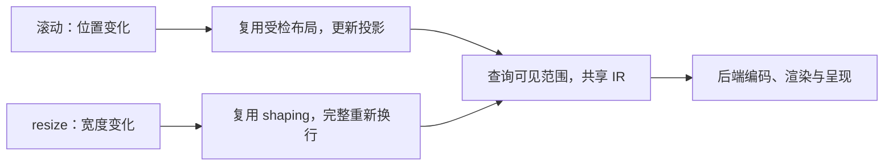

# 长文本滚动与 resize 优化提案

类型：`proposal`

能力归属：Core Flow／Runtime 的滚动与 resize 优化候选；platform 交付输入和呈现，backend 消费字形输出。

日期：2026-10-28；更新：2026-11-04。修订：4。
既有修订 2 已获用户实施授权；观测与共享 IR 已落地，
具体证据及剩余验收见[首批实施记录](../../verification/reviews/long-text-scroll-resize-implementation-2026-10-28.md)。
修订 3 根据滚动采证调整候选推进建议，增加依赖收敛的验证安排；
修订 4 按 SR3-R01～SR3-R05 补齐组合、真实输入和验收条件，见
[逐项回应](../../verification/reviews/long-text-scroll-resize-revision-4-response-2026-11-04.md)。
用户于 2026-11-04 确认“修订4审核通过，开始执行”，按本页顺序推进实施。
各专题的接口冻结、证明链和生产启用门禁继续分别验收。
修订 3 的[评审建议](../../verification/reviews/long-text-scroll-resize-revision-3-review-2026-11-04.md)
已记录，SR3-R01～SR3-R05 的方案回应随修订 4 通过；实际行为与成本仍需取证。

本提案记录 `TextFlowLargeExample` 拖动滚动条和调整窗口尺寸时的优化方案。
设计已采纳 SR-R01～SR-R06，并获用户实施授权。
最新成本与限制见[优化验证](../../verification/performance/text-optimization-validation.md)；
执行顺序只在[P2 backlog](../../roadmap/p2-delta-backlog.md#当前推进顺序)维护。
原生覆盖、宽度复用和后续调度仍须各自取证。
拟议的接口与数据角色均不表示已经实现。

## 文档归属与适用范围

[长文本总方案](long-text-performance-proposal.md)负责完整目标、消费模式和预算原则；
本页负责滚动与 resize 的优先顺序、共享 IR、失效分类、调度和验收安排。
[增量排版提案](long-text-incremental-layout-proposal.md)负责分阶段排版、
source delta、安全局部 shaping 和检查点证明；
[原生覆盖提案](long-text-native-coverage-boundary.md)负责原生墨迹与设备覆盖合同。
本页引用这些专题，不建立第二份算法正文或执行队列。

范围为精确 TextFlow：完整布局、来源几何、绘制和交互经过同次受检发布。
不按文本长度自动切换为渐进模式，不用估算高度替代全文精确尺寸。
所有通用机制放在 Core、文字引擎或 backend；官方样例只提供真实消费者。
内置与外部引擎共用 typed identity、payload trait 和实例 registry，
不按 `TextFlowLargeExample`、Parley 或 Vello 类型建立特权路径。

## 已有证据与问题判断

数字来自[实施记录的源提交补录](../../verification/reviews/long-text-performance-implementation-2026-10-27.md#原-large-源提交观测补录)。
冻结 Release 构建的五个会话取得 1000 次热样本、200 个新进程样本及
100 次预热；正式采样无失败，外部后台负载未受控。
下表只列 1000 次热样本，不混入新进程样本。

| 操作 | p50 | p95 | 取证范围 |
|---|---:|---:|---|
| 滚动至稳定查询 | 5.936 ms | 7.187 ms | 公开 viewport API 滚动 100，新增 shaping 为 0 |
| 宽度 resize 至稳定查询 | 31.961 ms | 36.673 ms | 根尺寸由 600×500 改为 400×500，有效文字宽度由 586 变为 386，新增 styled layout 6 次 |
| resize 后 CPU IR 录制 | 4.474 ms | 5.335 ms | 固定输出 7889 条命令、51233 个 native glyph |

这组 CPU 数据没有测量连续鼠标拖动、真实窗口 resize、GPU 完成或实际显示时间。
IR 录制发生在 resize 之后，不能代替固定可见区查询与 IR 的正式验收。
各阶段分位数不能相加推算帧率，也不能与历史二进制计算严格提速比。
修订 2 的设计阶段仅定向核验评审引用的实现事实和 Parley 0.7.0 的接口与所有权，
没有新增算法、窗口、GPU 或性能测试。
既有 resize 的六次 styled layout 调用尚未按完整 request 分类，
不能将它们全部判定为同 request 重算或全部归为 shaping。

实施前的定向源码核对确认（历史定位，不代表共享 IR 落地后的存储结构）：

- 滚动修改 view location 并重画 viewport。段落排版可以复用，
  绘制阶段仍保守输出原生字形；`GlyphRun` 的 glyph 数组为 `Vec`，
  录制中的 run clone 和 submission 构造中的 commands clone 均会复制数组。
- 页面跟随 viewport 宽度。宽度进入完整 request，
  默认引擎在缓存未命中时重新构建布局、shaping 和换行。
- 普通 Native 宿主使用支持 retained/Partial 的 `VelloRenderer`。
  当前 Partial 管理 damage 和重绘结果复制，没有提供滚动图像平移复用路径。
- 实际 surface 尺寸变化要求 Full redraw，并使 retained/scratch 纹理失效。
  窗口线程驱动输入、CPU 布局、录制、编码和提交；GPU 执行成本尚未独立量化。

源码入口为
[viewport](../../../crates/novadraw/src/container/viewport.rs)、
[文字录制](../../../crates/novadraw/src/render/context.rs)、
[字形与默认排版](../../../crates/novadraw/src/render/text.rs)、
[Native 宿主](../../../examples/support/src/app.rs)和
[Vello backend](../../../crates/novadraw-backend-vello/src/lib.rs)。
这些事实用于定位候选，不证明某个阶段占实际拖动卡顿的百分比。

## 建议采用的顺序

此前已完成阶段采证和共享 IR 增量。11 月 4 日的
[Native 滚动诊断](../../verification/reviews/textflow-scroll-perfetto-2026-11-04.md)
确认每次固定滚轮仍有两次 Flow 测量组装，没有新增文字引擎布局调用。
细 SDK 下组装平均为 12.37 ms、Vello 调用平均为 8.73 ms；
它们只定位当前慢路径，不代表关闭观测的生产成本。

随后同一 release、相同粗阶段观测和 GPU 离屏路径的
[纹理对照](../../verification/reviews/textflow-scroll-raster-experiment-2026-11-04.md)
取得每模式 48 次固定滚轮样本：活跃中位耗时为关闭缓存 21.09 ms、
开启缓存 11.46 ms，host-frame 中位为 14.39／5.18 ms。
热帧最终合成 Scene 的 glyph 从 51232 降为 0，但 Core 仍生成完整 IR，
冷块仍处理完整文字。该对照没有窗口 present，不能与前述细 SDK 数字直接相减。

因此下一步先处理上游重复组装，再解决新露出内容的补画和像素边界。
宽度复用解决 resize，不能用于解释纯滚动没有 shaping 调用时的收益。
技术推进建议如下；实际执行状态与恢复条件仍只由 P2 backlog 维护。

| 顺序 | 工作包 | 对应既有 LT 领域 | 进入下一步的证据 |
|---|---|---|---|
| 当前优先复核 | FR-02 贡献组装与共享输入 | LT-02、LT-01 | 完整声明、测量消费与最终发布证明链通过评审；获实施授权后验证回调减少、检查成本和净收益 |
| 随后定位 | 纹理像素差异 | backend 栅格实验 | 直接、单块和相邻块合成分别对照；定位不以新增 Core 裁剪 API 为前提，容差须另行裁决 |
| 共同依据复核后独立评审 | 冷块补画筛选 | backend 栅格实验 | backend 的实际 lowering 覆盖依据成立，输入覆盖整块；冷块与热块分列，不关闭 Core 裁剪门禁 |
| 按剩余成本选择 | 原生覆盖证书与可见 IR | LT-03 | 共用覆盖依据，另补 Runtime／Recorder 查询与提交绑定；与纹理缓存组合须证明稳定内容身份及块完整性 |
| 独立可行性验证 | 同版本发布依赖替换 | Core 文字依赖 | 当前运行功能、输出和成本与补丁版对照；定制能力的保留方式经评审，才迁移生产依赖 |
| resize 分母明确后恢复 | shaping／换行分离与宽度复用 | LT-04 | 必要布局调用分类清楚，完整分析准入和真实 inline 反馈成立；端到端收益支持恢复 B1 |
| 后续按实测选择 | 连续 resize 合并或 worker | Runtime／platform、LT-05 | 存在可省略的过时计算或剩余窗口阻塞；几何消费屏障、取消与发布合同分别通过 |

表格只映射工作领域，不新增 LT 编号或修改状态。
实施前在现有 [P2 backlog](../../roadmap/p2-delta-backlog.md)登记单一 Execute 切片，
每批按下列切片门禁完成适用验证后再进入下一批；平台发布准备采证保留独立状态。
本表不授权依赖切换、新 Core API 或生产缓存启用。
可行性安排允许调整分支优先顺序，但不同时开启多个 Execute；
用户对 release 流畅度的主观反馈保留为交互反馈，不替代尾延迟或呈现验收。

可见 IR 与纹理组合前须满足[稳定内容及整块查询条件](../rendering/text-scroll-raster-reuse.md#可见-ir-与纹理缓存的组合条件)。
视口片段只用于本帧绘制选择，不能作为整块输入或跨滚动内容身份；
冷块先生成完整有效区域，再允许同块内滚动复用。四种配置的组合验证单独执行，
不能以任一优化的独立通过代替。

### 切片交付与生产启用

| 工作包 | 切片交付所需证据 | 生产启用及整体验收 |
|---|---|---|
| FR-02 | FA-G03：公开消费者、适用 FA-R／FA-P 与既有回归；按冻结判据取得 CPU 净成本、冷路径和留存证据 | FA-G04 单独判断启用；实际输入到屏幕呈现由 platform 验收 |
| 纹理像素定位／冷块筛选 | 定位报告；筛选实施另验覆盖、块完整性、失败与冷／热匹配离屏成本 | 像素裁决、真实输入资格、窗口净延迟、内存和设备恢复通过后才评审默认启用 |
| Core 可见 IR | 覆盖专题的查询与提交绑定、外部消费者、未知回退、有序 IR、实际 backend 像素和查询／IR 成本 | 纹理组合另验；不能由 backend 筛选推定 Core 已交付，整体呈现保留平台门禁 |
| 依赖收敛 | 同版本隔离对照与定制能力差异说明 | 迁移方案接受、获实施授权并完成生产回归后才切换 |
| resize 调度／worker | 各自合同接受后验证几何屏障、版本替代、取消、失败和匹配 CPU 成本 | 实际显示关联与停止输入后的收敛独立验收，不把 worker 返回当呈现 |

窗口及 Windows／Linux 原生 runner 的发布准备证据可以后置，不阻塞平台无关
Core 切片推进；该切片自身的正确性与适用成本证据不能省略。
切片交付不等于生产默认启用或 16 ms／4 ms 整体目标关闭。
原 Large 宽度 resize 的 p95 ≤16 ms 仍是待审核建议，不作为下一片自动退出条件。

### FR-02 首片的交付边界

本片只复用贡献组装资产，不合并必要的布局反馈轮次，不提前缓存任意扩展回调。
只有 contributor、handler 和边框均给出完整有效声明时才省略组装；
未声明页面继续原路径，当前输入变化或预算错误仍立即失败。
声明检查、成员扫描、真实 inline 测量、坐标投影与最终发布核验继续计入成本。

先完成[复用合同](flow-assembly-reuse.md)与
[生产矩阵](../../verification/plans/flow-assembly-reuse.md)的修订 1 复核；
随后冻结签名、metadata、容量、冷路径回退容限和独立消费者入口。
实施与启用分别按 FA-G02、FA-G04 判定，复核通过不自动授权代码实施。
历史被审完整合同与矩阵缺失的限制保持，
见[版本核对](../../verification/reviews/fr02-review-baseline-2026-11-04.md)；
新复核以当前文件集合和可回查版本为基线，不拼造旧稿。

### 发布版依赖的收敛条件

2026-11-05 用户已授权删除可替代补丁并采用未打补丁的 Parley 0.12.0，
实施与实际替代边界见[迁移记录](../../verification/reviews/parley-upstream-migration-2026-11-05.md)。
以下同版本去补丁流程保留为修订 4 的历史候选条件，不再作为旧补丁保留要求。

当前定制范围由[依赖清单](../../../dependencies/README.md)维护。
生产默认排版使用普通 Parley 布局入口；存储观察、操作前准入和受限 Harfrust
分析准入主要为尚未默认启用的阶段能力提供验证。新增 FR-02、可见 IR 和
后端纹理策略不以继续扩张 Harfrust shaping 补丁为前提。

候选验证先比较补丁版与同版本发布版 Parley 0.7.0／其配套 Harfrust 0.3.2，
字体、锁定传递依赖、工具链与配置相同；只切换补丁来源。
使用隔离副本和独立 Cargo target，不修改生产 path。分别构建生产 library／应用，
比较完整布局、交互、GPU 像素与冷／热成本；定制 API 消费者另列，
不能删掉失败测试后宣称全部能力等价。

发布版候选若满足当前运行功能，仍须评审定制接口与测试的归属：
生产保持发布版、定制阶段实现作为独立可选能力，或继续保留必要补丁。
若不交付阶段能力，可以暂缓它的默认接入；既有严格预算合同仍保持，
不能把事后内存统计当作操作前准入，也不能把尚未接入解释为可以直接删除已批准成果。

2026-11-04 查询 crates.io 并核对发布源码，最新稳定版本为
[Parley 0.12.0](https://docs.rs/parley/0.12.0/parley/)和
[Harfrust 0.15.0](https://docs.rs/harfrust/0.15.0/harfrust/)。
Parley 已调整对齐签名并引入 parley_engine；不能将两者各自最新版直接组合后
视为现有文字栈的替换。最新版升级与同版本去补丁应分别验证。
Harfrust 0.15.0 的缓存预算为私有、按字体共享的预处理预算，耗尽后受影响 lookup
保持跳过；shape 的错误返回主要报告调用状态错误。它们不等价于 Core 会话
工作／分配预算及完整失败传播，不能据存在 Budget 或 Result 取消阶段准入要求。
本次仅核对发布 API，未切换依赖、执行迁移回归或取得新版性能结果。

图中为拟议目标路径。当前未声明覆盖或分阶段能力的实现继续保守完整计算。

## 阶段测量与请求分类

每次 styled layout 记录实例与段落身份、来源版本、完整受检 request、
有效宽度、measure／prepare 阶段、反馈轮次、engine revision 和缓存结果。
诊断记录可以用受检快照引用完整 request，散列只用于查找；
归类同 request 必须核对完整输入和依赖，不能按宽度或散列相同推断。
记录保持实例所有权，诊断默认关闭，热路径不打印日志。

| 分类 | 需记录的工作量 | 要回答的问题 |
|---|---|---|
| 不同段落／字体／结构 | 完整输入、实际分析与输出量 | 是否为合法不同 request |
| 真实 inline 反馈 | 输入和输出约束、反馈次序、来源依赖 | 是否为必要宽度或度量收敛 |
| measure／prepare 重入 | 调用阶段、相同 request 的命中与失效原因 | 哪些重复计算已有复用，哪些仍需合同 |
| 滚动稳定化 | 贡献捕获、测量、签名、投影、依赖重验、发布 | 耗时是否来自与位置变化无关的工作 |
| resize 排版 | 分析、shaping、换行、对齐、导出、交互、校验和发布 | 宽度复用能省去什么，剩余成本是什么 |
| 绘制和提交 | 查询、录制、submission 构造、资源检查、编码和 GPU／present | 全链路复制与可见输出是否改善总成本 |

阶段计时分别保留 inclusive 和 exclusive，所有失败前工作仍累计计费。
原生范围已知、未知和完整退化分开计时，不把整条稳定查询归入单一阶段。
先冻结请求分母、输入序列和阶段边界，再决定分支与匹配比较版本。

## 滚动的共享 IR

已接受的 GlyphBuffer/GlyphRange、范围验证、Recorder/submission 共享、
旧 lease 与 backing 计费统一由
[精确复用专题](exact-flow-layout-reuse.md#滚动共享-ir-的最小增量合同)负责。
共享缓冲不等于原生可见裁剪，也不免除字体、session 与提交检查。

同帧资源验证可按完整字体实例、资源版本、face 与变量坐标去重，
仅复用本帧已验证结果；字体、session 或依赖变化失效。
裁剪不能丢弃布局、资源和发布依赖。

## 滚动的原生可见输出

先完成原生覆盖合同复核，再将查询放在 IR 生成之前。
同一受检布局提供原生墨迹包络、范围索引和字体来源依据；
该帧实际 lowerer、设备缩放、clip 和变换提供覆盖证明。
坐标精度、非轮廓字形、描边或数值域不能证明时返回未知，保留对应输出。
已有填充路径覆盖声明不能直接用作原生 glyph 证书。

### 实施准入与查询通道

本分支须先复核[原生覆盖专题的准入与查询通道](long-text-native-coverage-boundary.md#准入与查询通道)。
专题维护完整合同，本页要求下列链路可追溯后才进入实现：

| 环节 | 所有者与准入条件 |
|---|---|
| 静态墨迹与索引 | 文字墨迹 provider 按不可变字体实例与受检布局生成；资产不含 backend 可变状态 |
| 实际 lowering policy | backend 提供只读的操作覆盖能力与 policy 身份，绑定实际算法、数值域和 AA 等策略 |
| 本帧绑定 | Runtime 冻结 backend/session、资源版本与 policy，将只读查询能力下传 Recorder |
| 录制前查询 | Recorder 以当前操作、clip、变换和静态摘要查询；不能先生成全文 IR 才取得证据 |
| 提交核验 | backend 验证 policy/session 与资源绑定，并实际采用该 policy；不匹配时拒绝该提交，按恢复合同重新录制 |

这些是拟议角色，不能通过现有填充路径 coverage 字段假装原生能力已经可用。
缺少能力、资产或数值证明时，Recorder 保留对应原生输出；
提交时不能把已裁剪 IR 换用未经证明的 lowering policy。
内置和外部实现共用可选能力、受检构造与失效通道，
backend 状态不写回 source 或文字布局缓存。

静态墨迹和索引随资产版本构建，不在每帧先扫描全文 glyph 重发证书。
每帧先检查 policy 与资源绑定，再检查段落／子树的保守摘要，
只对必要候选和未知分支下降。设备检查以当前操作、变换及有效数值域为准。
混合已知／未知的 sibling 分开处理；高度重叠或未知范围允许全扫描和完整输出。
H、C、G、V 同时计入摘要访问、候选及设备检查工作量，查询计时包括证书检查。

查询先缩小段落候选，再查询 glyph 的视觉墨迹范围。
长行和 RTL 使用重叠包络，不假定 source offset 或 glyph x 单调。
结果允许多个不连续片段，保持原有顺序并引用共享缓冲；
不重新 shaping，不以 line box 或 advance 代替墨迹。
未知叶子完整输出，同级已知范围仍可剪枝。

布局、墨迹、索引与 paint 依赖经过同次受检发布。
只在后端接收到全文 IR 后裁剪，不能减少此前的 Core 录制成本。
默认原生路径继续保留，不通过切换全部文字为曲线路径宣称本项提速。
具体证据来源、数值域和调用顺序由原生覆盖专题维护。

### 非字形输出与范围碎片

固定可见查询＋完整 IR 包含状态、边框、装饰、引用与提交构造成本。
除了 H、C、G、V，还记录可见片段数、draw run 数、状态命令数、
边框／装饰检查数和 backend 编码字节与操作量。
字形减少但命令碎片增加的输入单独列出分布，不能只凭 selected glyph 下降验收。

边框与装饰使用各自同源几何和覆盖证明；已知范围可剪枝，
未知范围保留原来顺序中的完整绘制。不能用文字墨迹证书代替边框或装饰证书。
只有原序中连续且字体、变量坐标、paint、clip、变换和其他状态完全兼容的范围
才考虑合并；不越过其他绘制操作拼接，不合并不连续范围以改变覆盖关系。

## 滚动的失效分类

先拆分现有稳定化耗时，分别记录贡献捕获、测量、签名、投影、
依赖检查和发布，再判断哪些资产被纯位置变化无效地重复生成。
目前的 7.187 ms 为整个公开滚动与稳定查询终点，不能全部归为布局。

目标是分开文本布局依赖和 viewport 位置依赖。
纯位置变化在完整证书有效时复用段落局部资产，更新坐标投影、滚动条和 damage。
字体、文本、样式、inline 或真实布局依赖变化按原合同失效。
外部 contributor 没有纯度或不可变版本声明的部分仍重读；
不能只比较全局 revision 或散列便省略其 callback。

坐标消费者仍更新：命中、focus、selection、accessibility、连接锚点与路由
继续读取权威当前场景，不使用过期投影。
该项不修改 source 文本，不将逐帧状态写入来源，
也不为官方样例设置免校验路径。

## resize 的宽度复用

可选能力、完整分析投影、实例绑定、字节准入、失败与完整回退统一由
[阶段协议](staged-text-width-reuse.md)负责。本轮已接受合同保留除 max_width 外
全部受检输入，包含 inline 尺寸、颜色和方向；不能采用旧候选的更细粒度失效表
推断这些字段可以移出分析 key。

默认 Parley 的模板复制、断行、导出与交互成本必须分别记录；
新宽度可能扫描全部 cluster，不承诺常数成本或零复制。
同输入的新鲜完整布局是宽度往返对照，真实 inline 测量与依赖仍须重读。
当前生产接入及暂停边界见
[文字阶段状态](../../verification/reviews/text-stages-status.md)。
跨编辑 checkpoint、paint-only 分离及更细粒度 inline 复用仍是
[增量候选](long-text-incremental-layout-proposal.md)，没有因阶段合同接受而获准。

## resize 的合并与几何消费边界

现有重绘请求可能已经被窗口系统合并，需先记录每帧接收尺寸数、
实际布局宽度数和过时计算数，确认剩余重复工作。
目标是在帧准备点针对最新尺寸执行昂贵布局，不为已被替代的尺寸重复计算。

只合并连续 resize 意图，不能任意丢弃窗口事件。
屏障由 Runtime 的实际几何消费操作形成，宿主不按事件名称猜测外部 handler 的需求。
任何操作需要当前目标解析、局部坐标转换或稳定几何时，
先落实其因果前缀中的最新尺寸并完成相应稳定化，再返回查询结果或调用 handler。
屏障记录消费操作、目标来源／尺寸版本和已完成版本；
handler 获得的几何上下文不得绕开这条准入。

| 消费操作 | 屏障与允许行为 |
|---|---|
| 命中、事件目标或局部坐标解析 | 派发使用几何之前落实此前尺寸；现有指针移动若包含这些操作，同样形成屏障 |
| caret／selection、focus／IME 或其他稳定几何查询 | 查询入口保证当前版本；未知外部 handler 默认完整准入 |
| 已证明只保存原始输入或读取 source 的操作 | 仅在统一能力合同明确不消费几何时允许暂存 resize；后续几何操作仍形成屏障 |
| 帧准备与最终稳定查询 | 落实之前所有尺寸意图，保证最后尺寸与完整结果一致 |

未知 handler 或通道没有“不消费几何”的证明时采用保守屏障。
稳定化失败按既有错误合同结束消费，不能返回过期几何冒充当前结果。
这一入口是待复核合同；本页不补造现有 Runtime 已支持延迟几何的 API。
如果所有移动都需要当前几何，合并收益可能很小，应保留实际宽度数与过时计算数，
而不是为了收益跳过命中或隐式复用旧坐标。

按下／释放、focus、生命周期和 surface 恢复等事件保留顺序；
最终尺寸、滚动范围和输入结果必须与无合并 oracle 一致。
验证 resize → move → resize → press，以及键盘／IME、DPI 变化、
最小化／恢复、focus 和 surface 重建序列；比较事件结果与最终几何，
允许成功合并减少未被消费的中间宽度计算。

不设置任意长时间 debounce，也不简单丢弃拖动中的鼠标位置。
具体合并边界须与 Runtime 驱动合同一起复核。
实际 surface 尺寸变化仍遵守 Full redraw，不能强行提交 Partial 保留错误旧像素。

## 后续 GPU 与 worker 条件

滚动图像平移复用需要独立的内容层和有效性合同。
仅在内容与绘制依赖未变、设备像素位移可精确表达、
clip 和效果满足条件时，复制旧画面并重绘新露出的条带。
固定 overlay 与滚动内容必须正确分离；源更新、设备重置、非整数位移、
复杂变换或未知效果走完整重绘。
复制安排必须符合纹理重叠读写限制，并与完整绘制逐像素对照。

只有纹理分配或清理经实测确为瓶颈，才评审容量复用。
物理 backing 容量和实际 surface 尺寸分别管理，
绘制、clip、damage、采样及 blit 使用真实尺寸，不能显示缓存的无效区域。
保留有限容量和释放策略，同时测量峰值显存、清理带宽及 resize 成本。
本页不冻结增长比例或尺寸分桶参数。

若前述同步优化仍无法满足响应目标，再独立推进 worker。
worker 只持有不可变输入和独立计算上下文，
结果绑定 Runtime 生命周期、请求代次、文本／宽度／字体版本及全部外部依赖。
Runtime 在提交点校验并原子发布完整结果。
旧完整布局只能作为明确的旧 presentation，不能冒充最新来源几何。
过时结果、队列合并、公平性、取消、预算和停止 resize 后的最终收敛均需验证。
异步降低窗口线程阻塞，不自动降低 CPU 完成延迟；
渐进覆盖与估算滚动高度继续属于独立合同。

## 验收目标与测试分母

修订 4 的生产性能比较采用相同 release、工具链、字体、预算和缓存配置，
冻结补丁来源与输入序列；不能沿用 Rust 1.96.0 的旧样本证明当前工具链收益。
每次只比较一项改动，至少分开以下运行方式：

| 对照 | 观察边界与用途 |
|---|---|
| 纹理关闭／开启，其他条件相同 | 区分既有后端纹理收益与新增 Core 优化；full／natural damage 分开 |
| 当前组装／FR-02 组装，纹理策略相同 | 判断回调和组装减少是否抵消声明、证明与留存成本 |
| 粗 SDK 同配置／各自关闭采集 | 前者用于归因，后者直接计宿主操作与帧总终点；不混算净收益 |
| 冷首次、持续向下、驻留回滚、淘汰后回滚 | 分列冷块数、热命中、峰值留存和延迟；不能只用热回滚代表持续滚动 |
| 补丁版／同版本发布版 | 核对当前普通功能与定制能力差异；不混入最新版本升级 |

保持原 Large、单长段、NoWrap、真实 inline 和多语言分母。
新增性能采样期间不运行截图读回或并行构建；像素验证单独执行。
所有操作保留实际位移、失败、no_damage、Skipped、缓存资格和输出数量；
未呈现的控制帧不能计入成功滚动。既有像素差异在解释与评审之前仍阻止生产启用，
不按差异像素比例很小自行放宽容差。冷块方法见
[栅格实验](../rendering/text-scroll-raster-reuse.md#冷块补画的候选改进)。

### 真实输入的缓存资格分母

固定 ±40 逻辑像素只证明现有实验的整数平移路径。另冻结真实触控板连续输入、
分数位移、惯性滚动、方向反转及横向滚动序列，记录设备、DPI、事件 delta、
接收时刻和 clamp 后实际 viewport 位移。保留原始顺序，匹配重放复用同一序列；
重放不替代真实 OS 输入及呈现证据。

缓存资格率以所有实际非零滚动、有效 surface 且进入后端提交的帧为分母，
符合缓存条件的帧为分子；Skipped／失败和无提交输入另列数量及关联原因，
no_damage／零位移不算滚动命中。合并前事件数与合并后提交数分别报告，
防止通过合并或排除回退帧抬高资格率。
合格帧再分全部热块、含冷块与缓存处理失败；块 hits／misses 不冒充帧命中率。
不合格帧按亚像素平移、clip、变换、图元、容量等实际原因分类。

整体延迟保留合格、冷块、回退与失败，成功帧的分位数须同时报告失败分母；
与原路径使用同一输入序列比较。亚像素支持可以后置，先由真实资格率和整体
尾延迟决定其优先级；不取整输入、位置或命中几何来制造缓存资格。

| 指标 | 目标性质 | 验收要求 |
|---|---|---|
| 纯滚动 shaping | 保持既有行为 | 无文本／字体／布局依赖变化时新增调用为 0 |
| IR 数组复制 | 新优化要求 | 录制 run clone 与 submission commands clone 均不复制 glyph 数组；backend 转换、复制与真实留存单列 |
| 固定可见查询＋IR | 既有目标不变 | p95 ≤ 4 ms，固定宽度、clip 与可见输出分母 |
| 原 Large 固定追加 | 既有目标不变 | CPU 精确稳定查询 p95 ≤ 16 ms |
| 原 Large 宽度 resize | 新建议目标，待用户审核 | CPU 完整精确稳定查询 p95 ≤ 16 ms |
| 连续交互呈现 | 新增采证范围 | 按目标显示器刷新率记录逐帧总延迟、错过刷新次数与输入到呈现分布 |

连续交互的阈值在匹配性能对照前冻结，不能随优化版结果调整：

| 判据 | 冻结方式与成功条件 |
|---|---|
| 窗口线程阻塞 | 记录目标刷新率与周期 T，冻结按显示刷新周期累计的主线程活跃预算 B；B 不大于 T，该口径工作 p95 不超过 B；连续阻塞区间另列 |
| 错过刷新 | 预先约定活跃交互区间、刷新机会计数和最大错过比例 M；实际显示证据取得后按同一规则判定 |
| 输入到呈现 | 预先约定输入接收起点、版本替代关联和最大延迟 L，按下节分别测最早待处理与最新输入到实际显示 |
| 停止输入后的收敛 | 预先约定完成时限 F；最后一次有效尺寸／滚动输入后，最终完整布局、范围和版本须在 F 内一致 |

B、M、L、F 的具体数值依目标刷新率、基线和宿主能力确定，
当前缺少连续窗口采样，不补造阈值或通过结论。
阈值尚未冻结时该项不能验收；固定 4 ms／16 ms 目标不因这一步放宽。
只有 CPU deadline 数据时单独报告，不能推断显示器错过刷新比例。
实际显示时间不可取得时对应呈现项保留 unavailable，不计为通过。

各阶段独立计时，直接测量请求总终点；不相加阶段 p95。
后端 submit 返回或 Runtime 的 Presented acknowledgement
不能代替实际显示时间；平台取得不了该终点时明确记录 unavailable。

### 合并与取消后的版本关联

每次接收输入赋予本宿主范围的单调序号，记录对应 source／viewport／尺寸版本。
分别登记接收、被替代、几何消费、候选取消、提交与实际显示，替代记录保留
旧序号到新序号的关系；source mutation 和已有几何消费仍遵守因果屏障。
提交关联实际采用的输入与布局版本，不能将未采用或已取消候选计入该提交。
实际显示以平台可观测的该提交终点关联，不能按最近时间戳猜测。

对确有显示的版本记录其最新有效输入接收到显示的延迟；对连续合并批次还记录
最早尚未被显示或几何消费完成、且由该结果满足的输入接收到显示的等待。
保留各被替代输入的接收时刻与终态，不要求它们各显示一帧，也不记为呈现失败。
若中间版本已被几何消费，单列消费延迟及结果，不能把它并入“从未处理”的等待。
丢失、失败、停止前仍待处理和不可关联的输入分别报告，不能只留下最后一个输入。
停止输入后的 F 从最后有效输入接收起算，到完整最终版本收敛；呈现终点另列。

主线程活跃工作按预先冻结的显示刷新周期累加输入、稳定化、录制、提交等区间
的时间并集，跨周期区间按交集分摊，嵌套区间不重复求和。
另报告从入口到返回的连续占用墙钟区间，包含同步等待；仅以单个细 slice 的
P95 不能代表整帧预算或连续阻塞。不可取得实际刷新时刻时，固定 T 分桶仅为
CPU 代理指标，须注明起点，不能据此声称错过刷新或输入到实际显示已通过。

CPU 对照保留原 Large 工厂、固定字体及输入分母，
采用独立源码和 Cargo target 构建匹配版本，冻结二进制与源码散列。
正式比较沿用五会话、每版 1000 次热样本、200 个新进程与 100 次预热，
保留各会话、失败、拒绝、取消、超时和环境负载。
连续拖动与真实窗口 resize 另建确定的输入序列：
包括上下往返、触控板分数位移与惯性方向反转、横向长行滚动、宽度缩窄与恢复、纯高度变化、
滚动和 resize 交错，以及停止输入后的最终稳定结果。

正确性按三层 oracle 分别比较：

| 层 | 比较对象与允许差异 |
|---|---|
| 完整布局 | 与同输入完整计算比较 glyph/font/offset/advance、断行、尺寸、来源映射、inline placement、caret／selection，保持完整等价 |
| 裁剪 IR | 与完整 IR 比较保留片段的字体、位置、paint 和原序；允许删除有可靠证明的不可见内容并增加范围切分，不要求全文 glyph 列表相同 |
| 实际绘制 | 用同一实际 backend 对完整绘制与优化绘制逐像素比较，覆盖 Full／Partial 与旧新 damage 修复 |

覆盖 RTL、Arabic joining、组合字符、emoji、CJK／Thai、tabs、
负 bearing、跨字体装饰、变量字体、非整数 DPI、非均匀变换、
嵌套 clip、大 origin 与抵消平移，以及未知原生字形退化。
Full／Partial、缓存淘汰、旧快照留存、字体替换、来源删除、
预算失败及不具备新能力的外部实现同样覆盖。

记录段落检查 H、候选 C、总 glyph G、实际提交 V、
共享／复制字节、唯一 backing allocation、旧 lease 留存、
可见片段／draw run／状态命令数、边框／装饰检查、编码量、
缓存淘汰、范围未知与完整退化次数。
GPU 与窗口证据使用实际 Native backend 和真实事件路径；
离屏像素通过不能代替窗口呈现或跨平台验收。

## 体积、预算与审核事项

共享 IR、原生可见输出和宽度复用原则上不增加字体或常驻 GPU 资源，
也不以引入 Rope、atlas 或新依赖为前提。
共享资产、墨迹索引和分阶段适配会增加元数据与留存；
采用实例所有权、可配置的有限预算和淘汰，旧 lease 仍计入真实留存成本。
计费 entry、进程 RSS、实际分配和 GPU 内存分别取证，不混用口径。
失败候选不部分安装，已提交的 source mutation 不声称回滚。
缓存命中不绕过预算或版本校验，不通过提高既有预算掩盖重复成本。

按同配置测量首次加载、峰值内存及代表性场景性能；
Native／Web 产物差额和压缩传输仅在用户明确要求体积比较时测量。
worker 与 GPU 缓存另计初始化和资源成本；当前没有这些新增产物或收益数据。

## 剩余验收边界

原生输出需证明操作覆盖、数值域、混合范围像素及 H／C／G／V 实际成本；
宽度复用需证明模板复制、断行、导出、交互和真实 inline 反馈的完整收益。
共享 IR 需覆盖旧 lease、淘汰、来源／字体／session 变化与峰值留存；
非字形命令、范围碎片和完整 4 ms 指标不能被单独 glyph 成本代替。
连续输入与调度需冻结事件屏障、取消及版本发布合同，并取得真实窗口证据。
已有实施授权不关闭增量提案的 LTI-R01／R02 或这些独立门禁。
