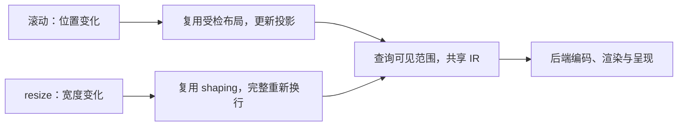

# 长文本滚动与 resize 优化提案

类型：`proposal`

日期：2026-10-28。修订：2。状态：已补齐设计响应，待复核，未授权新增实施切片。

本提案记录 `TextFlowLargeExample` 拖动滚动条和调整窗口尺寸时的优化方案。
本轮按[固定评审记录](../../verification/reviews/long-text-scroll-resize-review-2026-10-28.md)
处理 SR-R01～SR-R06；六条意见均有源码或合同依据，全部采用。
用户本次授权文档修订；本页不改变 ADR 接受状态、执行队列或既有验收结论。
拟议的接口与数据角色均不表示已经实现。

## 文档归属与适用范围

[长文本总方案](long-text-performance-proposal.md)负责完整目标、消费模式和预算原则；
本页负责滚动与 resize 的优先顺序、共享 IR、失效分类、调度和验收安排。
[增量排版提案](long-text-incremental-layout-proposal.md)负责分阶段排版、
source delta、安全局部 shaping 和检查点证明；
[原生覆盖提案](long-text-native-coverage-boundary.md)负责原生墨迹与设备覆盖合同。
本页引用这些专题，不建立第二份算法正文或执行队列。

范围为精确 TextFlow：完整布局、来源几何、绘制和交互经过同次受检发布。
不按文本长度自动切换为渐进模式，不用估算高度替代全文精确尺寸。
所有通用机制放在 Core、文字引擎或 backend；官方样例只提供真实消费者。
内置与外部引擎共用 typed identity、payload trait 和实例 registry，
不按 `TextFlowLargeExample`、Parley 或 Vello 类型建立特权路径。

## 已有证据与问题判断

数字来自[实施记录的源提交补录](../../verification/reviews/long-text-performance-implementation-2026-10-27.md#原-large-源提交观测补录)。
冻结 Release 构建的五个会话取得 1000 次热样本、200 个新进程样本及
100 次预热；正式采样无失败，外部后台负载未受控。
下表只列 1000 次热样本，不混入新进程样本。

| 操作 | p50 | p95 | 取证范围 |
|---|---:|---:|---|
| 滚动至稳定查询 | 5.936 ms | 7.187 ms | 公开 viewport API 滚动 100，新增 shaping 为 0 |
| 宽度 resize 至稳定查询 | 31.961 ms | 36.673 ms | 根尺寸由 600×500 改为 400×500，有效文字宽度由 586 变为 386，新增 styled layout 6 次 |
| resize 后 CPU IR 录制 | 4.474 ms | 5.335 ms | 固定输出 7889 条命令、51233 个 native glyph |

这组 CPU 数据没有测量连续鼠标拖动、真实窗口 resize、GPU 完成或实际显示时间。
IR 录制发生在 resize 之后，不能代替固定可见区查询与 IR 的正式验收。
各阶段分位数不能相加推算帧率，也不能与历史二进制计算严格提速比。
本轮仅定向核验评审引用的实现事实和 Parley 0.7.0 的接口与所有权，
没有新增算法、窗口、GPU 或性能测试。
既有 resize 的六次 styled layout 调用尚未按完整 request 分类，
不能将它们全部判定为同 request 重算或全部归为 shaping。

前序定向源码核对确认：

- 滚动修改 view location 并重画 viewport。段落排版可以复用，
  绘制阶段仍保守输出原生字形；`GlyphRun` 的 glyph 数组为 `Vec`，
  录制中的 run clone 和 submission 构造中的 commands clone 均会复制数组。
- 页面跟随 viewport 宽度。宽度进入完整 request，
  默认引擎在缓存未命中时重新构建布局、shaping 和换行。
- 普通 Native 宿主使用支持 retained/Partial 的 `VelloRenderer`。
  当前 Partial 管理 damage 和重绘结果复制，没有提供滚动图像平移复用路径。
- 实际 surface 尺寸变化要求 Full redraw，并使 retained/scratch 纹理失效。
  窗口线程驱动输入、CPU 布局、录制、编码和提交；GPU 执行成本尚未独立量化。

源码入口为
[viewport](../../../crates/novadraw/src/container/viewport.rs)、
[文字录制](../../../crates/novadraw/src/render/context.rs)、
[字形与默认排版](../../../crates/novadraw/src/render/text.rs)、
[Native 宿主](../../../examples/support/src/app.rs)和
[Vello backend](../../../crates/novadraw-backend-vello/src/lib.rs)。
这些事实用于定位候选，不证明某个阶段占实际拖动卡顿的百分比。

## 建议采用的顺序

先取得阶段与请求分母，再消除共享 IR 完整链路中的数组复制。
随后按实测选择原生裁剪、稳定化复用或宽度复用，
调度和 GPU 缓存按剩余瓶颈推进。
原生覆盖的复核只约束裁剪分支，不阻止宽度复用的可行性评估。

| 顺序 | 工作包 | 对应既有 LT 领域 | 进入下一步的证据 |
|---|---|---|---|
| 首先 | 阶段计时、请求分类与复制归属 | LT-00 | 可以区分合法反馈、不同 request 与真实重复计算；滚动、resize 和提交成本分别归属 |
| 随后 | 共享 glyph 缓冲与受检范围 IR | LT-01、LT-03 | 录制和 submission clone 均不复制 glyph 数组，留存与外部 backend 契约通过 |
| 按实测选择 | 原生覆盖证书与可见 IR | LT-03 | 覆盖准入复核通过，查询检查成本有分母，实际后端像素一致 |
| 按实测选择 | 滚动失效分类与稳定化复用 | LT-02 | 重复工作有证据，位置变化保留交互与外部依赖语义 |
| 可提前评估 | shaping／换行分离与宽度复用 | LT-04 | 模板复制、换行、导出与交互成本可行，多宽度完整等价和真实 inline 反馈通过 |
| 随后 | 按帧合并连续 resize 工作 | Runtime／平台驱动相关增量，需单独归档 | 过时宽度不产生重复昂贵计算，几何消费事件顺序正确 |
| 按实测推进 | 滚动图像平移、纹理容量复用 | Backend 相关增量，需单独归档 | GPU 或分配确为瓶颈，像素与内存成本通过 |
| 独立评审 | worker 排版 | LT-05 | 前述同步优化仍不足，候选发布、预算和终态恢复合同通过 |

表格只映射工作领域，不新增 LT 编号或修改状态。
实施前在现有 [P2 backlog](../../roadmap/p2-delta-backlog.md)登记单一 Execute 切片，
每批完成匹配验证后再进入下一批。
可行性安排允许调整分支优先顺序，但不同时开启多个 Execute；
不能把先前选定的线性顺序当作尚无实测依据的收益排名。

图中为拟议目标路径。当前未声明覆盖或分阶段能力的实现继续保守完整计算。

## 阶段测量与请求分类

每次 styled layout 记录实例与段落身份、来源版本、完整受检 request、
有效宽度、measure／prepare 阶段、反馈轮次、engine revision 和缓存结果。
诊断记录可以用受检快照引用完整 request，散列只用于查找；
归类同 request 必须核对完整输入和依赖，不能按宽度或散列相同推断。
记录保持实例所有权，诊断默认关闭，热路径不打印日志。

| 分类 | 需记录的工作量 | 要回答的问题 |
|---|---|---|
| 不同段落／字体／结构 | 完整输入、实际分析与输出量 | 是否为合法不同 request |
| 真实 inline 反馈 | 输入和输出约束、反馈次序、来源依赖 | 是否为必要宽度或度量收敛 |
| measure／prepare 重入 | 调用阶段、相同 request 的命中与失效原因 | 哪些重复计算已有复用，哪些仍需合同 |
| 滚动稳定化 | 贡献捕获、测量、签名、投影、依赖重验、发布 | 耗时是否来自与位置变化无关的工作 |
| resize 排版 | 分析、shaping、换行、对齐、导出、交互、校验和发布 | 宽度复用能省去什么，剩余成本是什么 |
| 绘制和提交 | 查询、录制、submission 构造、资源检查、编码和 GPU／present | 全链路复制与可见输出是否改善总成本 |

阶段计时分别保留 inclusive 和 exclusive，所有失败前工作仍累计计费。
原生范围已知、未知和完整退化分开计时，不把整条稳定查询归入单一阶段。
先冻结请求分母、输入序列和阶段边界，再决定分支与匹配比较版本。

## 滚动的共享 IR

引入不可变 glyph 缓冲与受检范围视图。
缓冲保存 glyph 数据及相关变量坐标；范围视图只引用已经校验的片段。
共享合同贯穿布局、Recorder、submission 构造和 backend 消费。
各阶段持有 lease，命令保存范围、原点与绘制状态；
`draw_glyph_runs` 的 run clone 与 `to_submission_for_session` 的 commands clone
均不得重新复制 glyph 或 normalized_coords 数组。
backend 编码可能需要转换或复制，其字节数和分配另行记录，不宣称全链路零复制。

构造入口仍能接收 owned 数据，统一完成字体、数值和范围校验。
共享视图必须保证范围合法、来源资产一致，不能依赖悬空借用或可变外部数组。
范围拆分保持字体实例、变量坐标、原点与原有绘制顺序。
这项先保持当前字形输出分母，单独验证复制、分配和录制时间的变化；
不把共享缓冲成功称为可见裁剪成功。

旧帧和旧布局在缓存淘汰后仍可保留缓冲；实际资源仍按 backend session 同步。
共享数据不免除字体资源、绘制输入和提交版本检查。
公开 IR 类型变化需要最小 ADR、迁移说明和 Native/Web API 边界核验；
外部构造器与外部 backend 必须使用同一模型。

同帧重复资源检查可以按完整字体实例去重，
键包含资源身份与当前版本、face 和变量坐标等全部相关输入。
只复用本帧已经验证的结果；字体、session 或依赖变化立即失效。
裁剪掉字形不能丢弃仍应保留的布局、资源或发布依赖。

范围视图可能钉住远大于可见片段的 backing buffer。
内存按真实唯一 allocation 记录，分别列出视图引用字节、backing 字节、
缓存预算、当前帧和旧 lease 的实际留存。
重叠范围不重复计算同一 backing allocation，也不只按视图长度计费。
淘汰仅释放缓存持有的引用，不能强制释放外部消费者仍持有的合法 lease。
缓冲粒度与拆分策略待实施评估，保留峰值留存和长期旧快照反例。

## 滚动的原生可见输出

先完成原生覆盖合同复核，再将查询放在 IR 生成之前。
同一受检布局提供原生墨迹包络、范围索引和字体来源依据；
该帧实际 lowerer、设备缩放、clip 和变换提供覆盖证明。
坐标精度、非轮廓字形、描边或数值域不能证明时返回未知，保留对应输出。
已有填充路径覆盖声明不能直接用作原生 glyph 证书。

### 实施准入与查询通道

本分支须先复核[原生覆盖专题的准入与查询通道](long-text-native-coverage-boundary.md#准入与查询通道)。
专题维护完整合同，本页要求下列链路可追溯后才进入实现：

| 环节 | 所有者与准入条件 |
|---|---|
| 静态墨迹与索引 | 文字墨迹 provider 按不可变字体实例与受检布局生成；资产不含 backend 可变状态 |
| 实际 lowering policy | backend 提供只读的操作覆盖能力与 policy 身份，绑定实际算法、数值域和 AA 等策略 |
| 本帧绑定 | Runtime 冻结 backend/session、资源版本与 policy，将只读查询能力下传 Recorder |
| 录制前查询 | Recorder 以当前操作、clip、变换和静态摘要查询；不能先生成全文 IR 才取得证据 |
| 提交核验 | backend 验证 policy/session 与资源绑定，并实际采用该 policy；不匹配时拒绝该提交，按恢复合同重新录制 |

这些是拟议角色，不能通过现有填充路径 coverage 字段假装原生能力已经可用。
缺少能力、资产或数值证明时，Recorder 保留对应原生输出；
提交时不能把已裁剪 IR 换用未经证明的 lowering policy。
内置和外部实现共用可选能力、受检构造与失效通道，
backend 状态不写回 source 或文字布局缓存。

静态墨迹和索引随资产版本构建，不在每帧先扫描全文 glyph 重发证书。
每帧先检查 policy 与资源绑定，再检查段落／子树的保守摘要，
只对必要候选和未知分支下降。设备检查以当前操作、变换及有效数值域为准。
混合已知／未知的 sibling 分开处理；高度重叠或未知范围允许全扫描和完整输出。
H、C、G、V 同时计入摘要访问、候选及设备检查工作量，查询计时包括证书检查。

查询先缩小段落候选，再查询 glyph 的视觉墨迹范围。
长行和 RTL 使用重叠包络，不假定 source offset 或 glyph x 单调。
结果允许多个不连续片段，保持原有顺序并引用共享缓冲；
不重新 shaping，不以 line box 或 advance 代替墨迹。
未知叶子完整输出，同级已知范围仍可剪枝。

布局、墨迹、索引与 paint 依赖经过同次受检发布。
只在后端接收到全文 IR 后裁剪，不能减少此前的 Core 录制成本。
默认原生路径继续保留，不通过切换全部文字为曲线路径宣称本项提速。
具体证据来源、数值域和调用顺序由原生覆盖专题维护。

### 非字形输出与范围碎片

固定可见查询＋完整 IR 包含状态、边框、装饰、引用与提交构造成本。
除了 H、C、G、V，还记录可见片段数、draw run 数、状态命令数、
边框／装饰检查数和 backend 编码字节与操作量。
字形减少但命令碎片增加的输入单独列出分布，不能只凭 selected glyph 下降验收。

边框与装饰使用各自同源几何和覆盖证明；已知范围可剪枝，
未知范围保留原来顺序中的完整绘制。不能用文字墨迹证书代替边框或装饰证书。
只有原序中连续且字体、变量坐标、paint、clip、变换和其他状态完全兼容的范围
才考虑合并；不越过其他绘制操作拼接，不合并不连续范围以改变覆盖关系。

## 滚动的失效分类

先拆分现有稳定化耗时，分别记录贡献捕获、测量、签名、投影、
依赖检查和发布，再判断哪些资产被纯位置变化无效地重复生成。
目前的 7.187 ms 为整个公开滚动与稳定查询终点，不能全部归为布局。

目标是分开文本布局依赖和 viewport 位置依赖。
纯位置变化在完整证书有效时复用段落局部资产，更新坐标投影、滚动条和 damage。
字体、文本、样式、inline 或真实布局依赖变化按原合同失效。
外部 contributor 没有纯度或不可变版本声明的部分仍重读；
不能只比较全局 revision 或散列便省略其 callback。

坐标消费者仍更新：命中、focus、selection、accessibility、连接锚点与路由
继续读取权威当前场景，不使用过期投影。
该项不修改 source 文本，不将逐帧状态写入来源，
也不为官方样例设置免校验路径。

## resize 的宽度复用

文字引擎通过统一可选能力声明分析／shaping 与行布局是否可以分离。
拟议资产关系为：

`不可变段落分析与 shaping 资产 → 当前宽度的行布局 → 完整受检 Flow 快照`

分析资产绑定文本、script/bidi、字体实例与 fallback、语言、features、
变量坐标和 inline 结构等全部相关输入。
引擎证明单纯宽度变化不影响这些输出后，复用分析资产，
重新计算换行、对齐、baseline、来源几何与 inline placements。
新完整快照统一拥有当前来源映射、依赖和交互 revision。
未知引擎继续完整布局，宽度仍进入其完整 request key。

默认 Parley 的最小可行性候选采用
[不可变分析模板与独立 Layout](long-text-incremental-layout-proposal.md#默认宽度复用候选与成本协议)：
保留模板，每个宽度复制到独立 Layout，重新换行、对齐并导出完整结果。
Parley 0.7.0 的 Layout／LayoutData clone 会复制 run、cluster、glyph、
变量坐标和行结果等 Vec，不能将这条候选描述为零复制。
分别测量模板生成与复制、换行扫描、对齐、位置导出、来源几何、
交互构建、校验和发布；失败前已完成的工作同样计入。
若复制和导出占主要预算，再独立评估更深的资产拆分或上游支持；
本轮不提供默认适配已可交付或能达到 16 ms 的结论。
不得让多个已发布快照共同修改同一个 Parley Layout；
第三方内部类型和状态不穿透 backend-neutral 公共契约。
每个新宽度仍可能扫描全部 cluster，本项不承诺换行成为常数成本。
宽度往返使用同输入的新鲜完整布局作 oracle，单独验证重复
`break_all_lines`／`align` 的状态恢复，再扩展到 alignment 切换和真实 inline 反馈。

先验证无真实内嵌 Figure 的原 Large，再扩展到真实图文混排。
inline 新增、删除和移动进入分析／shaping 重验；
纯尺寸与 baseline 改变只在引擎声明可分离时复用。
真实 Figure 测量及其依赖继续读取，反馈改变贡献结构时升级失效范围。
同一次稳定化中重复的相同受检 request 可以复用，
不能由此推断可跨场景缓存完整 contributor 测量。

本项不依赖跨编辑的局部 shaping 或检查点恢复。
LTI-R01／R02 继续约束对应后续路径；Parley 的 `revert`
不能直接当作持久检查点 export／restore。
证明和算法细节由增量排版专题维护。

## resize 的合并与几何消费边界

现有重绘请求可能已经被窗口系统合并，需先记录每帧接收尺寸数、
实际布局宽度数和过时计算数，确认剩余重复工作。
目标是在帧准备点针对最新尺寸执行昂贵布局，不为已被替代的尺寸重复计算。

只合并连续 resize 意图，不能任意丢弃窗口事件。
屏障由 Runtime 的实际几何消费操作形成，宿主不按事件名称猜测外部 handler 的需求。
任何操作需要当前目标解析、局部坐标转换或稳定几何时，
先落实其因果前缀中的最新尺寸并完成相应稳定化，再返回查询结果或调用 handler。
屏障记录消费操作、目标来源／尺寸版本和已完成版本；
handler 获得的几何上下文不得绕开这条准入。

| 消费操作 | 屏障与允许行为 |
|---|---|
| 命中、事件目标或局部坐标解析 | 派发使用几何之前落实此前尺寸；现有指针移动若包含这些操作，同样形成屏障 |
| caret／selection、focus／IME 或其他稳定几何查询 | 查询入口保证当前版本；未知外部 handler 默认完整准入 |
| 已证明只保存原始输入或读取 source 的操作 | 仅在统一能力合同明确不消费几何时允许暂存 resize；后续几何操作仍形成屏障 |
| 帧准备与最终稳定查询 | 落实之前所有尺寸意图，保证最后尺寸与完整结果一致 |

未知 handler 或通道没有“不消费几何”的证明时采用保守屏障。
稳定化失败按既有错误合同结束消费，不能返回过期几何冒充当前结果。
这一入口是待复核合同；本页不补造现有 Runtime 已支持延迟几何的 API。
如果所有移动都需要当前几何，合并收益可能很小，应保留实际宽度数与过时计算数，
而不是为了收益跳过命中或隐式复用旧坐标。

按下／释放、focus、生命周期和 surface 恢复等事件保留顺序；
最终尺寸、滚动范围和输入结果必须与无合并 oracle 一致。
验证 resize → move → resize → press，以及键盘／IME、DPI 变化、
最小化／恢复、focus 和 surface 重建序列；比较事件结果与最终几何，
允许成功合并减少未被消费的中间宽度计算。

不设置任意长时间 debounce，也不简单丢弃拖动中的鼠标位置。
具体合并边界须与 Runtime 驱动合同一起复核。
实际 surface 尺寸变化仍遵守 Full redraw，不能强行提交 Partial 保留错误旧像素。

## 后续 GPU 与 worker 条件

滚动图像平移复用需要独立的内容层和有效性合同。
仅在内容与绘制依赖未变、设备像素位移可精确表达、
clip 和效果满足条件时，复制旧画面并重绘新露出的条带。
固定 overlay 与滚动内容必须正确分离；源更新、设备重置、非整数位移、
复杂变换或未知效果走完整重绘。
复制安排必须符合纹理重叠读写限制，并与完整绘制逐像素对照。

只有纹理分配或清理经实测确为瓶颈，才评审容量复用。
物理 backing 容量和实际 surface 尺寸分别管理，
绘制、clip、damage、采样及 blit 使用真实尺寸，不能显示缓存的无效区域。
保留有限容量和释放策略，同时测量峰值显存、清理带宽及 resize 成本。
本页不冻结增长比例或尺寸分桶参数。

若前述同步优化仍无法满足响应目标，再独立推进 worker。
worker 只持有不可变输入和独立计算上下文，
结果绑定 Runtime 生命周期、请求代次、文本／宽度／字体版本及全部外部依赖。
Runtime 在提交点校验并原子发布完整结果。
旧完整布局只能作为明确的旧 presentation，不能冒充最新来源几何。
过时结果、队列合并、公平性、取消、预算和停止 resize 后的最终收敛均需验证。
异步降低窗口线程阻塞，不自动降低 CPU 完成延迟；
渐进覆盖与估算滚动高度继续属于独立合同。

## 验收目标与测试分母

| 指标 | 目标性质 | 验收要求 |
|---|---|---|
| 纯滚动 shaping | 保持既有行为 | 无文本／字体／布局依赖变化时新增调用为 0 |
| IR 数组复制 | 新优化要求 | 录制 run clone 与 submission commands clone 均不复制 glyph 数组；backend 转换、复制与真实留存单列 |
| 固定可见查询＋IR | 既有目标不变 | p95 ≤ 4 ms，固定宽度、clip 与可见输出分母 |
| 原 Large 固定追加 | 既有目标不变 | CPU 精确稳定查询 p95 ≤ 16 ms |
| 原 Large 宽度 resize | 新建议目标，待用户审核 | CPU 完整精确稳定查询 p95 ≤ 16 ms |
| 连续交互呈现 | 新增采证范围 | 按目标显示器刷新率记录逐帧总延迟、错过刷新次数与输入到呈现分布 |

连续交互的阈值在匹配性能对照前冻结，不能随优化版结果调整：

| 判据 | 冻结方式与成功条件 |
|---|---|
| 窗口线程阻塞 | 记录目标刷新率与周期 T，依据独立阶段测量约定主线程预算 B；B 不大于 T，交互期间主线程工作 p95 不超过 B |
| 错过刷新 | 预先约定活跃交互区间、刷新机会计数和最大错过比例 M；实际显示证据取得后按同一规则判定 |
| 输入到呈现 | 预先约定输入起点、目标位置／尺寸版本和最大延迟 L，直接测同版本实际显示终点 |
| 停止输入后的收敛 | 预先约定完成时限 F；最后一次有效尺寸／滚动输入后，最终完整布局、范围和版本须在 F 内一致 |

B、M、L、F 的具体数值依目标刷新率、基线和宿主能力确定，
当前缺少连续窗口采样，不补造阈值或通过结论。
阈值尚未冻结时该项不能验收；固定 4 ms／16 ms 目标不因这一步放宽。
只有 CPU deadline 数据时单独报告，不能推断显示器错过刷新比例。
实际显示时间不可取得时对应呈现项保留 unavailable，不计为通过。

各阶段独立计时，直接测量请求总终点；不相加阶段 p95。
后端 submit 返回或 Runtime 的 Presented acknowledgement
不能代替实际显示时间；平台取得不了该终点时明确记录 unavailable。

CPU 对照保留原 Large 工厂、固定字体及输入分母，
采用独立源码和 Cargo target 构建匹配版本，冻结二进制与源码散列。
正式比较沿用五会话、每版 1000 次热样本、200 个新进程与 100 次预热，
保留各会话、失败、拒绝、取消、超时和环境负载。
连续拖动与真实窗口 resize 另建确定的输入序列：
包括上下往返、横向长行滚动、宽度缩窄与恢复、纯高度变化、
滚动和 resize 交错，以及停止输入后的最终稳定结果。

正确性按三层 oracle 分别比较：

| 层 | 比较对象与允许差异 |
|---|---|
| 完整布局 | 与同输入完整计算比较 glyph/font/offset/advance、断行、尺寸、来源映射、inline placement、caret／selection，保持完整等价 |
| 裁剪 IR | 与完整 IR 比较保留片段的字体、位置、paint 和原序；允许删除有可靠证明的不可见内容并增加范围切分，不要求全文 glyph 列表相同 |
| 实际绘制 | 用同一实际 backend 对完整绘制与优化绘制逐像素比较，覆盖 Full／Partial 与旧新 damage 修复 |

覆盖 RTL、Arabic joining、组合字符、emoji、CJK／Thai、tabs、
负 bearing、跨字体装饰、变量字体、非整数 DPI、非均匀变换、
嵌套 clip、大 origin 与抵消平移，以及未知原生字形退化。
Full／Partial、缓存淘汰、旧快照留存、字体替换、来源删除、
预算失败及不具备新能力的外部实现同样覆盖。

记录段落检查 H、候选 C、总 glyph G、实际提交 V、
共享／复制字节、唯一 backing allocation、旧 lease 留存、
可见片段／draw run／状态命令数、边框／装饰检查、编码量、
缓存淘汰、范围未知与完整退化次数。
GPU 与窗口证据使用实际 Native backend 和真实事件路径；
离屏像素通过不能代替窗口呈现或跨平台验收。

## 体积、预算与审核事项

共享 IR、原生可见输出和宽度复用原则上不增加字体或常驻 GPU 资源，
也不以引入 Rope、atlas 或新依赖为前提。
共享资产、墨迹索引和分阶段适配会增加元数据与留存；
采用实例所有权、可配置的有限预算和淘汰，旧 lease 仍计入真实留存成本。
计费 entry、进程 RSS、实际分配和 GPU 内存分别取证，不混用口径。
失败候选不部分安装，已提交的 source mutation 不声称回滚。
缓存命中不绕过预算或版本校验，不通过提高既有预算掩盖重复成本。

实施后按同配置测量 Native Release 与 Web Wasm／JS 的启用／禁用差额，
并记录实际压缩传输、首次加载、峰值内存及代表性场景性能。
worker 与 GPU 缓存另计初始化和资源成本；当前没有这些新增产物或收益数据。

本轮请重点审核：

- 是否认可先测量、再共享 IR，随后按实测选择裁剪、稳定化或宽度复用的顺序，
  并允许宽度复用可行性评估独立于原生覆盖门禁。
- 是否接受公开字形数据改为受检共享缓冲，并要求相应 ADR 与外部消费者证明。
- 是否同意原生覆盖、分阶段排版和 resize 合并分别冻结合同，
  未声明或证据不足时保留完整回退。
- 是否接受原 Large 宽度 resize 的新增 CPU p95 ≤ 16 ms 目标。
- 是否将滚动图像平移、纹理容量复用和 worker 保留为按实测独立推进的后续项。

审核通过后，先修订必要 ADR 与接口合同，再登记对应执行切片。
本页不代替已有审计意见的复核，不关闭 LTI-R01／R02。

## 评审响应与剩余验证

对照固定修订 1 基线，六条意见均合理：
原生覆盖缺少录制前准入通道，默认 Layout clone 不是零复制，
既有六次调用未证明重复，submission clone 与旧 lease 未完整计费，
非字形命令和范围碎片仍可能主导成本，事件名称也不能代表实际几何需求。
本轮补齐设计响应，所有意见保持待复核。

| 意见 | 正文定位 | 处理方式 | 剩余验证项 |
|---|---|---|---|
| SR-R01 | 实施准入与查询通道；原生覆盖专题 | 静态资产、实际 policy、本帧绑定、录制前查询与提交核验串联；摘要和未知下降计入每帧成本 | 可选能力与 policy 绑定合同、session／字体／操作变化、数值域失败、混合范围像素和 H/C/G/V 实测 |
| SR-R02 | resize 的宽度复用；增量排版专题 | 明确不可变模板复制到独立 Layout 的候选和全阶段成本，保留更深拆分条件 | 模板复制／换行／导出／交互成本、alignment 恢复、多宽度完整等价与真实 inline 反馈 |
| SR-R03 | 建议采用的顺序；阶段测量与请求分类 | 测量前置，完整 request 归类，分支按实测选择，宽度评估不等待原生覆盖 | 六次调用的实际分类、反馈与重入分母、各阶段成本及收益证据 |
| SR-R04 | 滚动的共享 IR；体积、预算与审核事项 | 共享贯穿 Recorder／submission／backend，资源检查按帧受检去重，唯一 allocation 与旧 lease 分列 | 两处 clone 的复制消除、backend 转换成本、长期旧快照、淘汰／来源删除／字体和 session 变化、峰值留存 |
| SR-R05 | 非字形输出与范围碎片；验收目标与测试分母 | 完整 IR 计入边框、装饰、状态与编码；有证据才剪枝，兼容且原序连续才合并 | 长行／RTL／混合字体和装饰的范围碎片、命令分布、顺序与像素及完整 4 ms 指标 |
| SR-R06 | resize 的合并与几何消费边界；验收目标与测试分母 | 实际消费形成保守屏障，三层 oracle 分开，B/M/L/F 在比较前冻结 | 交错事件、DPI／生命周期／恢复、多宽度结果、屏障收益与连续窗口阈值和显示证据 |

本轮只修改方案与必要专题，不修改 Rust、ADR 接受状态、执行队列或固定评审原文。
