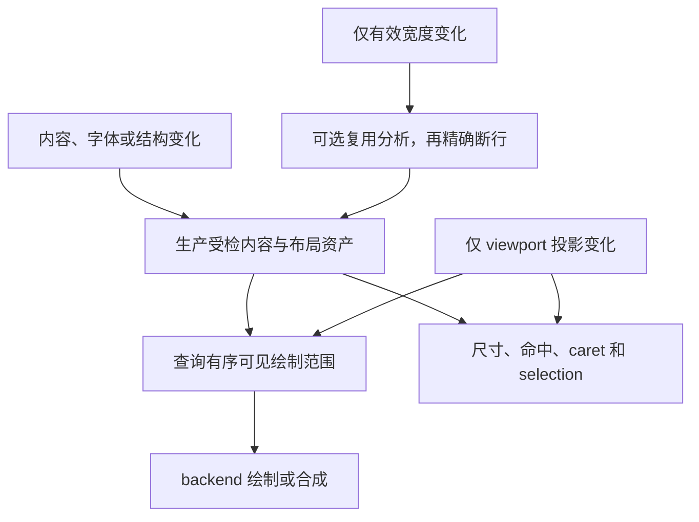

# 富文本渲染管线删减总体方案

类型：`proposal`

能力归属：Core（`novadraw`）拥有文字内容、Flow、布局资产、Preparation 输入证明和
Runtime 发布；Vello backend 拥有编码、栅格与纹理；platform 拥有真实输入和呈现。
Editor 继续消费 Core 交互几何，本方案不新增或删减 Editor 编辑行为。

日期：2026-11-05。状态：用户已授权按步骤实施。每项改进必须用匹配的
前后样本比较渲染时间，并覆盖真实鼠标拖拽和连续 resize 的整体成本；
Perfetto 用于诊断，关闭 tracing 的独立计时用于净成本判断。
既有合同和实验默认关闭状态继续有效；执行切片归入 FR-02。

`api_semantics`：`text.flow`、`text.interaction`、`layout.manager`、
`viewport.scroll_zoom`、`notification.layout_update`、`damage.repaint`、
`frame.preparation`、`render.backend_session`。

## 要解决的问题

本方案把“功能删减”落实为精简主线机制：取消重复的数据生产和检查，
让无变化查询、纯滚动、内容编辑与宽度变化各自只执行必要工作。
已交付的文字语义和外部扩展能力继续保留。将屏幕外尺寸改为估计值、
取消 bidi 或真实 inline Figure，会改变产品能力，不属于这次删减。

[最新原生滚动对照](../../verification/reviews/flow-assembly-scroll-comparison-2026-11-05.md)
说明，只减少组装次数不能保证更快。在带粗阶段观测的同配置 release 对照中，
assembly build 从 397 降至 3，固定滚轮活跃耗时中位数却从 19.83 ms 增至
30.93 ms；Stable 操作没有绘制，仍从 4.00 ms 增至 12.54 ms。
两组滚动帧仍各提交 7609 条命令、51232 个 glyph。

这批数据确认了 Core 稳定化与帧准备边界的增量成本，没有测出输入 reader、
证明比较、分配和释放各自的占比。约 56% 是本批观测下的回退，
不能当作无采集生产回退比例，也不能用于推算取消某个检查后的收益。

目标是使已受检且排版依赖不变的文字资产直接进入可见绘制。
纯滚动的文字工作量应取决于实际依赖检查、范围查询和可见输出，
不再固定遍历全文来源或提交全部 glyph。覆盖未知的分支允许保守退化，
不能承诺任意扩展、重叠场景和未知墨迹都达到相同复杂度。

## 归属和文档效力

本文负责删减清单、实施顺序、迁移与退出条件。具体机制继续由以下专题维护；
实施前修订所属专题，不在本文复制另一套公开签名和验证矩阵。

| 专题 | 本方案使用的边界 |
|---|---|
| [结构化 Flow](structured-flow-layout.md) | 整段 shaping、来源身份、inline、fragment 与共享交互几何 |
| [FR-02](flow-assembly-reuse.md) | 贡献复用声明、共享内容、输入证明和资产留存 |
| [精确 Flow 复用](exact-flow-layout-reuse.md) | 完整输入、共享 glyph 与 Recorder/submission 交接 |
| [滚动与 resize](long-text-scroll-resize-optimization-proposal.md) | 跨工作包组合、实际输入资格与生产启用 |
| [原生覆盖](long-text-native-coverage-boundary.md) | 墨迹、实际 lowering、范围查询与未知回退 |
| [可选阶段文字协议](staged-text-width-reuse.md) | 宽度变化时复用分析、准入及完整回退 |
| [栅格实验](../rendering/text-scroll-raster-reuse.md) | 冷热块、像素等价、完整块与设备资源 |

执行状态只在 [P2 backlog](../../roadmap/p2-delta-backlog.md) 维护。
下文步骤是建议的依赖顺序，不是第二份执行队列。新增步骤被接受后，
映射到既有 FR/LT 工作领域，同一时刻只推进一个 Execute 切片。

## 删减清单

“取消”表示旧工作不再进入目标路径；“替换”表示职责保留，换用成本更小的机制；
“隔离”表示可选能力保留，但不成为精简主线的必需依赖。

| 对象 | 处置 | 最终边界 |
|---|---|---|
| 内容、spans、来源和 glyph 的交接性深复制 | 取消 | 受检不可变 backing 在布局、快照、绘制与提交间共享；backend 编码转换独立计费 |
| 有效输入下每次重建整页 FlowAssembly | 取消重复调用 | 更新时生产资产，无变化时直接消费；贡献协议及不合格扩展的完整路径保留 |
| 同一输入作用域的 members、styles、prefix 和参与者重复物化 | 替换 | 共享受检输入，保留 root 权限、约束和动态字段的独立检查 |
| 无变化区间重复执行相同输入 reader 和完整比较 | 替换 | 在受控有效区间复用检查结果；可能改变依赖的回调之后重新检查必要依赖 |
| 纯投影变化导致的文字测量和布局重建 | 取消 | 更新投影、滚动条和 damage；实际宽度或排版依赖变化时恢复布局 |
| 已证明不可见文字的 IR、编码和栅格化 | 取消 | 录制前查询墨迹，保留有序可见范围、必要状态及未知分支 |
| 同帧相同资源身份的重复验证 | 去重 | 按完整资源实例、版本、字体参数和 session 复用；提交绑定检查保留 |
| 无活动写入时整树派生状态前后捕获 | 条件替换 | 仅在完整活动写集合与恢复合同成立后采用局部恢复；不属于首批 |
| backend 从全文命令流推断缓存范围并完整比较 | 隔离，后续替换 | 实验保持默认关闭；生产若采用纹理，改用受检稳定内容资产与完整块查询 |
| resize 重新分析和 shaping | 可选删除重复计算 | 阶段能力合格时复用分析；重新断行与当前几何仍需生成 |
| worker、渐进布局、自研字体后端及阶段依赖补丁继续扩张 | 暂缓新增 | 当前删减验收不以这些能力为前提；已批准成果和未完成状态保留 |

以下能力是主线必须保留的契约：Unicode 与 bidi、字体回退、整段 shaping、
精确尺寸、来源与 affinity、fragment 命中、真实 inline 测量、边框和装饰、
统一扩展入口、资源失效、预算失败、原子发布及恢复。不能用删除测试或缩小
消费者范围的方式宣布这些能力已经等价。

### 整页组装的删除边界

开放贡献树仍需解释成排版内容。首批删除同一有效版本的重复解释，
不删除 contributor/handler，也不把节点身份压成无法映射来源的字符串。
嵌套样式、段落边界、真实 Figure 和边框继续进入资产及其依赖。

原生富文本模型直接发布受检内容，是进一步取消中转组装的候选。
若已有入口足够，消费者直接复用；若不足，再定义最小公开增量。
该增量须向第三方提供同样的身份、来源映射、错误和计费能力。
它不作为首批依赖，也不能建立应用专用的免检查通道。

### 全量重验的删除边界

当前 reader 可读取扩展私有状态，后续串行回调又可能改变这些输入。
因此，已有正确性检查不能直接拿掉。首先只合并在同一受检作用域内、
同一绑定和约束下，且中间没有可能影响依赖的写入或回调的重复工作。
检查结果必须保留首次值及失败状态，不能被后续新值覆盖。

进一步减少跨阶段全量重读，要求所有相关变更进入可靠版本和失效协议。
依赖包括来源、结构、注册、字体、边框、资源、实际读取的派生几何和外部输入。
仅靠一个全局 revision、正文长度、散列或指针地址不能证明完整输入有效。

采用该协议的扩展必须保证相关写入可被观察；回调引起的变更使检查结果失效。
未采用协议的扩展继续重读。注册退役、输入变化、预算失败和原始 reader 错误
保持现有分类。最终发布检查仍确认所有候选的有效性与同次事务一致性。
若改变版本权威或跨层状态所有权，应另行记录长期边界选择及其取舍。

## 目标行为

图中表示拟议的合格路径。不合格声明、未知覆盖或缺少阶段能力时，
继续执行对应完整路径；普通错误和预算失败不解释为能力缺失。

| 操作 | 必须执行 | 应从合格路径中消失的工作 |
|---|---|---|
| 无变化查询 | 确认有效输入与当前场景，返回受检几何 | 整页内容物化、文字测量和新布局 |
| 纯滚动 | 更新投影、必要坐标消费者、damage 与可见输出 | 来源组装、shaping、换行及来源局部几何重建 |
| 内容编辑 | 验证新输入，更新受影响资产并保持来源映射 | 无关内容深复制；安全局部算法尚未通过时不承诺只重排编辑区 |
| 有效宽度变化 | 精确断行、对齐、inline 反馈和当前几何 | 阶段能力合格时重复分析；无能力时完整计算 |
| 字体、DPI 或设备变化 | 按实际依赖失效并恢复资源、布局或栅格 | 无；不能把这类输入归为纯滚动 |

颜色等 paint-only 分离另行定义，不在本批从既有完整请求或交互 revision 中
擅自移除字段。宽度变化不直接返回旧布局，屏幕外精确尺寸也不改为估计值。

## 实施步骤

### 步骤 0：冻结基线与删除判据

先在 FR-02 当前工作中补齐成本归因。记录 reader、参与者构造、首次证明合并、
完整比较、测量重入、稳定化调用和释放的工作量及必要阶段时间。
观测保持默认关闭、有界且实例持有，热路径不打印日志。

冻结相同 checkout、release 配置、字体、内容、窗口、预算和输入序列，
比较开关关闭与开启。匹配采样交替配置并重复进程；区分无采集计时与诊断计时。
基线覆盖首次、Stable、Pointer、滚动、追加、变宽、重置和失败恢复。
不同历史样本不拼成一条前后对照。

产出：可复查的基线收据、成本归属及本切片要删除的工作计数。
退出条件：能区分新增 reader/证明成本、重复测量和 backend 成本；
未细分的时间继续标为未知，不用阶段占比估算提速。

### 步骤 1：收口共享资产，取消交接复制

按 LT-01 和 FR-02 核对内容、spans、来源、ancestors、glyph 与变量坐标的交接。
已有共享内容和共享 glyph 使用同一受检存储，不重新开发第二套容器。
只处理仍存在的 owned clone、请求重建和快照交接性复制。
每条复制注明是否由算法本身需要，避免把 backend 编码转换写成全链路零复制。

产出：数据所有权图及已删除复制的清单。
退出条件：合格路径的内容交接不随文本长度复制 backing；旧快照在淘汰、
source 删除和服务销毁后仍合法可读；留存计费覆盖实际 backing 和 metadata。
调用级 clone 收益须与真实操作净成本分别报告。

### 步骤 2：合并重复输入捕获与证明检查

先修订 FR-02 专题，定义检查结果的有效区间、依赖绑定、回调屏障和失败语义。
首个实现限定同一不可变输入作用域：共享静态读取及资格输入，
避免每个消费点重新构造整套 participants 和 prefix。
reader 若无足够稳定性依据，继续重读。

随后仅在证据支持时扩展到按实际变更失效。新增公开协议须先冻结版本权威、
注册寿命、依赖传播和外部写入限制，并给出外部消费者。
不能通过删除最终检查或覆盖首次值取得性能改善。

产出：专题修订、有效区间示意及内置/外部共用的实现证据。
退出条件：有效区间内同一逻辑输入不重复物化；后续回调改变先前依赖时仍拒绝旧结果；
reader 错误、注册退役和预算失败仍可追溯。匹配 Stable 与滚动对照必须取得净收益，
首次及不合格路径不能出现未解释的显著回退。

### 步骤 3：分离排版失效与 viewport 投影

在步骤 2 的可靠输入依据上，把纯 viewport 位移从文字内容和布局依赖中分离。
既有布局资产继续有效，命中、focus、selection、连接锚点及其他坐标消费者
更新当前投影。宿主主动稳定查询与帧准备的重复入口按实际调用区间去重，
不能跨越必要回调或反馈轮次复用状态。

滚动条变化导致有效宽度变化、inline 依赖当前几何，或外部 contributor 读取 origin
等输入时，该操作不满足纯投影条件。继续执行必要布局，不按事件名称强制跳过。

产出：失效分类、受检复用依据及调用次数对照。
退出条件：已声明且仅投影变化的样本新增 assembly、文字测量、shaping 和换行
均为零；布局 revision 保持，投影正确更新；真实 inline、滚动条反馈、
跨 viewport 坐标和依赖变化反例通过。

### 步骤 4：删除屏幕外文字提交

按 LT-03 和原生覆盖专题修订接口，再实现录制前查询。
静态墨迹与范围索引随布局资产发布；Runtime 绑定本帧资源及实际 backend policy，
Recorder 只生成可能贡献可见像素的有序范围和必要状态。
字体资源验证在完整绑定相同的同帧范围内去重。

长行、RTL、负 bearing、重叠墨迹、边框和装饰按各自覆盖处理。
未知分支保持完整输出；覆盖或 session 不匹配时拒绝提交并按原恢复合同处理，
不能换用另一套未经证明的 lowering。

产出：公开查询及独立消费者、像素对照和范围查询成本。
退出条件：固定视口、增加可裁剪屏幕外内容时，不再固定提交全文 glyph；
查询包含索引及证书检查的总成本可解释。已知和未知混合、NoWrap 长行、
RTL 与装饰均保持顺序和像素正确性，记录命令碎片增加及最坏退化。

### 步骤 5：退役重复路径并完成主线验收

新路径通过契约与净成本验收后，删除已被替代且没有独立语义职责的内部构造、
复制和重复检查路径。公开 owned 构造、无声明贡献及未知覆盖的完整回退保留。
完整计算继续作为合法回退或差分 oracle，不为了减少代码行数删除。

长期 A/B 研究编排归研究宿主；生产运行无需同时维护两套合格路径。
移除研究开关或临时观测前，保留可复现方法、原始证据及失败记录。
不破坏受支持消费者，不清除未完成矩阵；公开 API 若需退役，单独说明迁移。

产出：删除清单、最终所有权图、回归与成本报告，以及相关文档的替代关系。
退出条件：仅保留有明确职责的主路径、能力缺失回退和研究验证入口；
代表性输入净成本改善，适用的冷路径、拒绝、内存、容量和恢复验收完成。
执行最终 workspace 门禁；生产启用按原专题独立裁决。

### 主线之后的可选步骤

主线删减完成后，按剩余成本决定是否继续。下列工作不自动列为完成本方案的条件。

| 候选 | 恢复条件 | 删除目标及限制 |
|---|---|---|
| 宽度阶段复用 | resize 成本仍有明显分析负担，LT-04 暂停范围获准恢复 | 复用已受检分析，保留精确断行、inline 和预算；不先扩张 shaping 补丁 |
| 生产栅格复用 | 像素差异已裁决，实际输入资格、冷热块及净延迟成立 | 稳定内容资产替换逐帧全文命令推断；热块不重新编码，冷块查询完整区域 |
| Runtime 活动恢复优化 | 整树捕获确认为剩余热点，完整活动写集合和失败恢复已定义 | 局部恢复替换整树捕获；不能仅依据“无活动”返回值跳过 |
| 原生富文本内容直入 | 贡献适配仍昂贵，已有共享内容入口无法满足消费者 | 减少中转组装，保留来源与扩展合同；应用模型仍归应用/Editor |
| 局部编辑与巨段增量 | 受影响长段成为主要瓶颈，安全边界和 delta 合同接受 | 删除未受影响部分的重新分析；bidi 和 shaping 影响可传播，保留完整回退 |

worker 只在剩余必要计算仍阻塞窗口时另行研究。将工作移到线程不会减少总工作量，
不作为这次删除机制的替代验收。

## 验证、失败和交付

每步先运行受影响 crate 的 lib 或精确 integration target 检查，
跨层切片使用对应已有 suite。公共跨 crate API 提前提升到 workspace quick gate；
最终边界运行 workspace fmt、Clippy 和 test。不得在每个小改动后重复全量门禁。
具体命令由 [测试入口](../../../tests/README.md) 和 `cargo xtask list` 确认。

行为矩阵至少覆盖：等长内容修改、样式与字体更新、注册替换、删除/重挂载、
后一个回调改变先前候选输入、真实 inline 二次测量、RTL、NoWrap、复杂装饰、
预算耗尽、旧快照留存及 backend/session 恢复。
优化后的输出与完整正确路径比较；不同 Runtime 的身份数值无需相同。

性能同时记录 P50/P95/P99、工作计数、复制与分配、留存及拒绝路径。
不能以 assembly hit、selected glyph 或局部 clone 变快代替操作与帧准备净收益。
当前证据不足以设定每步毫秒预算；实施切片冻结时确定回退容限和代表性负载，
不把历史建议的 16 ms/4 ms 写成已接受的新门槛。

来源变更仍按现有 mutation 合同提交；派生候选失败时保留旧成功发布及其恢复前缀，
不得把旧发布冒充当前源。过期、依赖变化、reader 错误和资源错误沿原通道传播。
需要恢复或重新录制时，已发生工作仍计入预算，不无限重试。

文本验证中间产物按仓库约定放在 `target/verification/text-*/`，不纳入 Git；
报告进入 verification，当前执行状态进入 roadmap。原始证据不重写，
本次不做产物体积测量。Windows/Linux、WindowServer 和实际屏幕呈现证据按
既有发布准备安排后置，Core 正确性及本切片净成本不能省略。

首个切片为步骤 0 的归因与基线，随后核对步骤 1 的剩余复制，
再落实步骤 2 的检查有效区间。每项改进独立保留前后原始计时，
未通过净成本与正确性验收的路径不得标为完成。
