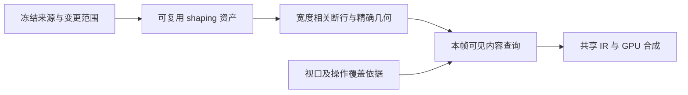

# 文本顶尖性能路线

类型：`proposal`

日期：2026-11-02。能力归属：Core Text／Layout／Runtime，backend 字形与合成，
platform 输入驱动；Editor 和产品只消费几何、版本及输入协议。
用户已要求记录路线并继续推进。本文确定目标、技术组合与推进条件，
不表示所有候选 API 已获评审或所有性能指标已通过。
执行状态只在 [P2 backlog](../../roadmap/p2-delta-backlog.md)维护。

## 要实现什么

目标是让输入、滚动、resize 和首次显示保持低尾延迟，并在复杂脚本、混合字体、
真实 inline Figure、多视图及资源变化下保持精确语义。
“行业顶尖”必须由同环境、同功能和同负载的可复现对照证明，
不以某个微基准、平均帧率或换用 GPU 代替整体验收。

采用精确增量排版、可复用 shaping、可见输出、共享资产和有预算调度的组合。
全文布局和本帧可见绘制分别持有状态；绘制范围缩小不改变全文尺寸、
来源身份、caret、selection 或实际 Figure 的生命周期。
精确模式与后续渐进模式显式区分，不按文本长度自动改变几何合同。

图中各阶段使用有来源依据的版本与依赖。生产实现状态见执行队列，
分阶段能力、原生覆盖和 worker 仍需各自冻结具体合同。

## 技术组合与所有权

| 技术 | owner／状态 | 要减少的工作 | 必须保留的合同 |
|---|---|---|---|
| shaping 与断行分离 | Core 文字引擎；不可变分析／字形资产与宽度相关行结果分开 | resize 重复字符分析、字体选择和 shaping | 完整请求、bidi／fallback／样式／inline 依赖；不可分离引擎继续完整计算 |
| 精确增量重排 | Core 来源／排版服务；delta 与检查点证据 | 一次编辑影响范围之外的重排 | 旧新版本、合法 UTF-8、shaping 安全边界和完整断行状态收敛 |
| 可见段落／行／glyph 查询 | Core 索引与 Recorder，backend 覆盖 policy | 全文 glyph 的遍历、准备和 IR 生成 | 实际墨迹、transform／clip／AA／数值域；未知时保留完整输出 |
| 不可变共享资产与稀疏 IR | Core Text／Render；版本化布局、glyph 和绘制片段 | 快照、glyph、来源映射与静态绘制的重复复制 | 旧 lease 留存、依赖准入、paint 顺序和失败恢复 |
| 按帧合并与有预算调度 | Runtime／platform；冻结请求、候选及取消状态 | 连续 resize 的过期计算和前台长时间等待 | 不丢弃已被交互消费的几何、不合并语义不同的事件、版本重验后发布 |
| 紧凑文档来源与位置摘要树 | Core 文档 provider；来源 token 与位置摘要 | 海量来源的存储、编辑和位置寻址 | Rope／piece tree 不替代 shaping；真实 Figure 保留树身份 |
| 可替换字形栅格缓存 | backend session；字体／glyph／设备参数资产 | 重复字形栅格化、上传与合成 | DPI、变量字体、彩色字形、变换、淘汰和设备恢复；默认路径保持可用 |

内置和外部分阶段引擎、provider、backend 使用同一 typed identity、payload trait、
registry、预算和受检结果。不得通过判断 Parley、Vello 或 Large 样例类型建立特权路径。
具体接口由所属 ADR 固化，本文不预占公共类型名称。

## 推进顺序

先处理当前可证明的重复工作，保持完整语义；再增加需要新证据的能力。
不同工作包的顺序可由测量调整，但每次只推进一个文字 Execute 切片。

| 顺序 | 工作包 | 当前起点与推进条件 |
|---|---|---|
| 已完成小片 | 精确缓存查找 | [2026-11-02 记录](../../verification/reviews/text-cache-optimization-2026-11-02.md)：长度预筛选与完整请求比较；查找累计明显下降，整体收益有限 |
| 当前下一片 | 宽度变化的阶段分母与复用可行性 | 核对默认引擎重复分析／shaping、复制、断行、输出验证成本；先做完整对照，再冻结可选分阶段合同 |
| 随后按实测选择 | 重复贡献／稳定化复用 | contributor 缺少纯度／revision 合同时仍重读；只缓存有完整依赖依据的纯资产 |
| 随后按实测选择 | 默认原生文字可见输出 | 原生墨迹与操作级设备覆盖证据复核通过，不能用行盒或固定像素常量冒充 |
| 后续独立设计 | 巨段编辑增量、调度、紧凑来源 | 安全边界、检查点、候选发布和取消合同成立；基准证明其解决剩余瓶颈 |
| GPU 取证后决定 | atlas／栅格策略 | 先证明栅格化或上传是瓶颈，比较默认路径和可选策略的像素、延迟与内存 |

宽度复用的下一片先做只读 API 核对和隔离实验，不提前改变生产公开协议。
若克隆分析资产、导出交互几何或内嵌反馈抵消收益，应保留失败证据并调整方案。
新重大协议需先形成具体 ADR 和退出矩阵，再按项目门禁实施；
路线获授权不等于未经验证的接口已经完成评审。

## 失败、扩展与成本边界

源变更、缓存完成、布局发布和帧呈现分别记账。
候选过期、字体更新、依赖变化、预算耗尽或输出非法时，按既有通道拒绝，
完整回退也受同一预算；源已提交后不承诺任意外部副作用回滚。
共享旧资产可以继续被旧 lease 持有，但不能冒充新交互 revision。

缓存分别计量分析资产、行结果、来源几何、墨迹、IR 和 GPU 资源。
记录当前／候选／旧 lease 共存、索引容量、分配和淘汰；
不能用无限保存所有历史宽度或字体实例换取命中率。
ASCII／等宽等受限路径必须有显式适用条件，并与完整引擎比较，
不能把字节数当作任意字体宽度。

## 怎样证明接近顶尖性能

建立固定功能负载：原 Large、单巨段、NoWrap 长行、CJK／RTL／混合字体、
真实 inline Figure、字体替换、极窄宽度、多视图和连续 resize。
记录冷／热缓存与淘汰，避免只比较长期预热的简单拉丁文字。
跨产品对照须匹配文字内容、字体、宽度、功能和实际输出；无法匹配时只比较机制，
不输出没有共同分母的产品排名。

分别测量输入到呈现、首次就绪、CPU 排版／IR、GPU 完成、P50／P95／P99、
峰值内存、分配、重复 shaping 和实际提交的 glyph 数。
不同阶段的分位数不能相加当作总延迟。
现有精确模式 16 ms 更新与 4 ms 查询／IR 目标继续适用，
不把 CPU 成功、离屏像素或某一次低于阈值的样本当作生产呈现验收。
产物体积分析仅按用户明确要求执行。

行业研究见[性能技术参考](../../reference/text-layout-performance-2026-11-02.md)。
用户已明确暂时保留 Parley；Core 直接编排底层文本库的替代路径保存在
[未来技术候选](parley-replacement-candidate.md)，尚未批准替换实施。
完整目标与状态所有权由[长文本总方案](long-text-performance-proposal.md)负责；
安全算法由[增量排版提案](long-text-incremental-layout-proposal.md)负责；
原生绘制依据由[覆盖提案](long-text-native-coverage-boundary.md)负责。
本页不复制这些文档的算法、签名或完整验收矩阵。
