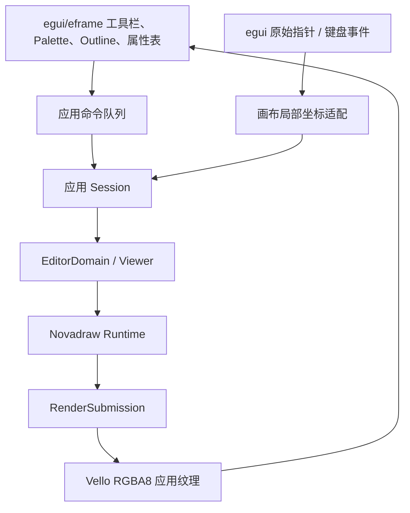
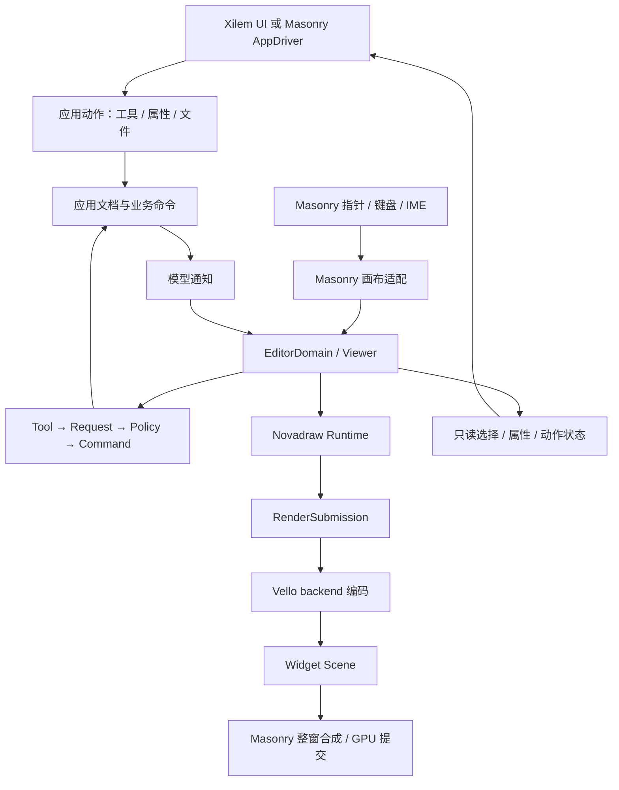

# GEF 官方样例对等实现方案

类型：`proposal`

日期：2026-10-27。2026-10-28 用户批准记录方案并开始实施。
总体方向已获授权；分批实施与完成证据只在 P2 backlog 维护。

## 2026-10-28 egui 宿主修订

用户后续明确要求 Shapes 样例直接使用 egui 搭建工具栏、Palette、Outline 和属性窗口。
该决定替代本文原先针对 Shapes 应用外壳的 Xilem/Masonry 选择，但不撤销已经完成的
Masonry adapter，也不改变 Core、Editor、typed Request/Tool/CommandStack 和模型
所有权契约。本文后续的 Xilem/Masonry 章节保留为原决策及独立 adapter 的历史证据；
Shapes 当前实现与状态以
[验证记录](../../verification/reviews/shapes-editor-implementation-2026-10-28.md)和
[P2 backlog](../../roadmap/p2-delta-backlog.md)为准。

当前宿主边界如下：

egui 不拥有业务模型、Viewer、EditorDomain 或命令历史。应用持有 WGPU
Device/Queue 和画布纹理，Vello 提交完成后由 egui 使用稳定 `TextureId` 合成。
UI 重绘、面板缩放和纹理重建不得重建编辑会话；输入只按中央画布矩形转换为局部坐标。

## 本次授权与首个切片

2026-10-28 用户指令：“好的，记录这个方案，然后开始实施”。
本次采用 Shapes 作为首个完整编辑样例，以 Masonry 自定义 Widget 包装为 Xilem
View；Digraph 仍保留独立只读分母。当前先完成 Scene 输出的后端前置切片，
契约见 [ADR-053](../../adr/adr-053-embedded-vello-scene-target.md)。

Editor 补充清单为专用 CreationTool、MarqueeTool、typed 模板拖放创建，以及供
工具栏、大纲和属性面板消费的稳定查询与变化通知。现有 G1–G5 的模型、命令、
投影和连接机制先以真实 Shapes 模型核验，不因本次授权重新宣称完成。
Logic 的吸附/guide/reparent、Flow 的拓扑与联合动画、Text 的历史合并/选区恢复
保留独立后续切片。业务模型、序列化、大纲控件和文件服务归应用。

UI 接入拆为 Widget 与 View 两层。Widget 负责渲染、surface mapping、输入仲裁、
capture/focus、IME lease、调度和 lifecycle；View 的 build 绑定稳定 session，
rebuild 只更新配置和 revision，message 转 typed action，teardown 释放消息路径与 lease。
Runtime、Viewer、CommandStack 和 direct-edit session 不随 Xilem rebuild 重建。
高频 pointer feedback 在 Widget/controller 内更新，外层 UI 只消费稳定状态。

Masonry/Vello 版本兼容尚未验证。本次 Scene 输出采用 Novadraw 的 Vello 版本，
不改动第三方参考仓库，不将未编译的 Masonry Widget 或 Xilem View 计为实现。
首批通过后继续固定兼容依赖并建设 Widget/View 消费者。

本方案以 [GEF 官方样例分析](../../reference/gef/official-examples-analysis.md)为需求证据，
以 [Editor 架构](architecture.md)、[GEF 语义账本](../../parity/gef/api-coverage.md)
和已接受 ADR 为约束。它不修改现行契约，不提升能力完成状态，也不另建执行队列。
获批后的通用增量进入 [P2 backlog](../../roadmap/p2-delta-backlog.md)；
业务 schema、文件格式与完整应用仍由独立产品包负责。

## 推荐方向

建立一个独立的 GEF 样例消费应用，复用 Novadraw Core 与 Editor，使用 Masonry
自定义 Widget 承载编辑画布；需要声明式工具栏、属性面板与页面组织时，在外层使用
Xilem。Masonry 是 Widget 与窗口宿主路线，Xilem 是可选的 UI 组合层，
两者不成为 Core 或 Editor 的依赖。

画布渲染优先验证“Novadraw 编码 Vello Scene，Masonry 合成并提交整窗”。
这条路线能避免每块画布各建一套 GPU renderer 和中间纹理。
共享 GPU 离屏纹理是保留的替代方案，适合需要独立画布渲染配置或已有纹理消费者的场景。
两者都需要接入验证，当前不能直接用现成 `xilem::view::canvas` 拼成完整编辑器。

推进顺序建议为：宿主接入验证 → Digraph1/2 → Shapes → Palette 定制 →
Logic → Flow → Text。Shapes 是第一个完整编辑闭环，Text 是单独的富文本编辑切片。
不以“全部先画出来”作为完成标准。

## 对等的范围与判定

对等目标是复现官方样例的可观察职责：模型结构、投影、编辑请求、命令历史、
几何与路由、宿主动作及失败行为。无需复刻 Eclipse RCP、JFace、OSGi、
Java 序列化或 SWT 控件层次。

保留原分析的完整分母：6 个编辑器模块、2 个 Palette snippet，以及 PDE 的
4 项和 Capabilities 的 2 项支持检查。能力表共 70 项；模型预设、文件向导、
Editor/View 入口、资源及不同事件路径继续分别记录。
每项都要写明“等价实现、平台替代、明确不采用、待实现或待验证”，不能删除难项来
提高完成比例。Eclipse 专有入口采用平台替代时，记录替代职责与无法等价的部分。

| 层次 | 应交付的证据 | 能证明的范围 |
|---|---|---|
| 参考事实 | 固定 Java 快照、类和方法、原报告编号 | 原样例实际接通的路径与限制 |
| Core/Editor 契约 | 公共 API、外部消费者、成功与失败测试 | 通用机制可被应用使用 |
| 样例应用 | 模型快照、命令重放、投影与操作断言 | 该业务用例走通 |
| 宿主与 GPU | Masonry 测试、真实 GPU 输出、窗口输入与 IME 人工记录 | 指定平台与接入路径 |
| 分发 | 可运行包、资源清单、启动和错误说明 | 下游用户能获得并运行 |

不照搬已识别的上游缺陷。Digraph 保持只读；Shapes 不添加用户折点来冒充原样例；
Flow 保持拓扑驱动布局；Text 的未接通 factory 类型、分页请求和结构删除疑点
按原报告分别处置。修正或扩展上游行为必须注明，不能归为原版已具备的能力。
<a href="#source-01">[cite:1]</a>

## 已有基础与需要核验的增量

下表区分已有规范/完成记录与本方案的接入需求。本次只定向审阅渲染公开边界，
没有重跑 G1–G5、图布局或文本测试，也没有扫描整个项目实现来决定架构。

| 领域 | 已有依据 | 本次需要做什么 |
|---|---|---|
| Model、Part、Command、Viewer | G1–G5 完成记录与 Editor 架构 | 用真实样例模型消费；检查所需操作是否仍属 partial family |
| 连接投影、创建、重连、折点 | G5 与 Anchor/Router 扩展契约 | 验证几何锚点、端口 key、相对折点与动态编辑资格 |
| 直接文本编辑与 IME | P2-E02 完成；单 session plain-text draft | Logic/Flow 标签可复用；Text 富文本不能套用成整篇 plain-text draft |
| Directed/Compound 图布局 | ADR-043、P2-L01 完成与图投影记录 | 增加 Flow 的业务拓扑贡献、布局辅助边与增量编辑验证 |
| Presentation 动画 | 动画契约、ADR-046 与 Tree 消费者记录 | 验证 Flow 节点/线联合过渡；Tree 证据不等于 Flow 已完成 |
| 框选、专用创建工具、reparent | GEF 账本仍有 partial 项 | 定向审计后定义最小增量，不按 G4 完成推断全部已支持 |
| 组合吸附、guide、clipboard | 账本 deferred 项 | Logic 所需通用契约需单独评审 |
| 非图形 TreeViewer、Workbench | 核心明确不采用 | 用应用大纲、属性面板、文件服务和动作绑定替代 |
| 平台 accessibility、打印 | 既有 P2 后续范围 | 不因 Masonry 自带 AccessKit 或可截图就标记完成 |
| Masonry 宿主、Scene 输出 | 本次第三方核对与后端公开面审阅 | 新增宿主桥接与编码出口，完成版本、生命周期及失败验证 |

依据：[Editor 路线图](../../roadmap/editor/00-index.md)、
[GEF 账本](../../parity/gef/api-coverage.md)、
[Direct Edit](p2-direct-text-edit.md)、
[ADR-043](../../adr/adr-043-directed-compound-graph-layout.md)、
[图投影契约](../architecture/graph-projection-preparation.md)、
[动画契约](../animation/animation-system.md)和
[Tree 表现几何](../animation/tree-layout-presentation-proposal.md)。

## 应用与引擎的所有权

| 状态或服务 | 唯一 owner | 约束 |
|---|---|---|
| 业务模型、序列化、保存错误 | 应用文档 session | 持久 ID 与运行时 Part/Figure ID 分离 |
| CommandStack、active Tool | EditorDomain | UI 不另建撤销栈，不在属性 callback 直接改 Figure |
| Viewer selection、targeting、direct-edit session | Editor Viewer | 大纲按业务 ID 桥接；文本 selection 与节点 selection 分离 |
| 布局、命中、几何、资源、presentation | Core Runtime | 普通消费者以 Runtime 为管理入口 |
| 事件归一化、host effects、尺寸和宿主 lease | Masonry adapter | Host 不拥有业务模型、Runtime 或 GPU |
| 编码资源 cache、backend session | Vello backend | 每个 Runtime 的资源与 session 隔离 |
| 窗口、Device/Queue、UI 合成和事件循环 | Masonry window driver | 不再嵌入第二个 winit event loop |
| 工具栏、大纲、属性表、文件选择 | 应用 shell | 读取稳定 UI projection，写入通过应用动作 |

Xilem 的 view 重建只能更新 Widget 配置和消费稳定状态，不能重建 Viewer、
Runtime、CommandStack 或订阅。Widget 内可持有画布 controller，应用 session 持有
文档与 domain；跨两者的消息通过有界动作/效果通道传递，避免循环可变借用。
controller、session 和 Host 的释放职责必须在接入 ADR 中固定。

一个窗口多文档时，每个文档拥有独立模型和历史。多个 Viewer 若共享同一文档，
共享的模型与命令路由由应用 session 协调，Viewer selection 和 Runtime 仍分别持有。
大纲只是同文档的只读 projection 与选择入口，不为它创建另一套业务模型。
缩略图按模型或公开只读描述重建独立 Runtime，不搬运活 Figure，也不高频反向改主视图。

## Masonry 自定义 Canvas 的接入

这里的 `NovadrawCanvasWidget`、`MasonryCanvasHost` 等名称是候选角色，
不是已经存在的 API。先在真实消费应用中验证边界，再决定是否提取可复用
`novadraw-platform-masonry`。通用输入归一化、坐标和 Host 协议最终归 adapter；
样例仅负责平台组合和业务编排。

### 现成 Canvas 与自定义 Widget

本地 Xilem/Masonry 基线为 `5281ffb308732b00f42e0755c6095b6ae234ae16`，
本次核对时工作区无未提交变更。
`xilem::view::canvas` 回调取得 `vello::Scene` 和尺寸；
Masonry Canvas 缓存 Scene、布局时设置 clip、尺寸变化触发 action。
它有 pointer interaction 资格，但没有专用 pointer、keyboard 或 IME 编辑处理。
自定义 `Widget` 则具备 `on_pointer_event`、`on_text_event`、`on_access_event`、
`update`、`on_anim_frame`、`measure`、`layout`、`paint` 和 accessibility hooks。
<a href="#source-02">[cite:2]</a><a href="#source-03">[cite:3]</a>

| Hook | 画布职责 | 应避免的工作 |
|---|---|---|
| `measure` | 根据配置报告画布最小/期望尺寸 | 在测量阶段提交模型或执行布局动画 |
| `layout` | 记录可见内容区域，建立 clip，排队 surface resize | 反复重建整份文档 |
| pointer/text hooks | 归一化输入，经 Viewer 仲裁，回收效果 | 直接改模型或绕过 Figure 消费结果 |
| `update` | 处理 focus、disabled、stashed 等状态转换 | 保留已失效 capture/IME lease |
| `on_anim_frame` | 注入单调时间、驱动 wakeup、更新必要画面 | 循环等待或每帧重新求图布局 |
| `paint` | 合成已准备的稳定 Scene 或接受受控编码结果 | 执行业务 Command，重复确认同一 submission |
| accessibility | 消费 Core/Editor 稳定语义投影并回传 action | 从截图或临时动画推测交互状态 |

Masonry paint 可以被跳过，也可以因宿主失效而重复调用。
模型动作、资源接纳和 Runtime frame completion 必须使用独立 generation，
不能把 `paint` 次数当作命令次数或成功提交次数。

### 渲染路线与版本前置项

| 路线 | 组合方式 | 增量与成本 | 建议 |
|---|---|---|---|
| A：Scene 合成 | Novadraw submission 编码为画布局部 Scene，append 到 Masonry Scene | 需要 backend 编码出口和提交确认设计；无画布中间纹理，但共享整窗 AA 配置 | 优先验证 |
| B：共享 GPU 纹理 | Novadraw 渲染应用纹理，Masonry image override 引用它 | 同 Device/Queue，独立 renderer 与纹理；Vello 会拷贝到 image atlas | A 不满足要求时评估 |
| C：独立原生画布窗口 | 当前 winit canvas/整窗路线承载 Editor，UI 另作组合 | 已有宿主基础；跨窗口焦点、布局和平台集成成本较高 | 保留现有验证入口 |
| D：CPU 回读图像 | GPU → CPU → UI image upload | 增加同步、回读与上传，不适合交互热路径 | 仅允许离线导出验证用途 |

Novadraw workspace 当前声明 Vello `0.10.0`；本地 Xilem 声明 `0.7.0`。
因此 A 的 Scene 不能直接 append，B 的 WGPU Device/Texture 也必须核对版本和类型兼容，
“都基于 Vello”并不足以接通。先验证 Masonry 适配到同一 Vello 版本的可行性；
若需维护小范围兼容分支，固定 commit、补丁清单和升级测试责任。
不为接入 UI 擅自降低引擎版本，也不在 Core 增加多版本 Scene 转换接口。
<a href="#source-04">[cite:4]</a><a href="#source-06">[cite:6]</a>

本项目 `SceneEncoder` 当前私有，公开出口主要是整窗 `VelloRenderer` 和
`texture::VelloTextureRenderer`。A 需要把编码能力在 Vello backend 内独立出来，
复用已有校验、glyph/image resources、描边和 antialias preparation；
不能在应用里复制一套 RenderCommand lowering。Vello Scene 类型可以留在具体
backend 的公开 API，不能进入 backend-neutral Core/Editor。
<a href="#source-06">[cite:6]</a>

A 的候选提交契约：

1. Runtime 按 backend capability 准备 full-frame submission。
2. backend 先验证 composition、命令、资源 session 和设备像素要求，再构造候选 Scene。
3. 成功后原子替换 Widget 持有的 Scene generation；`Presented` 指目标 Scene 已发布，
   不表示窗口扫描输出或 GPU 已完成。
4. Runtime 完成该次 submission；Masonry 缓存/重复合成同一 Scene 不重复完成。
5. 窗口 present、GPU failure 与 device recreation 是另一条宿主反馈路径；
   失效后重建 backend session、请求完整资源快照并重绘。

若无法保证 Scene 目标的生命周期或失败回传，A 不能宣布接入成功，
须评审延迟确认机制或改选 B。编码 Retry 保留旧稳定 Scene 与 damage；
候选失败不得发布半份命令或丢弃待提交资源。

Masonry paint 实现当前缓存每个 Widget Scene，但整窗合成仍有
“Handle damage regions”的 TODO。A 首版不得宣称 retained partial GPU present，
应申报 full-frame target；Core 的增量布局和资源缓存仍可使用。
画布 clear/background 在局部 clip 内表示，不能清空整窗 Scene。
编码设备像素描边、AA 后再还原到局部坐标，需验证 DPI 只被应用一次。
<a href="#source-05">[cite:5]</a>

B 有源码依据：Masonry `AppDriver::on_wgpu_ready` 暴露共享 Device/Queue，
`DriverCtx::set_image_override` 支持持久 image→GPU texture 映射。
纹理要求 `Rgba8Unorm` 与 `COPY_SRC`，override 作用域为 renderer/device，
每次绘制会拷贝到 Vello image atlas。Novadraw 纹理后端另要求匹配尺寸、
单采样、`STORAGE_BINDING` 和 full damage。
这是一条 GPU 合成路径，但不能称为零拷贝。
<a href="#source-04">[cite:4]</a><a href="#source-06">[cite:6]</a>

B 的 renderer、纹理和 override 由 driver 管理，Widget 只引用稳定图像身份；
同 Queue 上先提交画布渲染，再提交 Masonry 合成。
resize 时同步替换 image dimensions、texture 和 override，旧资源在安全时点释放；
跨 Device 纹理结构化拒绝。Xilem view 当前没有本次已确认的对应高层入口，
需要定向核对或扩展 driver 桥接，不能把低层能力当作 Xilem Canvas 的直接参数。

### 输入、坐标与 capture

输入顺序为 Masonry 命中 Widget → adapter 转画布局部 surface 坐标 →
Viewer 的 direct-edit/Figure/Tool 仲裁 → Host effects → Masonry 标记 handled。
画布内消费与 capture 以 Viewer outcome 为准；未消费事件才允许冒泡到 UI，
避免 Delete、滚轮或快捷键被执行两次。

建立一份不可变 surface mapping，包含 Widget 内容区、DPI、逻辑/物理尺寸、
generation 和可见状态。EventCtx 的 `local_position` 已执行 physical→logical 与
content-box 转换，不能再手工减窗口 offset 或重复除 DPI。
Masonry 部分 measure/layout 注释使用 device pixels，而 paint/坐标转换仍说明宿主
自动 scale；本地源码正处坐标演进期。接入验证须固定该基线的实际单位，
分别断言 pointer、clip、paint、纹理尺寸与 IME area，不能只根据方法名作假设。
<a href="#source-03">[cite:3]</a>

Editor zoom/viewport 留在 Runtime，Masonry 只分配画布矩形。
鼠标位置缩放、拖动增量、handle 和反馈继续使用引擎坐标契约。
缩略图控制主视口时通过明确应用动作，不用 Widget transform 代替 Editor zoom。

Masonry capture 对 Widget 树内目标具有排他性；Up/Cancel 后自动释放，
窗口失焦等情况产生 Cancel。但当前 `capture_pointer` 中仍有把 capture 接到
平台 winit 的 TODO。窗口外持续接收指针不能据此宣称完成。
必须实测离开画布、离开窗口、Alt-Tab、禁用和关闭；缺失时明确补宿主契约或限制，
不能用每帧轮询鼠标位置掩盖丢失的事件。
<a href="#source-03">[cite:3]</a>

### IME 与焦点

Masonry 的 `accepts_focus`、`accepts_text_input` 在 Widget 创建时缓存；
后者为 true 时，Widget 获焦会开启平台 IME。因此不能在 direct-edit session
启动/结束时简单切换返回值。

推荐自定义画布为容器：普通编辑 surface 获取键盘焦点但不接受 IME；
单独的 `TextInputBridge` 子 Widget 固定接受文本输入，仅在有效编辑 lease 存续时
启用并获得焦点。它只转发 composition/commit，不持有另一份可见文本布局或业务值。
结束 session 后释放 lease、清空候选区域、恢复画布焦点并使 bridge 失活。
是否用 stashed 或禁用状态及其焦点清理顺序，需要 Masonry 测试确认。
如果选择新增动态 text-input capability，则先评审上游 API 与生命周期，避免反复
销毁画布来切换 IME。<a href="#source-03">[cite:3]</a>

Editor 输出的 caret surface rect 经 adapter 转为 bridge content-box rect，
交给 `set_ime_area`，窗口位置与 DPI 由 Masonry 转换；
bridge 有自己的布局原点时必须计入该映射。
IME events 带当前 lease/session identity，迟到的旧事件被拒绝。
keyboard text、dead key 与 IME Commit 不能重复插入。
Masonry focus、Viewer part focus、Figure focus、text selection 四者保持独立。

### 时间、失效与无障碍

Host 发出的 redraw 和 deadline 先排队，由合法 Masonry context 消费；
Host 不保存 `EventCtx`/`PaintCtx` 借用。
动画 callback 的 interval 首帧为零，并不自动 request repaint。
adapter 从宿主单调时钟取得时间，显式 request render 和下一次 wakeup。
动画、auto-expose 与 caret blink 共用调度；无活动任务时停止 tick。
本地 DriverCtx timer 仍有 TODO，deadline 路线需验证，不能为稀疏 blink 永久开 60 Hz。
<a href="#source-03">[cite:3]</a><a href="#source-04">[cite:4]</a>

隐藏、零尺寸或 suspend 暂停渲染；禁用和失焦取消输入所有权；
关闭时按既有 Editor 生命周期清理订阅、feedback、capture、IME 和待执行动作，
再撤销 host lease 和 backend 资源。旧 widget/session/generation 的 callback 不能
影响重新打开的文档。模型/投影 fault 由应用显示错误并重建，Host 不伪造 rollback。

Masonry 可通过 AccessCtx 输出附加 AccessKit 节点；这只证明宿主有扩展口。
画布需另建稳定 semantic-ID→AccessKit-ID 映射、坐标、焦点、selection 与 action 路由，
按 Core committed state 授予交互资格。不能只写一段 Canvas alt text 就满足
Logic 的节点/导线名称，更不能据此声明完整 Text accessibility provider。
接入已有 P2-A01 平台工作，逐平台验收。<a href="#source-03">[cite:3]</a>

## 外层 UI 与业务服务

| Eclipse 职责 | 本项目替代 | 边界 |
|---|---|---|
| Editor/View/Perspective | 应用页面、文档 tab、只读视图 | Digraph 独立 View 与编辑文档分别验证 |
| Palette/tool entry | Xilem/Masonry 工具面板与 typed 工具工厂 | Tool、creation payload、gesture 在 Editor |
| Properties/Actions | 只读属性 projection、应用动作、Command | 同一操作经工具栏与快捷键进入同一 action |
| Outline | 业务 ID 大纲与 selection bridge | 避免双向监听回环，不复刻核心 TreeViewer |
| 文件向导/save/save-as | 文档服务、领域预设、原子文件写入 | 写入成功后才标 save location，失败保留 dirty |
| DnD/clipboard | 平台 payload adapter 与受检应用请求 | 不把 UI 坐标直接写成模型坐标 |
| Tooltip service/preferences | 实例作用域 typed factory 与设置观察 | 不使用全局 service locator 或静态字体 |
| Print | 输出目标服务与明确文档版本 | Logic 原版打印读取已保存文件，需区分当前未保存视图 |
| PDE 工程向导 | 可获取源码、cargo 示例工程或模板生成 | 不声称实现 Java/PDE nature；取消、命名和失败分别验证 |
| Capabilities activities | 应用入口分组与显示配置 | 与 Runtime Figure capability、权限系统分离 |

属性面板写入先校验当前文档、业务身份与版本，再生成命令；
selection change 只刷新 UI projection，不回写模型。
文件加载构造并校验新模型，成功后整体替换 session；未知类型、版本和损坏连接应
返回领域错误。Rust 样例格式可采用显式版本化数据，但不承诺读取 Java serialized 文件。

Palette snippet 需要两层验收。外层 UI 的工具 panel 可承担创建工具选择职责；
PL1 的 Figure 角色字体更新、PL2 的 Figure ancestor→entry 定位与复合提示，
则建立独立 Novadraw Palette 展示场景。普通 Xilem button/tooltip 的截图不能证明
这些 Figure 扩展语义。工厂替换的作用域和 fallback 用 typed 注册测试，
OSGi DS 精确 class 匹配记录为装配替代，不复制闭合类型分支。

## 各样例的实现切片

下表覆盖原分析所有能力编号。每组实施时仍需逐项写操作、模型断言、
投影断言、宿主断言和平台证据；分组不会合并验收分母。

| 切片 | 对应编号 | 应用实现 | 通用增量或重点核验 |
|---|---|---|---|
| Digraph1 | DG1-01～05 | 固定 5 节点模型、factory、根装配；只读页面与 View | 无命令的输入边界、订阅生命周期 |
| Digraph2 | DG2-01～05 | 4 边及双端关系、reference.x 决定 top/bottom 的 Anchor；不额外加箭头 | 双端发现去重、外部 Anchor、反馈不赋予编辑资格 |
| Shapes 投影与几何 | SH-01、02、05、08 | 矩形/椭圆模型，freeform，Chopbox/Ellipse，障碍路由 | 公开 Anchor/Router 接入与移动缩放后的失效 |
| Shapes 创建与历史 | SH-03、04、06、07 | 工具/模板创建、拒绝重复边、自连接、重连、删除关系恢复 | 专用创建/框选缺口；两阶段 cancel；历史身份 |
| Shapes 宿主 | SH-09、10 | 大纲、属性、save/save-as/reopen | selection bridge、保存点与文件失败 |
| Palette1 | PL1-01～04 | 独立面板、drawer/entry 两种设置、字体 lease | Figure 样式更新与旧资源释放 |
| Palette2 | PL2-01～05 | 实例级 tooltip factory、entry 查询、标题/说明提示 | 定制作用域、ancestor lookup、无贡献 fallback |
| Logic 模型与端口 | LG-01～04 | 预设电路、typed terminal、wire 关系与确定性值传播 | 端口 Anchor key、重连完整恢复；计算留在模型 |
| Logic 路由与反馈 | LG-05～07 | manual/Manhattan/shortest 模式、相对折点 | 动态 policy/handle 资格、缩放反馈与路由切换 |
| Logic 结构编辑 | LG-08～11 | guide model、嵌套容器、克隆 ID 映射与内部边复制 | 开放组合吸附、guide attachment、reparent 事务 |
| Logic 应用接入 | LG-12～15 | 标签直接编辑、大纲/鸟瞰、两类 DnD、保存打印和名称 | IME、clipboard/DnD、导出、semantic provider |
| Flow 结构与布局 | FL-01～04 | 普通/顺序/并行活动，内容区与 typed layout contribution | GraphProjection；顺序约束辅助边不进入业务模型 |
| Flow 编辑目标 | FL-05～09 | 容器/活动/连接目标，split edge、重连、标题编辑、add/orphan | target 解析、原子拓扑命令、reparent 与 Anchor 更新 |
| Flow 动画与宿主 | FL-10～12 | 前后稳定布局、节点和线联合过渡、新对象入场、保存 | 全组 plan 原子预检；订阅释放；静态终态一致 |
| Text 文档与选区 | TX-01～05 | block/inline 文档模型、结构 projection、范围与对象选区 | 稳定文档位置→layout map、共同祖先 target、导航 |
| Text 编辑与历史 | TX-06～08 | 插入/覆盖/删除/换段/缩进；结构命令与选区书签 | 可扩展历史合并、execute/undo/redo selection restoration |
| Text 样式与宏 | TX-09～11 | 范围样式、继承、段方向；宏转换明确支持范围 | 样式拆分/合并、Bidi interaction；不复制上游未接通分支 |
| Text 排版与应用 | TX-12～14 | wrap/reveal、资源释放、保存/重开与工具栏 | 布局版本、Masonry IME；不声称原版支持 save-as |
| 开发者分发 | PDE-01～04 | 来源可获取、模板命名/生成、Rust 依赖和取消错误 | 标注 Java/PDE 机制的替代范围 |
| 入口组织 | CAP-01、02 | 样例分组开关与不匹配入口保持原状 | 应用配置测试；不等同 Runtime capability |

### Shapes 建立第一条完整链路

先完成鼠标创建 → 模型通知 → 节点/连接投影 → 移动缩放 → 重连 →
delete/undo/redo → save/reopen，再补模板拖放与大纲。
界面动作不得调用内部 PartTree mutation；模型命令保存业务 ID 和 old/new 值。
删除恢复需另测 child 顺序/Z-order，原样例“节点边恢复”不能自动证明顺序恢复。

第一版接入成功要求一个窗口能同时放置 UI 按钮与画布：
画布拖动不触发按钮，属性输入不触发画布 Delete，画布取消后 UI 焦点正常。
这比先做完整菜单外观更能检验宿主边界。

### Logic 的增量保持开放

吸附采用 typed provider、请求参数、candidate 和有序 resolver；
grid、geometry、guide 与应用自定义 provider 走同一注册路径。
显式声明优先级、容差坐标域和 zoom/DPI 换算；反馈只表示候选，
最终 guide attachment 与 bounds 在同一业务命令中提交和撤销。

reparent/clone 首先是应用图事务：固定 parent、顺序、端点、terminal、guide 关系
与新旧 ID 映射。通用编辑框架负责请求和反馈，模型负责合法性及可恢复失败。
信号传播用实例内确定性队列和预算处理重复计算/环，不建设 Core 电路求解器。
Manhattan 模式必须同时撤销折点反馈、handle 与命令资格，
不能只隐藏控制柄而仍接受旧请求。

### Flow 复用图布局，单独验证动画消费

模型拓扑贡献为不可变图请求；Sequential 的相邻顺序约束只作为布局辅助边，
不进入文档 connections、序列化或 undo 历史。
自动求解后的 bounds 是派生结果，用户拖到容器/活动/连接时生成拓扑命令，
不保存一个自由 XY 坐标来替代结构编辑。

SplitTransition 在同一事务中移除 A→B、加入 X 和 A→X→B；
undo 恢复原边身份、顺序与关系。失败必须保持原状态或明确 fault，
不能依赖“先执行再随意 undo”获得原子性。

动画捕获两个稳定 layout generations，节点 bounds、可见性、线 provider 输出和
必要视口跟随组成一个 plan，预检成功后整体激活。线与端点读取同一 presentation
geometry view；不用每帧调用图求解器，也不每帧写 source route/bounds。
输入、selection、focus 和 accessibility 继续使用 committed state。
新节点使用明确入场几何，新边避免从默认斜线插值；
若两个路由拓扑不可插值，显式采用离散切换或淡入淡出并记录差异。
source 已提交后动画激活失败时保持静态最终场景，不能声称模型已回滚。

### Text 建立富文本协议

P2-E02 是“编辑草稿、accept 产生一个模型 Command”的 plain-text direct edit。
官方 Text 则持续编辑 block/inline 树，支持范围样式、结构变化、
连续输入合并和历史选区恢复。两者共用输入、位置几何和资源服务，但不共用
同一份闭合 session 状态机来承诺所有行为。

候选方案采用应用定义的 typed TextTool/Request/Policy，并补充通用且开放的历史协议：

- 应用持久文档位置使用 block/inline 稳定 ID、UTF-8 offset 与 affinity；
  发布 layout 时建立到 Core 文本位置的受检映射。
- 文本范围与结构对象选择分开；跨 sibling 的请求解析共同祖先编辑目标。
- TextCommand 保存模型补丁和执行前后 selection bookmark；
  undo/redo 后先同步模型与新布局，再解析书签，不能保存旧 layout/Part 句柄。
- 合并通过外部可注册的 typed merge contribution 协议表达。
  导航、样式改变、结构改变、composition 完成和外部 revision 变化是明确边界；
  不在应用里绕过 CommandStack 调用 pending mutation 来伪造历史。
- 富文本 composition 保留临时草稿；平台 Commit 形成受检编辑事务，
  preedit 不进入模型历史。composition 与一般输入的合并规则单独定义。
- 范围样式拆分、合并、继承与 toolbar mixed state 由文档模型实现；
  Layout/paint/hit-test/caret 读取同一布局 generation。

先交付纯文本跨段内容和历史，再做范围样式/Bidi/宏。
上游宏生成但 factory 未接通的结构记录为明确未对等或修正扩展，
不得一次性承诺全部 bulleted/code/import 路径。
此切片需要独立 ADR 与外部消费者，不能把整个富文本模型塞入 Core。

## 外部消费者与接入退出条件

新契约要用仓库公共依赖之外的消费者验证。内置与扩展走同一 typed identity、
payload trait 和 registry；下表是必须能成立的用例，尚未执行。

| 证明 | 最小消费行为 |
|---|---|
| Host 可移植 | 同一 Shapes 模型/策略运行于 headless、现有 winit 和 Masonry |
| Figure/Anchor 开放 | 外部第三种 shape、自定义端口与 Anchor，无 Core 类型分支 |
| Tool/Request 开放 | 外部创建工具和 Text 请求正常 dispatch、拒绝并 cancel |
| Snap 开放 | 外部吸附 provider 与内置 grid/guide 一起排序和反馈 |
| 图布局开放 | Flow 同一请求可选默认与外部算法，结构化拒绝不支持的结果能力 |
| 历史开放 | 外部文本 merge contribution 与 selection bookmark 通过 failure/revision 测试 |
| backend 可嵌入 | 两个 Runtime 的 font/image/session 隔离，Scene/texture consumer 正确失效 |
| UI 可替换 | 替换 toolbar/docking 方案不改变 Editor 的模型、历史与输入契约 |

宿主接入验证必须先通过以下退出条件：

1. 固定兼容依赖，记录 `cargo tree -d`、Vello/WGPU/Kurbo 版本与补丁责任。
2. 单画布与双画布完成 resize、clip、DPI、输入坐标、资源隔离和静态 GPU 比对。
3. Scene generation、Retry、重复 paint、零尺寸、hide/show、重开及 device failure
   不丢失待提交帧，不误确认提交。
4. pointer cancel/capture、焦点、快捷键和中文 IME 候选区域可重放并有人工作证。
5. 测量两条渲染路线的帧成本与产物成本，再决定正式采用路线；
   若 A 已满足功能与预算，不要求把 B 也建设成生产实现。

## 性能、包体积与验证

本次没有性能或二进制测量。以下是设计预期与后续测量要求，
不能当作 Masonry 比现有宿主更快的结论。

| 成本 | 预期与测量方法 |
|---|---|
| UI 与文本依赖 | 可能增加 Masonry/Xilem、AccessKit 与字体系统代码；统一版本后测实际增量，不按 crate 数估算 |
| Scene 路线 | 减少画布纹理和独立 renderer，但整窗 Scene append/encoding 与 full GPU render 仍需测 |
| 纹理路线 | 每块画布 RGBA8 至少 `W×H×4` 字节，另有 atlas、AA 和 renderer 工作区；GPU copy 计入帧成本 |
| DPR | 同样逻辑面积的纹理像素数随 DPR 平方增长；resize/多画布峰值内存必须采样 |
| 图求解与文本布局 | 仅源拓扑、样式或约束变化时重算；animation sample 不重排版、不求图 |
| UI 重建 | 稳定 projection 按 revision 刷新，输入热路径不序列化全模型 |
| 空闲 | 无动画/auto-expose/blink 任务时无持续 frame；有 blink 时按 deadline 唤醒 |
| Web | 首版 Masonry Native；Web 复用模型/Editor 与现有 DOM adapter，不能把 native 体积结论外推到 WASM |

同一 release profile、target、feature、资源、strip/LTO 配置，比较现有 winit shell、
Masonry-only 和必要时 Xilem+Masonry。记录可执行包未压缩/压缩大小、依赖重复、
冷启动、首次画面、首次输入、常驻/峰值 RSS、GPU memory 和录入场景。
Web 单独测 raw/gzip/brotli、下载和首次可交互；字体和预设资源评估裁剪及按需加载。
不把系统字体用于测量的一组结果等同于内置字体分发成本。

代表性场景包括：官方固定 Digraph、Shapes 创建/拖动/重连、
Logic 四位加法器与克隆/guide、嵌套 Flow split/undo/动画，以及 Text 混合方向、
跨段样式、长文本输入和滚动。各场景增加明确的规模配置，记录输入量，
不把扩大的压力场景计作官方新增样例。
分别测 input→stable projection、布局/路由/编码、GPU、input→present 的
p50/p95/p99 和超帧比例，预算按目标设备评审；不能预先声称达到固定帧率。

验证按风险逐级执行：模型与命令 headless 契约 → 外部消费 API →
Masonry TestHarness 的 Widget 行为 → 原始 GPU 输出 →
Native window 的 pointer/IME/focus/拖放 → 分发包。
host harness 和截图不替代窗口外 capture、中文 IME、真实 GPU 或系统 AT 验收。
不修改、编译或运行 Java，静态参考与 Rust 行为记录分别保存。

## 实施与评审顺序

| 顺序 | 可评审交付 | 进入下一步的依据 |
|---|---|---|
| 接入验证 | 固定版本、A/B 最小渲染消费者、坐标/IME/生命周期契约、成本记录 | 选定宿主与渲染路线，无未说明的关键阻断 |
| Digraph 与 Shapes | 只读投影、完整编辑闭环、文件/属性/工具栏、headless+Native 证据 | 验证模型、Editor、Canvas 与 shell 的职责 |
| Palette | 两个独立展示与作用域/资源测试 | 工具 UI 和 Figure 定制分层证据齐全 |
| Logic | 端口、路由、吸附、嵌套、克隆、多视图与宿主服务 | 通用缺口已通过 ADR 和外部消费者 |
| Flow | 拓扑编辑、compound 请求、原子图结果与联合动画 | 静态终态、历史与表现几何一致 |
| Text | 文档位置、内容/结构命令、历史、样式/Bidi 与 IME | plain-text 和富文本契约分开，限制逐项记录 |
| 分发闭合 | 源码工程入口、资源、入口组织、支持矩阵 | 70 项能力与 6 项支持检查均有明确处置 |

每个切片按 source contract → targeted current-state audit → 最小 ADR/delta →
外部消费者 → 实现 → 对应 suite → 文档状态更新推进。
通用增量只使用 P2 唯一队列，保持单链推进；本表是建议依赖顺序，
不替代现有 backlog，也不承诺同时启动多个架构切片。

已批准的方向是 Masonry 自定义 Widget 宿主、Xilem View 包装、
A 路线优先验证，以及先 Shapes 后复杂样例。首个具体交付为
Scene 输出 ADR 与最小消费验证；富文本、吸附、reparent、导出和 AT
后续按缺口细化契约，不能由总体方向批准推断这些能力已实现。

## 来源

[cite:1] [GEF 官方样例构成与能力分析](../../reference/gef/official-examples-analysis.md)，
固定 GEF Classic commit `4463d9d0ce13c19d10fbe769d29f28b7345a8cba`；
原报告含各样例类/方法及 28 组源码引用。

[cite:2] Xilem `canvas` 与 Masonry `Canvas`：
[view 源码](file:///Users/bytedance/Documents/code/GitHub/xilem/xilem_masonry/src/view/canvas.rs)、
[Widget 源码](file:///Users/bytedance/Documents/code/GitHub/xilem/masonry/src/widgets/canvas.rs)。

[cite:3] Masonry 自定义 Widget、事件、上下文与示例：
[Widget](file:///Users/bytedance/Documents/code/GitHub/xilem/masonry_core/src/core/widget.rs)、
[Contexts](file:///Users/bytedance/Documents/code/GitHub/xilem/masonry_core/src/core/contexts.rs)、
[Events](file:///Users/bytedance/Documents/code/GitHub/xilem/masonry_core/src/core/events.rs)、
[Custom Widget](file:///Users/bytedance/Documents/code/GitHub/xilem/masonry/examples/custom_widget.rs)。

[cite:4] Masonry GPU/driver 与 Xilem 版本声明：
[AppDriver](file:///Users/bytedance/Documents/code/GitHub/xilem/masonry_winit/src/app_driver.rs)、
[窗口执行器](file:///Users/bytedance/Documents/code/GitHub/xilem/masonry_winit/src/event_loop_runner.rs)、
[Cargo.toml](file:///Users/bytedance/Documents/code/GitHub/xilem/Cargo.toml)。
上述 Xilem/Masonry 引用均以本地 commit `5281ffb308732b00f42e0755c6095b6ae234ae16` 为基线。

[cite:5] [Masonry paint pass](file:///Users/bytedance/Documents/code/GitHub/xilem/masonry_core/src/passes/paint.rs)：
Widget Scene cache、transform/clip append 与 damage TODO。

[cite:6] Novadraw 当前定向公开面审阅：
[backend 编码与整窗出口](../../../crates/novadraw-backend-vello/src/lib.rs)、
[纹理后端](../../../crates/novadraw-backend-vello/src/texture.rs)、
[提交结果与能力](../../../crates/novadraw/src/render/traits.rs)、
[版本声明](../../../Cargo.toml)、
[winit Canvas 接入](../../../crates/novadraw-platform-winit/README.md)。
本项目工作区有其他未提交改动；参考章节的原始核对描述当时工作区，
不等于固定 commit 的行为验证。2026-10-28 的增量只修改 backend 的 Scene
公开出口，未改变纹理或 Core 协议；实施证据与原参考核对分开记录。
