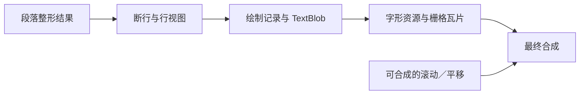

# Chromium 文本排版与渲染性能优化

类型：`reference-analysis`

日期：2026-11-05。外部能力归属：Blink 文本排版与绘制、Skia 字形处理、cc 合成。
Novadraw 参考归属：Core 文本资产与布局、后端字形预处理与渲染、平台呈现。
本文记录外部源码机制及适用条件，不定义 Novadraw 契约，也不表示已批准采用。
相关采用方案见[富文本管线删减](../design/architecture/rich-text-pipeline-reduction-proposal.md)；
其他产品的机制见[文本排版与绘制性能技术](text-layout-performance-2026-11-02.md)。

## 分析基线与结论范围

本次先阅读公开 `main`，随后固定版本并重新核对主要符号与条件：

| 仓库 | 固定提交 | 关系 |
|---|---|---|
| Chromium `src` | `b29d440b1aaad8123da500adb25908bc24161ffb` | Blink、cc 和依赖声明的分析基线 |
| Skia | `263e01b6a3fe1a1641bdd2f539e1d7ab8189b452` | 与该 Chromium 提交的 `DEPS.skia_revision` 一致 |

基线关系已通过 Chromium `DEPS` 核对。[cite:1](#source-1)
正文描述源码中存在的机制；未构建 Chromium、运行交互基准或采集 Perfetto。
因此不能给出实测提速比例，也不能将该提交等同于某个 Chrome 稳定版。
同一项目的类声明、调用点和注释相互印证实现意图，但不构成独立性能复现。

Chromium 在多个阶段保留结果：段落整形供断行使用，行视图共享字形区间，
绘制记录供后续重绘使用，字形资源和瓦片供栅格化及合成使用。
收益取决于变化是否落在该阶段的依赖范围之外；一个缓存命中不能证明整帧成本低。

## 文本管线与复用边界

整形（shaping）把字符及上下文转换成实际字体的 glyph、advance、offset 和
cluster，包括连字、kerning 与阿拉伯文连接。断行使用这些结果决定视觉行；
绘制记录描述如何绘制字形，栅格化生成像素覆盖，合成把内容放到屏幕位置。

图示表达阶段关系。滚动分支要求内容与合成条件允许复用；新进入视口的内容仍可能
需要绘制或栅格化。仅改变宽度也不保证全部阶段都命中缓存。

| 变化 | 可研究复用的结果 | 仍可能需要执行的工作 |
|---|---|---|
| 局部文本编辑 | 满足安全边界的未改变整形区间 | 编辑上下文整形、受影响断行与位置、绘制更新 |
| 容器宽度变化 | 字体及整形条件未变的段落结果 | 断行、行边界重整形、对齐与逐行 bidi 处理 |
| 颜色等非布局属性变化 | 已有字形和位置、可复用的 TextBlob | 绘制记录更新及受影响区域栅格化 |
| 可合成的滚动或平移 | 已有布局、绘制记录和栅格瓦片 | 合成更新，以及新暴露内容的准备 |

这些是机制推导出的复用机会，不是所有页面或所有 CSS 属性的统一保证。

## 段落整形与断行分离

`ShapingLineBreaker` 使用整段的整形结果和可用宽度，先找到理想断行位置，
再向前寻找合法断点，减少对所有候选位置逐一测量和求值的工作。
断点处于 HarfBuzz 标记的 safe-to-break 边界时可复用结果；否则重新整形
行首或行尾受影响部分，以反映断行对字形连接的影响。[cite:2](#source-2)

这里使用实际整形宽度定位候选，不以平均字符宽度替代正确测量。
该类还提供 `SetNoResultIfOverflow()`：调用方不需要溢出行的整形结果时，
可以避免为超长 URL 等文本创建昂贵的结果。
`SetDontReshapeEndIfAtSpace()` 则允许在宽度精度不关键的用途省略部分边界重整形；
它有明确的精度取舍，不能作为精确布局的默认策略。[cite:2](#source-2)

`ShapeResultView` 是对一个或多个既有 `ShapeResult` 的只读组合视图。
各行通过区间引用段落结果，避免复制整套 glyph 数据。
若边界需要重整形，视图可以组合新边界结果和原段落的中间区间。[cite:3](#source-3)

这同时减少重算和复制，但并非整条管线完全零复制。
`ReusingTextShaper` 的另一条复用路径会使用 `CopyRange()` 组合结果；
需要按具体交接点区分共享视图与复制组装。[cite:4](#source-4)

## 局部编辑与有条件的整形缓存

`InlineNodeDataEditor` 比较旧、新文本，找出相同前缀和后缀，为仍可复用的
`InlineItem` 保留或调整整形区间。`ReusingTextShaper` 收集有效旧结果，
对缺失区间调用 `Reshape()`，再组合结果。[cite:4](#source-4)

复用检查包括字体、方向、已应用 spacing 和 unsafe-to-reuse 标记。
编辑边界附近会扩大重算范围，并查找安全边界；代码注释明确举出 `AV` kerning、
阿拉伯文连接和 Emoji ZWJ 上下文问题。因此不能按字符差异直接切开 glyph 数组。
拼接旧结果产生的整形结果也不允许直接进入通用 shape cache，因为它可能与从头
整形的结果不同。[cite:4](#source-4)

这些代码证明未改变区间可减少整形工作，不证明编辑只重排新增尾部，
也不证明后续行存在通用的“新旧断行收敛后停止”算法。
文本修改后仍可能重新收集 inline 数据并执行分段分析。

`NGShapeCache` 挂在主字体的 `SimpleFontData` 上。其 key 保存完整文本、区间、
语言、font features 和方向，使用完整文本也保留了区间外上下文。
该版本的限制如下：[cite:5](#source-5)

| 条件 | 源码行为 |
|---|---|
| 文本长度 | `key.GetText().length()` 超过 30 时跳过缓存；16 位字符串按 UTF-16 代码单元计 |
| 条目容量 | 最多 2048；满后仍查询已有项，未命中则执行整形，不继续增加条目 |
| 字体 fallback | 只有不含主字体以外 fallback font 的可缓存结果才写入 |
| 内存释放 | 支持清空缓存；使用强引用或弱引用的路径取决于运行时 feature |

调用方 `IsNGShapeCacheAllowed()` 进一步限制 inline 结构与字体 features。
会修改整形结果的 spacing、可能应用的 text autospace 等情况限制缓存使用，
以避免上下文或可变结果引起错误。[cite:4](#source-4)
这是常见短文本的缓存，不是无限制的全文段落缓存。

## 字体指标、临时数据与按需计算

`SimpleFontData` 保存字体指标、空格字形与宽度等数据，部分其他指标按需初始化。
macOS 路径额外缓存 glyph bounds；源码注释说明，基于路径的字形指标计算较慢，
仍需要这层缓存。精确字形边界也有独立缓存。[cite:6](#source-6)

`ShapeResultView::ComputeInkBounds()` 的注释明确指出，逐字形测量并累积墨迹边界
较昂贵。实现提供按水平布局、glyph offset 等条件特化的计算路径，并有受编译
条件控制的 SIMD 入口；不能据此推断所有平台均启用了 SIMD。[cite:3](#source-3)

`InlineNode` 预估 inline item 数量以减少 vector 扩容，并在数据不再使用时主动
清空部分集合和字符串。`InlineLayoutAlgorithm::CreateLine()` 清空当前行但保留
缓冲区，`PrepareBoxStates()` 在条件允许时复用上下文状态，布局入口也检查缓存
`LineInfo`。[cite:4](#source-4)[cite:7](#source-7)
这些机制减少分配、重建和重复准备；该 `LineInfo` 缓存不能被解释为任意编辑后的
跨帧完整行布局缓存。

## 绘制记录与 TextBlob 复用

`TextFragmentPainter` 在重新生成文字绘制命令前，调用
`DrawingRecorder::UseCachedDrawingIfPossible()`，命中后直接返回。
`PaintController` 支持单个 display item 和整个 subsequence 的复用，
并负责失效和合并。[cite:8](#source-8)[cite:9](#source-9)

对于非布局原因导致的重绘，`PaintController::CachedTextBlob()` 可以从匹配的
旧绘制项中获取可复用 `SkTextBlob`。因此绘制记录失效不一定要求重新创建字形及
位置表示，仍需满足其复用条件。[cite:9](#source-9)

`PaintController` 还对乱序缓存请求建立 ID 索引，避免为每次请求反复遍历旧列表；
注释说明该匹配算法保持线性时间。[cite:9](#source-9)
`TextFragmentPainter` 区分无高亮、简单选区与复杂 overlay 等绘制路径，
并只在需要时保存图形状态。鼠标拖拽选择因此可能主要增加命中、选区和绘制成本，
不能仅凭交互名称把耗时归为排版。[cite:8](#source-8)

## 字形缓存与 GPU atlas

Skia 的 `SkStrikeCache` 按 `SkDescriptor` 查找 strike，提供
`findOrCreateStrike()`、数量及内存预算、清理入口。
strike 缓存属于字形资源层，与 Blink 的段落整形缓存职责不同。[cite:10](#source-10)

GPU `TextBlob` 保存处理后的 subrun、glyph 和位置数据，使用 arena 管理相关分配，
并通过 `canReuse(paint, positionMatrix)` 判断能否继续使用。
其 key 涉及颜色规范化、像素几何、变换和绘制参数，不能只用 glyph ID 判断
渲染资产等价。[cite:11](#source-11)

在 Ganesh 路径中，`GrAtlasManager` 管理不同 mask format 的字形图集。
`hasGlyph()` 与 `addGlyphToAtlas()` 区分已有字形与新增上传；
atlas generation 随资源移除变化，用于发现旧引用失效。
use token 避免待使用图块提前淘汰，并支持批量更新使用记录。[cite:12](#source-12)

本文确认的是 Ganesh atlas 与所列 GPU TextBlob 代码，未完整分析 Graphite、
软件绘制或所有距离场及路径回退选择，也未确认某个 Chrome 实例实际使用的后端。
不能把全部文字绘制概括为统一的位图 atlas 路径。

## 可见性裁剪、瓦片和合成线程

`BoxFragmentPainter::PaintLineBoxes()` 先检查内容墨迹范围与 cull rect 是否相交；
完全不相交时直接返回，减少不必要的文字绘制遍历。
墨迹范围与行盒范围并不相同，裁剪需要覆盖实际可绘制内容。[cite:13](#source-13)

cc 以瓦片管理可栅格化内容，根据需要安排栅格工作。
invalidation 描述内容更新，支持缩小瓦片的栅格化范围；damage 描述最终屏幕更新，
用于减少显示端工作。移动图层等操作可以产生 damage 而不产生新的内容
invalidation。[cite:14](#source-14)

多线程模式下，pending tree 准备新内容，active tree 继续展示和处理可合成的
滚动、pinch 与动画。因而已有文本内容可以继续呈现，而不必每个滚动帧重新
执行 Blink 排版；新暴露内容仍可能需要补充准备。[cite:14](#source-14)

屏幕外绘制裁剪不等于屏幕外免排版。普通文档仍可能需要布局才能确定全文尺寸、
滚动范围和后续元素位置；本文没有证明所有页面只排版可见文字。

## 对 Novadraw 的参考价值

本节是基于外部机制的分析建议，未扫描 Novadraw 当前实现来判断完成情况。
Core、后端和平台分别承担不同成本，采用时需要独立确认依赖与有效性。

| 候选方向 | Novadraw 归属 | 需要先证明的条件 |
|---|---|---|
| 段落整形与宽度相关断行分离 | Core 文本资产与布局 | Parley 的整形、bidi、fallback、样式和行边界依赖支持所需复用 |
| 行区间共享 glyph 数据 | Core 文本资产；后端消费 | 共享资产不可变，区间及寿命有效；交接接口不会再次完整复制 |
| 局部编辑扩大到安全上下文 | Core 文本增量能力 | cluster、连接与安全边界可靠；不能直接照抄 Blink 的上下文常量 |
| 绘制记录与字形资产分别复用 | Core Render 协议与后端 | 内容、布局、绘制属性和设备依赖分别可判断 |
| 滚动与排版分离 | Core 视图及后端；平台呈现 | 全文几何仍精确，实际 transform、clip、墨迹及设备覆盖有效 |
| 字形 atlas 或其他设备缓存 | 后端 | 已确认瓶颈在字形处理、栅格化或上传；不能由 CPU 排版慢直接推出需要 atlas |

优先研究现有资产的重算、复制和提交成本，再决定是否增加缓存。
实例所有权与内置／扩展统一协议继续遵循 Novadraw 现有规则，不能照搬
Skia 的全局缓存入口。

若后续采用这些方向，分别测量首次布局、局部编辑、宽度变化、鼠标拖拽选择和滚动。
Perfetto 应区分整形、断行、交互几何、IR、后端准备、栅格化与呈现，
记录相同输入和配置下的端到端耗时。缓存次数下降、局部阶段更快或滚动帧更快，
均不能单独证明窗口 resize 或整帧取得净收益。

## 固定源码来源

以下链接固定到本次提交，正文通过 class／method 定位机制。

[cite:1] Chromium：[DEPS](https://chromium.googlesource.com/chromium/src/+/b29d440b1aaad8123da500adb25908bc24161ffb/DEPS)，`skia_revision`。

[cite:2] Blink：[shaping_line_breaker.h](https://chromium.googlesource.com/chromium/src/+/b29d440b1aaad8123da500adb25908bc24161ffb/third_party/blink/renderer/platform/fonts/shaping/shaping_line_breaker.h)，`ShapingLineBreaker`。

[cite:3] Blink：[shape_result_view.h](https://chromium.googlesource.com/chromium/src/+/b29d440b1aaad8123da500adb25908bc24161ffb/third_party/blink/renderer/platform/fonts/shaping/shape_result_view.h)，`ShapeResultView`、`ComputeInkBounds`。

[cite:4] Blink：[inline_node.cc](https://chromium.googlesource.com/chromium/src/+/b29d440b1aaad8123da500adb25908bc24161ffb/third_party/blink/renderer/core/layout/inline/inline_node.cc)，`ReusingTextShaper`、`InlineNodeDataEditor`、`IsNGShapeCacheAllowed`、`ShapeText`。

[cite:5] Blink：[ng_shape_cache.h](https://chromium.googlesource.com/chromium/src/+/b29d440b1aaad8123da500adb25908bc24161ffb/third_party/blink/renderer/platform/fonts/shaping/ng_shape_cache.h)，`ShapeCacheKey`、`NGShapeCache::GetOrCreate`。

[cite:6] Blink：[simple_font_data.h](https://chromium.googlesource.com/chromium/src/+/b29d440b1aaad8123da500adb25908bc24161ffb/third_party/blink/renderer/platform/fonts/simple_font_data.h)，`SimpleFontData`、`BoundsForGlyph`。

[cite:7] Blink：[inline_layout_algorithm.cc](https://chromium.googlesource.com/chromium/src/+/b29d440b1aaad8123da500adb25908bc24161ffb/third_party/blink/renderer/core/layout/inline/inline_layout_algorithm.cc)，`PrepareBoxStates`、`CreateLine`、`Layout`。

[cite:8] Blink：[text_fragment_painter.cc](https://chromium.googlesource.com/chromium/src/+/b29d440b1aaad8123da500adb25908bc24161ffb/third_party/blink/renderer/core/paint/text_fragment_painter.cc)，`TextFragmentPainter::Paint`。

[cite:9] Blink：[paint_controller.h](https://chromium.googlesource.com/chromium/src/+/b29d440b1aaad8123da500adb25908bc24161ffb/third_party/blink/renderer/platform/graphics/paint/paint_controller.h)，`UseCachedItemIfPossible`、`UseCachedSubsequenceIfPossible`、`CachedTextBlob`。

[cite:10] Skia：[SkStrikeCache.h](https://skia.googlesource.com/skia/+/263e01b6a3fe1a1641bdd2f539e1d7ab8189b452/src/core/SkStrikeCache.h)，`SkStrikeCache`。

[cite:11] Skia：[TextBlob.h](https://skia.googlesource.com/skia/+/263e01b6a3fe1a1641bdd2f539e1d7ab8189b452/src/text/gpu/TextBlob.h)，`sktext::gpu::TextBlob`、`Key`、`canReuse`。

[cite:12] Skia：[GrAtlasManager.h](https://skia.googlesource.com/skia/+/263e01b6a3fe1a1641bdd2f539e1d7ab8189b452/src/gpu/ganesh/text/GrAtlasManager.h)，`hasGlyph`、`addGlyphToAtlas`、`atlasGeneration`、`setUseTokenBulk`。

[cite:13] Blink：[box_fragment_painter.cc](https://chromium.googlesource.com/chromium/src/+/b29d440b1aaad8123da500adb25908bc24161ffb/third_party/blink/renderer/core/paint/box_fragment_painter.cc)，`PaintLineBoxes`。

[cite:14] Chromium：[cc/README.md](https://chromium.googlesource.com/chromium/src/+/b29d440b1aaad8123da500adb25908bc24161ffb/cc/README.md)，active／pending tree、invalidation、damage、tiles。
