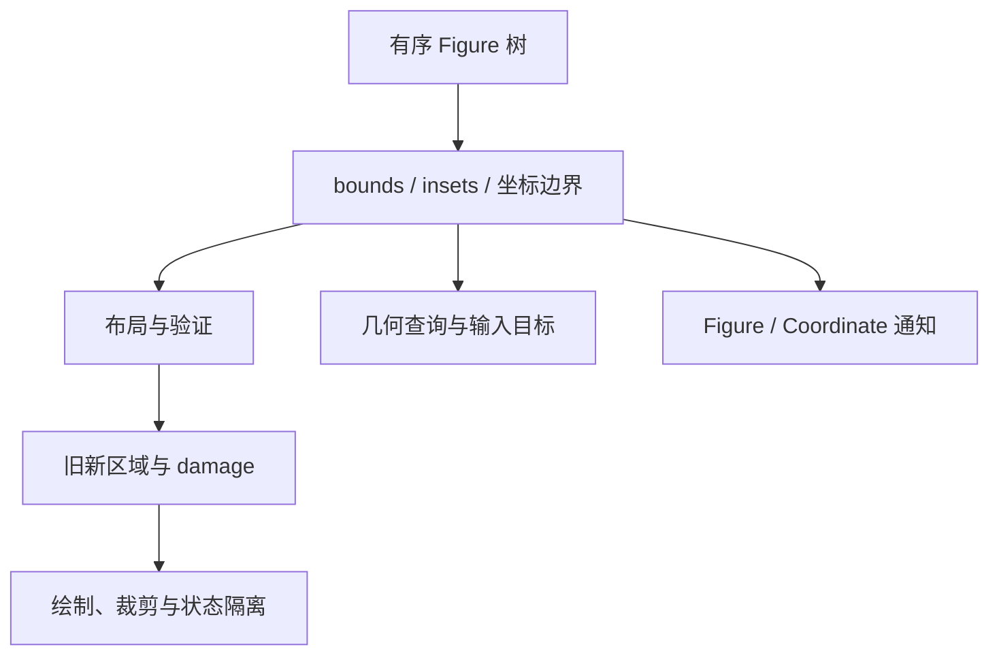

# Draw2D Figure 核心概念

类型：`reference-analysis`

本文提供概念地图。具体源码、坐标公式和调用顺序由专题承载，避免在概览中
再维护一份 `setBounds`、坐标转换、绘制和命中实现。

源码基线：Eclipse GEF Classic commit `4463d9d0c`（2026-01-01）。

## 概念与专题

| 概念 | 可观察语义 | 详细分析 |
|---|---|---|
| 树与 Z-order | children 有序；默认绘制正序、命中逆序；同层迭代不消除递归 | [树操作](tree-operations.md) |
| bounds | 位置与尺寸位于 parent 提供的坐标域；不能一律解释为画布绝对坐标 | [Bounds](bounds.md) |
| 坐标边界 | `useLocalCoordinates` 为 children 建立局部域；公开转换沿父链组合 | [树与坐标](tree-coordinates.md) |
| 盒模型 | bounds、Border、Insets 和 client area 共同约束布局及裁剪 | [盒模型](box-model.md) |
| Figure 协议 | `IFigure` 定义多种行为；`Figure` 提供可覆盖的默认实现 | [接口](ifigure-interface.md)、[实现](figure-implementation.md) |
| 绘制模板 | 本地样式 → push → self → restore → client/children → border → pop | [渲染管线](../rendering/update-manager.md)、[裁剪](../rendering/clip.md) |
| 布局与验证 | manager 计算 bounds；invalidate、revalidate、validate 作用不同 | [布局约束](layout-constraints.md)、[更新管线](../rendering/update-manager.md) |
| 几何与输入命中 | 共享树和坐标；输入另检查 enabled 及 handler | [树操作](tree-operations.md)、[Figure 实现](figure-implementation.md) |
| 通知 | FigureMoved 表达位置或尺寸变化；CoordinateListener 表达坐标系统变化 | [通知对照](../../../parity/draw2d/notification-mapping.md) |

## 协议之间的关系

树、几何、布局、绘制、命中和通知互相约束。手动 `setBounds` 与 LayoutManager
都是 Draw2D 的正式能力，容器策略决定使用方式。`Figure.paint` 可以覆盖；默认模板
的顺序不能被解释为禁止其他合成次序。

## Novadraw 采用关系

本页不定义 Novadraw 的对象布局、API 或执行顺序。采用、调整和收窄分别见
[Draw2D 语义账本](../../../parity/draw2d/api-coverage.md)与
[Core 架构](../../../design/architecture/00-index.md)。
