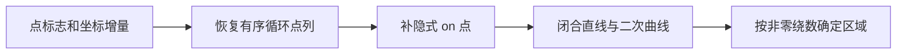

# 字形轮廓的存储约定与填充规范

类型：`reference-analysis`

核对日期：2026-10-23。

范围：OpenType 的 `glyf`、`CFF `、`CFF2` 轮廓表示，以及轮廓方向、闭合、
控制点、复合字形和变体实例对字形读取的影响。本文整理外部规范，不定义新的
Novadraw API。算法比较与彩色字体格式见
[字形渲染算法与彩色 Emoji 字体](glyph-rendering-and-color-emoji.md)。

## 方向约定随轮廓格式而变

字体确实有轮廓存储和方向规定，但必须同时确认字体格式、坐标轴方向和填充规则。
以下顺时针、逆时针均指**字体设计坐标：X 向右、Y 向上**；外轮廓和孔洞指
普通、无自交的轮廓嵌套情形。[1](#source-1)[3](#source-3)[4](#source-4)

| 轮廓表 | 曲线 | 外轮廓方向 | 孔洞方向 | 填充规则 | 重叠轮廓 |
|---|---|---|---|---|---|
| `glyf`（TrueType） | 二次贝塞尔及直线 | 顺时针 | 逆时针 | 非零绕数 | 支持 |
| `CFF `（版本 1，Type 2 CharString） | 三次贝塞尔及直线 | 逆时针 | 顺时针 | 奇偶；当前 CFF2 规范对旧 CFF 的明确说明 | OpenType 格式比较列为不支持 |
| `CFF2` | 三次贝塞尔及直线 | 逆时针 | 顺时针 | 必须使用非零绕数 | 支持 |

曲线阶数和重叠支持见 OpenType 格式比较；TrueType 方向规定见 TrueType
Fundamentals；CFF2 的 “Path direction” 同时规定自身方向，并明确其与 TrueType
相反、与旧 CFF 的填充规则不同。[1](#source-1)[3](#source-3)[4](#source-4)
Adobe Type 1 规范 §3.5 也规定填充区域在行进方向左侧；Type 2 继承 Type 1
字体概念。这是 CFF 系列方向约定的历史来源。[5](#source-5)[6](#source-6)

因此，“逆时针表示填充”适用于 CFF 系列的上述坐标约定，不能直接推广到
TrueType。字形解码库也可能翻转 Y、统一方向或返回已经变换的路径，读取其输出
时需以该库的坐标契约为准。

## 孔洞由轮廓组合与填充规则确定

轮廓是有方向的闭合边界。`glyf` 没有为每条轮廓保存一个“填充／掏空”布尔字段；
`CFF` 的路径操作也没有给每条子路径单独编码一个减法操作。[2](#source-2)[6](#source-6)
格式的方向约定帮助构造正确边界，最终区域仍按该格式的填充规则确定。

非零规则统计一个点相对整个字形轮廓集合的绕数。以下采用数学约定：
逆时针包围贡献 `+1`，顺时针包围贡献 `−1`；其他实现可以采用相反符号，
只要整个计算保持一致。`W ≠ 0` 表示内部，`W = 0` 表示外部。[7](#source-7)

| 轮廓关系 | 某点处的绕数示意 | 非零规则 | 奇偶规则 |
|---|---|---|---|
| 只被一个轮廓包围 | `+1` 或 `−1` | 填充 | 填充 |
| 被两个反向嵌套轮廓包围 | `+1 − 1 = 0` | 留空，形成孔洞 | 留空 |
| 被两个同向嵌套轮廓包围 | `+1 + 1 = 2` | 填充 | 留空 |
| 两个同向实心轮廓的重叠区 | `+1 + 1 = 2` | 填充 | 留空 |

表中后两项用于比较规则，不能据此声称旧 CFF 支持这种输入。
CFF2 规范直接用同向嵌套轮廓解释两种规则的差别；TrueType 手册明确说明同向
填充轮廓可以相交，黑色区域重叠后仍为黑色。[3](#source-3)[7](#source-7)

**单独的顺时针轮廓仍可在非零规则下填充**，因为其绕数为 `−1`，不是零。
只有与包含它的反向轮廓相抵消，才形成孔洞。轮廓全部反转会使 `W` 变号，
但不会改变非零填充区域；仅反转其中一条则可能改变孔洞或重叠区域。

对无相交、方向规范的普通嵌套轮廓，奇偶与非零规则通常得到相同区域。
这解释了部分字体实验看不出差异；它不证明两种规则可对所有格式互换。

## 字形定位先于轮廓读取

字形不是一个 Unicode 码点固定对应的一条路径。`cmap` 提供初始字符映射，
布局中的替换和定位还会确定实际 glyph ID 与位置。轮廓数据按 glyph ID 读取；
字体 face 和可变轴实例也必须固定。

| 信息 | 所属数据 | 读取时需保留的含义 |
|---|---|---|
| glyph 数量及身份 | `maxp`；布局结果中的 glyph ID | 字形编号不能用字符文本替代 |
| TrueType 字形位置 | `loca` 指向 `glyf` | 相邻偏移之差确定字形数据长度；相同偏移可表示无轮廓数据 |
| CFF 字形位置 | `CharStrings INDEX` | OpenType glyph ID 对应 CharString 索引 |
| CFF2 字形位置 | `CharStringINDEX` | 同一字形程序还可能依赖变体和子程序 |
| 横向 advance 与侧承 | `hmtx` | advance 不等于轮廓包围盒宽度 |
| 纵向 advance 与侧承 | `vmtx` | 与轮廓位置分开读取 |

`glyf`、CFF 和 CFF2 的索引关系分别由对应表规范定义。
空轮廓、零轮廓字形和损坏的数据必须区分；空格可以具有 advance 而没有可见轮廓。
[2](#source-2)[8](#source-8)[3](#source-3)

## TrueType 保存循环点列与二次控制点

`glyf` 的简单字形由公共 header、各轮廓的末点索引、指令、点标志、
X 坐标序列和 Y 坐标序列组成。`numberOfContours ≥ 0` 表示简单字形；
负数表示复合字形，规范建议使用 `−1`。[2](#source-2)

### 标志和坐标的含义

| 字段或标志 | 语义 |
|---|---|
| `endPtsOfContours` | 各轮廓最后一个点的索引，严格按点序列递增 |
| `ON_CURVE_POINT`，位 0 | 置位表示曲线上的点；未置位表示二次贝塞尔控制点 |
| `X_SHORT_VECTOR` / `Y_SHORT_VECTOR` | 对应坐标增量采用短编码 |
| `REPEAT_FLAG`，位 3 | 下一字节表示该标志额外重复多少次 |
| `X_IS_SAME_OR_POSITIVE_X_SHORT_VECTOR` 等 | 与短编码标志组合，表示正负或零增量 |
| `OVERLAP_SIMPLE`，位 6 | 第一份点标志可标记轮廓可能重叠；不是填充规则字段 |

逻辑上每点有一份标志和一对坐标。物理存储先放压缩后的标志，再分别放 X 和
Y 增量，不是逐点交错保存 `(x, y)`。首点坐标相对 `(0, 0)`，后续坐标相对
前一点；跨轮廓也沿整个字形点序列累计，不能在每条轮廓开头重新归零。
整数设计坐标与最终像素坐标不是同一种数据。[2](#source-2)

### 相邻点决定如何重建曲线

| 点序列 | 重建结果 |
|---|---|
| `on → on` | 两点之间的直线 |
| `on → off → on` | 一段二次贝塞尔，off 为唯一控制点 |
| `off → off` | 在两点的精确中点补一个隐式 on 点 |

隐式点 `M = (C₁ + C₂) / 2` 不必存入字体文件。
连续多个 off 点可表示连续二次曲线；不能把它们误读为三次曲线的两个控制点。
隐式中点还可能落在半个设计单位的位置，解码时不应取整。
[3](#source-3)[9](#source-9)

这些隐式点属于几何重建，不增加原 `glyf` 的存储点编号。
应用按点编号索引的变体增量或 TrueType 指令时，应保持原编号体系，
不能因提前插入隐式点而让后续点号偏移。[2](#source-2)[9](#source-9)

轮廓是**循环点列**：最后一点还要连接第一点。解码起点按以下顺序确定：

1. 首点是 on：从首点开始。
2. 首点是 off、末点是 on：从末点开始。
3. 首点和末点都是 off：从二者的隐式中点开始。

随后循环处理存储点，恢复所有直线和二次曲线，并回到起点。整条轮廓都是 off 点
也可以通过相邻隐式中点构造，不应仅因没有显式 on 点而拒绝。
这些重建规则见 FreeType 对 TrueType 轮廓的分解说明。[9](#source-9)

```text
存储：P₀(on), C₁(off), C₂(off), P₃(on)
补点：M = (C₁ + C₂) / 2
曲线：Q(P₀, C₁, M)，Q(M, C₂, P₃)
```

图 1 将上述重建与后续填充分开，避免把压缩存储中的点直接当成 GPU 三角形或路径命令。



图 1：TrueType 的隐式控制点解码完成后，才得到可供填充的闭合轮廓。

## CFF 系列保存三次曲线的字形程序

OpenType `CFF ` 表要求 `CharstringType = 2`。Type 2 CharString 和 CFF2
都按操作数栈解释数字与操作符，还可能调用局部或全局子程序；不是一份可直接
按点标志读取的 `glyf` 数据。[6](#source-6)[8](#source-8)

| 操作 | 作用 |
|---|---|
| `rmoveto` / `hmoveto` / `vmoveto` | 移动当前点，开始新轮廓 |
| `rlineto` / `hlineto` / `vlineto` | 添加直线，部分操作可以一次编码多段 |
| `rrcurveto` 等曲线操作 | 添加三次贝塞尔；专用操作可省略固定为零的增量 |
| `callsubr` / `callgsubr` | 调用局部／全局子程序，可能继续当前轮廓 |
| hint 操作 | 声明栅格化提示；不等于轮廓几何 |
| CFF2 `blend` / `vsindex` | 根据所选变体实例计算操作数 |

一般三次曲线操作 `rrcurveto` 的六个操作数为：

```text
dx₁, dy₁, dx₂, dy₂, dx₃, dy₃
P₀ = 当前点
P₁ = P₀ + (dx₁, dy₁)
P₂ = P₁ + (dx₂, dy₂)
P₃ = P₂ + (dx₃, dy₃)
C(P₀, P₁, P₂, P₃)
```

各增量依次相对前一控制点或端点，不是全都相对 `P₀`。
三次曲线的两个控制点必须完整保留；TrueType 的 off-off 中点规则不适用于它们。
CharString 数值可包含 16.16 定点数，不能统一截断成整数设计单位。
[6](#source-6)[4](#source-4)

### 闭合并不要求文件重复起点

Type 2 与 CFF2 的轮廓必须闭合。当前轮廓尚未闭合时，新 `moveto` 会隐式补
一条回到上一轮廓起点的直线。Type 2 在 `endchar` 结束字形时闭合最后轮廓；
CFF2 去掉了 `endchar` 操作，按自身程序结束规则处理最后轮廓。
CFF2 还明确规定最后操作为曲线时补隐式 `lineto`，即使曲线终点已经与起点重合。
[6](#source-6)[4](#source-4)

这里的结束指完整 glyph 程序结束；子程序返回不意味着当前轮廓结束，
因为调用者可以继续向同一轮廓添加曲线。

因此，读取库返回 `MoveTo / LineTo / CurveTo / Close` 时，必须尊重其闭合语义，
不能只处理显式 line/curve 而跳过 `Close`。若边列表需要显式闭合段，应按起终点
关系补齐；零长闭合段不能产生虚假的射线穿越。

## 复合字形和可变实例改变最终几何

TrueType 复合字形引用其他 glyph ID，可为组件设置平移、缩放、二维仿射变换，
或按父子点对齐。组件还可以是复合字形；规范要求引用图无环。
必须依次展开组件并处理各自变换，才能得到最终轮廓，不能把复合记录解释成
另一组普通控制点。[2](#source-2)

`OVERLAP_SIMPLE` 和复合记录的 `OVERLAP_COMPOUND` 提示某些栅格器启用重叠处理。
这些标志不是必需的；**未置位不能证明没有重叠**。可变字体尤其常用重叠轮廓，
静态实例导出工具需要按规范考虑保留标记或去除重叠。[2](#source-2)

`glyf` 变体的轮廓增量来自 `gvar`；CFF2 的变体通过自身 VariationStore 和
`blend` 等机制参与字形程序求值。计算实际包围盒、方向和 GPU 预处理资产前，
应固定字体实例并应用所需变化。默认 `glyf` header 的包围盒不会自动变成
非默认实例的包围盒。[2](#source-2)[1](#source-1)[4](#source-4)

轮廓、字体度量和 hinting 还需分开。`glyf` header 的 bounds 包括 on/off 控制点，
不一定是曲线的紧包围盒；advance 又是另一项度量。Hinting 可按尺寸调整几何，
其生成的 phantom points 用于度量与指令，不能当成普通轮廓边。
[2](#source-2)[9](#source-9)

## 坐标反射会翻转方向

字体设计坐标通常 Y 向上，常见屏幕 UI 坐标 Y 向下。只反转 Y 是反射，
会翻转顺逆时针。更一般地，二维仿射变换的线性部分满足：

```text
det(A) > 0：保留方向
det(A) < 0：翻转方向
det(A) = 0：退化，不能按普通二维封闭区域处理
```

该结论来自几何变换，与选用哪种贝塞尔阶数无关。整条字形统一反射时，
所有轮廓方向一起反转，非零区域仍按对应几何变换保持；不能因方向反转就把孔洞
改成填充。只镜像某个复合组件时，其与其他组件的相对方向可能改变，需要按最终
组合判断，不能套用“整个字形一起反转”的等价性。

方向必须从**曲线实际遍历**判断，不宜把含 off 点的控制多边形面积直接当成
曲线的精确有向面积。平面闭合曲线的有向面积为
`A = ½ ∮(x dy − y dx)`；数学 Y 向上坐标中，简单逆时针轮廓的面积为正。
自交曲线的总有向面积也不能单独决定每一点的内外。

若确需反转几何，二次曲线 `Q(P₀,P₁,P₂)` 变为 `Q(P₂,P₁,P₀)`，
三次曲线 `C(P₀,P₁,P₂,P₃)` 变为 `C(P₃,P₂,P₁,P₀)`。
重新编码 CFF 时还必须重算相对增量，不能直接倒序 CharString 字节。
整体反转、单轮廓反转和填充规则转换是不同操作。

## 彩色字形按各自表示读取

COLR 本身不保存新的贝塞尔控制点；它引用 `glyf`、`CFF ` 或 `CFF2` 的 glyph
作为形状，再提供颜色、层序和 Paint 图。层间覆盖由合成操作控制，
不是轮廓方向的“掏空”关系。[10](#source-10)

COLRv1 的 “Filling shapes” 将 `PaintGlyph` 的轮廓定义为对子 Paint 图施加的
clip region；实际显示的是该子图提供的填充内容。此段规范没有定义一个逐轮廓的
“掏空”字段，也不能据此推导出一项覆盖所有来源表的统一 fill rule。
读取时仍要确认轮廓来源与所用栅格器的填充契约。[10](#source-10)

OpenType SVG 使用其 SVG 路径及 `fill-rule` 语义；sbix、CBDT/CBLC 的位图字形
则不通过贝塞尔轮廓方向决定透明区域。具体格式职责见
[彩色 Emoji 格式](glyph-rendering-and-color-emoji.md#彩色-emoji-格式决定呈现路径)。
这些表示不能统一假定为“一份闭合轮廓加一种颜色”。

## 对轮廓消费者的要求

从上述规范可推导出以下读取要求；它们是工程检查依据，不代表新 API 已接受。

| 环节 | 应保留或确认的内容 |
|---|---|
| 选择输入 | 精确 font face、glyph ID、变体实例及单色／彩色呈现上下文 |
| 解码 | 字体表格式、循环点列或 CharString、子程序／复合组件 |
| 恢复几何 | 隐式 on 点、闭合边、二次／三次控制点、合法空轮廓 |
| 变换 | 设计单位、坐标轴、组件矩阵、反射及退化情况 |
| 填充 | 明确的 fill rule；保留轮廓相对方向与重叠语义 |
| 预处理 | 曲线降阶的误差约束、候选完整性、实际实例 bounds |
| 显示 | 与覆盖率估计、hinting、颜色和有序合成分别处理 |

特别是，不能从“外轮廓方向规范”推断字形无重叠，也不能无条件把 TrueType 或
CFF2 交给奇偶累计。Evan 当前奇偶 demo、Lengyel 非零路线与 Dobbie 的局部
有向积分，分别需要与实际输入的 fill rule 匹配；方法名或曲线阶数不足以决定
兼容性。现有实现行为与局限直接引用算法专题，不在此复制。

## 原始规范与证据

<a id="source-1"></a>

1. [OpenType：Comparison of glyf, CFF and CFF2](https://learn.microsoft.com/en-us/typography/opentype/spec/glyphformatcomparison)。
   曲线阶数、数值精度、变体支持和重叠能力；明确 CFF2 必须使用非零规则。

<a id="source-2"></a>

2. [OpenType：glyf](https://learn.microsoft.com/en-us/typography/opentype/spec/glyf)。
   简单／复合记录、点标志、坐标增量、重叠标志、bounds 与 phantom points。

<a id="source-3"></a>

3. [TrueType Fundamentals](https://learn.microsoft.com/en-us/typography/opentype/spec/ttch01)
   与 [Apple：Digitizing Letterform Designs](https://developer.apple.com/fonts/TrueType-Reference-Manual/RM01/Chap1.html)。
   TrueType 点序、填充区域在右侧、隐式二次控制点和相交轮廓。

<a id="source-4"></a>

4. [OpenType：CFF2](https://learn.microsoft.com/en-us/typography/opentype/spec/cff2)。
   “Closing contours”“Path direction”、三次曲线操作、CharString 数值与变体求值。
   当前该页合并了字形程序的详细规范，方向与闭合结论以此页为准。

<a id="source-5"></a>

5. [Adobe Type 1 Font Format](https://adobe-type-tools.github.io/font-tech-notes/pdfs/T1_SPEC.pdf)。
   §3.5，印刷页 27–28：填充路径逆时针，孔洞顺时针，填充区域在左侧。
   §3.6 的历史避重叠建议不能替代当前 OpenType CFF/CFF2 格式规定。

<a id="source-6"></a>

6. [Adobe Technical Note #5177：The Type 2 Charstring Format](https://adobe-type-tools.github.io/font-tech-notes/pdfs/5177.Type2.pdf)。
   2000-03-16；§3–4：字形程序、路径操作、相对控制点和隐式闭合。

<a id="source-7"></a>

7. [Apple：Font Engine — Distinguishing the inside from the outside](https://developer.apple.com/fonts/TrueType-Reference-Manual/RM02/Chap2.html#distinguishing)。
   非零绕数的射线判定方法。本文示例的正负号采用数学坐标约定，不照搬栅格器扫描符号。

<a id="source-8"></a>

8. [OpenType：CFF](https://learn.microsoft.com/en-us/typography/opentype/spec/cff)。
   OpenType 中的 Type 2 要求和 CharStrings INDEX 与 glyph ID 对应关系。

<a id="source-9"></a>

9. [FreeType Glyph Conventions / VI](https://freetype.org/freetype2/docs/glyphs/glyphs-6.html)。
   轮廓分解、首末 off 点、隐式中点和 control box 与紧 bounds 的区别。
   此来源是成熟实现的读取约定，不替代 OpenType 二进制格式规范。

<a id="source-10"></a>

10. [OpenType：COLR — Filling shapes](https://learn.microsoft.com/en-us/typography/opentype/spec/colr#filling-shapes)。
    彩色形状引用、图层组合，以及 PaintGlyph 对填充子图的裁剪关系。
