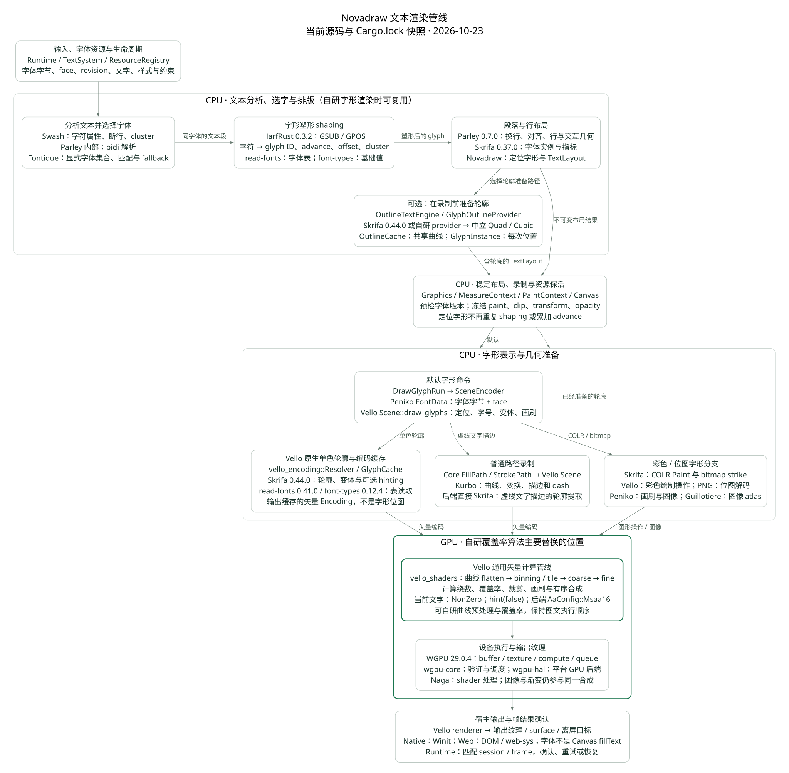

# Novadraw 文本渲染管线与自研替换范围

类型：`reference-analysis`

核对日期：2026-10-23。

自研接入思路补充日期：2026-10-24。

源码基线：`3911710d49da7817b6b4431d4c7be2ddfa2365ef`，并定向核对本次读取的
工作区文件。项目正在并行推进其他切片，本报告描述所列文本入口的读取快照，
不把其他未提交改动视作本文的实施结果。

依赖依据：当前 [Cargo.lock](../../../Cargo.lock)、项目 package manifest，
以及 Cargo registry 中对应版本的源码。独立 Vello checkout 的最新代码没有用作
当前项目版本证据。本文不修改实现，也不宣称已经完成性能、像素或跨平台验收。

## 结论与阅读范围

当前项目已经复用成熟的文字链路：**Parley 组织文本分析、字体匹配与段落排版，
HarfRust 执行 shaping，Skrifa 读取字体指标和字形轮廓，Vello 将定位字形转成
矢量编码并在 GPU 上栅格化、裁剪与合成。**

自研“从字形曲线生成像素”时，主要替换**字形几何预处理和 GPU 覆盖率计算**，
保留现有 shaping、排版、字体实例与字形定位。只替换 `GlyphOutlineProvider`
会改变轮廓来源，最终仍可以由 Vello 绘制；它不等于实现了自研栅格器。
若还要独立支持彩色 Emoji，就需要同时实现其呈现解析与有序合成。

图 1 按发生顺序展示流程。虚线表示可选路线或特殊描边分支，不表示未实现；
绿色边框表示自研覆盖率算法主要对应的位置，不表示该能力已经交付。



图 1：文本布局确定字形和位置，轮廓准备与 GPU 栅格化可分别替换。
图中分别标明了库的职责；可单独打开
[SVG 原图](assets/text-rendering-pipeline.svg)，图形源文件为
[Graphviz DOT](assets/text-rendering-pipeline.dot)。

本文负责当前调用链、依赖关系与替换分析。统一 API、服务所有权和提交合同仍以
[ADR-025](../../adr/adr-025-unified-graphics-and-glyph-preparation.md)、
[文字与图形整合](../../design/rendering/text-graphics-integration.md)为准。
字体表与方向、闭合规则见
[轮廓存储规范](glyph-outline-storage-conventions.md)；
三种曲线算法与彩色格式见
[字形渲染算法与彩色 Emoji](glyph-rendering-and-color-emoji.md)。

## 各阶段处理的是不同数据

| 数据 | 内容 | 主要用途 |
|---|---|---|
| 文本与样式请求 | Unicode 文本、字体请求、样式 span、约束、inline box | 分析、匹配、shaping 与段落排版 |
| 塑形后的 glyph | 精确字体实例中的 glyph ID、advance、offset、cluster | 字形选择、位置推进、源文本映射 |
| `TextLayout` | 已定位的 glyph run、行指标、baseline、交互几何 | 测量、布局与后续绘制 |
| `GlyphOutline` | 字体局部坐标的直线、二次／三次曲线、ink bounds、units-per-em | 几何分析或替代轮廓绘制 |
| 绘制命令 | glyph 或路径、位置、paint、变换、裁剪、透明度 | 有序录制与帧提交 |
| Vello `Encoding` | 路径标签、几何、样式、资源和待解析 glyph run | GPU 场景输入 |
| 覆盖率与像素 | 区域判断、抗锯齿覆盖、画刷颜色、混合结果 | 输出纹理与呈现 |

Shaping 不输出贝塞尔曲线；轮廓提取不决定文本换行；栅格化不重新选择字体。
Glyph ID 只在对应 font face 中有意义，不能脱离字体资源和变体实例复用。

## 输入与字体资源由 Novadraw 管理

独立准备入口 `TextSystem` 拥有文字引擎和 `ResourceRegistry`，默认引擎为
`ParleyTextEngine`。挂载 Figure 则使用其 Runtime 拥有的文字服务。
字体注册、替换和移除通过资源 ID 与 revision 连接布局和绘制，避免只传字体家族
字符串而让后端重新找一个可能不同的字体。

Parley 的 `FontContext` 使用 Fontique 管理集合与字体数据。项目的
`empty_font_context()` 显式设置 `shared: false`、`system_fonts: false`：
**当前文字集合由显式注册的字体构成，不会因为 Fontique 支持系统字体发现就自动
使用操作系统的全部字体。**

Fontique 负责匹配 family、weight、style 等字体请求，并参与缺字 fallback。
它需要字体表元数据，因此依赖 `read-fonts 0.35.0`。字体数据的共享句柄由
`linebender_resource_handle` 支持；Novadraw 自己的资源身份与句柄身份之间，
仍要由适配层建立对应关系。

Fontique 的 `system` feature 在 macOS 可以包含 CoreText 相关依赖，在 Windows
或 Linux 又会涉及不同的平台库。这是平台发现能力的依赖，不能据此声称本项目
当前文字集合正在自动枚举这些系统字体。编译进依赖与运行时使用某项能力要分别确认。

源码依据：
[TextSystem](../../../crates/novadraw/src/text/system.rs)；
[ParleyTextEngine](../../../crates/novadraw/src/render/text.rs)，
`new`、`register_font`、`empty_font_context` 与 `resolved_faces`。

## 文本分析由 Swash 与 Parley 内部代码完成

Parley 先调用 `swash::text::analyze` 获取字符属性及边界信息，建立 `CharInfo`。
这些信息用于 script、断行、cluster 与字体匹配。若文本需要双向解析，
Parley 使用自身的 `BidiResolver` 得到方向层级，后续 shaping 和视觉顺序使用同一结果。

这里有三项容易混淆：

- Swash 自身具备 shaping 和 glyph rendering 能力，但当前 Parley 0.7 的实际
  shaping 调用进入 HarfRust，而不是 `swash::shape`。
- Parley 的 bidi resolver 在其源码内，不能看到 workspace 中存在 `unicode-bidi`
  就认定该库执行了这里的 bidi。
- Novadraw 直接依赖 `unicode-segmentation`，用于源文本的 grapheme 边界等交互处理；
  它不负责 GSUB/GPOS，也不能替代 shaping。

Cluster 关联源字符与塑形结果。一个字符可以产生多个 glyph，多个字符也可以合成
一个 glyph。后续 caret、选择和点击映射必须保留这种关系，不能按 glyph 数量
直接当作字符长度。

源码依据：Parley 0.7.0 `src/context.rs::analyze_text`、`src/bidi.rs`，
以及 Novadraw `render/text.rs` 中的文本位置与交互几何适配。

## HarfRust 执行 OpenType shaping

Parley 按选中的字体分段，创建 `harfrust::FontRef`、`ShaperData`、
`ShaperInstance` 和 `ShapePlan`。计划的输入包括字体、变体、方向、script、
language 和 features；可缓存的字体数据、实例与计划分开组织。

Shaper 接收当前文本段及 cluster 编号，实际执行字形替换与定位：
GSUB 可以产生连字、上下文替换和不同文字体系所需的字形形式；GPOS 可以调整字距、
附加符号位置等。输出包含 glyph ID、advance、offset 和源文本映射。

HarfRust 0.3.2 直接依赖 `read-fonts 0.35.0`，后者通过 `font-types 0.10.1`
解释字体基础值。这些库负责 OpenType 表数据访问，HarfRust 负责 shaping 规则执行。
此依赖是 Rust 实现，不应误报成当前项目调用系统 HarfBuzz 动态库。

HarfRust 不决定整段文字的换行宽度，不输出 GPU buffer，也不绘制字形。
将字符串逐字符调用 `charToGlyph` 只解决初始映射，不能对等替代这个阶段。

源码依据：Parley 0.7.0 `src/shape/mod.rs` 中的字体分段、
`shape_with_plan` 和 `layout.data.push_run`；
HarfRust 0.3.2 package manifest。

## Parley 排版，Novadraw 固定最终字形位置

项目通过 `LayoutContext::ranged_builder` 提供默认字体与样式 span、inline box，
构造 Parley `Layout`，随后调用 `break_all_lines` 和 `align`。
Parley 在塑形结果上进行行布局、视觉顺序和对齐，提供行指标、glyph run 与 cluster
几何；Novadraw 再适配成自己的不可变文字结果。

在转换 glyph run 时，Novadraw：

1. 由实际字体 blob 与 collection index 找回已注册 `FontFaceRef`。
2. 保留 run 的字号、规范化变体坐标和合成斜体信息。
3. 从 run offset 开始累加 glyph advance，结合 offset 得到每个 glyph 的位置。
4. 将 baseline 与字形 Y 偏移转换到布局使用的 Y 向下坐标。
5. 保留行、源文本位置、方向与交互映射。

**Advance 在这里已经应用。后端消费 glyph 坐标时不能再累加一次。**
字体匹配和布局固定的 face 也不能在 renderer 中重新 fallback。

Parley 直接使用 `Skrifa 0.37.0` 读取字体实例和行度量；它与后端使用的
`Skrifa 0.44.0` 是不同版本。两边通过字体字节、face index、规范化变体坐标和
引擎值连接，不直接互传版本不同的 Skrifa 类型。

`MeasureContext::measure_text` 从布局结果读取 `TextMetrics`，不是用字符数量
估算宽度。`layout size`、advance、ink bounds 与 paint bounds 各有职责：
空格可以推进位置而没有轮廓；斜体和组合符可以超出 advance；
描边与滤波还会扩大实际绘制包络。

源码依据：[布局构建与转换](../../../crates/novadraw/src/render/text.rs)，
`layout_styled`、`break_all_lines`、`align`、`PositionedGlyph` 和行／cluster 适配；
[MeasureContext](../../../crates/novadraw/src/text/system.rs)。

## 可选轮廓准备发生在绘制录制之前

默认 `TextLayout` 可以只保留定位 glyph，不需要提前展开所有字形曲线。
若选择 `OutlineTextEngine`，它先委托基础排版引擎，再通过 `OutlineCache`
取得中立曲线，并将结果关联到布局；后续录制才能据此选择路径分支。

默认 provider `SkrifaOutlineProvider` 使用 `Skrifa 0.44.0`：
按 collection face index 建立 `FontRef`，应用规范化变体坐标，
调用 `outline_glyphs()`，再用 `OutlinePen` 收集 Move、Line、Quad、Cubic、Close。
该路径使用字体设计单位、Y 向上、未缩放且未 hint 的轮廓。
`read-fonts 0.41.0` 与 `font-types 0.12.4` 是它的下层字体读取依赖。

`OutlineCache` 的 key 包含 provider 身份与 revision、font face、glyph ID 和变体。
字体局部轮廓可跨位置共享；`GlyphInstance` 单独保存字体单位到布局坐标的变换。
最终布局路径组合字号、Y 翻转、斜体和既有 glyph 位置，避免把位置烘焙进原始共享资产。

这些数据是中立 CPU 几何，不是 Lengyel 条带、Dobbie 网格或 GPU 地址。
后端专用曲线系数、候选索引与设备资源，仍由具体算法及后端拥有。

空轮廓是合法结果；缺 glyph、坏字体、不支持轮廓格式和资源版本不匹配有不同失败
含义。自研 provider 要维持这个区别，而不是把所有异常都转换成一条空路径。

源码依据：[轮廓服务](../../../crates/novadraw/src/text/outline.rs)和
[准备与缓存](../../../crates/novadraw/src/text/outline/preparation.rs)，
`SkrifaOutlineProvider::outline`、`OutlineCache::prepare`、
`GlyphGeometryKey`、`GlyphInstance`、`OutlineTextEngine`。

## Graphics 录制文字并保活资源

Graphics 的文字方法接受已完成的 `TextLayout` 和 origin。它先检查有限坐标、
字体资源身份、revision、face 和变体关联，并收集资源保活信息，再进入录制。
Paint、Stroke、transform、clip、opacity 属于这次绘制实例，不属于共享轮廓。

Canvas 的 `draw_glyph_runs` 有两条现有分支：

| 布局状态 | 录制结果 | 后续行为 |
|---|---|---|
| 没有关联准备好的轮廓 | `DrawGlyphRun` | 后端按字体资源和 glyph ID 走原生字形路径 |
| 有 `OutlinedText` | `FillPath` 或 `StrokePath` | 后端消费准备好的路径，不再从字体重新提取相同轮廓 |

当前文字填充使用 `FillRule::NonZero`。准备轮廓的输入必须与实际采用的填充契约
匹配，不能因某种轮廓存储约定就假定所有格式和重叠输入都可互换。
字体格式差别直接引用轮廓存储专题。

挂载场景的布局／派生准备与 Figure paint 分阶段执行；paint 不重新 shaping。
录制成功表示命令准备成功，不能据此认定 GPU 已完成或窗口已呈现。
场景资源与命令进入 `RenderSubmission` 后，还需要后端结果与 Runtime 确认闭合。

源码依据：[Graphics 的文字预检](../../../crates/novadraw/src/graphics/context.rs)，
`text`；[Canvas 的两条录制分支](../../../crates/novadraw/src/render/context.rs)，
`draw_glyph_runs`。阶段与所有权合同见 ADR-025、ADR-031。

## Vello Scene 接收定位字形或普通路径

`SceneEncoder` 处理 `DrawGlyphRun` 时，按资源 ID 与 revision 取得共享字体字节，
构造 Peniko `FontData`，collection index 指定字体集合中的 face。
`append_glyph_run` 再把 origin 和 glyph 坐标转换到后端像素尺度，设置画刷、
transform、字形合成变换、字号和规范化变体坐标。

默认调用形态为：

```rust,ignore
scene
    .draw_glyphs(&font_data)
    .brush(&brush)
    .hint(false)
    .transform(transform)
    .glyph_transform(glyph_transform)
    .font_size(font_size)
    .normalized_coords(coords)
    .draw(Fill::NonZero, positioned_glyphs);
```

这里没有 raw text，也不调用 Parley 或 HarfRust。Peniko 提供字体 blob、画刷、
颜色、图像和 fill/stroke 描述；Kurbo 提供仿射变换、路径和描边几何。

当前后端还单独处理虚线文字描边：Vello 的 glyph cache 忽略 dash，
因此后端直接用自己的 `Skrifa 0.44.0` 提取曲线，构建 Kurbo `BezPath`，
调用普通 `scene.stroke`。没有矢量轮廓时则保留原生字形行为。
这解释了后端 manifest 中显式的 Skrifa 依赖：它有直接调用用途，
不是只为声明 Vello 已经间接使用的库。

源码依据：[Vello 后端](../../../crates/novadraw-backend-vello/src/lib.rs)，
`SceneEncoder`、`append_glyph_run`；
[虚线描边轮廓提取](../../../crates/novadraw-backend-vello/src/glyph_outline.rs)。

## 原生字形在 CPU 解析成缓存的矢量编码

Vello `Scene::draw_glyphs` 返回 `DrawGlyphs` builder。
单色轮廓分支把 glyph 和 run 配置保存到资源中，添加 `Patch::GlyphRun`，
并记录画刷；它可以先保存字形请求，在后续资源解析时展开。

渲染开始时，`vello_encoding::Resolver` 处理这些 patch。
`GlyphCache::session` 使用 Skrifa 建立对应字体、变体和字号的轮廓集合，
`get_or_insert` 读取 glyph 并把其轮廓写进 `Encoding`。已有缓存可以复用，
不要求每次重新建立完整 Kurbo `BezPath`。

缓存依赖包括 font blob 身份、face index、glyph ID、字号、变体、hinting、
样式及适用的合成加粗参数。每次布局位置不属于这份字形几何缓存；
后续 patch 会应用 glyph 位置和变换。
因此移动同一段文字与改变字体、字号或变体不是同一种失效事件。

**单色 glyph cache 的主要结果是矢量路径编码，不是文字图片 atlas。**
图像 atlas 用于 bitmap glyph 或其他图片，是另一类资源。

Skrifa 负责解释 `glyf`、CFF/CFF2、复合字形与变体轮廓，并提供可选 hinting。
当前 Novadraw 原生字形 builder 设置 `hint(false)`，中立轮廓 provider 也采用
unhinted。Skrifa 支持 hinting 不代表本项目当前启用。

Vello 的部分下层失败路径使用 `Option`、跳过 glyph 或空编码。
这与 Novadraw 要求的受检资源和提交错误合同不能简单等同。
自研替换验证需要检查失效字体、不支持表示和资源错配，不能只观察有效字形能否显示。

源码依据：Vello 0.10.0 `src/scene.rs::DrawGlyphs`；
vello_encoding 0.10.0 `src/resolve.rs::resolve_patches`、
`src/glyph_cache.rs::GlyphCacheSession::get_or_insert`。

## 彩色与位图字形使用另一类 CPU 准备

Vello 0.10 的 `DrawGlyphs::draw` 检查 COLR/CPAL 和 bitmap strike，
按具体 glyph 选择彩色轮廓、位图或普通轮廓路径。
Skrifa 的 `color_glyphs()` 与 `bitmap_strikes()` 提供呈现数据。

COLR 路径通过 `color.paint(...)` 回调 Vello 的彩色绘制适配，构造画刷、
变换、裁剪及合成操作。Bitmap 路径处理 strike、位置和图片数据：
PNG 格式由 `png 0.18.1` 解码，BGRA 数据需要相应颜色通道处理。
图像与画刷由 Peniko 表达，vello_encoding 的图像 atlas 使用 Guillotiere 管理分配。

彩色/位图字形的 style 行为与普通轮廓不同：Vello API 明确说明此时忽略传入
fill/stroke style，画刷作为 foreground 使用。不能把单色文字描边的结果承诺
直接套到彩色 Emoji。

现有源码能证明这些执行分支存在，不能证明所有字体格式、所有 COLRv1 操作或
平台都已验收；OpenType SVG 也不能因为存在 COLR/bitmap 分支就被认定为支持。
Skrifa 的“有轮廓”接口与完整彩色呈现接口是不同职责。

源码依据：Vello 0.10.0 `src/scene.rs::DrawGlyphs::draw`、
`try_draw_colr`、`DrawColorGlyphs`；vello_encoding 的图像资源解析。

## GPU 执行曲线展开、覆盖率和有序合成

CPU 提交的编码包含路径、样式、glyph 展开的几何、渐变和图像资源。
Vello renderer 经 WGPU 上传和绑定数据，`vello_shaders` 执行计算阶段。
下面按语义组织，省略部分 reduce、scan、setup 和缓冲管理步骤，
不把它误写成只有几个 shader 的完整 dispatch 列表。

| 阶段 | 典型入口 | 作用 |
|---|---|---|
| 路径标签与偏移解析 | `pathtag_reduce` / `pathtag_scan` | 定位编码中的路径几何和状态 |
| 曲线展开 | `flatten` | 在变换与误差策略下，把曲线展开成用于栅格化的线段并处理相应几何 |
| 绘制与裁剪解析 | `draw_reduce` / `draw_leaf`、clip 相关阶段 | 恢复绘制状态及裁剪关系，计算相关范围 |
| 空间分配 | `binning` / `tile_alloc` / `path_count` | 将工作分配到 bin/tile，组织路径片段和所需存储 |
| 背景绕数与粗粒度工作 | `backdrop` / `coarse` | 建立 tile 内的背景贡献和有序执行数据 |
| 精细栅格化 | `fine` 的 Area / MSAA 变体 | 计算样本或面积覆盖、画刷取色、裁剪和混合，写输出纹理 |

Vello 的常规路径是**GPU 通用矢量计算管线**。这里的原生文字轮廓最终参与和
普通图形相同的路径栅格化，不是专门为每个 glyph 绘制包围盒、在片段 shader
中按 Lengyel 条带查询原曲线的实现。

当前 Novadraw 的 Vello surface／截图路径选择 `AaConfig::Msaa16`。
Vello `record_fine` 为此上传 sample mask LUT，选择 `fine_msaa16` 计算 shader，
在工作组内累计绕数和样本覆盖。**该名称不意味着使用一个硬件 16× 多重采样附件**；
它与 Evan demo 的硬件 stencil/MSAA 管线不是同一种执行方式。
不能仅按相同“MSAA”字样比较成本或质量。

WGPU 负责 device、queue、buffer、texture、绑定与 compute dispatch。
`wgpu-core` 提供验证与资源／命令协调，`wgpu-hal` 对接 Metal、Vulkan、DX12 等
平台实现，Naga参与 shader 处理；具体启用哪些平台受 target 和 features 影响。
这些库不解析字体的 GSUB/GPOS，也不决定段落换行。

源码依据：Vello 0.10.0 `src/render.rs::render_encoding_coarse`、`record_fine`；
vello_shaders 0.10.0 `shader/flatten.wgsl`、`shader/fine.wgsl`；
Novadraw Vello 后端的 `RenderParams`。

## 输出与 Runtime 确认是管线末端

Vello renderer 将结果写入输出纹理。Native surface 路径还要处理纹理取得、
尺寸、呈现和 surface 恢复；离屏／Canvas 路径则可把纹理用于后续合成。
Winit 或 DOM/WebSys 承担窗口、Canvas 宿主、输入、IME 和调度适配，
不承担这里的 glyph shaping 或曲线覆盖率计算。

Web 路径没有因为使用 HTML canvas 就调用浏览器 `fillText` 完成这份 GPU 字形绘制。
操作系统 IME 提供文本输入，也不等同于操作系统文字绘制引擎。

Core 准备的提交带有 session／frame 身份。后端返回结果后，Runtime 才能匹配
当前在途帧并处理确认、重试或恢复。缓存生成、CPU 录制成功、
GPU 命令已提交和窗口已呈现是不同阶段，报告不将其合并成一个“渲染完成”事件。
准确协议见现行 Runtime 驱动与录制／发布 ADR。

源码依据：[Runtime](../../../crates/novadraw/src/runtime/runtime.rs)及其
`frame_submission` 模块；
[Vello surface 路径](../../../crates/novadraw-backend-vello/src/lib.rs)；
[离屏路径](../../../crates/novadraw-backend-vello/src/texture.rs)；
平台 adapter manifest。

## 直接与间接依赖按消费者解释

“直接”表示该消费者的 manifest 直接声明此库；“间接”表示经另一依赖到达。
同一个库可以同时是 Core 的直接依赖和 Parley/Vello 的间接依赖。
版本存在于 workspace 锁文件，也不等于该版本位于本条文字调用链。

| 库与当前版本 | 直接消费者或到达路径 | 作用及使用边界 |
|---|---|---|
| Parley 0.7.0 | `novadraw` 直接 | 完整文字布局框架，组织分析、选字、塑形、行布局与交互 |
| Fontique 0.7.0 | Parley 直接 | 字体集合、匹配、fallback；系统发现能力与当前显式集合分开 |
| HarfRust 0.3.2 | Parley 直接 | 本条链路实际调用的 shaping 引擎 |
| Swash 0.2.10 | Parley 直接 | 文本属性、边界与 cluster；当前调用不是它的 shaper 或 rasterizer |
| Skrifa 0.37.0 | Parley 直接 | 排版端的字体实例与指标 |
| Skrifa 0.44.0 | Core、Novadraw Vello 后端、Vello、vello_encoding 直接 | 中立轮廓、虚线文字路径、Vello 轮廓与彩色/位图读取 |
| read-fonts 0.35.0 | Fontique、HarfRust 0.3.2、Skrifa 0.37.0 直接 | 这些版本的 OpenType 表读取 |
| font-types 0.10.1 | 经 read-fonts 0.35.0 | 字体标签、固定数值、glyph 等基础数据表示 |
| read-fonts 0.41.0 | Skrifa 0.44.0 直接 | 后端及 Core 轮廓端的 OpenType 表读取 |
| font-types 0.12.4 | 经 read-fonts 0.41.0 | 对应版本的字体基础值 |
| linebender_resource_handle 0.1.1 | Parley、Fontique、Peniko 直接 | 共享字体／图像字节与资源句柄，不替代 Core 资源 revision 协议 |
| unicode-segmentation 1.13.3 | Core 直接 | 源文本 grapheme 分段与交互位置处理，不做 shaping |
| Vello 0.10.0 | `novadraw-backend-vello` 直接 | Scene、字形呈现适配、GPU renderer |
| vello_encoding 0.10.0 | Vello 直接 | Encoding、glyph cache、gradient/image 资源及解析 |
| vello_shaders 0.10.0 | Vello 的 GPU feature 直接 | 矢量管线 shader 与相关执行描述 |
| Peniko 0.6.1 | Vello、vello_encoding 直接 | FontData、Brush、Fill/Stroke、颜色和图片值 |
| Kurbo 0.13.1 | Core 直接；Vello 路径经 Peniko | 贝塞尔、bounds、仿射、描边与路径几何 |
| PNG 0.18.1 | Vello 直接 | PNG bitmap glyph 解码；普通单色轮廓不需要该步骤 |
| Guillotiere 0.7.0 | vello_encoding 直接 | 图像 atlas 的矩形分配，非 shaping 或轮廓提取 |
| WGPU 29.0.4 | Vello GPU 路径直接 | 设备、资源、compute 和提交 |
| wgpu-core / wgpu-hal 29.0.4 | 经 WGPU，受平台 feature 影响 | API 验证与平台图形后端 |
| Naga 29.0.4 | WGPU、vello_shaders 等 | shader 处理与验证，不执行字形塑形 |

`unicode-segmentation` 的 manifest 要求为 `1.12.0`，锁定结果是 `1.13.3`。
本表记录实际锁定版本，不将 semver 要求误当作最终解析版本。

辅助依赖按作用列出，避免把容器、锁或图片解压库误认成文字算法：

| 库 | 在相关依赖链中的作用 |
|---|---|
| bytemuck | 字体固定值、编码和 GPU 数据的受约束字节视图与转换 |
| hashbrown / smallvec / arrayvec | 字体、布局或 GPU 工作数据的容器，承担缓存和小数组存储 |
| core_maths / libm | 相应版本或 feature 所需的数学运算支持，不独立进行布局 |
| icu_locale_core | Fontique 的语言／区域标识处理，参与匹配和 fallback 上下文 |
| log | Vello、shader 或平台层的诊断接口 |
| static_assertions | 编译期类型或数据布局断言 |
| thiserror | 错误类型实现，不定义字形失败的领域策略 |
| futures-intrusive | Vello GPU 路径中的异步协调支持 |
| png 的 fdeflate / flate2 / miniz_oxide | PNG/Deflate 数据解压；只有图片路径需要，不用于轮廓覆盖 |
| crc32fast 等校验辅助 | PNG 数据校验，非字体轮廓算法 |
| parking_lot / portable-atomic | WGPU 等依赖中的锁和原子协调 |
| memmap2 | Fontique source 路径可以使用的文件映射能力，不代表当前字体必须从文件加载 |
| roxmltree | Fontique 相关配置解析能力，不是 OpenType SVG 字形 renderer |
| Yazi / Zeno | Swash 可选缩放／渲染路径中的解压和路径栅格化能力；本条 Parley 调用链不使用其 glyph rasterizer |

底层平台绑定、系统库和各辅助库自己的依赖还会随 target/features 改变。
它们没有新增本文的文字领域阶段；本报告按字体与渲染职责分析，不把所有系统链接项
展开成文字算法清单。

Fontique 的平台发现链涉及 macOS CoreText/Objective-C 绑定、Windows 平台绑定、
Linux fontconfig 等；相关平台依赖只在匹配的 target/features 下适用。
Parley 明确对 Swash 关闭默认 features。本调用链没有进入 Swash 的 scale/render，
因此即使 workspace 锁文件出现 Yazi、Zeno，也不能将其视作 Vello 的文字栅格器。

锁文件另有 HarfRust 0.7.0/0.12.0、Skrifa 0.42.1、
read-fonts 0.39.2、font-types 0.11.3 和 unicode-bidi。
这些包的存在不能改变本文对 Parley 0.7.0 实际调用 HarfRust 0.3.2 的判断。
不同版本的依赖关系按 manifest 和调用点确认，不按整个锁文件的最高版本猜测。

## 自研文本渲染可以替换哪些环节

“对等实现”应以输入、输出和行为契约为准，不要求复刻依赖内部的数据结构或算法。
先明确目标是字体解析、字形栅格化、完整文字布局，还是彩色呈现，才能划定替换范围。

| 自研目标 | 保留的成熟环节 | 需要对等实现的环节 | 接入与限制 |
|---|---|---|---|
| 从标准字体取得曲线 | Parley/HarfRust、Vello 栅格化 | 受检 face/变体/glyph → 中立轮廓 | 实现 `GlyphOutlineProvider`；只是替换几何来源 |
| 贝塞尔曲线生成像素 | 字体读取可继续用 Skrifa；排版继续用 Parley/HarfRust | 曲线准备、索引、覆盖率、GPU 资源与绘制 | 在同一 backend 中接入曲线执行器；只把 provider 换掉不够 |
| 完整单色文字绘制 | 排版、字体身份、字形位置可复用 | 上项加填充/描边、画刷、clip、transform、opacity、Z-order | 必须与普通图形共用提交和合成关系 |
| 彩色 Emoji 绘制 | shaping 与段落布局可复用 | COLR Paint 或位图呈现、颜色、strike、定位及合成 | 不应把多色字形压成一条普通轮廓 |
| 自定义文字排版 | 可按需求复用 HarfRust 与字体读取 | `TextLayoutEngine` 的布局指标、源文本映射、caret/selection | 自定义行布局不等于重写 shaping |
| 新 shaping 算法 | 字体字节读取和 renderer 可保留 | GSUB/GPOS 等塑形语义、cluster、方向与字形位置 | 替换成本显著高于只做栅格器，需要独立文本语料验证 |
| 自定义字体格式 | 图形 renderer 可保留 | 字体身份、指标、glyph 解释、布局适配与几何读取 | 若标准 shaper 无法读该格式，不能只换轮廓 provider |

对于当前 Lengyel / Dobbie / Evan GPU 曲线实验，建议首批目标是
**“已定位 glyph 的单色曲线栅格器”**：

1. 保留 Parley/HarfRust 的字体选择、塑形和布局结果。
2. 保留 Skrifa 标准字体解析，先消费精确实例和 glyph 的未 hint 曲线。
3. 自研字体局部 `PreparedGlyph`：曲线系数、条带或网格、索引和数值有效性。
4. 自研 GPU 覆盖率与画刷执行，维持明确的 fill rule 与统一坐标单位。
5. 与宿主 renderer 共享设备、目标和有序 clip/混合/提交；再验证图文混排。

这对应替换图 1 中单色几何准备的算法专用部分及绿色 GPU 栅格阶段的文字执行部分。
Vello 的其余图形仍可保留；但保留 Vello 时，文字执行器必须有实际 backend 接线。
不能先画完所有 Vello 图形再统一补全部文字，这会改变图文交错的 Z-order 与裁剪。

只把曲线转成 Kurbo `BezPath` 再调用 Vello `fill/stroke`，仍然是 Vello 栅格化。
只把文本转成 atlas 再贴图则是另一种策略，需要明确 ppem、采样、失效与放大质量；
它不自动等价于直接曲线覆盖。

`novadraw-text` 可以作为这些可选实现的 package 候选。
具体包边界仍需新 ADR 接续 ADR-023/025，不能因本文分析就迁移 Core 的公共协议
或宣布新后端已接受／实现。字体身份、布局结果和通用提交权威仍遵循现行契约。

## 自研字形栅格器的可能接入思路

状态：研究思路记录，尚未作为新架构决策接受，也未接入实现。
本节补充两条落地路线，区分 Vello 公开 API 的实际能力与需要进一步设计的内部扩展。
当前版本没有可直接注册到 `Scene::draw_glyphs` 的可替换文字栅格器接口。

两条路线都可以保留 Parley/HarfRust 的排版，继续使用 Skrifa 提取标准字体曲线。
自研部分接收已确定的 font face、glyph ID、变体、位置及曲线，负责曲线预处理
和覆盖率。它不重新 shaping，不再次累加 advance，也不接管 Runtime 的帧提交权威。

| 路线 | 接入方式 | 保留能力 | 尚需解决的问题 |
|---|---|---|---|
| A：GPU 纹理接入 | 自研曲线栅格器生成 RGBA 纹理，再注册到 Vello 并按图像绘制 | Vello 图形绘制及其有序裁剪、混合、合成 | Novadraw 后端资源接线、纹理缓存、更新、目标尺度和画刷语义 |
| B：直接曲线执行 | 在 Vello 内部增加专用字形表示与 shader 执行，或由自有混合 backend 协调文字与 Vello 图形 | 现有布局及可继续使用的图形能力 | 字形编码、GPU 调度、共享裁剪/目标、图文顺序和维护边界 |

### GPU 纹理路线使用现有公开接口

概念流程为：

```text
现有排版结果
→ 对应 glyph 的贝塞尔曲线
→ 自研 GPU 覆盖率计算与 RGBA 输出
→ Renderer::register_texture
→ ImageData / Scene::draw_image
→ Vello 按原图文顺序裁剪与合成
```

Vello 0.10.0 的 `Renderer::register_texture` 可以接收 GPU 驻留纹理，
不要求先把像素读回 CPU。它包装 `override_image`，让 Scene 中相应图像使用
该纹理的数据。因此该路线可以验证自研栅格算法，而不修改 Vello 内部字形管线。
**Novadraw 后端仍需实际接线；Vello API 存在不代表本项目已经支持这条输入。**

此接口的现有条件包括：

- 纹理来自与 Vello renderer 匹配的设备，格式为 `Rgba8Unorm`，具备 `COPY_SRC`。
- 注册结果只用于该 renderer 渲染的 Scene，不能跨 renderer 任意复用。
- 接口按非预乘 alpha 解释纹理；自研输出需与此约定及后续颜色处理一致。
- Vello 会将数据复制到自己的图像 atlas，不能将该接口描述为零复制合成。
- 修改既有纹理内容后，调用 `mark_override_image_dirty` 触发 atlas 更新；
  不再使用的纹理通过 `unregister_texture` 注销。

纹理化之后，后续缩放是图片采样。应依据字号、DPI、目标变换和质量要求决定
何时重新栅格化，并把实际依赖加入缓存 key；一次低分辨率输出不能替代任意尺度
下的直接曲线覆盖。按 glyph、run 还是局部层输出纹理，也需要比较 atlas 占用、
复制量、重复字形复用和图文顺序，不能预先断言某种粒度最快。

如果颜色烘焙进 RGBA，颜色或其他 paint 参数改变就可能使纹理失效。
若只缓存覆盖率 mask，则还需要明确 mask 与纯色、渐变等画刷的合成方式，
不能假定一次 `draw_image` 自动等价于现有文字的全部 paint 行为。
描边、opacity、clip 和渐变坐标还要验证，避免重复应用透明度或逐 glyph 重置渐变。

### 直接曲线路线需要扩展执行边界

若目标是在目标表面每次绘制时直接查询 glyph 贝塞尔曲线，避免中间字形图片，
应采用专用曲线执行路线。现有 Vello 原生 glyph 会在 CPU resolve 阶段转成普通
矢量路径编码，随后与图形共用 `flatten`、tile 和 `fine`。
因此仅替换通用 `fine` shader 会影响其他图形，不能天然只替换文字。

Vello 内部扩展需要在转成通用路径之前保留字形的独立身份和专用预处理数据，
设计对应编码、资源缓存、GPU shader 与有序执行调度。
可以维护 Vello 分支或探索上游扩展点；是否修改
`vello_encoding`、`vello_shaders` 和 renderer，需由具体设计确认。
不能把重新生成 `BezPath` 后交给 Vello `fill/stroke` 记作自研栅格器。

另一种组织方式是自有混合 `RenderBackend`：Vello 执行图形，自研执行器处理文字，
由同一 backend 协调设备、目标、裁剪、混合、资源同步和提交结果。
共享 WGPU device 与纹理只是必要条件，不能据此认定图文已经语义对等。
尤其不能先画完所有图形再统一画文字，必须保持原命令的图文交错顺序。

两种组织方式都涉及现有合同之外的实际接线与所有权设计。
专用 GPU handle 或任意预处理 blob 不进入 Core 通用布局结果；
外部算法与默认算法使用同一扩展和失败机制。

### 建议先验证纹理接入，再决定长期路线

可先用真实 GPU 曲线算法完成单色文字的纹理输出和 Vello 图像接入，
验证布局不变、字形边缘、alpha、裁剪、图文顺序、缩放重建、缓存和资源失效。
这一步证明算法与宿主可以协作，不作为直接曲线生产路径已经完成的证据。

随后在相同字形、设备与缓存条件下测量纹理复制、atlas、显存及重建成本。
若目标需要直接曲线执行，再评审内部扩展与自有混合 backend 的代价，
固化 `PreparedGlyph`、调度与合成边界，以及 `novadraw-text` 的实际 package 职责。
首个阶段不要求重写 shaping、排版或字体文件解析。

本节仅保存候选思路；没有据此创建 crate、改变执行队列、修改 Vello 或声称接口已验收。
进入实现时仍需相应 ADR 与真实消费者证据。
公开接口依据：Vello 0.10.0 `src/lib.rs` 中
`override_image`、`register_texture`、`mark_override_image_dirty`、
`unregister_texture`，以及 `src/scene.rs::Scene::draw_image`。

## 对等验证应分别覆盖几何、像素和行为

| 验证面 | 需要证明的结果 |
|---|---|
| 布局不变 | 换栅格器后 font face、glyph ID、advance/offset、行、baseline 和 caret/selection 不漂移 |
| 输入完整 | Quad/Cubic、隐式闭合、复合与变体、孔洞、同向重叠、空格和退化几何可解释 |
| 覆盖率 | 单位一致，端点／切线／近退化分类、小字号、亚像素、旋转和非均匀变换得到可解释结果 |
| 绘制状态 | Paint、描边、渐变、clip、opacity、图文 Z-order 和 DPI 一致 |
| 缓存与资源 | 位置变化复用曲线；字体/变体/算法变化正确失效；device loss 重建 GPU 资源 |
| 失败行为 | stale/foreign 字体、unsupported 呈现和损坏数据不被静默画成空白或部分确认帧 |
| 彩色呈现 | 单独验证 palette、COLR 操作、bitmap strike 与 foreground，不能靠单色字形通过代替 |
| 性能 | 同设备、同输入和相同缓存冷热条件下测 CPU/GPU、上传、内存与候选规模 |

填充规则、轮廓与实例坐标、字形呈现、资源失败和混排顺序属于语义对等。
抗锯齿策略不同可能产生不同边缘像素；是否要求逐像素等价，应由目标契约明确，
不能未经证据承诺两个算法的全部像素完全相同。

本报告完成的是源码分析与文档整理。上述测试是自研实现的验收方向，
不是已经运行或通过的测试结果。

## 源码与复核入口

项目事实源：

- [Cargo.lock](../../../Cargo.lock)：
  锁定实际版本；不同版本在同一 workspace 中分别记录。
- [Core manifest](../../../crates/novadraw/Cargo.toml)、
  [Vello 后端 manifest](../../../crates/novadraw-backend-vello/Cargo.toml)：
  直接依赖关系。
- [render/text.rs](../../../crates/novadraw/src/render/text.rs)：
  `ParleyTextEngine`、布局构建、glyph 坐标与交互几何、显式字体集合。
- [text/system.rs](../../../crates/novadraw/src/text/system.rs)、
  [text/outline.rs](../../../crates/novadraw/src/text/outline.rs)、
  [outline/preparation.rs](../../../crates/novadraw/src/text/outline/preparation.rs)：
  文字服务、受检中立轮廓与缓存。
- [graphics/context.rs](../../../crates/novadraw/src/graphics/context.rs)、
  [render/context.rs](../../../crates/novadraw/src/render/context.rs)：
  预检、保活和 glyph/path 录制分支。
- [Vello 后端 lib.rs](../../../crates/novadraw-backend-vello/src/lib.rs)、
  [glyph_outline.rs](../../../crates/novadraw-backend-vello/src/glyph_outline.rs)、
  [texture.rs](../../../crates/novadraw-backend-vello/src/texture.rs)：
  字体桥接、虚线描边、抗锯齿配置和输出。

依赖源码读取根目录为
`/Users/bytedance/.cargo/registry/src/index.crates.io-1949cf8c6b5b557f/`。
稳定复核入口：

| package | 定向源码入口 |
|---|---|
| Parley 0.7.0 | `Cargo.toml`；`src/context.rs::analyze_text`；`src/bidi.rs`；`src/shape/mod.rs` |
| Fontique 0.7.0 | `Cargo.toml`；字体集合、查询和 source cache 模块 |
| HarfRust 0.3.2 | `Cargo.toml`；shaper、实例、计划与 glyph buffer |
| Swash 0.2.10 | `Cargo.toml`；`src/text`、`src/shape`、`src/scale` 的职责分别核对 |
| Vello 0.10.0 | `Cargo.toml`；`src/scene.rs::DrawGlyphs`；`src/render.rs`；`src/lib.rs` 的 GPU 纹理注册与更新接口 |
| vello_encoding 0.10.0 | `src/resolve.rs`；`src/glyph_cache.rs`；Encoding 与 image cache |
| vello_shaders 0.10.0 | `shader/flatten.wgsl`；`shader/fine.wgsl`；binning/coarse 等 shader |
| Skrifa 0.37.0 / 0.44.0 | 对应 `Cargo.toml`；metrics、instance、outline、bitmap、color 等模块 |

可查阅对应版本的
[Parley 文档](https://docs.rs/parley/0.7.0/parley/)、
[HarfRust 文档](https://docs.rs/harfrust/0.3.2/harfrust/)、
[Skrifa 文档](https://docs.rs/skrifa/0.44.0/skrifa/)、
[Vello 文档](https://docs.rs/vello/0.10.0/vello/)。
本次事实判断以本地对应版本调用点为依据，不将文档中的“库能做什么”直接写成
“项目正在使用什么”。
