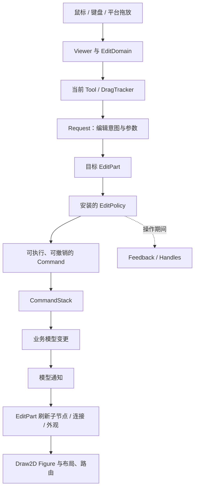
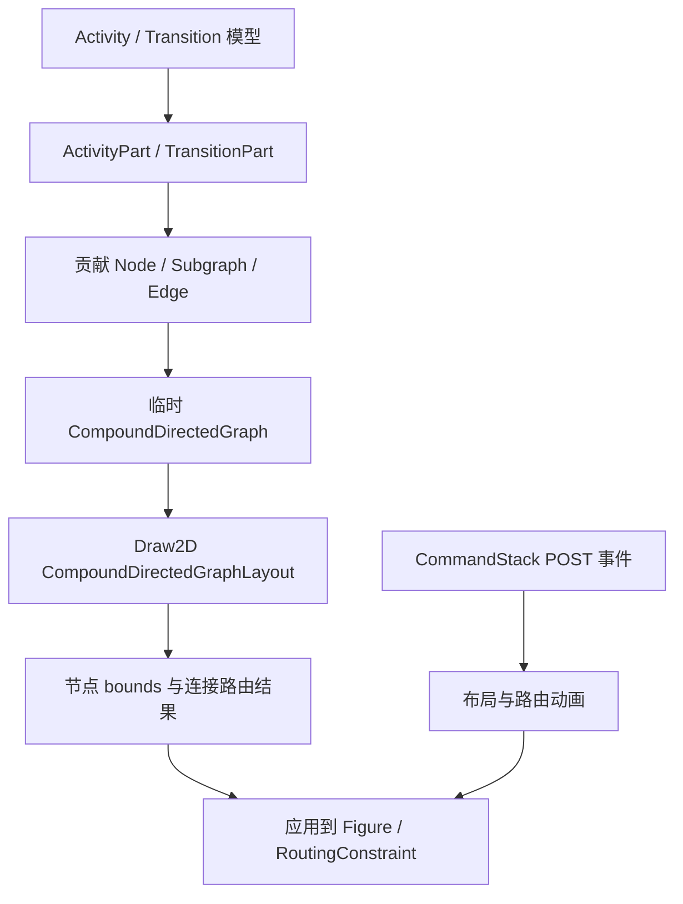
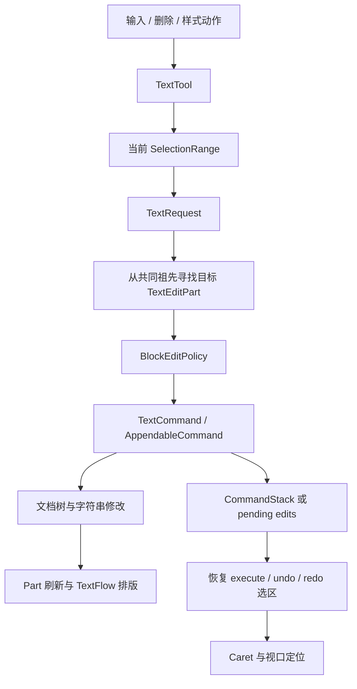

# GEF Classic 官方样例构成与能力分析

类型：`reference-analysis`

分析日期：2026-10-27。
参考仓库：`/Users/bytedance/Documents/code/GitHub/gef-classic`。
源码基线：`4463d9d0ce13c19d10fbe769d29f28b7345a8cba`，提交日期为
2026-01-06。本文描述该本地快照，不声称覆盖上游最新版本。

## 范围、证据与阅读方式

本报告分析 GEF Classic 的 `org.eclipse.gef.examples*` 官方样例及其直接使用的
GEF/Draw2D 契约。范围包括 6 个图形编辑器模块、2 个 Palette 小样例、
PDE 源码工程向导和 Capabilities 配置。JavaFX 路线的新一代 GEF、
`org.eclipse.zest` 及其样例不在本次范围内。Draw2D 独立样例也不混入此清单。
官方 README、Examples feature 和插件注册共同确定了样例归属。
<a href="#source-01">[cite:1]</a><a href="#source-02">[cite:2]</a>

本次采用静态源码分析：核对插件入口、模型结构、Figure/EditPart、策略安装、
命令实现、工具与宿主接入。不修改、编译或运行 Java；没有截图、人工操作、
跨平台结果或性能实测。参考仓库存在 `.project` 等本地修改，但本次范围内的
Java 源码、`plugin.xml`、Manifest 和 feature 文件没有出现在已跟踪修改清单中。

文中的证据分为三种，效力不同：

| 表述 | 含义 | 能证明什么 |
|---|---|---|
| 源码事实 | 方法体、注册项或资源直接支持的判断 | 某条实现路径存在，或某处明确拒绝操作 |
| 能力归纳 | 从多个类协作关系推导出的展示目的 | 该样例适合检验哪类框架机制 |
| 建议验收 | 根据展示路径提出的操作与断言 | 后续验证应该观察什么；不代表测试已通过 |

官方样例大多没有把“能力验证目标”写成正式测试规格。因此各节的能力表属于
源码支持的分析归纳，不应当引用为官方认证结果，也不定义 Novadraw 的当前契约
或完成状态。Novadraw 的采用关系仍由
[GEF 语义账本](../../parity/gef/api-coverage.md)维护。

## 官方样例清单与入口

### 模块、源码规模和交付方式

下表的数量为本地模块 `src/` 下的 `.java` 文件数，包含 Messages 等辅助源码，
不等于 API 数、测试数或功能数量。统计采用同一快照和口径。

| 模块 | Java 文件数 | 内容与入口 | 交付定位 |
|---|---:|---|---|
| `org.eclipse.gef.examples.digraph1` | 13 | `.digraph1` Editor、Graphical View、RCP Application/Perspective | 最小节点投影与宿主接入 |
| `org.eclipse.gef.examples.digraph2` | 11 | `.digraph2` Editor，依赖 Digraph1 | 在基础投影上加入连接 |
| `org.eclipse.gef.examples.shapes` | 32 | `.shapes` Editor、Shapes Diagram 文件向导 | 精简而完整的图形编辑应用 |
| `org.eclipse.gef.examples.logic` | 118 | `.logic` Editor、Logic Diagram 文件向导、打印命令 | 复杂交互与电路模型展示 |
| `org.eclipse.gef.examples.flow` | 59 | `.flow` Editor、Flow Diagram 文件向导 | 结构化活动编辑与自动布局 |
| `org.eclipse.gef.examples.text` | 78 | `.text` WYSIWYG Editor、文档文件向导 | 自定义文本编辑协议 |
| `org.eclipse.gef.examples` | 3 | `PaletteSnippet1`、`PaletteSnippet2` 两个 View，另有 Messages | Palette 定制扩展 |
| `org.eclipse.gef.examples.ui.pde` | 7 | Logic、Flow、Shapes、Text 四个源码工程向导 | 开发者源码工程导入 |
| `org.eclipse.gef.examples.ui.capabilities` | 0 | `org.eclipse.ui.activities` 配置 | 工作台功能入口的组织与筛选 |

Examples feature 收录以上 9 个插件模块。官方 README 的运行说明重点列出
Flow、Logic、Shapes、WYSIWYG Document 四个部署样例；它没有把 Digraph1/2
描述为同等完整的交互应用。不能因为所有模块都打进一个 feature，就把它们按同一
验收标准统计。<a href="#source-01">[cite:1]</a><a href="#source-02">[cite:2]</a>

### 宿主入口和模型内容需要分别统计

文件向导负责创建模型文件；Editor 负责读取和编辑文件；Palette View 展示局部
扩展点；PDE 向导创建源码工程。这些入口不应重复计为独立编辑器样例。

Logic 文件向导提供 Empty Model 和 Four-bit Adder Model 两个选择。
半加器、全加器还有创建工厂，可进入 Palette；这些是同一 Logic 编辑器的模型
预设，不能再计为三个独立框架样例。Text 在空文件或未加载到文档模型时，由
`TextEditor.setInput()` 构造默认文档，而不是读取一份普通纯文本文件。
<a href="#source-10">[cite:10]</a><a href="#source-17">[cite:17]</a>

## 样例共同展示的框架链路

Shapes、Logic、Flow 都沿用 GEF 的工具、请求、策略和命令协作；Text 使用相同
扩展机制，但定义了自己的文本请求、选区和命令协议。Digraph1/2 则主要停留在
模型到图形的投影层。<a href="#source-04">[cite:4]</a>
<a href="#source-08">[cite:8]</a><a href="#source-13">[cite:13]</a>
<a href="#source-18">[cite:18]</a>

这个链路有几项需要分别观察的能力：

| 层次 | 样例承担的应用代码 | 框架提供的机制 | 验收中容易漏掉的内容 |
|---|---|---|---|
| 模型 | 属性、子元素、连接、通知、领域计算 | GEF 接受应用模型 | 删除和撤销后关系是否一致 |
| 投影 | Factory、EditPart、Figure、Content Pane | Viewer、EditPart 树与连接管理 | 激活/停用的监听、刷新范围、身份复用 |
| 编辑 | Policy 返回应用 Command | Tool、Request 分发、CommandStack | 操作拒绝、拖动反馈、取消与撤销 |
| 几何 | 锚点、路由约束、图布局适配 | Draw2D 坐标与布局、路由协议 | 缩放、滚动、嵌套容器下的坐标 |
| 工作台 | 文件向导、Actions、属性源、大纲 | Eclipse Editor/View/Selection 等接口 | 保存点、动作绑定、视图同步 |

界面上出现控制柄只证明反馈策略参与了显示；能否修改模型仍取决于目标策略是否
返回可执行命令。Digraph2 就是这一差别的直接例子。
<a href="#source-24">[cite:24]</a>

## Shapes：精简的完整图形编辑器

### 构成与状态归属

| 构成 | 主要类 | 职责 |
|---|---|---|
| 图模型 | `ShapesDiagram`、`ModelElement` | 子形状集合、属性通知、属性面板适配与序列化基础 |
| 节点模型 | `Shape`、`RectangularShape`、`EllipticalShape` | 位置、尺寸、入连接和出连接 |
| 边模型 | `Connection` | 源、目标、线型，以及端点关系的连接/断开 |
| 图形投影 | `DiagramEditPart`、`ShapeEditPart`、样例 `ConnectionEditPart` | 容器、矩形/椭圆、带箭头连接 |
| 布局与节点策略 | `ShapesXYLayoutEditPolicy`、`ShapeComponentEditPolicy`、匿名 `GraphicalNodeEditPolicy` | 创建、移动/缩放、删除、创建连接和重连 |
| 命令 | `ShapeCreateCommand`、`ShapeSetConstraintCommand`、`ShapeDeleteCommand`、连接创建/删除/重连命令 | 模型修改和撤销/重做 |
| 工具与宿主 | `ShapesEditorPaletteFactory`、`ShapesEditor`、`ShapesOutlinePage` | Palette、模板拖放、文件保存/另存、大纲同步 |

`ShapeEditPart` 用同一个控制器实现矩形和椭圆投影，但创建 Figure 和锚点时仍按
模型具体类型分支。矩形使用 `ChopboxAnchor`，椭圆使用 `EllipseAnchor`。
`DiagramEditPart` 使用 `FreeformLayer`/`FreeformLayout`，连接层安装
`ShortestPathConnectionRouter`。因此样例同时展示了形状几何锚点和障碍感知路由。
<a href="#source-03">[cite:3]</a><a href="#source-04">[cite:4]</a>

节点位置和尺寸通过布局策略生成 `ShapeSetConstraintCommand`，最终进入模型。
节点激活时注册模型监听，停用时移除；属性变化再触发外观或连接刷新。
编辑后的场景不是仅靠拖动 Figure 临时保留下来的。
<a href="#source-04">[cite:4]</a>

### 特征与关键操作链

Palette 提供选择/平移、框选、两种形状创建及实线/虚线连接创建。模板既能作为
创建工具使用，也能通过 TemplateTransfer 从 Palette 拖进画布。
连接的线型由 CreationFactory 的对象类型参数传入命令；图形上的箭头安装在
target decoration。<a href="#source-03">[cite:3]</a>
<a href="#source-05">[cite:5]</a><a href="#source-06">[cite:6]</a>

创建连接分为两个阶段：源节点策略建立 `ConnectionCreateCommand` 并放入
`CreateConnectionRequest.startCommand`；目标节点补齐 target，再由工具执行。
`canExecute()` 拒绝自连接和同方向重复连接。拒绝规则按端点关系判断，不因为
切换实线/虚线就允许再连一条相同端点的边。
<a href="#source-04">[cite:4]</a><a href="#source-05">[cite:5]</a>

删除形状时，`ShapeDeleteCommand` 保存入边/出边信息，移除形状并断开连接；
撤销时重新添加形状并 reconnect。重连命令保存旧端点，分别处理更换源或目标。
这两条路径比“画面上少一个矩形”更能检验模型和投影是否保持一致。
<a href="#source-05">[cite:5]</a>

### 能力点与建议验收

| 编号 | 能力点 | 建议操作与观察 | 证据 |
|---|---|---|---|
| SH-01 | 工厂与节点投影 | 创建矩形、椭圆，核对模型类型、Figure 类型和锚点类型 | `ShapeEditPart.createFigureForModel/getConnectionAnchor` |
| SH-02 | 约束编辑 | 分别移动、缩放、多选操作，再撤销/重做，核对模型位置和尺寸 | `ShapesXYLayoutEditPolicy`、`ShapeSetConstraintCommand` |
| SH-03 | 模板拖放 | 同一种形状分别用工具创建和拖放创建，核对两条路径最终进入同类模型命令 | Palette factory、Editor 的 transfer listeners |
| SH-04 | 连接创建与拒绝 | 创建两种线型；尝试自连接和重复边；取消未完成连接 | `ConnectionCreateCommand.canExecute`、节点策略 |
| SH-05 | 锚点与路由 | 移动/缩放端点，增加阻挡形状，观察连接端点和路径更新 | 两类 Anchor、`ShortestPathConnectionRouter` |
| SH-06 | 连接重连 | 分别重连源、目标，再撤销；核对原端点和两个节点的连接集合 | `ConnectionReconnectCommand` |
| SH-07 | 删除关系恢复 | 删除有入边/出边的形状，再撤销；检查孤立边、重复边和连接身份 | `ShapeDeleteCommand` |
| SH-08 | 模型通知生命周期 | 反复打开/关闭，修改模型；检查停用控制器不再响应 | `activate/deactivate/propertyChange` |
| SH-09 | 大纲与属性接入 | 在画布/大纲切换选择，通过属性源检查和修改几何属性 | `ShapesOutlinePage`、模型属性源 |
| SH-10 | 文件和保存点 | 编辑、保存、继续编辑、撤销，并执行另存和重新打开 | `ShapesEditor.doSave/doSaveAs/setInput/stackChanged` |

上述断言分别来自投影、命令和宿主实现，运行结果尚未采集。
<a href="#source-04">[cite:4]</a><a href="#source-05">[cite:5]</a>
<a href="#source-06">[cite:6]</a>

### 能力边界

Shapes 没有安装交互折点策略，自动路由不等于用户可拖动折点；也没有复杂嵌套
容器或业务值传播。新增第三种形状需要调整样例的类型分支。这说明它适合展示
基础框架协作，但不能作为开放类型注册设计的直接范本。
<a href="#source-04">[cite:4]</a><a href="#source-05">[cite:5]</a>

删除撤销代码调用 `parent.addChild(child)`，没有在该命令中显式保存并恢复原来的子节点
索引。后续验收应将“节点和边恢复”与“原顺序/Z-order 恢复”分开记录，不能默认
前者已经证明后者。<a href="#source-05">[cite:5]</a>

## Logic：复杂编辑机制与可计算电路模型

### 构成与业务场景

| 构成 | 主要类或子目录 | 职责 |
|---|---|---|
| 领域模型 | `LogicElement`、`LogicSubpart`、`LogicDiagram`、`Circuit`、`LogicFlowContainer` | 通知、图形属性、根图、嵌套电路与布局容器 |
| 逻辑元件 | `AndGate`、`OrGate`、`XORGate`、`LiveOutput`、`GroundOutput`、`LED`、`LogicLabel` | 布尔门、信号源、数值输入/显示和标签 |
| 连接与辅助几何 | `Wire`、`WireBendpoint`、`LogicRuler`、`LogicGuide` | 端子连接、相对折点、标尺和辅助线模型 |
| 视图 | `figures/`、`GraphicalPartFactory`、`TreePartFactory` | 元件图形、固定端子锚点、画布与树投影 |
| 编辑 | `edit/`、`tools/`、`model/commands/` | 端子连接、折点、约束、克隆、容器操作、标签直接编辑 |
| 应用接入 | `LogicEditor`、`LogicPlugin`、`LogicRulerProvider`、`dnd/`、`handlers/` | Palette、缩放、吸附、大纲/鸟瞰、拖放、打印 |

官方模型工厂包含半加器、由两个半加器和 OR 门组成的全加器，以及四位加法器场景。
四位场景组合多个 Circuit 和三个 LED，并把进位和结果接到明确端子。
文件向导直接提供空模型与四位模型；半加器/全加器工厂也可作为模板创建。
<a href="#source-10">[cite:10]</a>

### 端子、连接和逻辑值传播

Logic 的边连接到“元件 + terminal”，而不只是 Figure 中心。节点控制器把
ConnectionAnchor 映射为 terminal 标识；`ConnectionCommand` 同时保存源/目标元件
及 terminal，执行时 detach、设置新关系、attach，撤销时恢复旧关系。
`canExecute()` 检查目标 terminal 是否已被连接占用。节点策略还明确拒绝把
LiveOutput/GroundOutput 作为某些目标重连操作的接收者。
<a href="#source-08">[cite:8]</a>

这使端口身份、端口方向、连接合法性成为模型编辑内容。仅在 Figure 边缘画几个
圆点，无法证明这些能力。

`Wire.setValue()` 在值变化后调用 target 的 `update()`，再发出 value 通知；
AND 门的 `getResult()` 计算两个输入的逻辑与。`WireEditPart` 根据值改变线色。
因此 Logic 同时展示领域计算和模型驱动的视觉更新；布尔计算属于样例模型，
GEF 提供控制器和通知接入，不提供通用电路求解器。
<a href="#source-07">[cite:7]</a><a href="#source-09">[cite:9]</a>

### 路由模式与折点策略的联动

根图可以在 manual、Manhattan 和 shortest-path 路由模式间切换：

| 模式 | 源码装配 | 对折点交互的影响 |
|---|---|---|
| Manual | `FanRouter` 串接 `BendpointConnectionRouter` | 读取模型相对折点，安装 `WireBendpointEditPolicy` |
| Manhattan | `ManhattanConnectionRouter` | `WireEditPart` 停止应用模型折点，并移除折点策略 |
| Shortest path | `ShortestPathConnectionRouter` | 非 Manhattan 路径仍进入折点刷新/策略安装分支；具体路由结果需运行确认 |

`WireEditPart.activateFigure()` 监听连接的 router 属性变化，再刷新折点及编辑策略。
模型 `WireBendpoint` 保存相对两端的尺寸；投影创建 `RelativeBendpoint` 并设置 weight。
折点位置因此会随连接两端变化。不能把它简化为固定屏幕坐标数组。
<a href="#source-09">[cite:9]</a><a href="#source-11">[cite:11]</a>

### 吸附、嵌套、克隆和宿主集成

`LogicDiagramEditPart.getAdapter(SnapToHelper.class)` 按 Viewer 设置组合
`SnapToGuides`、`SnapToGeometry`、`SnapToGrid`；多个策略使用
`CompoundSnapToHelper`。布局策略把 guide attachment 的变更串入命令。
辅助线既有视觉反馈，也有模型关系和撤销命令。
<a href="#source-11">[cite:11]</a>

`CloneCommand` 递归克隆嵌套元素，维护 old-part → new-part 映射，复制折点并
重新连接克隆集合内部的边。这是带图关系的克隆，不能用浅拷贝模型或复制 Figure
代替。具体复制范围、外部连接处理和顺序恢复仍应逐项验收。
<a href="#source-11">[cite:11]</a>

`LogicEditor` 接入 flyout Palette、TreeViewer 大纲和缩略图，并提供 fit all/width/height、
鼠标位置缩放滚动策略、标尺、网格与几何吸附动作。连接创建反馈放到
`SCALED_FEEDBACK_LAYER`，源码还注明这是缩放反馈缺陷的修正位置。
<a href="#source-08">[cite:8]</a><a href="#source-12">[cite:12]</a>

原生文本拖放通过 `NativeDropRequest` 进入编辑目标；模板拖放是另一条路径。
打印 handler 从选中的 `.logic` 文件重新反序列化模型，创建临时 Viewer，
再调用 `PrintGraphicalViewerOperation`。它打印的是所选文件对应的模型，
不能据此声称包含当前编辑器未保存的修改。
<a href="#source-12">[cite:12]</a>

### 能力点与建议验收

| 编号 | 能力点 | 建议操作与观察 | 证据入口 |
|---|---|---|---|
| LG-01 | 复合模型投影 | 打开四位加法器；核对根、嵌套 Circuit、内部元件和跨层连接 | `LogicDiagramFactory`、两类 PartFactory |
| LG-02 | 端口身份与拒绝 | 连不同 terminal；尝试连接已占用输入和不合法目标 | `LogicNodeEditPolicy`、`ConnectionCommand.canExecute` |
| LG-03 | 端口重连和撤销 | 重连源/目标，核对元件、terminal 和连接集合一并恢复 | `ConnectionCommand.execute/undo` |
| LG-04 | 值传播 | 改变 LED/输入值；核对门输出、导线值和线色，撤销后再观察 | `Wire.setValue`、元件 `getResult/update` |
| LG-05 | 折点生命周期 | 创建、移动、删除相对折点；移动端点；切换路由模式 | `WireEditPart`、`WireBendpointEditPolicy` |
| LG-06 | 路由和编辑资格 | 切到 Manhattan，核对折点控制柄/命令被禁用；切回后恢复 | `refreshBendpointEditPolicy` |
| LG-07 | 缩放反馈坐标 | 在多种 zoom 和滚动位置创建/重连；核对锚点、预览与实际线重合 | scaled feedback layer、ZoomManager |
| LG-08 | 组合吸附 | 分别启用网格、几何、辅助线，再组合使用；观察优先顺序和反馈 | `CompoundSnapToHelper`、SnapFeedbackPolicy |
| LG-09 | 辅助线模型关系 | 拖动 guide、移动已绑定节点、撤销；核对位置与 attachment | Guide 命令、`LogicRulerProvider` |
| LG-10 | 容器编辑 | 在根图、Circuit、FlowContainer 间操作；核对父关系、坐标和删除恢复 | Container/XY/Flow policies |
| LG-11 | 图关系克隆 | 克隆包含内部连接的多个节点及嵌套电路；核对新旧对象和端点映射 | `CloneCommand` |
| LG-12 | 标签直接编辑 | 打开编辑框、修改、取消、撤销，在缩放状态下检查位置 | `LogicLabelEditManager`、Locator、Policy |
| LG-13 | 多视图选择 | 在树、画布与鸟瞰间切换，核对选择同步和视口定位 | `LogicEditor.OutlinePage` |
| LG-14 | 平台拖放 | 分别测试模板和原生文本拖放，核对 Request 与模型修改 | `dnd/`、`NativeDropRequest` |
| LG-15 | 文件、打印和可访问名称 | 保存/重开，打印所选文件，查询节点与导线可访问名称 | Editor、PrintHandler、AccessibleEditPart |

以上能力跨模型、策略、图形和宿主层；LG-04 的电路结果是领域断言，LG-07
属于几何/反馈断言，LG-15 还依赖平台服务，应分别取证。
<a href="#source-07">[cite:7]</a><a href="#source-08">[cite:8]</a>
<a href="#source-09">[cite:9]</a><a href="#source-11">[cite:11]</a>
<a href="#source-12">[cite:12]</a>

### 能力边界

四位加法器的名称和较多类文件不能证明大图性能、任意循环电路稳定求解或后台
计算能力。模型中有同步 `update()` 传播路径，本次没有验证循环拓扑的终止性。
Logic 模型还有 SWT Image 和属性面板相关接口，不能把它当作 backend-neutral
纯领域模型的完整范本。<a href="#source-07">[cite:7]</a>

Clone 等样例实现按具体类型分支；静态 Color、Image 和部分共享对象也存在。
这些是参考实现事实，不应覆盖 Novadraw 的无全局状态、第三方类型边界和
内置/扩展统一规则。

## Flow：结构化活动、图布局与动画

### 构成与模型特征

| 构成 | 主要类 | 职责 |
|---|---|---|
| 活动模型 | `FlowElement`、`Activity`、`StructuredActivity`、`ActivityDiagram` | 名称、父子关系、输入/输出转换 |
| 结构类型 | `SequentialActivity`、`ParallelActivity` | 顺序容器和并行容器 |
| 连接模型 | `Transition` | 活动间有向关系 |
| 投影 | `ActivityPart`、`SimpleActivityPart`、`StructuredActivityPart`、各结构 Part、`TransitionPart` | 活动、标题/内容面板和连接 |
| 图布局适配 | `GraphLayoutManager`、节点/边的 contribute/apply 方法 | 构造并布局 `CompoundDirectedGraph`，把结果应用到 Figure |
| 编辑策略 | `ActivityNodeEditPolicy`、`ActivitySourceEditPolicy`、`ActivityContainerEditPolicy`、`StructuredActivityLayoutEditPolicy`、`TransitionEditPolicy` | 连线、结构创建/迁移、命名、连接拆分 |
| 动画 | 样例 `LayoutAnimator`、`RoutingAnimator`、`ActivityDiagramPart.stackListener` | 布局和路由过渡、新节点和新连接的入场处理 |
| 宿主 | `FlowEditor`、`FlowEditorPaletteFactory`、文件向导 | Palette、模板拖放、动作、保存/另存 |

Palette 明确提供 Activity、Sequential Activity、Parallel Activity，以及选择、
框选和连接工具。本地清单没有独立的 Decision 节点工厂；不能仅凭“流程图”
称谓把完整 UML Activity Diagram 或 BPMN 元素补进展示范围。
<a href="#source-13">[cite:13]</a>

### 拖放目标决定模型操作

同一个创建意图，落到不同对象上会产生不同命令：

| 落点 | 策略 | 模型效果 |
|---|---|---|
| 结构容器 | `StructuredActivityLayoutEditPolicy` | 创建/加入 child |
| 某个已有活动 | `ActivitySourceEditPolicy` | 创建/加入 child，并指定已有活动为 source |
| 某条 Transition | `TransitionEditPolicy` | 拆开旧边，在中间插入新 Activity，再创建两条新边 |

`TransitionEditPolicy.getTargetEditPart()` 接受 `REQ_CREATE`，让连接成为创建操作的
合法目标；目标反馈把线宽从 1 改为 2，结束时恢复。`SplitTransitionCommand`
保存旧 source/target，执行时移除旧关系，添加活动和两条新连接；undo 则移除
新关系并恢复旧边。<a href="#source-13">[cite:13]</a>
<a href="#source-14">[cite:14]</a>

这条路径检验目标解析、反馈、结构命令和撤销关系。验收需要比较模型拓扑，
仅观察新节点出现在连线上不足以证明旧边已正确移除。

### 自动布局如何与模型分离

`GraphLayoutManager.layout()` 构造临时 `CompoundDirectedGraph`，由各 Part 贡献
nodes/edges，调用 Draw2D 的 `CompoundDirectedGraphLayout.visit()`，再由 Part
把结果应用到图形。StructuredActivity 对应 `Subgraph`，标题高度、padding 等
作为图布局输入；Content Pane 返回复合 Figure 的内部 contents。
<a href="#source-15">[cite:15]</a>

SequentialActivityPart 还按 child 顺序加入相邻节点之间的额外布局 Edge，
设置较高 weight。它们用于约束排布，并不代表模型新增了业务 Transition。
这是区分业务图与布局图的关键证据：自动布局可能需要额外边，但这些边不能
自动升级为业务关系。<a href="#source-15">[cite:15]</a>

Flow 的位置主要由图布局导出。`StructuredActivityLayoutEditPolicy.getMoveChildrenCommand()`
明确返回 null，不能把它描述成任意节点可自由拖到 XY 坐标的编辑器。
拖放可以改变父子/连接关系，然后触发重新布局。
<a href="#source-13">[cite:13]</a>

### 布局与路由动画

根 Part 监听 CommandStack 的 POST 事件，调用 `Animation.markBegin()`，注册
节点和连接的动画状态，然后 `Animation.run(230)`。230 是样例源码中的动画
时长，不是性能目标或测量结果。激活/停用时分别注册/移除 stack listener。
<a href="#source-15">[cite:15]</a>

样例 LayoutAnimator 特别处理初始 bounds 为空的新节点：起始位置和宽度使用
最终位置和宽度，保留零高度以形成展开效果。RoutingAnimator 识别新连接的默认
点列，不把它从默认斜线插值到最终路由，而在收尾时 revalidate 并恢复 visible。
这两项处理说明新增对象需要单独定义入场语义。
<a href="#source-16">[cite:16]</a>

### 能力点与建议验收

| 编号 | 能力点 | 建议操作与观察 | 证据入口 |
|---|---|---|---|
| FL-01 | 结构类型投影 | 创建普通、顺序、并行活动及嵌套结构，检查模型和对应 Figure | Palette factory、ActivityPartFactory |
| FL-02 | Content Pane | 向复合结构添加 child，核对 child 进入内容区域，标题不成为业务 child | `StructuredActivityPart.getContentPane` |
| FL-03 | 图布局适配 | 改变结构/连接，核对 nodes/subgraphs/edges 和最终 bounds | `GraphLayoutManager`、contribute/apply |
| FL-04 | 顺序布局约束 | 调整顺序容器 children，观察顺序，并确认没有新增业务边 | `SequentialActivityPart.contributeEdgesToGraph` |
| FL-05 | 创建目标解析 | 将模板拖到空容器、活动、连接，核对各自产生的命令和拓扑 | Source/Container/Transition policies |
| FL-06 | 连接拆分与恢复 | 对 A→B 插入 X，得到 A→X→B；撤销后恢复原 A→B | `SplitTransitionCommand` |
| FL-07 | 连线拒绝与重连 | 尝试自连接、重复边，分别重连源/目标并撤销 | `ConnectionCreateCommand`、重连命令 |
| FL-08 | 标题直接编辑 | 在复合 Figure 标题/内容区分别触发编辑，检查命中与编辑框坐标 | `directEditHitTest`、DirectEditManager/Locator |
| FL-09 | 容器迁移 | 对已有活动执行 add/orphan，核对父关系和关联连接，撤销后比较模型 | Add/Orphan/AssignSource 命令 |
| FL-10 | 动画同步 | 创建、删除、撤销、重做时观察节点和线；结束后核对最终静态几何 | stack listener、两类 Animator |
| FL-11 | 新对象入场 | 检查新节点不会从左上角飞入，新连接没有默认斜线过渡 | 样例 LayoutAnimator/RoutingAnimator |
| FL-12 | 命令与宿主生命周期 | 关闭/重开，确认旧 stack listener 不再参与；保存/另存并重载拓扑 | Part.activate/deactivate、FlowEditor |

连线创建命令拒绝自连接及相同 source→target 的重复连接；本次没有从该方法
获得完整的跨容器合法性规则，不应推断任意跨层连接都受支持。
<a href="#source-14">[cite:14]</a>

### 能力边界

Transition 使用 `BendpointConnectionRouter` 来承载图布局产生的路由点，但没有
安装类似 Logic 的交互折点策略。路由点存在与用户可编辑折点是两项能力。
<a href="#source-15">[cite:15]</a>

上述动画实现有共享 Animator 和默认点列判定。对 Novadraw 而言，可以参考新增
节点/边的行为问题与验收场景；其状态所有权、调度和 presentation API 必须由
项目设计另行确定，不能直接照搬 Java 的共享状态或写 Figure bounds 的方式。
Flow 也未提供大图布局耗时、连续输入下的中断/重定向或 Web 包体积证据。

## Text：自定义文本编辑框架

### 构成与默认文档

| 构成 | 主要类 | 职责 |
|---|---|---|
| 文档模型 | `ModelElement`、`Container`、`Block`、`InlineContainer`、`TextRun`、`Style` | 文档树、字符串、父关系、样式继承 |
| 模型位置 | `ModelLocation` | 命令使用的模型对象和偏移 |
| 图形位置与选区 | `TextLocation`、`SelectionRange`、`SelectionModel` | EditPart + offset、范围方向、trailing、对象选择 |
| Viewer | `GraphicalTextViewer` | 选区更新、选择事件、caret reveal |
| Tool/Tracker | `TextTool`、`SelectionRangeDragTracker` | 键盘导航、输入、范围拖选、插入/覆盖模式 |
| 请求 | `CaretRequest`、`TextRequest`、`SelectionRangeRequest`、`SearchResult` | 几何搜索、编辑意图和目标定位 |
| 控制器/图形 | `DocumentPart`、`BlockTextPart`、`InlineTextPart`、`TextFlowPart`、Imports/Import Part | 文档、段落、内联、文字、结构装饰 |
| 策略/命令 | `BlockEditPolicy`、`TextStyleManager`、`MiniEdit`、Compound/Single/结构编辑命令 | 内容、结构和样式修改，连续输入与撤销 |
| 宿主 | `TextEditor`、`StyleService`、Actions、字体 ContributionItems、TreeViewer | 动作状态、样式工具栏、保存、大纲 |

默认文档是结构化的 Java 文件风格内容：package 段落、import declarations、
含中英文/阿拉伯文的 comment，以及 Courier New 代码段。TextRun 的 import/code
类型会影响 Part 或布局选择。`.text` 文件使用 Java 对象序列化，并非普通 UTF-8
文本文件。<a href="#source-17">[cite:17]</a><a href="#source-20">[cite:20]</a>

Editor 使用 `ScalableRootEditPart`，让 viewport contents tracks width，使段落
随可用宽度重新排版；默认 Tool 换成 `TextTool`，并创建自己的
`GraphicalTextViewer`。因此它展示了在 GEF 上构建另一类交互系统的扩展能力，
不能按 Shapes 的节点拖动模型理解。
<a href="#source-17">[cite:17]</a>

### 文本位置、范围选择与 caret

TextLocation 使用 TextEditPart 与 offset；SelectionRange 还记录方向和 trailing。
`TextFlowPart` 把点转换到 Figure 相对坐标，调用 Draw2D TextFlow 的 offset/caret
几何 API。COLUMN、ROW、LINE_BOUNDARY、WORD_BOUNDARY、LOCATION 等搜索
分别走不同方法；word boundary 使用 Java `BreakIterator`。
<a href="#source-18">[cite:18]</a><a href="#source-20">[cite:20]</a>

文字的屏幕位置、逻辑偏移和双向文本 caret 边不一定一一对应。保留 trailing
以及 visible offset API，是这里比普通标签命中更值得研究的部分。

SelectionModel 被源码注明为 immutable，并封装文本范围和普通 EditPart 选择；
其实现仍持有 EditPart 和范围引用，不能外推为可跨线程、深度不可变的文档快照。
GraphicalTextViewer 设置新 selection model 时应用/清除选择，并发布 selection
changed 事件；`revealCaret()` 按 caret bounds 调整视口滚动。
<a href="#source-18">[cite:18]</a>

### 编辑命令与选区恢复

TextCommand 额外定义执行、撤销和重做后的 SelectionRange。TextEditor 和
GraphicalTextViewer 的命令栈监听路径会据此恢复选区。这表明“撤销文本”
需要同时定义编辑位置，而不是只恢复字符串。
<a href="#source-17">[cite:17]</a><a href="#source-18">[cite:18]</a>

`CompoundTextCommand` 区分 pending 和 applied；执行 pending 后转入 applied，
undo 按逆序调用，redo 按顺序调用。`TextTool.handleTextEdit()` 首次通过命令栈
执行；若后续返回同一个 AppendableCommand，则调用 `executePending()`，
并直接更新选区。这个连续输入方案有专门的历史协议，不能简化为每个字符都
必然生成独立的 CommandStack entry。
<a href="#source-19">[cite:19]</a>

### 样式、结构和宏转换

Editor 注册粗体、斜体、下划线、段落对齐、LTR/RTL 等动作；字体和字号通过
ContributionItem/StyleService 接入。Style 支持从父样式继承属性。段落方向和
段落对齐在策略里应用到 block container，范围样式则需要处理选区涉及的文本段。
<a href="#source-17">[cite:17]</a><a href="#source-21">[cite:21]</a>

BlockEditPolicy 除插入、覆盖、删除、换段、缩进/取消缩进外，还包含输入宏：
`<b>` 转成粗体内联结构，`()` 转成 bulleted list 结构，`import` 转成 import
declarations。这些是样例定义的文档规则，不是 GEF 的内置文本语言。
<a href="#source-21">[cite:21]</a>

### 能力点与建议验收

| 编号 | 能力点 | 建议操作与观察 | 证据入口 |
|---|---|---|---|
| TX-01 | 文档树与图形投影 | 打开默认文档，核对段落、注释、imports、code 的 Part 和布局 | Editor factory、Document/Block/TextFlow Part |
| TX-02 | 点到文本位置 | 单击换行边缘、段边界、混合方向文字，比较 offset、trailing 与 caret | `TextFlowPart.searchLocation/getCaretPlacement` |
| TX-03 | 可见偏移导航 | 字符、词、行、页、文档首尾导航及 Shift 扩选，检查跨 Part 行为 | TextTool、CaretRequest、TextFlowPart |
| TX-04 | 文本范围与对象选择 | 拖选跨文本段范围，再通过大纲选择结构对象，观察选区和焦点 | SelectionModel、GraphicalTextViewer、Tracker |
| TX-05 | 编辑目标定位 | 选区跨 sibling/inline/block 时，核对共同祖先目标与生成命令 | `TextTool.getTextTarget`、BlockEditPolicy |
| TX-06 | 内容/结构编辑 | 插入、覆盖、退格、删除范围、换段、缩进/取消缩进，核对文档树 | MiniEdit 和结构命令 |
| TX-07 | 连续输入历史 | 连续输入后导航、改样式再输入；核对合并边界和撤销粒度 | AppendableCommand、pending/applied |
| TX-08 | 撤销后选区 | 对内容、跨段和样式编辑执行 undo/redo，比较模型与选区两份状态 | TextCommand、stack listeners |
| TX-09 | 样式继承与范围样式 | 对部分文本与整段分别设样式；检查拆分、继承和工具栏状态 | StyleService、TextStyleManager、BlockEditPolicy |
| TX-10 | Bidi/方向交互 | 在 LTR/RTL 段落内输入与导航，核对布局方向、caret 边和左右键映射 | Editor actions、TextTool.isMirrored、TextFlow API |
| TX-11 | 宏转换 | 输入三个宏并撤销，核对转换后的树、文本与选区；记录不支持分支 | `BlockEditPolicy.checkForConversion` |
| TX-12 | 排版与视口 | 改窗口宽度、缩放、移动 caret 到视口外，检查换行与 reveal | tracks width、`revealCaret` |
| TX-13 | 字体资源生命周期 | 切换字体/样式并关闭编辑器，核对 FontCache 引用归还 | `TextFlowPart.refreshVisuals/deactivate` |
| TX-14 | 持久化与动作 | 保存/重开文档，核对树和样式；检查 dirty、Undo/Redo 与快捷键 | TextEditor、plugin.xml、Actions |

TX-10 需要区分 SWT 宿主 mirrored 状态与文档 block orientation。存在两类方向
处理不等于已证明所有 Bidi 输入行为一致；本次没有运行输入法或混合方向测试。
<a href="#source-17">[cite:17]</a><a href="#source-19">[cite:19]</a>
<a href="#source-20">[cite:20]</a>

### 源码限制与未完整接通的内容

Text 的实现包含明确限制，不能按成熟富文本编辑器的完整功能清单验收：

| 观察 | 源码事实 | 对报告结论的影响 |
|---|---|---|
| 部分文档类型未进入 factory | Container 定义 bulleted list/code 等类型；Editor 的 Container switch 只接 root、imports、comment/paragraph、inline，其余抛异常 | 定义常量或生成宏结构不证明可完整显示与编辑 |
| 部分 Request 仅有定义 | TextRequest 定义 `REQ_BREAK`、`REQ_NEW_PAGE`；已查 BlockEditPolicy 分发未处理这两项 | 不宣称完整软换行、分页能力 |
| 另存未实现 | `doSaveAs()` 留空，`isSaveAsAllowed()` 返回 false | TX-14 仅包括保存与重开 |
| caret reveal 有已知限制 | Viewer 注释指出应先 expose text location；当前依据 caret bounds 滚动 | 不宣称覆盖所有折叠/不可见文本场景 |
| 选区接口仍有迁移遗留 | `getSelectionRange/setSelectionRange` 已 deprecated，调用仍存在；选区恢复在 Editor/Viewer 两处接入 | 学习行为边界时应避免把重复接入当推荐结构 |
| 结构操作存在静态疑点 | `Container.removeAll(Collection children)` 的参数遮蔽字段，方法体对参数执行 `children.removeAll(children)` | 不能仅凭 split/subdivide 命令存在就认定结构变更正确 |
| 完整输入法/剪贴板能力未获证据 | 已查 TextTool 主要依据 KeyEvent 的 character 和导航请求；未获得完整 IME composition 或剪贴板链路证据 | 不宣称生产级中文输入、复制/粘贴已验证 |

这些观察分别来自 factory、请求分发和具体方法体，属于本快照的静态边界。
`removeAll` 的调用影响还需定向运行确认；本次不修改参考源码。
<a href="#source-17">[cite:17]</a><a href="#source-18">[cite:18]</a>
<a href="#source-19">[cite:19]</a><a href="#source-21">[cite:21]</a>

## Digraph1：最小节点投影与宿主装配

### 构成与特征

`Digraph1Graph` 创建固定 5 个 `Digraph1Node`。Factory 创建 Graph/Node EditPart；
Node Part 从模型 number 构造 Figure，再读取图形中的矩形位置/大小作为父布局约束。
它没有 Shapes 那样完整的几何属性命令模型。
<a href="#source-22">[cite:22]</a><a href="#source-23">[cite:23]</a>

宿主同时提供 GraphicalEditor、ViewPart 和 RCP application/perspective。
View 创建 ScrollingGraphicalViewer，设置 EditDomain、FreeformGraphicalRootEditPart、
Factory 和 contents；Editor 使用类似装配，但把 active tool 换为 DoNothingTool。
两者展示 GEF Viewer 可以进入不同工作台承载形式。
<a href="#source-22">[cite:22]</a><a href="#source-23">[cite:23]</a>

### 能力点与建议验收

| 编号 | 能力点 | 建议观察 |
|---|---|---|
| DG1-01 | 最小模型投影 | 5 个节点分别对应正确模型、Part 和 Figure |
| DG1-02 | Factory 与根装配 | contents、root、factory 的配置顺序和子节点创建 |
| DG1-03 | 布局约束 | number 对应的图形位置和父 Part constraint 一致 |
| DG1-04 | 宿主复用 | Editor 和 View 各自显示同类图模型；RCP 入口正确注册 |
| DG1-05 | 只读交互边界 | 点击、拖动、创建和约束请求不生成模型编辑命令 |

Node Part 的 `isSelectable()` 返回 false，`createEditPolicies()` 未实现；
XYLayoutPolicy 的创建和约束变更命令返回 null；Editor.doSave() 未实现。
DG1-05 应当验证这些限制，不应要求这个样例通过完整 CRUD、撤销或保存验收。
<a href="#source-22">[cite:22]</a><a href="#source-23">[cite:23]</a>

## Digraph2：连接投影的最小增量

### 构成与依赖

Digraph2 在 Manifest 上依赖 Digraph1，Editor、Graph、Node Part 等也继承其实现。
模型仍创建 5 个节点，并为相邻节点建立边，形成 4 条链式连接。
节点增加 sourceEdges/targetEdges；Factory 增加 Edge Part；Node Part 实现
NodeEditPart 和两端连接发现。<a href="#source-24">[cite:24]</a>

Edge Part 创建普通 `PolylineConnection`，安装连接端点反馈和 ConnectionEditPolicy。
该实现没有安装 target arrow decoration；“有向”首先体现在 source/target 模型关系，
不能从名称推断箭头已经绘制。<a href="#source-24">[cite:24]</a>

### 锚点的实现细节

`Digraph2ConnectionAnchor` 的注释说源锚点在底部、目标锚点在顶部。实际
`getLocation(reference)` 先把 owner center 转到 absolute，然后比较
`reference.x < center.x`，选择 owner top 或 bottom，再转换到 absolute。
它是按参考点 x 分支的实现，并非简单按 source/target 角色固定返回 top/bottom。
后续对等验证应保留方法体事实，不能用注释替代行为。
<a href="#source-24">[cite:24]</a>

### 能力点与建议验收

| 编号 | 能力点 | 建议观察 |
|---|---|---|
| DG2-01 | 边模型投影 | 4 条边的 source/target 与相邻节点关系正确 |
| DG2-02 | 双端连接发现 | 同一模型边通过 source/target 集合关联到同一连接投影 |
| DG2-03 | 增量扩展 | 在 Digraph1 的 Factory/Part 模型上增加 Edge，不重建整套宿主 |
| DG2-04 | 自定义 Anchor | 对不同 reference 点验证 top/bottom 分支和 absolute 转换 |
| DG2-05 | 反馈与命令分离 | 有端点策略并不产生可执行重连/删除；请求应保持无模型修改 |

Digraph2 沿用 DoNothingTool 和节点不可选择行为。其 ConnectionEditPolicy 删除
命令返回 null，也没有补齐节点创建、移动、重连命令。它适合做 connection projection
的阅读起点；不能与 Shapes/Logic 按完整编辑能力对等统计。
<a href="#source-24">[cite:24]</a>

## PaletteSnippet1：分组与工具条目的字体定制

### 构成、特征与扩展点

这个 View 创建 PaletteRoot、PaletteDrawer 和 SelectionToolEntry，使用
PaletteViewer 展示。自定义 preferences 把默认的一份 Palette 字体拆为
drawer-font 与 entry-font；PropertyChangeListener 响应配置变化，更新对应
Figure 的字体并刷新。上下文菜单和设置对话框也随之定制。
<a href="#source-25">[cite:25]</a>

| 编号 | 能力点 | 建议验收 |
|---|---|---|
| PL1-01 | Palette 作为独立 Viewer | 在 ViewPart 中显示 Palette，不依赖图编辑器 contents |
| PL1-02 | 按角色定制图形属性 | 修改分组字体只影响 drawer，修改工具字体只影响 entry |
| PL1-03 | Preferences 驱动更新 | 通过设置界面变更，核对 listener、Figure 更新和 refresh |
| PL1-04 | 资源生命周期 | 多次改变字体及关闭 View，检查旧 Font 和最终 Font 的 dispose |

它展示 Palette 定制，不展示业务模型创建、连线或 CommandStack。示例中还包含
SWT FontDialog、SettingsAction/PaletteSettingsDialog 等宿主部分，应与画布内
Palette 图形的行为分开分析。<a href="#source-25">[cite:25]</a>

## PaletteSnippet2：Tooltip 工厂服务与局部替换

### 构成、特征与扩展点

View 使用 `CustomPaletteViewer`。OSGi Declarative Services 注册
`PaletteToolTipHelperFactory` 为 `IToolTipHelperFactory` 服务；工厂只对
`CustomPaletteViewer` 的精确类型返回自定义 helper，其余返回 null。
Helper 在提示即将显示时，用 viewer 查到 hover source 对应的 EditPart/PaletteEntry，
构造由 Label 和 GridLayout 组成的新提示 Figure；无法构造时使用原提示。
<a href="#source-26">[cite:26]</a>

| 编号 | 能力点 | 建议验收 |
|---|---|---|
| PL2-01 | 工厂服务发现 | Bundle 的 Service-Component 生效，Viewer 获得对应 helper |
| PL2-02 | 替换范围 | CustomPaletteViewer 使用定制提示，普通 PaletteViewer 保留默认路径 |
| PL2-03 | Figure 到模型语义映射 | 悬停内部子 Figure 时逐层寻找 EditPart，显示正确名称和描述 |
| PL2-04 | 复合提示布局 | 标题与说明按 GridLayout 排布，位置和尺寸随内容变化 |
| PL2-05 | 默认回退 | 无对应 PaletteEntry 时使用原 tip，保持提示行为可用 |

工厂使用精确 class 比较，因此子类是否匹配也应作为边界观察。静态 `BOLD_FONT`
是样例实现方式，不能作为 Novadraw 字体资源所有权方案。这里的 Tooltip 图形扩展
与 OSGi 服务发现分别属于 Draw2D/GEF 和平台装配，移植时应分别取证。
<a href="#source-26">[cite:26]</a>

## PDE 与 Capabilities：样例的开发者配套

### PDE 源码工程向导

`org.eclipse.gef.examples.ui.pde` 注册 Logic、Flow、Shapes、Text 四个工程向导。
公共基类 `ProjectUnzipperNewWizard` 创建/打开项目、解压源码归档、调整工程名、
设置 Java/PDE nature，并切换到 PDE Perspective。具体向导分别定位
`examples/logic.zip`、`flow.zip`、`shapes.zip`、`text.zip`。
<a href="#source-27">[cite:27]</a>

本地 `examples/` 目录为空，而 build.properties 保留打包目录。这能证明
向导代码和归档依赖存在，不能证明当前源码 checkout 已具备可直接导入的全部 ZIP。
本次没有执行构建，也没有核验发行包是否补齐这些资源。
<a href="#source-27">[cite:27]</a>

建议验收 PDE-01～PDE-04 分别覆盖归档可获得、工程创建/命名、Java/PDE nature
与引用正确、进度取消和失败反馈。它们属于开发者分发体验，不计入 Core
图形编辑能力。

### Capabilities 配置

`org.eclipse.gef.examples.ui.capabilities` 没有 Java 源码，注册
`org.eclipse.ui.activities`，通过 `org\.eclipse\.gef\.examples\..*/.*`
模式把匹配插件贡献归入活动分组。
<a href="#source-28">[cite:28]</a>

建议验收 CAP-01 为活动配置是否正确控制匹配的工作台贡献，CAP-02 为不匹配入口
是否维持原状态。它不提供 Runtime capability、权限系统或 Figure capability；
Eclipse 的 activities 与 Novadraw 的能力接口不能因为名称相近就建立语义等价。

## 跨样例能力矩阵

“明确展示”表示已核对具体实现；“基础”表示仅涉及投影/装配；
“局部/有限”表示存在限制或未完整接通；“未展示”表示本次未获得该样例的完整
实现证据，不表示 GEF 框架本身不支持。

| 能力 | Digraph1 | Digraph2 | Shapes | Logic | Flow | Text |
|---|---|---|---|---|---|---|
| Model → Part → Figure | 基础节点 | 节点与边 | 明确展示 | 复合电路与边 | 结构活动与边 | 文档树与文本段 |
| 编辑请求与应用命令 | 明确不实现 | 明确不完整 | 明确展示 | 明确展示 | 明确展示 | 自定义文本协议 |
| 自由位置/尺寸编辑 | 明确不实现 | 沿用限制 | 明确展示 | 明确展示 | 主要自动布局 | 文本排版 |
| 连接创建/重连 | 未展示 | 仅投影 | 明确展示 | 含 terminal | 含结构操作 | 不适用此样例 |
| 用户折点编辑 | 未展示 | 未展示 | 未展示 | 模式相关 | 未展示 | 不适用此样例 |
| 图形锚点与路由 | 未展示 | 自定义锚点 | 几何锚点与最短路由 | 固定端子、多路由 | 上下锚点、布局路由 | caret/offset 几何 |
| 嵌套业务结构 | 未展示 | 未展示 | 未展示 | Circuit/FlowContainer | Sequential/Parallel | Block/Inline |
| 领域值计算 | 未展示 | 未展示 | 未展示 | 电路信号传播 | 未展示执行引擎 | 未展示语言执行 |
| 网格/几何/辅助线吸附 | 未展示 | 未展示 | 未展示组合机制 | 明确展示 | 未展示 | 不适用此样例 |
| 自动图布局与过渡 | 未展示 | 未展示 | 路由为主 | 路由切换动画 | 明确展示 | 换行排版 |
| 原生标签编辑框 | 未展示 | 未展示 | 未展示 | 明确展示 | 明确展示 | 自定义文本编辑 |
| 连续输入与选区历史 | 未展示 | 未展示 | 未展示 | 未展示 | 未展示 | 明确但有遗留限制 |
| 大纲/多视图同步 | 独立 View | 依赖基础宿主 | 树与画布 | 树/画布/鸟瞰 | 未展示大纲 | 树与文本选择 |
| 文件保存/另存 | 未实现保存 | 沿用限制 | 保存与另存 | 文件模型保存 | 保存与另存 | 保存，另存禁用 |
| 具体可访问名称 | 未定向核验 | 未定向核验 | 未定向核验 | 已查节点/导线实现 | 未定向核验 | 未定向核验 |

矩阵依据各样例前述源码记录；没有利用 Eclipse 基类“可能具备”的能力补齐空格。
Palette 与 PDE/Capabilities 另有独立用途，放入同一编辑器矩阵会混淆分母。

## 从展示样例转为能力验收的方法

### 保留完整分母

后续若建立 GEF 官方样例对等清单，建议保留以下层次：

| 分母层次 | 本次范围 | 为什么必须独立 |
|---|---|---|
| 主样例模块 | Digraph1、Digraph2、Shapes、Logic、Flow、Text | 模块间展示目标和完整度不同 |
| 局部扩展示例 | PaletteSnippet1、PaletteSnippet2 | 验证局部定制与工厂替换 |
| 模型预设 | Logic 空模型/四位加法器、半加器/全加器工厂、Text 默认文档 | 覆盖复杂结构和数据，不是新增编辑器 |
| 配套入口 | 文件向导、Editor/View/RCP、PDE、Capabilities | 平台工作台职责不能算作引擎协议 |
| 事件路径 | 创建/拒绝/取消、拖放、重连、折点、undo/redo、样式/文本导航 | 一张截图无法覆盖同一界面里的行为差异 |
| 资源与平台 | 图标、字体、原生编辑框、拖放、打印、服务发现 | 缺资源和宿主差异会影响可运行性 |

能力编号只作为本报告的查阅标识，不加入现有 M/G/P2 里程碑编号体系。

### 分层取证与断言

| 层次 | 建议保留的证据 | 代表场景 |
|---|---|---|
| 模型与命令 | 编辑前后模型关系、执行/撤销/重做、拒绝时不变 | Shapes 删除、Logic terminal 重连、Flow split、Text 跨段编辑 |
| 投影与生命周期 | 模型/Part/Figure 身份、监听注册/移除、子树和连接刷新 | 多次创建/删除/重开，检查 stale Part 与重复连接 |
| 几何和反馈 | bounds、锚点、路由、caret/offset、缩放滚动下的反馈 | Logic scaled feedback、Flow Content Pane、Text trailing |
| 可见输出 | 固定输入的截图或像素结果，说明 DPI/字体/平台 | 箭头、折点、字体、Tooltip、动画终态 |
| 宿主集成 | 文件内容、保存点、大纲选择、原生控件/服务调用结果 | PDE 导入、打印、DND、直接编辑框、DS factory |

模型断言先于截图；几何断言先于外观近似。对迁移实现，可以调整类型和所有权
表达，但必须明确哪些外部行为采用、收窄或拒绝。新增机制还应有外部消费者验证，
证明它不依赖内置专用分支。

### 性能与包体积需要补充测量

官方样例不是性能基线。本次没有获得以下数据，后续评估应按消费场景实测：

| 场景 | 应记录的成本 | 需要控制的变量 |
|---|---|---|
| 大量节点与边 | 初次投影、局部模型更新、删除/撤销、内存和监听数量 | 图规模、拓扑、嵌套层数、路由方式 |
| 拖动与吸附 | 命中、吸附搜索、反馈、路由更新和输入延迟 | 选中数量、吸附模式、zoom/DPI |
| 结构图编辑 | Compound graph 构造、布局、路由、动画帧成本 | 活动/子图/边数量、编辑频率 |
| 文本输入 | 编辑命令、重排、caret 搜索、可见绘制与内存 | 文本量、样式段、语言、视口宽度 |
| 多视图 | 投影数量、选择同步和关闭后的资源回收 | 大纲/鸟瞰数量、生命周期 |
| Web 交付 | Wasm/JS/字体/图标增量及压缩传输、首屏初始化 | 同一 release 配置、feature 与按需加载 |

源码文件数只描述阅读规模，不能替代任何一项成本测量。把 Eclipse 工作台依赖
拆到宿主层也不自动证明包体积降低，最终仍需比较同配置产物。

## 参考价值与后续分析顺序

按阅读收益，Shapes 适合先建立完整编辑链路；Digraph1/2 可用于定位最小投影和
连接发现；Logic 适合定向研究端口、折点、吸附、克隆和多视图；Flow 适合研究
结构命令、业务图/布局图区分及过渡；Text 应作为独立的文本交互专题深入。
Palette 示例用于检查局部定制是否可以通过正常扩展路径完成。

对 Novadraw 后续工作，报告提供的是来源和验收场景。建议按“源码契约 →
定向现状审计 → 最小设计增量 → 外部消费者证据 → 实现 → 分层验证”的顺序
推进；不从这份报告直接推断缺口、开设实现批次或更新完成状态。
已有参考专题可继续从
[连接编辑](connection-editing.md)、
[直接编辑](direct-editing.md)及
[Editor 规范](../../design/editor/00-index.md)进入。

## 源码与官方资料

以下源码链接指向本地参考仓库，稳定定位使用“提交 + class/method”，不依赖易变
行号。在线核对可在
[官方仓库固定快照](https://github.com/eclipse-gef/gef-classic/tree/4463d9d0ce13c19d10fbe769d29f28b7345a8cba)
按同名模块和路径查找。多个文件归为一个证据项时，只支持该组已阅读的实现；
它们仍来自同一仓库，不冒充独立来源。

**[cite:1] 官方样例归属与分发。**
[README](file:///Users/bytedance/Documents/code/GitHub/gef-classic/README.md)、
[Examples feature](file:///Users/bytedance/Documents/code/GitHub/gef-classic/org.eclipse.gef.examples-feature/feature.xml)、
[feature 名称与说明](file:///Users/bytedance/Documents/code/GitHub/gef-classic/org.eclipse.gef.examples-feature/feature.properties)。

**[cite:2] 插件入口和源码清单。**
[Shapes](file:///Users/bytedance/Documents/code/GitHub/gef-classic/org.eclipse.gef.examples.shapes/plugin.xml)、
[Logic](file:///Users/bytedance/Documents/code/GitHub/gef-classic/org.eclipse.gef.examples.logic/plugin.xml)、
[Flow](file:///Users/bytedance/Documents/code/GitHub/gef-classic/org.eclipse.gef.examples.flow/plugin.xml)、
[Text](file:///Users/bytedance/Documents/code/GitHub/gef-classic/org.eclipse.gef.examples.text/plugin.xml)、
[Digraph1](file:///Users/bytedance/Documents/code/GitHub/gef-classic/org.eclipse.gef.examples.digraph1/plugin.xml)、
[Digraph2](file:///Users/bytedance/Documents/code/GitHub/gef-classic/org.eclipse.gef.examples.digraph2/plugin.xml)、
[Palette Views](file:///Users/bytedance/Documents/code/GitHub/gef-classic/org.eclipse.gef.examples/plugin.xml)。
数量依据对应模块 `src/` 下 `.java` 文件清单。

**[cite:3] Shapes 工具与创建工厂。**
[ShapesEditorPaletteFactory](file:///Users/bytedance/Documents/code/GitHub/gef-classic/org.eclipse.gef.examples.shapes/src/org/eclipse/gef/examples/shapes/ShapesEditorPaletteFactory.java)，
`createPalette` 及 shape/control/connection entry 构造。

**[cite:4] Shapes 投影、策略、锚点与布局。**
[ShapeEditPart](file:///Users/bytedance/Documents/code/GitHub/gef-classic/org.eclipse.gef.examples.shapes/src/org/eclipse/gef/examples/shapes/parts/ShapeEditPart.java)，
`createEditPolicies/createFigureForModel/getConnectionAnchor/activate/deactivate`；
[DiagramEditPart](file:///Users/bytedance/Documents/code/GitHub/gef-classic/org.eclipse.gef.examples.shapes/src/org/eclipse/gef/examples/shapes/parts/DiagramEditPart.java)，
`createFigure/propertyChange` 与内部 `ShapesXYLayoutEditPolicy`。

**[cite:5] Shapes 连接与删除命令。**
[ConnectionCreateCommand](file:///Users/bytedance/Documents/code/GitHub/gef-classic/org.eclipse.gef.examples.shapes/src/org/eclipse/gef/examples/shapes/model/commands/ConnectionCreateCommand.java)、
[ConnectionReconnectCommand](file:///Users/bytedance/Documents/code/GitHub/gef-classic/org.eclipse.gef.examples.shapes/src/org/eclipse/gef/examples/shapes/model/commands/ConnectionReconnectCommand.java)、
[ShapeDeleteCommand](file:///Users/bytedance/Documents/code/GitHub/gef-classic/org.eclipse.gef.examples.shapes/src/org/eclipse/gef/examples/shapes/model/commands/ShapeDeleteCommand.java)、
[样例 ConnectionEditPart](file:///Users/bytedance/Documents/code/GitHub/gef-classic/org.eclipse.gef.examples.shapes/src/org/eclipse/gef/examples/shapes/parts/ConnectionEditPart.java)。

**[cite:6] Shapes 宿主。**
[ShapesEditor](file:///Users/bytedance/Documents/code/GitHub/gef-classic/org.eclipse.gef.examples.shapes/src/org/eclipse/gef/examples/shapes/ShapesEditor.java)，
transfer listeners、`doSave/doSaveAs/setInput/stackChanged`、`ShapesOutlinePage`。
补充官方讲解：
[A Shape Diagram Editor](https://www.eclipse.org/articles/Article-GEF-diagram-editor/shape.html)，
2004-12-08；用于交叉核对基础意图，当前行为以固定源码为准。

**[cite:7] Logic 值传播。**
[Wire](file:///Users/bytedance/Documents/code/GitHub/gef-classic/org.eclipse.gef.examples.logic/src/org/eclipse/gef/examples/logicdesigner/model/Wire.java)，
`attach/detach/setValue`；
[AndGate](file:///Users/bytedance/Documents/code/GitHub/gef-classic/org.eclipse.gef.examples.logic/src/org/eclipse/gef/examples/logicdesigner/model/AndGate.java)、
[Gate](file:///Users/bytedance/Documents/code/GitHub/gef-classic/org.eclipse.gef.examples.logic/src/org/eclipse/gef/examples/logicdesigner/model/Gate.java)。

**[cite:8] Logic 端子编辑与反馈。**
[LogicNodeEditPolicy](file:///Users/bytedance/Documents/code/GitHub/gef-classic/org.eclipse.gef.examples.logic/src/org/eclipse/gef/examples/logicdesigner/edit/LogicNodeEditPolicy.java)，
连接创建/重连与 `getFeedbackLayer`；
[ConnectionCommand](file:///Users/bytedance/Documents/code/GitHub/gef-classic/org.eclipse.gef.examples.logic/src/org/eclipse/gef/examples/logicdesigner/model/commands/ConnectionCommand.java)，
`canExecute/execute/undo`。

**[cite:9] Logic 折点、路由监听与可访问名称。**
[WireEditPart](file:///Users/bytedance/Documents/code/GitHub/gef-classic/org.eclipse.gef.examples.logic/src/org/eclipse/gef/examples/logicdesigner/edit/WireEditPart.java)，
`activateFigure/deactivateFigure/refreshBendpoints/refreshBendpointEditPolicy/refreshVisuals/getAccessibleEditPart`。

**[cite:10] Logic 模型预设与向导。**
[LogicDiagramFactory](file:///Users/bytedance/Documents/code/GitHub/gef-classic/org.eclipse.gef.examples.logic/src/org/eclipse/gef/examples/logicdesigner/model/LogicDiagramFactory.java)，
`createHalfAdder/createFullAdder/createLargeModel`；
[LogicWizardPage1](file:///Users/bytedance/Documents/code/GitHub/gef-classic/org.eclipse.gef.examples.logic/src/org/eclipse/gef/examples/logicdesigner/LogicWizardPage1.java)。

**[cite:11] Logic 吸附、路由切换与克隆。**
[LogicDiagramEditPart](file:///Users/bytedance/Documents/code/GitHub/gef-classic/org.eclipse.gef.examples.logic/src/org/eclipse/gef/examples/logicdesigner/edit/LogicDiagramEditPart.java)，
`getAdapter/refreshVisuals/createEditPolicies`；
[LogicXYLayoutEditPolicy](file:///Users/bytedance/Documents/code/GitHub/gef-classic/org.eclipse.gef.examples.logic/src/org/eclipse/gef/examples/logicdesigner/edit/LogicXYLayoutEditPolicy.java)；
[CloneCommand](file:///Users/bytedance/Documents/code/GitHub/gef-classic/org.eclipse.gef.examples.logic/src/org/eclipse/gef/examples/logicdesigner/model/commands/CloneCommand.java)，
`clonePart/cloneBendPoints/execute/redo`。

**[cite:12] Logic 工作台、拖放与打印。**
[LogicEditor](file:///Users/bytedance/Documents/code/GitHub/gef-classic/org.eclipse.gef.examples.logic/src/org/eclipse/gef/examples/logicdesigner/LogicEditor.java)，
OutlinePage、zoom、Palette 与保存；
[TextTransferDropTargetListener](file:///Users/bytedance/Documents/code/GitHub/gef-classic/org.eclipse.gef.examples.logic/src/org/eclipse/gef/examples/logicdesigner/dnd/TextTransferDropTargetListener.java)；
[LogicPrintHandler](file:///Users/bytedance/Documents/code/GitHub/gef-classic/org.eclipse.gef.examples.logic/src/org/eclipse/gef/examples/logicdesigner/handlers/LogicPrintHandler.java)。

**[cite:13] Flow 创建与容器策略。**
[FlowEditorPaletteFactory](file:///Users/bytedance/Documents/code/GitHub/gef-classic/org.eclipse.gef.examples.flow/src/org/eclipse/gef/examples/flow/FlowEditorPaletteFactory.java)；
[StructuredActivityLayoutEditPolicy](file:///Users/bytedance/Documents/code/GitHub/gef-classic/org.eclipse.gef.examples.flow/src/org/eclipse/gef/examples/flow/policies/StructuredActivityLayoutEditPolicy.java)；
[ActivitySourceEditPolicy](file:///Users/bytedance/Documents/code/GitHub/gef-classic/org.eclipse.gef.examples.flow/src/org/eclipse/gef/examples/flow/policies/ActivitySourceEditPolicy.java)。

**[cite:14] Flow 拓扑编辑。**
[TransitionEditPolicy](file:///Users/bytedance/Documents/code/GitHub/gef-classic/org.eclipse.gef.examples.flow/src/org/eclipse/gef/examples/flow/policies/TransitionEditPolicy.java)；
[SplitTransitionCommand](file:///Users/bytedance/Documents/code/GitHub/gef-classic/org.eclipse.gef.examples.flow/src/org/eclipse/gef/examples/flow/model/commands/SplitTransitionCommand.java)；
[ConnectionCreateCommand](file:///Users/bytedance/Documents/code/GitHub/gef-classic/org.eclipse.gef.examples.flow/src/org/eclipse/gef/examples/flow/model/commands/ConnectionCreateCommand.java)。

**[cite:15] Flow 业务图到布局图的适配。**
[GraphLayoutManager](file:///Users/bytedance/Documents/code/GitHub/gef-classic/org.eclipse.gef.examples.flow/src/org/eclipse/gef/examples/flow/parts/GraphLayoutManager.java)；
[ActivityDiagramPart](file:///Users/bytedance/Documents/code/GitHub/gef-classic/org.eclipse.gef.examples.flow/src/org/eclipse/gef/examples/flow/parts/ActivityDiagramPart.java)；
[StructuredActivityPart](file:///Users/bytedance/Documents/code/GitHub/gef-classic/org.eclipse.gef.examples.flow/src/org/eclipse/gef/examples/flow/parts/StructuredActivityPart.java)；
[SequentialActivityPart](file:///Users/bytedance/Documents/code/GitHub/gef-classic/org.eclipse.gef.examples.flow/src/org/eclipse/gef/examples/flow/parts/SequentialActivityPart.java)；
[TransitionPart](file:///Users/bytedance/Documents/code/GitHub/gef-classic/org.eclipse.gef.examples.flow/src/org/eclipse/gef/examples/flow/parts/TransitionPart.java)。

**[cite:16] Flow 动画与宿主。**
[LayoutAnimator](file:///Users/bytedance/Documents/code/GitHub/gef-classic/org.eclipse.gef.examples.flow/src/org/eclipse/gef/examples/flow/parts/LayoutAnimator.java)；
[RoutingAnimator](file:///Users/bytedance/Documents/code/GitHub/gef-classic/org.eclipse.gef.examples.flow/src/org/eclipse/gef/examples/flow/parts/RoutingAnimator.java)；
[FlowEditor](file:///Users/bytedance/Documents/code/GitHub/gef-classic/org.eclipse.gef.examples.flow/src/org/eclipse/gef/examples/flow/ui/FlowEditor.java)。

**[cite:17] Text 宿主、文档工厂、动作与保存。**
[TextEditor](file:///Users/bytedance/Documents/code/GitHub/gef-classic/org.eclipse.gef.examples.text/src/org/eclipse/gef/examples/text/TextEditor.java)，
factory、`configureGraphicalViewer/createActions/init/setInput/doSave/doSaveAs`；
[plugin.xml](file:///Users/bytedance/Documents/code/GitHub/gef-classic/org.eclipse.gef.examples.text/plugin.xml)；
[NewFileWizardPage](file:///Users/bytedance/Documents/code/GitHub/gef-classic/org.eclipse.gef.examples.text/src/org/eclipse/gef/examples/text/wizard/NewFileWizardPage.java)。

**[cite:18] Text 选区与命令选区协议。**
[SelectionModel](file:///Users/bytedance/Documents/code/GitHub/gef-classic/org.eclipse.gef.examples.text/src/org/eclipse/gef/examples/text/SelectionModel.java)；
[GraphicalTextViewer](file:///Users/bytedance/Documents/code/GitHub/gef-classic/org.eclipse.gef.examples.text/src/org/eclipse/gef/examples/text/GraphicalTextViewer.java)；
[TextCommand](file:///Users/bytedance/Documents/code/GitHub/gef-classic/org.eclipse.gef.examples.text/src/org/eclipse/gef/examples/text/TextCommand.java)。

**[cite:19] Text 输入、目标解析和连续命令。**
[TextTool](file:///Users/bytedance/Documents/code/GitHub/gef-classic/org.eclipse.gef.examples.text/src/org/eclipse/gef/examples/text/tools/TextTool.java)，
`doAction/doTyping/getTextTarget/handleTextEdit/lookupAction`；
[CompoundTextCommand](file:///Users/bytedance/Documents/code/GitHub/gef-classic/org.eclipse.gef.examples.text/src/org/eclipse/gef/examples/text/model/commands/CompoundTextCommand.java)。

**[cite:20] Text 排版与交互几何。**
[TextFlowPart](file:///Users/bytedance/Documents/code/GitHub/gef-classic/org.eclipse.gef.examples.text/src/org/eclipse/gef/examples/text/edit/TextFlowPart.java)，
`createFigure/getCaretPlacement/searchColumn/searchRow/searchLocation/searchWordBoundary/refreshVisuals/deactivate`。

**[cite:21] Text 文档结构、样式和请求分发。**
[Container](file:///Users/bytedance/Documents/code/GitHub/gef-classic/org.eclipse.gef.examples.text/src/org/eclipse/gef/examples/text/model/Container.java)；
[Style](file:///Users/bytedance/Documents/code/GitHub/gef-classic/org.eclipse.gef.examples.text/src/org/eclipse/gef/examples/text/model/Style.java)；
[BlockEditPolicy](file:///Users/bytedance/Documents/code/GitHub/gef-classic/org.eclipse.gef.examples.text/src/org/eclipse/gef/examples/text/edit/BlockEditPolicy.java)；
[TextRequest](file:///Users/bytedance/Documents/code/GitHub/gef-classic/org.eclipse.gef.examples.text/src/org/eclipse/gef/examples/text/requests/TextRequest.java)。

**[cite:22] Digraph1 模型与编辑器。**
[Digraph1Graph](file:///Users/bytedance/Documents/code/GitHub/gef-classic/org.eclipse.gef.examples.digraph1/src/org/eclipse/gef/examples/digraph1/model/Digraph1Graph.java)；
[Digraph1GraphicalEditor](file:///Users/bytedance/Documents/code/GitHub/gef-classic/org.eclipse.gef.examples.digraph1/src/org/eclipse/gef/examples/digraph1/editor/Digraph1GraphicalEditor.java)。

**[cite:23] Digraph1 投影限制与 View。**
[Digraph1NodeEditPart](file:///Users/bytedance/Documents/code/GitHub/gef-classic/org.eclipse.gef.examples.digraph1/src/org/eclipse/gef/examples/digraph1/editpart/Digraph1NodeEditPart.java)；
[Digraph1XYLayoutEditPolicy](file:///Users/bytedance/Documents/code/GitHub/gef-classic/org.eclipse.gef.examples.digraph1/src/org/eclipse/gef/examples/digraph1/policy/Digraph1XYLayoutEditPolicy.java)；
[Digraph1GraphicalView](file:///Users/bytedance/Documents/code/GitHub/gef-classic/org.eclipse.gef.examples.digraph1/src/org/eclipse/gef/examples/digraph1/view/Digraph1GraphicalView.java)。

**[cite:24] Digraph2 连接投影与限制。**
[Manifest](file:///Users/bytedance/Documents/code/GitHub/gef-classic/org.eclipse.gef.examples.digraph2/META-INF/MANIFEST.MF)；
[GraphicalEditor](file:///Users/bytedance/Documents/code/GitHub/gef-classic/org.eclipse.gef.examples.digraph2/src/org/eclipse/gef/examples/digraph2/editor/Digraph2GraphicalEditor.java)；
[Graph](file:///Users/bytedance/Documents/code/GitHub/gef-classic/org.eclipse.gef.examples.digraph2/src/org/eclipse/gef/examples/digraph2/model/Digraph2Graph.java)；
[NodeEditPart](file:///Users/bytedance/Documents/code/GitHub/gef-classic/org.eclipse.gef.examples.digraph2/src/org/eclipse/gef/examples/digraph2/editpart/Digraph2NodeEditPart.java)；
[EdgeEditPart](file:///Users/bytedance/Documents/code/GitHub/gef-classic/org.eclipse.gef.examples.digraph2/src/org/eclipse/gef/examples/digraph2/editpart/Digraph2EdgeEditPart.java)；
[ConnectionAnchor](file:///Users/bytedance/Documents/code/GitHub/gef-classic/org.eclipse.gef.examples.digraph2/src/org/eclipse/gef/examples/digraph2/figure/Digraph2ConnectionAnchor.java)；
[ConnectionEditPolicy](file:///Users/bytedance/Documents/code/GitHub/gef-classic/org.eclipse.gef.examples.digraph2/src/org/eclipse/gef/examples/digraph2/policy/Digraph2ConnectionEditPolicy.java)。

**[cite:25] Palette 字体定制。**
[PaletteSnippet1](file:///Users/bytedance/Documents/code/GitHub/gef-classic/org.eclipse.gef.examples/src/org/eclipse/gef/examples/palette/PaletteSnippet1.java)。

**[cite:26] Palette 提示与服务装配。**
[PaletteSnippet2](file:///Users/bytedance/Documents/code/GitHub/gef-classic/org.eclipse.gef.examples/src/org/eclipse/gef/examples/palette/PaletteSnippet2.java)；
[Manifest](file:///Users/bytedance/Documents/code/GitHub/gef-classic/org.eclipse.gef.examples/META-INF/MANIFEST.MF)；
[DS component](file:///Users/bytedance/Documents/code/GitHub/gef-classic/org.eclipse.gef.examples/OSGI-INF/org.eclipse.gef.examples.palette.PaletteSnippet2$PaletteToolTipHelperFactory.xml)。

**[cite:27] PDE 工程向导与归档依赖。**
[plugin.xml](file:///Users/bytedance/Documents/code/GitHub/gef-classic/org.eclipse.gef.examples.ui.pde/plugin.xml)；
[ProjectUnzipperNewWizard](file:///Users/bytedance/Documents/code/GitHub/gef-classic/org.eclipse.gef.examples.ui.pde/src/org/eclipse/gef/examples/ui/pde/internal/wizards/ProjectUnzipperNewWizard.java)；
[FlowExampleNewWizard](file:///Users/bytedance/Documents/code/GitHub/gef-classic/org.eclipse.gef.examples.ui.pde/src/org/eclipse/gef/examples/ui/pde/internal/wizards/FlowExampleNewWizard.java)；
[LogicExampleNewWizard](file:///Users/bytedance/Documents/code/GitHub/gef-classic/org.eclipse.gef.examples.ui.pde/src/org/eclipse/gef/examples/ui/pde/internal/wizards/LogicExampleNewWizard.java)；
[ShapesExampleNewWizard](file:///Users/bytedance/Documents/code/GitHub/gef-classic/org.eclipse.gef.examples.ui.pde/src/org/eclipse/gef/examples/ui/pde/internal/wizards/ShapesExampleNewWizard.java)；
[TextExampleNewWizard](file:///Users/bytedance/Documents/code/GitHub/gef-classic/org.eclipse.gef.examples.ui.pde/src/org/eclipse/gef/examples/ui/pde/internal/wizards/TextExampleNewWizard.java)；
[build.properties](file:///Users/bytedance/Documents/code/GitHub/gef-classic/org.eclipse.gef.examples.ui.pde/build.properties)；
本地 `examples/` 目录清单。

**[cite:28] Capabilities 活动绑定。**
[plugin.xml](file:///Users/bytedance/Documents/code/GitHub/gef-classic/org.eclipse.gef.examples.ui.capabilities/plugin.xml)。
