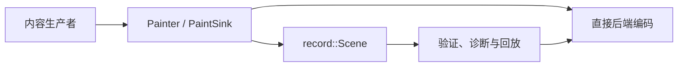
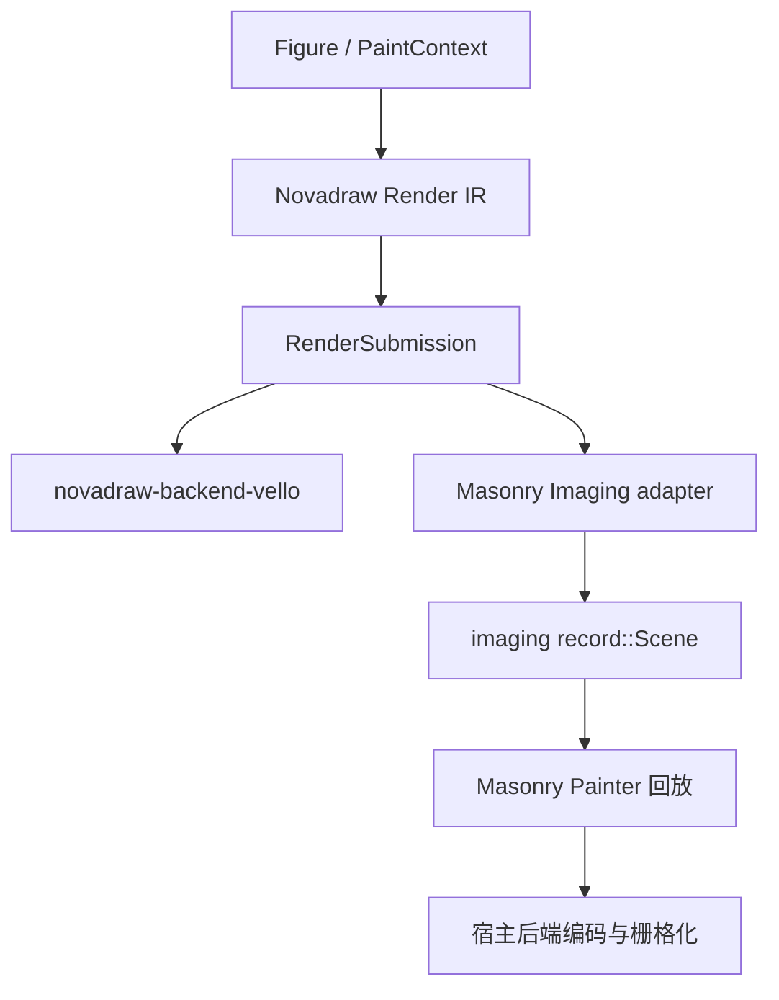

# Imaging 绘图中间表示与 Novadraw 接入分析

类型：`reference-analysis`

核验日期：2026-10-28。项目：[forest-rs/imaging](https://github.com/forest-rs/imaging)。
本文记录外部源码事实、当前接入关系和评估意见，不改变 Core 渲染契约或执行队列。

## 源码基线与定位

Imaging 是一套与渲染后端无关的二维绘图词汇、流式绘制接口和录制表示。
生产者通过 `Painter` 发出绘图操作，消费者实现 `PaintSink` 接收操作；
需要保留内容时，使用 `record::Scene` 录制，再验证、诊断或回放。
它把内容生成与后端编码分开，让同一份绘图内容可以交给不同消费者。[cite:1](#source-1)

本次分别核查上游主线和 Novadraw 实际使用的发布版本。两者不能按包名视为同一套 API：

| 基线 | 身份 | 本次用途 |
|---|---|---|
| Imaging 上游主线 | `f3f932a8a0e233f5ab52863041b8a3d6cff9255b`，提交日期 2026-10-17 | 分析目前的协议、生态与限制 |
| Imaging 已发布源码 | `imaging 0.0.1`，源码提交 `eea0e47503fdab1c4159a939797ba74acab19876` | 核对当前 Masonry adapter 能实际使用什么 |
| Xilem/Masonry | `66c8893f12232b9d5cdf4296f773aa3dc07ee776` | 当前宿主依赖，间接引入 Imaging |

发布源码身份来自 Cargo 缓存的 `.cargo_vcs_info.json`；依赖版本以本项目
[Cargo.lock](../../Cargo.lock)为准。上游主线 `imaging_vello` 的包版本字段为
0.0.2，依赖 Vello 0.11 / WGPU 30；本项目锁定的 `imaging_vello 0.0.1` 使用
Vello 0.8 / WGPU 28。主线 Cargo 字段不证明该版本已经发布。[cite:2](#source-2)[cite:3](#source-3)

官方 README 明确把 API 标为实验性，预期会出现 breaking changes。Core crate
支持 `no_std + alloc`，关闭默认 feature 后启用 `libm`；MSRV 为 Rust 1.92。
MIT / Apache-2.0 双许可见官方说明。当前 UI 接入要求 Rust 1.96，来自其宿主依赖，
不能归因于 Imaging 本身。[cite:1](#source-1)[cite:2](#source-2)

## 绘制、录制与后端编码

Imaging 提供两条路径。流式路径把借用的几何、画刷和 glyph 数据直接交给
`PaintSink`，不要求先构建拥有数据的 `Scene`。录制路径让 `Scene` 实现同一个
接口，把操作转换成拥有数据的表示，之后回放到另一个 sink。[cite:1](#source-1)[cite:4](#source-4)

`record::Scene` 存储有序 `Vec<Command>`，并分别保存 draw、clip、group、mask 和
context 的 payload 表。命令通过 `DrawId` 等身份引用表内数据；`replay` 按命令顺序
调用 sink，`append_transformed` 通过带前置变换的回放追加内容。它是录制后的
语义表示，不承担 UI 节点身份、布局或命中测试。[cite:5](#source-5)

绘图词汇包括 fill/stroke、路径与矩形、图像画刷、已定位 glyph run、裁剪、
隔离 group、blend/alpha、mask 和 filter。Clip/group/context 保留栈式结构；
draw payload 自带 transform 与 composite。几何和画刷公开使用 Kurbo、Peniko
类型，所以这里的“后端无关”意味着不绑定某个 rasterizer，并不意味着没有共享
第三方类型。[cite:4](#source-4)[cite:5](#source-5)

`GlyphRunRef` 接收字体、glyph iterator、位置、variation coordinates 和绘制样式。
文字 shaping 与排版应在生产端完成。上游主线还支持 glyph brush、brush transform
和 embolden 等字段；这些字段不应直接外推到本项目锁定的 0.0.1。[cite:4](#source-4)

主线图像表示区分共享像素的 `Image::Raster` 和带类型资源身份的 `Image::External`。
后者允许 renderer 绑定外部资源，录制本身不需要 GPU 类型。编码后的后端 scene
保留其采样资源的绑定；外部像素可变化，因此 scene 相等不能单独作为这类场景的
光栅缓存依据。[cite:1](#source-1)[cite:3](#source-3)[cite:5](#source-5)

`RenderSource` 描述可向 sink 发出内容的来源，`ImageRenderer` 描述向调用者提供的
图像缓冲区渲染的接口。GPU texture target 在 `imaging_wgpu` 等后端边界处理。
Vello 集成建议宿主持有 device、queue 和 presentation target，再交给 renderer。
窗口事件、布局调度和 surface 生命周期仍由宿主负责。[cite:3](#source-3)[cite:6](#source-6)

## 项目价值与生态

Imaging 的主要价值在于共享绘图内容和消费者接口。上游 workspace 已包含
Vello GPU、Vello CPU、Vello hybrid、Skia 和 tiny-skia adapter，以及 conformance
和像素快照测试。这说明它已经在组织多后端接入；源码目录存在和测试素材存在，
不能证明各后端在所有操作上的结果完全一致。[cite:2](#source-2)[cite:7](#source-7)

录制与验证可以服务测试、截图和问题定位。Context annotation 能记录 widget ID、
child index、slot 和源码位置；结构化数值不要求热路径先格式化成字符串。
验证错误可以带回当前上下文，适合追查“哪段内容发出了不平衡的 clip/group”。
Context 是诊断信息，sink 的默认实现可以忽略它，不能拿它替代业务身份或节点
生命周期协议。[cite:1](#source-1)[cite:4](#source-4)[cite:5](#source-5)

生产端也开始共享这套词汇：`svg_imaging` 将 usvg 归一化结果降低为绘图计划，
再通过 Painter 输出；`velato_imaging` 将 Velato 的 `RenderSink` 接到 `PaintSink`。
因此价值不限于切换 rasterizer，还包括把 SVG、动画和 UI 绘制汇入共同消费接口。
其中 SVG filters 和 pattern paints 仍明确报告为 unsupported。[cite:8](#source-8)[cite:9](#source-9)

对 Novadraw，已经落地的价值是 Masonry 宿主互通：Core 不需要暴露或交换某个
版本的 Vello Scene，adapter 输出 Imaging recording，再由宿主合成和栅格化。
它降低了在绘图内容边界直接耦合 Vello 版本的压力；device/texture 等 GPU 对象的
版本兼容仍须由具体 adapter 解决。
当前接入与验收见 [Masonry 迁移报告](../verification/reviews/masonry-upstream-migration-2026-10-28.md)。

## Novadraw 自有 IR 与 Imaging 的关系

Novadraw 已有自己的进程内绘图中间表示。`RenderCommand` /
`RenderCommandKind` 描述状态、变换、裁剪、透明度、图形、图像和 glyph 绘制。
`CommandRecorder` 录制命令，`RecordedDrawing` 保留命令及其精确资源快照；
`RenderSubmission` 则把绘图内容和帧发布信息一起交给 `RenderBackend`。

| 层次 | Novadraw | Imaging |
|---|---|---|
| 作者侧绘图接口 | Graphics / PaintContext | Painter |
| 绘图词汇 | RenderCommandKind | FillRef / StrokeRef / GlyphRunRef 等 |
| 拥有数据的录制 | RecordedDrawing，含资源快照 | record::Scene，含命令和 payload 表 |
| 消费接口 | RenderBackend::submit | PaintSink；具体 renderer 接口 |
| 帧发布 | damage、surface、frame/session、资源同步、retention | Scene / PaintSink 不覆盖这整套契约 |
| 通用类型边界 | Core 自有几何、颜色和资源身份 | 公开使用 Kurbo / Peniko |

本地依据：
[命令定义](../../crates/novadraw/src/render/command.rs)、
[录制与资源保留](../../crates/novadraw/src/render/recorder.rs)、
[帧提交](../../crates/novadraw/src/render/submission.rs)、
[后端接口](../../crates/novadraw/src/render/traits.rs)。
当前规范见 [ADR-031](../adr/adr-031-graphics-recording-and-publication-boundary.md)。

当前接入顺序如下。两份 IR 在不同边界各司其职，转换由平台 adapter 承担：

实际转换在 [Masonry render adapter](../../crates/novadraw-platform-masonry/src/render.rs)，
Widget 的 `paint` 使用 `painter.replay(self.session.scene())`，见
[widget.rs](../../crates/novadraw-platform-masonry/src/widget.rs)。
当前目标只接收 full-frame damage，保留资源 revision、session 准入和缺资源 Retry
处理，再发布录制场景。

本项目当前 adapter 不声明 `PerOperationAntialias` / `GlyphRuns`，明确拒绝相应命令；
默认文字经 Core 准备的轮廓路径绘制。Imaging 0.0.1 确实有 glyph 操作，但不能完整
覆盖当前 adapter 所要求的 glyph brush/dash 语义，因此“有 glyph API”不能等同于
“本项目已支持原生 glyph run”。上游主线已增强 glyph 表达，需要另做兼容验证，
不改变现有接入结论。

Novadraw 也有 [DisplayList 候选协议](../design/rendering/display-list-protocol.md)，
讨论序列化、跨进程、跨语言和增量传输。它仍是休眠 proposal。
当前 Rust 命令流和 Imaging 的拥有数据的 Scene 都不能仅凭“可录制、可回放”视为
稳定二进制格式、wire protocol 或跨语言 ABI。

## 采用边界、成本与建议

当前适合继续在平台/后端 adapter 边界使用 Imaging，Core 保留自身绘图和帧发布契约。
若要替换 Core IR，必须先证明逐操作 AA、资源 revision/session、glyph、错误通道
和包依赖边界都能保留；替换还会把实验性 API 与 Kurbo/Peniko 类型带入更广的公共
边界。现有接入已产生互通收益，不足以单独证明整体替换更合算。

Imaging 对消费者开放 `PaintSink`，但绘图词汇仍是固定方法集合，retained Draw
使用闭合 enum。上游自定义 draw pipeline 的讨论仍开放，不能把“可以实现新 sink”
视为“外部可以注册任意绘图命令”。扩展消费者和扩展命令种类是不同能力。
Novadraw 自身 RenderCommandKind 也使用 enum，本文不据此声称本地 IR 已具备
任意 opcode 注册能力。[cite:4](#source-4)[cite:5](#source-5)[cite:10](#source-10)

后端支持需要逐项核查。官方 Vello adapter 对无法表示的 clip/group 交错可返回
`UnbalancedLayerStack`；共同的词汇并不保证各后端支持全部语义。
上游还有图像数据哈希成本的开放问题，其存在提示需要核查缓存身份和重复处理，
不能据此推断当前所有后端或 Novadraw adapter 都有同样的性能问题。[cite:3](#source-3)[cite:11](#source-11)

成本评估应覆盖 `Novadraw commands → Imaging Scene → 后端 scene` 的遍历、几何
转换、payload 分配与保留，以及资源缓存和实际栅格化。流式 sink 路径有机会减少
中间 owned recording，但目前 Widget paint 回放已发布 recording，承担稳定内容
的职责。任何改为直接流式输出的优化都要先保留发布与失败行为，不能只统计少了一次分配。

进一步评估可比较直接 Vello adapter 与 Imaging adapter 在简单图元、深层 clip、
大量文字和图像、静态/动态混合场景的帧耗时、p95、allocation 和峰值内存。
引入更多后端或生产端时，还须比较同配置 Native 产物、Web Wasm 与首次加载资源。
本次没有运行性能或包体积对照，不声称 Imaging 更快、更小或已具备生产级稳定性。

## 证据范围与来源

上游结论来自官方源码、README、Cargo 配置和 issue；README 与实现交叉核对属于
同项目证据，不算独立社区验证。本地接入结论来自当前工作树和已有迁移验收记录。
本次做静态研究，没有重新执行 Imaging 的跨后端测试，也没有进行依赖升级。

[cite:1] [Imaging 主线 README](https://github.com/forest-rs/imaging/blob/f3f932a8a0e233f5ab52863041b8a3d6cff9255b/imaging/README.md)：定位、工作流、feature、许可和实验性状态。

[cite:2] [主线 workspace Cargo.toml](https://github.com/forest-rs/imaging/blob/f3f932a8a0e233f5ab52863041b8a3d6cff9255b/Cargo.toml)：模块、版本字段、MSRV 和共享依赖。

[cite:3] [Vello adapter README](https://github.com/forest-rs/imaging/blob/f3f932a8a0e233f5ab52863041b8a3d6cff9255b/imaging_vello/README.md)及 [Cargo.toml](https://github.com/forest-rs/imaging/blob/f3f932a8a0e233f5ab52863041b8a3d6cff9255b/imaging_vello/Cargo.toml)：后端编码、宿主 GPU 所有权、版本和限制。

[cite:4] [paint.rs](https://github.com/forest-rs/imaging/blob/f3f932a8a0e233f5ab52863041b8a3d6cff9255b/imaging/src/paint.rs)：借用 payload、glyph 与 PaintSink 接口。

[cite:5] [record.rs](https://github.com/forest-rs/imaging/blob/f3f932a8a0e233f5ab52863041b8a3d6cff9255b/imaging/src/record.rs)：Scene、Command、存储表、验证与回放。

[cite:6] [0.0.1 发布源码的 render.rs](https://github.com/forest-rs/imaging/blob/eea0e47503fdab1c4159a939797ba74acab19876/imaging/src/render.rs)：RenderSource / ImageRenderer 与错误边界。

[cite:7] [固定主线源码树](https://github.com/forest-rs/imaging/tree/f3f932a8a0e233f5ab52863041b8a3d6cff9255b)：后端 adapter、conformance 和 snapshot 测试布局。

[cite:8] [SVG Imaging README](https://github.com/forest-rs/imaging/blob/f3f932a8a0e233f5ab52863041b8a3d6cff9255b/svg_imaging/README.md)：SVG 降低链路、支持范围与 unsupported。

[cite:9] [Velato Imaging README](https://github.com/forest-rs/imaging/blob/f3f932a8a0e233f5ab52863041b8a3d6cff9255b/velato_imaging/README.md)：动画 RenderSink 的接入。

[cite:10] [Issue #65](https://github.com/forest-rs/imaging/issues/65)：自定义 draw pipeline 讨论，核验时仍开放。

[cite:11] [Issue #72](https://github.com/forest-rs/imaging/issues/72)：图像数据哈希成本讨论，核验时仍开放。
