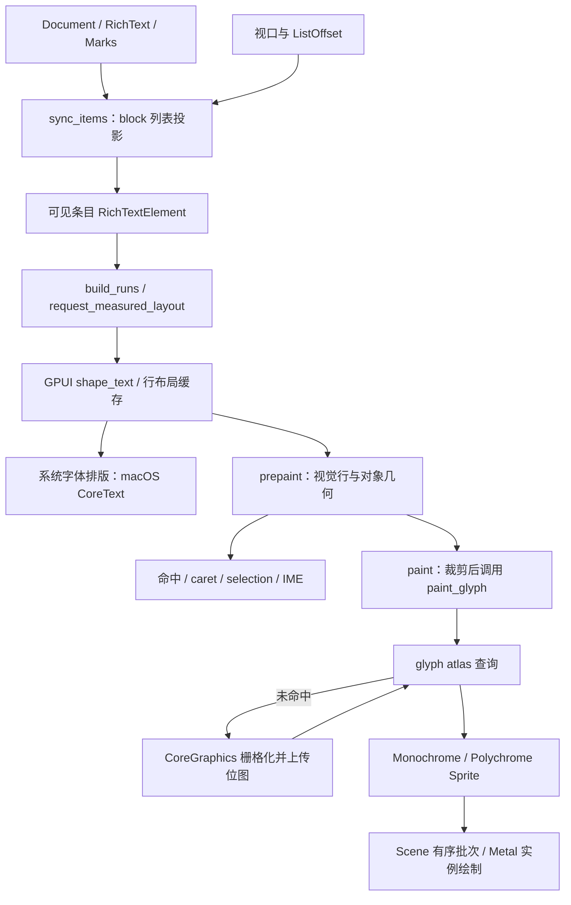

# quiet-md 富文本渲染与长文滚动技术分析

类型：`reference-analysis`

日期：2026-11-05。研究基线：quiet-md 提交
`937b254f8c4553e4998f83ce942675da558c743a`，内置 GPUI 0.2.2 与本地补丁。
能力归属：quiet-md 应用负责文档、样式转换、视口投影与交互；GPUI 负责排版缓存、
平台字体调用、绘制场景与 GPU 资源。Novadraw 的采用建议分别归 Core、backend、
Editor 和文档应用，不将 quiet-md 的应用 `core` 等同于 Novadraw Core。

状态：固定版本静态研究完成；未构建或运行 quiet-md，未独立复现作者性能结果。
本报告不切换 Novadraw 的文字依赖或后端，不建立执行队列。
已有编辑模型与事务研究见[富文本编辑适用性报告](../verification/reviews/quiet-md-rich-text-assessment-2026-11-05.md)。

## 技术判断

quiet-md 的长文渲染由两组机制配合：文档层用 block 虚拟化控制进入布局和绘制的
内容量；文字层用系统字体引擎、近期排版缓存、glyph 位图图集和 GPU 实例绘制，
减少重复 shaping、字形栅格化与上传。macOS 主路径是 CoreText 排版、
CoreGraphics 字形栅格化、Metal 纹理合成；Windows 使用 DirectWrite 与 DirectX。
该文字路径使用已经生成的字形位图，没有证据表明它采用 SDF／MSDF 或逐帧在
片段着色器中解析字形 Bezier 轮廓。[cite:1](#source-1)[cite:2](#source-2)[cite:7](#source-7)[cite:8](#source-8)[cite:11](#source-11)

建议 Novadraw 优先借鉴可见输出、稳定布局资产与可替换 glyph 栅格缓存。
这些机制可以在保持精确文字语义的前提下研究；直接引入 GPUI 整套 UI 体系、
替换 Parley，或把精确 TextFlow 改成估计高度列表，需要分别判断。
现行[性能路线](../design/architecture/text-performance-strategy.md)已保留 Parley，
并列出可见输出和可替换字形栅格缓存；本报告补充源码依据，不修改该选择。

下文的源码事实可沿调用链核对，但都来自同一项目快照，不能当作多个独立工程复现。
用户观察到的滚动流畅与这些机制相符；各机制对该体验的贡献仍需消融测量才能确定。

## 富文本能力与实现范围

### 样式和段落

`RichText` 使用 `String + Vec<Run>`。每个 run 用 UTF-8 字节长度和 `Marks`
描述样式，支持粗体、斜体、下划线、删除线、inline code、链接、文字颜色、
背景色和行内对象。文档另以 block 表达段落、标题、列表、代码、表格和容器。
这是一套自绘的结构化富文本编辑应用，正文不经浏览器 DOM 排版。[cite:3](#source-3)[cite:4](#source-4)

`build_runs` 把文档样式转换为 GPUI `TextRun`，还按 IME marked range、
语法高亮和特定标点的字体规则切分区间。字体选择包含 family、weight、style
和 fallback；正文显式配置中文和彩色 Emoji 回退。
颜色、背景和下划线进入装饰数据，删除线由应用另行绘制。[cite:4](#source-4)

这个版本的 `Marks` 没有任意行内字号或字体族字段，`TextSpec` 和
`shape_text` 的字号主要按 block 设置。因此不能把它的有限样式模型泛化为
支持任意混合字号、字体功能、变量轴和排版效果的通用富文本合同。
行内对象自身可以有独立文字或公式字号，但那是另一条对象绘制路径。

### 行内对象

公式、按钮、文件、文档链接与日期提醒在文档位置中占一个 U+FFFC。
排版前以同样占三个 UTF-8 字节的 en dash 替代对象字符，把占位 glyph 隐藏，
再根据对象真实 advance 调整后续 glyph 位置并重新断行。
行高会扩展以容纳对象，`paint_rows` 和 `paint_background_rows` 接受显式行顶部，
使同一 block 的视觉行可以有不同高度。[cite:3](#source-3)[cite:4](#source-4)[cite:10](#source-10)

这证明它支持文字与对象共同排版。
`adjust_line` 会新建调整后的 glyph 和行结果，公式几何也在元素测量路径生成。
不能把带公式、按钮和字距的重排成本视为普通正文的缓存命中成本。
其替代字符和封闭 `InlineKind` 是应用机制；Novadraw 的真实 inline Figure
仍须保留自身身份、baseline、断行反馈和开放扩展契约。

## 从文档到 GPU 的实际调用链

图中的系统排版节点只在相关行缓存未命中时执行；图集未命中才栅格化并上传。
每帧仍会创建当前可见元素、处理装饰和交互几何，并组织绘制实例。
这些步骤的工作量与 block 粒度、样式数量及视口内容有关。

### request_layout、prepaint 与 paint

`RichTextElement::request_layout` 准备文字和样式，向 GPUI 注册测量回调。
回调根据可用宽度执行 shaping、断行与对象几何计算，生成 `Prepared`。
相同测量过程内，如果回调再次收到相同 wrap width，就复用 `Prepared` 的高度；
该状态在本次元素请求中创建，不是长期按 block 保存的布局缓存。[cite:4](#source-4)

`prepaint` 将行结果变成窗口坐标下的 `TextLayout`，记录视觉行范围、
行高、基线偏移、对齐、公式和按钮位置。`paint` 消费同一结果绘制背景、选区、
文字、对象、删除线、查找标记和 caret。命中与导航也读取该几何。
这避免绘制和输入各自排一份文字，但不代表它满足 Novadraw 所有 affinity、
bidi 视觉导航及 revision 合同。

特别需要区分三类状态：

| 状态 | 保存内容与有效范围 | 实际作用 |
|---|---|---|
| quiet-md `LayoutCache` | 当前可见 block 的窗口几何；每次 `render_editor` 清空并重建 | 绘制、命中和输入共用几何 |
| GPUI `LineLayoutCache` | 当前帧和上一帧使用的行布局、断行布局 | 跨相邻帧复用 shaping 与断行结果 |
| GPUI glyph atlas | 字体实例及设备参数对应的字形位图 | 跨位置、跨 block 复用栅格化和上传 |

前两行由 `render_editor`、`request_layout` 和 `finish_frame` 的源码共同确认，
第三行由 `paint_glyph` 到 `MetalAtlas::get_or_insert_with` 的调用确认。
[cite:4](#source-4)[cite:5](#source-5)[cite:6](#source-6)[cite:8](#source-8)

## 长文本滚动如何控制工作量

### block 虚拟化与邻近测量

页面使用 GPUI 可变高度 `List`，列表保存 `SumTree<ListItem>`。
条目区分已测和未测，摘要记录数量、已测高度及未测数量；滚动位置表示为
`ListOffset { item_ix, offset_in_item }`，避免必须先得到整篇精确高度才能定位
当前条目。quiet-md 初始化的 overdraw 为 600 逻辑像素。[cite:5](#source-5)[cite:9](#source-9)

`layout_items` 从顶部条目开始处理视口和 overdraw 范围。
可见条目每帧创建元素并测量；屏幕外邻近条目已有高度时可以复用高度，
尚未测量时补测。`prepaint` 和 `paint` 主要处理可见元素，并应用列表裁剪。
GPUI 还保留特定离屏焦点条目的处理分支，因此不能绝对概括为“任何离屏元素都不创建”。

这使一篇由很多普通段落组成的长文，滚动时不用创建所有段落的文本元素。
但虚拟化单位是列表条目：文本、标题和列表的子级可独立成行，表格等容器的
子级通常仍在容器条目内绘制。一个超长单段落或巨大表格进入视口时，
其整个条目仍可能产生大量布局与遍历工作。
“百万字多 block 滚动快”不能证明“百万字单段落滚动和编辑也快”。

### 未变化时跳过文档投影

`sync_items` 的帧键包含文档 generation、列宽和布局依赖、主题、资源及部分
编辑状态。键未变就提前返回，不递归重建整篇列表投影；普通滚动不修改文档
generation。`units` 与公式编号同样按 generation 复用。[cite:5](#source-5)

文档变化时仍会构造条目和 key，再比较新旧公共前缀、后缀，对中间区间
执行 `splice`，保留区间外的测量状态。顶部条目受替换影响时还保留条目内偏移。
这是无变化快速返回与视图差分，不是按任意编辑 delta 只访问最少文档节点的算法。

`hash_block` 对文本主要取长度和 run 数量，没有比较完整内容与样式。
其注释明确允许同长度修改后，屏幕外高度暂时过期，因为可见行会重新测量。
这类 key 只适合该估计几何策略；不能用作精确 shaping 或 TextFlow 的复用证明。
GPUI 行布局缓存则有完整文本和 font runs，二者的缓存身份不能混淆。

### 估计高度和滚动锚定

`estimated_scroll_metrics` 用已测高度，加未测条目数乘以平均条目高度，
估算总高度和当前偏移。`scroll_to_estimated_offset` 以同一估计找到目标条目。
这省掉首次为滚动条测量所有 block 的成本，但估计尺寸会随测量变化；
其估计偏移寻址还会遍历条目，不能宣称所有滚动操作都是对数复杂度。
[cite:9](#source-9)

Novadraw 的精确 TextFlow 还可能被父布局、连接、命中和坐标查询消费。
若采用渐进文档视图，应明确哪些区域已测、哪些查询需要补测、
估计尺寸何时更新以及如何保持阅读位置；不能按文字长度自动改变已有几何语义。

## GPUI 如何复用排版

`shape_text` 先按换行符处理 hard line，把样式转换成 font runs 和 decoration runs。
行缓存键包含完整文字、字号、font runs、wrap width 和 force width。
命中当前帧或上一帧结果时复用 `Arc<LineLayout>`／`Arc<WrappedLineLayout>`；
未命中才调用平台 `layout_line`。`finish_frame` 交换两个帧缓存，清空旧集合。
[cite:6](#source-6)

因此它主要保存近期使用的结果，没有在这条缓存中永久保留全文所有段落、
所有历史宽度。回到已离开多帧的段落，可能重新 shaping；
该段落使用的 glyph 位图仍可能命中 atlas。排版缓存命中率和 glyph 缓存命中率
是两个不同指标。

shaping 结果与 wrap width 分开：计算新断行结果时可以先查询未断行的行布局。
这为宽度变化复用字形位置提供基础，但同时保留多个完整历史宽度并非该缓存的承诺。
带字距和对象的 quiet-md 自定义路径另外调用 `adjust_line`，不由普通断行缓存
自动消除所有后处理工作。

装饰与几何也不是绝对独立：`shape_text` 合并 font runs 时还检查
`decoration_changed`。颜色或下划线边界变化可能改变 font-run 分段，
因此不能概括为“所有纯颜色修改一定复用同一 shaping 结果”。
Novadraw 应按实际文字引擎的 shaping 输入证明可分离条件。

## glyph 位图图集与 GPU 合成

### 系统字体引擎

macOS 的 `layout_line` 构造带字体属性的字符串，调用 CoreText `CTLine`，
读取系统选择的字体、glyph ID、位置及源索引，再把 UTF-16 索引转换为 UTF-8。
栅格化使用实际字号的 CTFont 和 CoreGraphics bitmap context。[cite:7](#source-7)

普通文字生成单通道 alpha 位图，彩色 Emoji 使用多通道位图。
Windows 路径使用 DirectWrite `CreateTextLayout`，并通过 glyph-run analysis
生成 alpha texture，彩色 glyph 有单独分支。[cite:11](#source-11)

系统 shaping 的字体回退和复杂文字能力，不自动证明应用层 caret、
选区和双向导航完整。quiet-md 的 `row_for`、`x_for_index` 等查找逻辑仍有自身假设。
也不能让 Parley 产生的 glyph ID 直接交给名称相同但 face 不同的系统字体；
布局字体与栅格字体必须是同一实际字形表。

### 缓存键、颜色与亚像素位置

`paint_glyph` 以 font ID、glyph ID、字号、scale factor、亚像素 variant
和 Emoji 分类构造栅格键。颜色不在普通 glyph 位图键内，在 sprite 实例上设置，
所以同一 glyph 可以在多个位置和颜色下复用 alpha 位图。
[cite:6](#source-6)[cite:8](#source-8)

该版本横向亚像素位置有四档，macOS 纵向也有四档；Windows 和 Linux 的纵向
只有一档。整数平移可继续使用同一位图，分数平移可能进入另一个 variant。
字号、DPI 或字体实例变化也会改变键，不能承诺所有滚动都零栅格化。
首次出现的 glyph／variant 会在 paint 路径同步栅格化和上传，冷帧仍有成本。

这类亚像素位置变体用于保留定位后的字形覆盖，不等同于 LCD RGB 子像素抗锯齿。
macOS 源码为普通文字创建 alpha-only 位图，并显式打开抗锯齿和字体平滑。

### atlas 与有序批次

`MetalAtlas::get_or_insert_with` 命中时返回 tile；未命中时生成位图、分配图集区域、
上传纹理并登记键。单色图集使用 `A8Unorm`，彩色图集使用 `BGRA8Unorm`。
默认图集页为 1024 × 1024；需要更多空间时可以增加或创建更大的纹理，
该默认页大小不是整个文字缓存的内存上限。[cite:8](#source-8)

`paint_line` 遍历 glyph，通过内容裁剪检查后调用 `paint_glyph` 或 `paint_emoji`。
后者生成带位置、颜色、clip 和 atlas tile 的 sprite，场景按绘制顺序和纹理组织批次。
Metal 用实例数据批量绘制，每个 sprite 对应六个三角形顶点；Windows 使用
DirectX 的实例绘制。[cite:8](#source-8)[cite:10](#source-10)[cite:11](#source-11)

这减少已缓存 glyph 的曲线处理和上传，同时仍需遍历相关行、构造可见实例、
处理装饰与合成。特别是巨大 block 内，当前 `paint_line` 仍遍历 glyph 再做检查，
没有证据表明它为该 block 建立可直接跳过所有屏幕外 glyph 的行索引。
Novadraw 的可见查询仍须以实际墨迹、变换和后端覆盖依据保证输出完整，
不能照搬这个通用大小检查作为任意 glyph 的覆盖证明。

图集代码提供移除与纹理释放机制，但本次阅读未确认一套完整的 glyph 总容量
预算及自动 LRU 策略。不能把虚拟化、近期行缓存与“glyph 显存始终有硬上限”等同。
采用时应另定义预算、淘汰、在途资源保活和设备恢复。

### quiet-md 的补丁主要补足质量和能力

vendor 补丁包含中文避头尾、可变行高绘制、估计滚动指标、系统字体平滑、
实际字号的 glyph bounds、缺少 italic face 时的合成斜体，以及 fallback 字体身份修复。
这些说明仅接入通用 GPU atlas 还不足以得到它的文字表现。[cite:2](#source-2)

一个值得注意的源码冲突：Cargo.toml 的说明仍称关闭 font smoothing；
固定版本 `vendor/PATCHES.md` 和实际栅格化代码均为开启。
本报告采用执行代码和对应补丁说明，不把旧依赖注释当作当前行为。
字体回退补丁还明确记录：同 PostScript 名的两份苹方字体可能有不同 glyph 表。
Novadraw 必须用实际 face 身份绑定布局与栅格，避免 glyph ID 指向错字。

## 作者性能结果及其解释范围

作者报告使用历史版本 `0e92b51`，Apple M5 Pro／48 GiB、macOS 26.5，
release 构建，1280 × 800 pt 窗口和 2× 缩放，文档包含 1,001,307 字符、
549 章及段落、列表、表格和代码。[cite:12](#source-12)

| 操作 | 同步帧处理 P50 | P95 | 最大 |
|---|---:|---:|---:|
| 连续输入 | 5.06 ms | 5.78 ms | 6.94 ms |
| 连续退格 | 4.99 ms | 5.55 ms | 5.69 ms |
| 连续滚动 | 2.08 ms | 4.14 ms | 9.23 ms |

脚本在首段末尾输入 100 个 `x`、退格 100 次，再滚动 100 次；
每次操作后同步调用 `window.draw`。这是应用内帧处理时间，
不包含最终屏幕呈现延迟。该测试版本与本次研究快照不同，未独立复现，
不能计算 Novadraw 提速比，也不能当作用户本次体验的已确认配置。

原始输出中滚动的 editor render P50 为 0.02 ms，而 frame P50 为 2.08 ms。
这与文档投影未变化时提前返回相符，但剩余时间不能直接全部归给 GPU：
布局、paint、场景编码和呈现调用仍在 frame 路径，作者未给出本报告所需的逐项消融。
各阶段分位数也不能相减得到另一个阶段的分位数。

## Novadraw 的采用方式与取舍

### 保持精确模式，减少滚动帧重复工作

Core 继续持有精确布局、来源映射及交互几何，将不变内容资产与本帧 viewport 投影
分开。可见输出使用资产上的索引，减少进入 Recorder 和 backend 的 glyph；
backend 提供可替换的字形位图缓存和合成策略。
Editor 继续消费同一布局 revision 的几何，应用持有持久文档。
这些建议服从[ADR-025](../adr/adr-025-unified-graphics-and-glyph-preparation.md)，
不把平台字体或 GPU 类型暴露到 backend-neutral 公共签名。

研究“类似核心渲染技术”时，最小替换范围是布局之后的 glyph 栅格化与合成。
Parley 的字体选择、shaping 和精确几何可以继续使用，后端尝试将其实际 glyph
缓存为位图。栅格来源可以是同 face 的字体库或经身份验证的平台字体；
具体 provider 选择和合成接入仍需设计，不能把系统字体名称视作充分身份。

| 技术候选 | owner | 对应收益与条件 |
|---|---|---|
| 内容与 viewport 分离、稳定资产复用 | Core | 纯滚动减少全文捕获、组装、校验和复制；保持通知及发布合同 |
| 录制前可见查询 | Core 与 backend policy | 减少屏幕外 IR；需要实际墨迹、数值域和绘制覆盖证据 |
| glyph 位图 atlas 与批量合成 | backend | 降低热 glyph 的栅格化和上传；验证字体、AA、缩放及资源生命周期 |
| block 虚拟化、估计高度与阅读锚定 | 文档应用；所需 Core 合同另列 | 适合多 block 文档，需显式渐进模式和未测区域查询行为 |
| 系统 shaping 替换 Parley | 独立文字引擎候选 | 需要跨平台、复杂文字及扩展合同比较，当前材料不足以支持切换 |

### 与现有整块纹理实验的区别

quiet-md 缓存的是 glyph 位图，Novadraw 现有
[滚动栅格实验](../design/rendering/text-scroll-raster-reuse.md)缓存的是有序绘制范围的
纵向纹理块。两者可以作为不同候选，不能用同一个命中指标概括。

| 对比项 | glyph atlas | 整块文字纹理 |
|---|---|---|
| 复用单位 | 字体实例中的一个 glyph 及栅格参数 | 一段有序绘制内容对应的空间块 |
| 热帧主要工作 | 可见 glyph 实例、装饰和 GPU 合成 | 可见纹理块合成；上游是否省工取决于协议 |
| 改色或局部编辑 | 已有 glyph 位图可继续复用，布局另判断 | 受影响绘制块可能需要重建 |
| 新露出文字 | 新 glyph／variant 未命中才栅格化；实例仍生成 | 缺失空间块需要补画 |
| 几何变换 | 位图质量和键策略需覆盖实际缩放／旋转 | 内容栅格原点、DPI、clip 和变换资格需核对 |
| 额外内存 | 字形种类、字号、DPI、variant 与图集碎片 | 内容块面积、驻留及在途资源 |

glyph atlas 更适合在许多位置重复使用字形，也能跨 block 共享。
整块纹理有机会进一步省掉热块的逐 glyph 实例构造，但冷块和失效范围不同。
普通文字、动态选区和对象若混入同一块，更新可能扩大整块失效；
overlay 分离必须保持绘制顺序，不能任意搬到最后绘制。

更换栅格器无法消除 Core 重复组装、全文校验或全文 IR。
应先沿现有执行队列解决已确认的上游重复工作，再按剩余阶段成本决定
glyph atlas 与整块纹理的实验顺序。新技术的潜在收益不能替代匹配测量。

### 最小可比较实验

固定同一字体文件、实际 face、文字、样式、窗口、DPI 和滚动序列，
保留 Parley 与精确布局，对比默认矢量文字路径和隔离的 glyph atlas 路径。
可见输出应在两组一致启用或一致关闭，避免同时改变多个因素。
关闭 tracing 的整体计时与诊断 trace 分开采集。

除了普通多段长文，还应覆盖超长单段落、CJK 标点、Emoji、组合字符、
RTL、密集样式、真实 inline Figure、连续 resize、分数像素滚动及字体替换。
单独记录冷字形、热字形、变体切换、淘汰后回滚和设备恢复。
比较输入到帧完成、最终呈现、CPU 各阶段、GPU 完成、P50／P95／P99、
glyph 提交量、栅格未命中、上传量和完整内存。

视觉验收需要单列小字号墨量、斜体和负 bearing、中文 fallback、彩色 Emoji、
缩放后的清晰度、裁剪与装饰顺序。系统 bitmap 与当前矢量 AA 不必逐像素相同，
必须明确可接受的质量目标；这与同一路径缓存前后保持像素等价的验证不同。
实验设计不是实施或默认启用授权，实际切片继续由
[P2 backlog](../roadmap/p2-delta-backlog.md)维护。

## 来源

以下 quiet-md 链接全部固定到同一提交；行号用于定位本次阅读的实际机制。
研究快照仅放在 `/tmp/novadraw-quiet-md-render-study/`，不是本项目生产依赖。

1. [Cargo.toml：GPUI 0.2.2 与本地 patch](https://github.com/s1dashu/quiet-md/blob/937b254f8c4553e4998f83ce942675da558c743a/Cargo.toml)。

2. [vendor/PATCHES.md：完整本地补丁说明](https://github.com/s1dashu/quiet-md/blob/937b254f8c4553e4998f83ce942675da558c743a/vendor/PATCHES.md)。

3. [model.rs：Marks、Inline 与 RichText](https://github.com/s1dashu/quiet-md/blob/937b254f8c4553e4998f83ce942675da558c743a/crates/core/src/model.rs#L30-L214)。

4. [text.rs：build_runs、测量、prepaint、paint 与 adjust_line](https://github.com/s1dashu/quiet-md/blob/937b254f8c4553e4998f83ce942675da558c743a/src/editor/text.rs#L602-L1305)。

5. [render.rs：sync_items 与逐帧几何重建](https://github.com/s1dashu/quiet-md/blob/937b254f8c4553e4998f83ce942675da558c743a/src/editor/render.rs#L1027-L1354)；
   [view.rs：ListState 配置](https://github.com/s1dashu/quiet-md/blob/937b254f8c4553e4998f83ce942675da558c743a/src/editor/view.rs#L357)。

6. [GPUI text_system.rs：shape_text 与栅格参数](https://github.com/s1dashu/quiet-md/blob/937b254f8c4553e4998f83ce942675da558c743a/vendor/gpui/src/text_system.rs#L409-L786)；
   [LineLayoutCache：当前帧、上一帧与完整键](https://github.com/s1dashu/quiet-md/blob/937b254f8c4553e4998f83ce942675da558c743a/vendor/gpui/src/text_system/line_layout.rs#L396-L640)。

7. [macOS text_system.rs：CoreText 排版与 CoreGraphics 位图](https://github.com/s1dashu/quiet-md/blob/937b254f8c4553e4998f83ce942675da558c743a/vendor/gpui/src/platform/mac/text_system.rs#L375-L635)。

8. [Window::paint_glyph：atlas 查询与 sprite](https://github.com/s1dashu/quiet-md/blob/937b254f8c4553e4998f83ce942675da558c743a/vendor/gpui/src/window.rs#L2971-L3078)；
   [MetalAtlas：命中、位图上传和纹理格式](https://github.com/s1dashu/quiet-md/blob/937b254f8c4553e4998f83ce942675da558c743a/vendor/gpui/src/platform/mac/metal_atlas.rs#L30-L173)；
   [Metal 实例绘制](https://github.com/s1dashu/quiet-md/blob/937b254f8c4553e4998f83ce942675da558c743a/vendor/gpui/src/platform/mac/metal_renderer.rs#L947-L1020)。

9. [GPUI List：估计尺寸与视口布局](https://github.com/s1dashu/quiet-md/blob/937b254f8c4553e4998f83ce942675da558c743a/vendor/gpui/src/elements/list.rs#L477-L715)。

10. [GPUI paint_line：逐 glyph 裁剪与显式行顶部](https://github.com/s1dashu/quiet-md/blob/937b254f8c4553e4998f83ce942675da558c743a/vendor/gpui/src/text_system/line.rs#L130-L465)；
    [Scene：绘制顺序与批次](https://github.com/s1dashu/quiet-md/blob/937b254f8c4553e4998f83ce942675da558c743a/vendor/gpui/src/scene.rs#L128-L165)。

11. [Windows DirectWrite：排版和 glyph alpha texture](https://github.com/s1dashu/quiet-md/blob/937b254f8c4553e4998f83ce942675da558c743a/vendor/gpui/src/platform/windows/direct_write.rs#L546-L953)；
    [DirectX 实例绘制](https://github.com/s1dashu/quiet-md/blob/937b254f8c4553e4998f83ce942675da558c743a/vendor/gpui/src/platform/windows/directx_renderer.rs#L524-L568)。

12. [PERFORMANCE.md：历史源码 0e92b51 的测量环境、方法和原始输出](https://github.com/s1dashu/quiet-md/blob/937b254f8c4553e4998f83ce942675da558c743a/docs/PERFORMANCE.md)。
