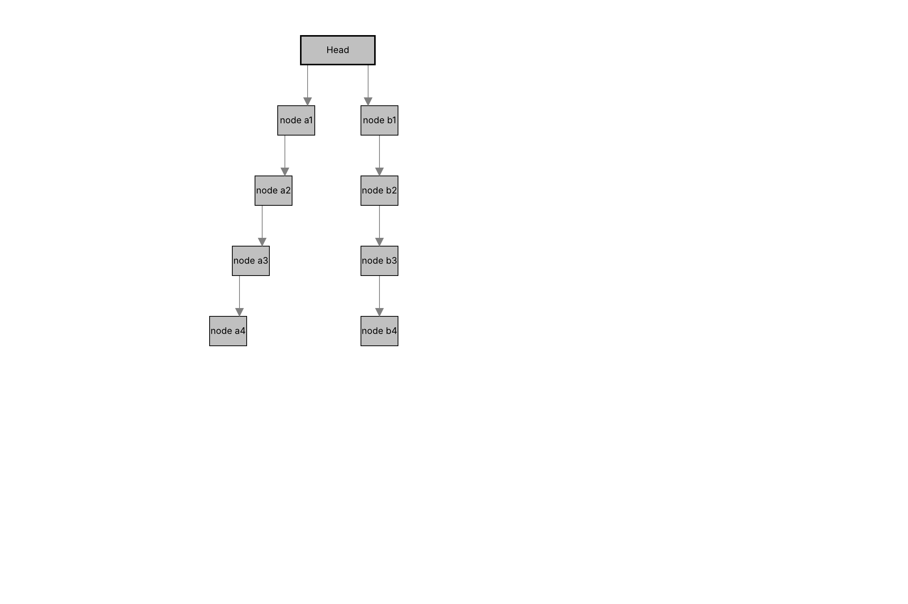
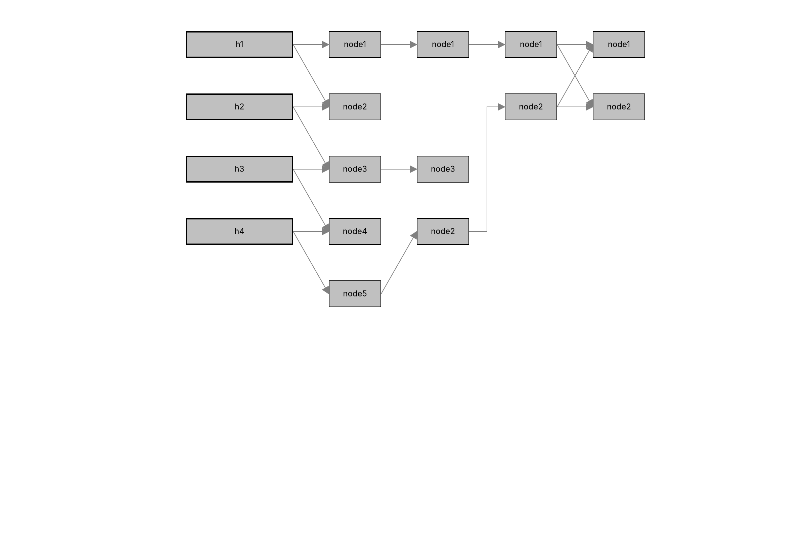
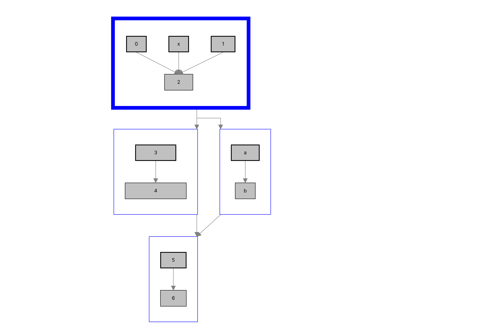
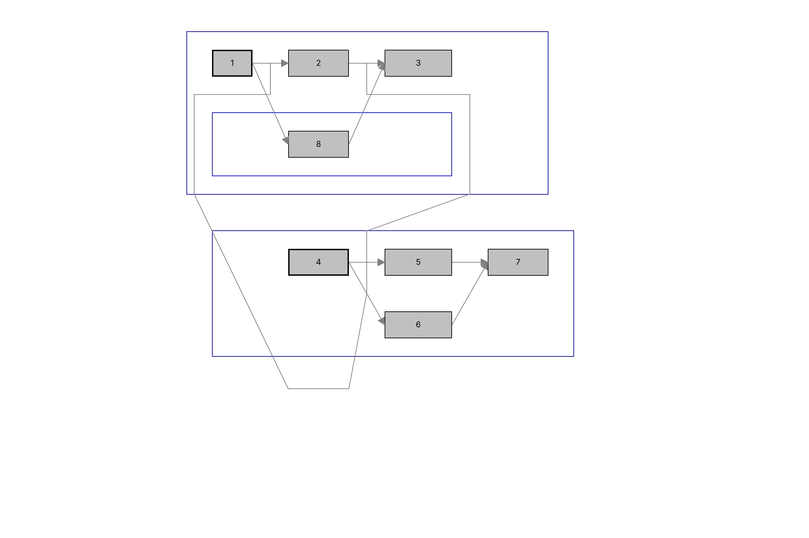

# ADR-043 实施证据

类型：`verification-record`

日期：2026-10-22

规范：[ADR-043](../../../doc/adr/adr-043-directed-compound-graph-layout.md)、
[图投影 preparation 增量](../../../doc/design/architecture/graph-projection-preparation.md)。

## Core 能力

独立图请求、受检结果和 typed registry 支持默认 Directed/Compound 与外部非分层
算法。完整 flat binding 将图实体绑定到 Figure、图边绑定到 Connection；
图包含关系不改变 FigureTree 的父子关系。

`GraphProjection` 在冻结源前缀下测量、求解并检查候选宽度反馈。
领域快照与节点位置、Anchor attachment、完整路径经 Runtime 的必需组发布屏障
共同发布。生产者缓存只保存纯受检结果，不能作为当前路由权限。
源变更、binding 退休、依赖变化、测量振荡或预算耗尽通过结构化错误拒绝；
同源失败保留有效检查点，改源失败保留源修改并撤销旧路由权限。

图容器的 `measure_scene` 复用纯 producer，取受检尺寸并丢弃其缓冲布局。
tracked viewport 可以据此安排内容范围。固定尺寸不被 viewport hint 裁掉；
滚动后图请求 identity 和路由计算次数保持不变。

## 消费者与验证范围

官方两个 graph 入口显示真实 Label、无 incoming 节点的双宽边框、gray connection、
target decoration 和 blue group 边框。16 个 Directed 与 10 个 Compound fixture
各覆盖 SOUTH/EAST，共 52 个组合。图容器、节点、子图边框与 Connection 使用普通
公开 API；宿主菜单以真实 egui 点击驱动 fixture 和方向替换。
旧内容退休后，宿主释放显式 Router/Anchor 注册；重复切换测试检查旧注册已不存在。

Core `graph_projection_contract` 的 9 项测试通过；图场景的三项测试通过，其中
一项覆盖全部 52 个组合的文字布局、完整路径、绑定、旧身份与注册退休。
`p2_query_failure_semantics` 的 7 项测试通过，旧测试改为显式 clone `LayoutError`，
保留新增错误的原始 source 链。
Core 四组定向回归共 54 项通过：图投影 9 项、约束测量 18 项、快照路由 20 项、
查询失败 7 项。官方示例库的 62 项通过，包含全部图组合、真实菜单点击、
窗口缩窄重排、大段文本、输入重排和小尺寸多行标签。

全量验证发现普通布局未传入当前约束的文字测量服务，以及后代重复复制冻结前缀。
Runtime 现将文字服务与本次预算显式交给布局；LayoutManager 保留整树读取范围，
preparation 回调仍只读自身子树。快照源前缀与计算观察改为共享不可变切片。
大段文本此前在发布快照时累计分配 2,399,511，超过默认 2,000,000；
修复后同一默认预算下回归通过，未提高默认额度。
InteractivePage 委托公开 Flow 测量服务，PathFigure 返回固定路径的几何尺寸。
图容器测量包装保留嵌套失败主体与原始原因，未改为 owner 身份或字符串错误。

Editor 修改文字反馈的滚动 offset 后，先稳定化再读取不可变光标与选区几何；
`p2_direct_text_edit_contract` 的 10 项定向回归通过。
四个 Native 图工厂另检查 resize 后提交帧中的 glyph 字体身份与资源版本一致。

## 最终门禁

| 门禁 | 结果 |
|---|---|
| workspace check | 通过 |
| workspace Clippy，`-D warnings` | 通过 |
| workspace test | 通过，1,321 项通过、1 项忽略、0 项失败 |
| `runtime.apps` | 通过，Update/Event/Viewport/UML/Animation 五份 JSON 均为 passed |
| Web backend feature check | 通过，`wasm32-unknown-unknown` + `web` |
| 公开 API / 依赖 / 热路径 / Native 与 Wasm rustdoc | 通过，Runtime 公开方法 27/27 |
| Markdown 与当前 xtask 引用 | 通过，344 个 Markdown 文件 |
| fmt 与 diff check | 通过，含暂存区 diff |
| 官方入口状态与来源清单 | 通过，清单 1 项与来源 2 项 |

执行日志保存在 `target/verification/adr043-*-final.log`。
公开符号快照新增 preparation 测量、共享预算、领域快照和图容器入口，
均位于规范领域路径；crate root 继续只暴露模块。

## Native 视觉证据

运行命令：

```sh
cargo run -p draw2d-official-examples --example graph_verification
```

采用内置 Inter 字体，保留源码中的显式图尺寸，不宣称与平台 Tahoma 逐像素相同。
箭头、折点、节点文字、厚边框和嵌套子图已逐图检查。
图 1 显示 attachment offset 对两个分支的影响；图 2 显示 EAST 跨层路径；
图 3 显示 9px 子图边框；图 4 显示 graph 包含关系由 sibling Figure 表达。









## 交付边界

本记录只关闭 ADR-043 和增量要求的图布局能力。K06 中 tree contour 和动画、
K07/K08 及其他官方入口继续按原计划维护。未运行 Java、Windows/Linux runner、
浏览器性能采证；这些不作为本次平台无关 Core 编码的完成依据。
