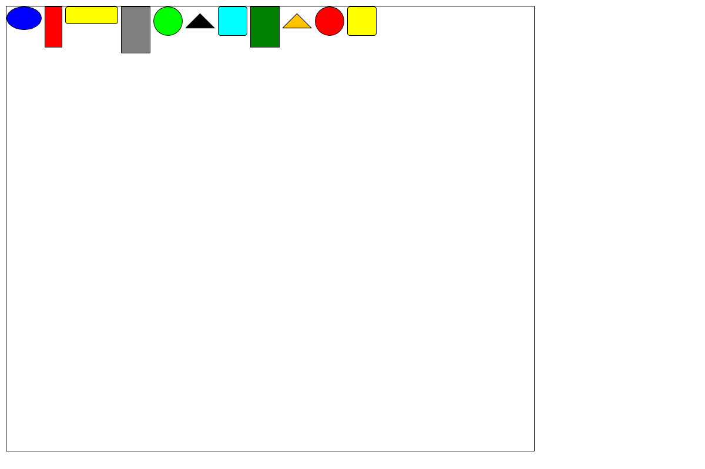
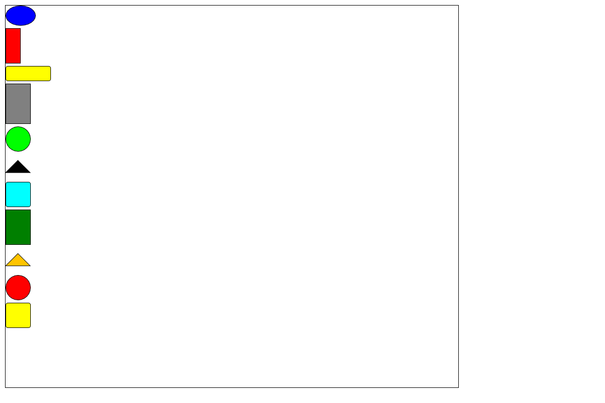
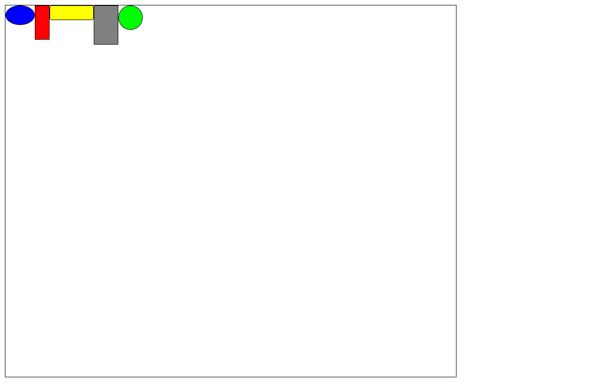
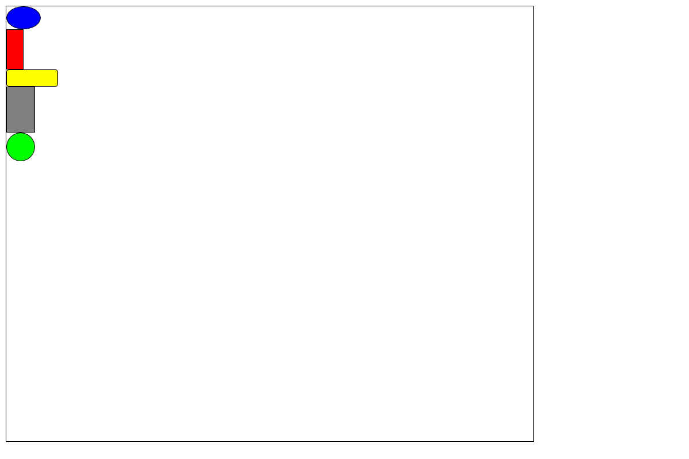
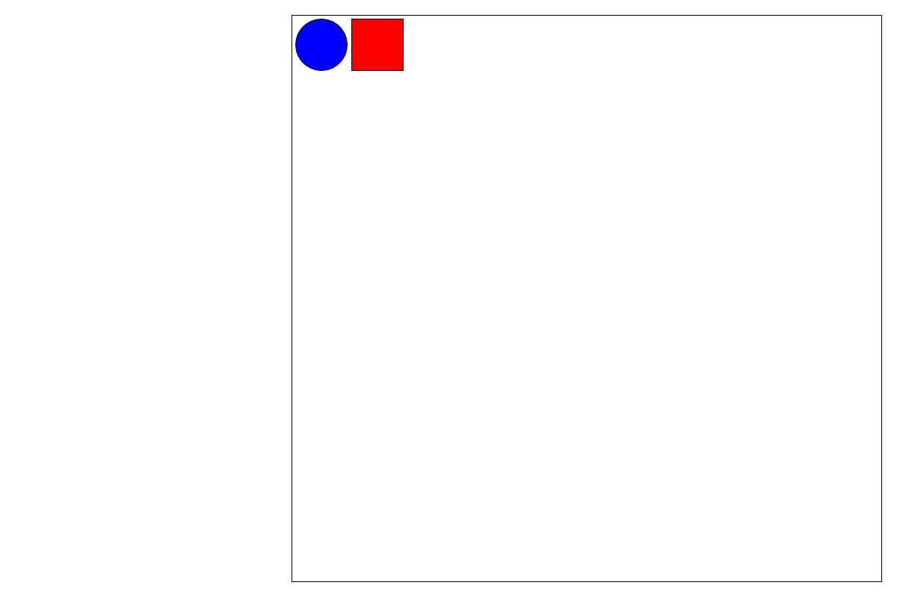
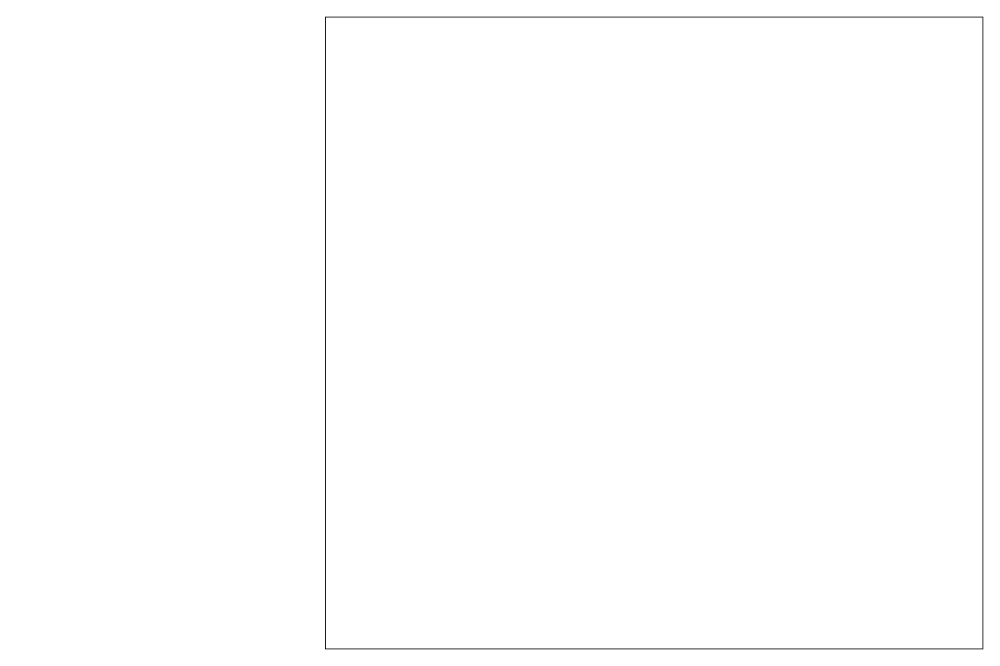
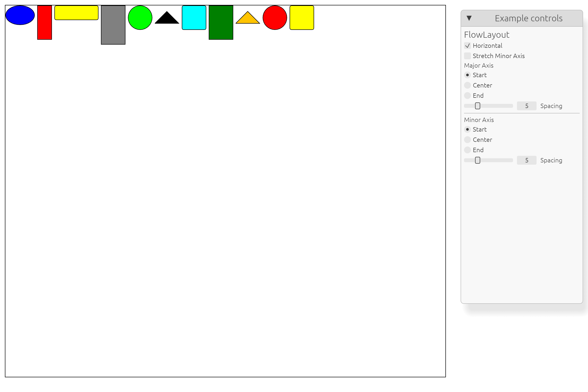
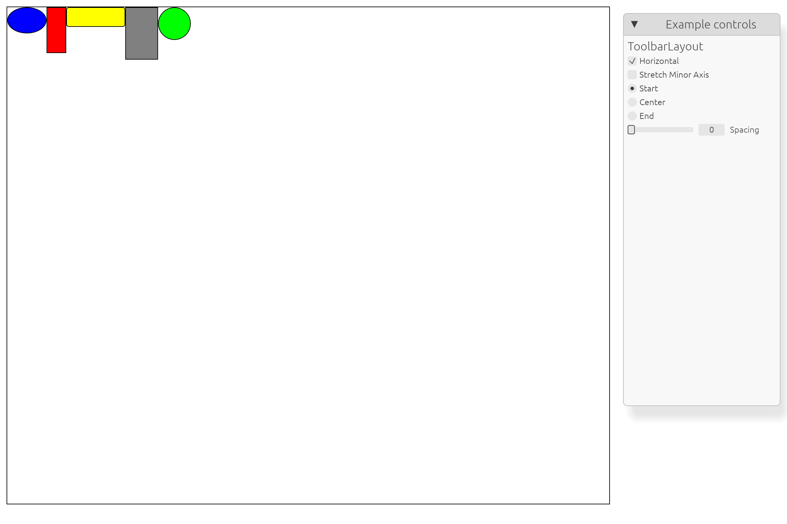

# 布局连续提交图像

本目录保存真实官方场景的 Native GPU 连续提交图像。结论与限制见
[核验记录](../../../doc/verification/reviews/k02-layout-consumers-evidence-2026-10-23.md)。
恢复阶段的原始 RGBA 数据由测试逐字节比较，PNG 仅用于视觉检查。

## Flow 改为纵向后原位置已清空






## Toolbar 改为纵向后原位置已清空






## Grid 移除后无残影





## Native 工具区保持在 Canvas 右侧





## 复现入口

从仓库根目录执行；证据路径使用绝对路径，因为 Cargo 测试的工作目录为 package：

```bash
cargo test -p draw2d-official-examples --lib layout_example
cargo test -p draw2d-official-examples --test layout_submission
NOVADRAW_LAYOUT_EVIDENCE="$PWD/target/verification/k02-layout" \
  cargo test -p draw2d-official-examples --test layout_submission \
  native_gpu_layout_changes -- --ignored --nocapture
```

GPU 测试默认忽略，最后一条命令要求本机可用 Native GPU adapter。
