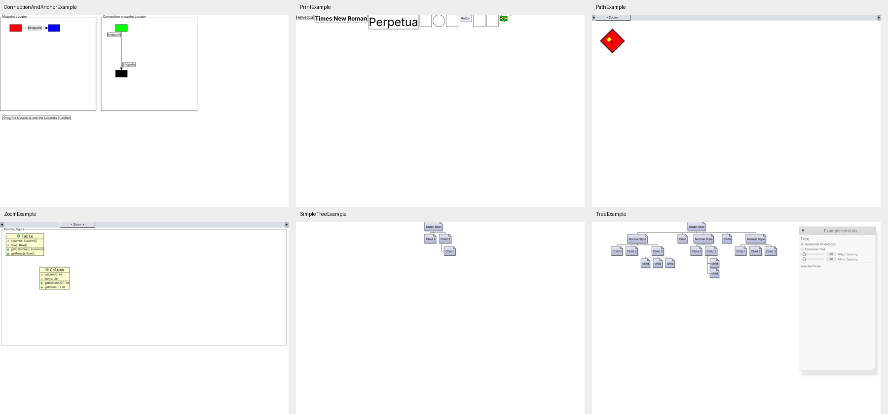

# 官方样例补充与 Core 普通扩展

本批基于现有官方示例计划，补充 Print，并完善 ConnectionAndAnchor、Path、SimpleTree、
Tree 和 Zoom。对应契约见
[增量设计](../../../doc/design/architecture/official-example-border-output-increment.md)。
Java 仅作只读语义参考，没有修改、编译或运行 Java；没有使用 Zest。

## 交付内容

| 边界 | 交付与证据 |
|---|---|
| ConnectionAndAnchor | 改用 owner-aware `ConnectionEndpointLocator`，目标端 14/4、源端 4/-3；标题和说明文字真实测量，说明位置恢复为 10/420；既有跨偏移面板拖拽与路由验证继续有效 |
| Path | `SchemeBorder` 滑块标签；font-derived baseline offset/thickness 替代固定下划线；两次文字/选字绘制、闭合旋转路径、缩放与滚动条尺寸验证 |
| SimpleTree | 白色 Canvas 与四分支、normal/hanging contour、PageNode 折角和转置验证；Canvas 的白色背景通过普通 Figure/StackLayout 表达 |
| Tree | PageNode 的蓝色选中渐变与白色文字，换选后恢复原节点；真实输入与绘制测试覆盖 |
| Print | 三个字号/字体名称标签、三种图形、Button、两个连接节点、原始 brazil.ico；300→600→300 窗口宽度变化按 surface 坐标验证连接，完成帧后再请求下一帧 |
| Zoom | 原始 SVG 经已有 Core 解码器加载；SchemeBorder 滑块标签；重复缩放保持 24 高度与未缩放内容可见 |
| Core | `SchemeBorder`、`FontDecorationMetrics`、受检下划线查询、ICO 格式识别及 `InvalidIco`；外部消费者共用 Border、FontMetrics 和资源请求契约 |

目录中 ConnectionAndAnchor、Path、SimpleTree 转为 complete，完整分母仍为 25；
当前 14 complete、8 in_progress、3 blocked，22 个入口可运行。
Print 使用内置 Inter 替代三个系统字体，保留 in_progress。Tree 动画和 viewport tracking、
Thumbnail 共享投影、透明背景、AA、SVG 随 zoom/DPI 重栅格化及混合字体装饰仍未关闭。

## Native 核验

全部 22 个可运行入口完成 Native 启动和截图。对本批六个相关场景及 Flow/Grid/Toolbar
进行了图像检查；SimpleTree 白底和 ConnectionAndAnchor 说明文字在最终修改后单独重采。
结构或截图成功不替代剩余功能契约。

原始截图：[连接](ConnectionAndAnchorExample.png)、[Print](PrintExample.png)、
[Path](PathExample.png)、[Zoom](ZoomExample.png)、[SimpleTree](SimpleTreeExample.png)、
[Tree](TreeExample.png)。选中渐变另由 PageNode 绘制测试和 Tree 的换选输入测试验证。

## 自动验证

- Core 外部契约：`scheme_border_contract` 与 `font_decoration_image_contract`，4 项通过。
- Print 精确尺寸变化/输出测试通过；完整 workspace 测试通过：1,328 passed、1 ignored、0 failed，含全部文档测试。官方样例 crate 的 65 项测试全部通过。
- workspace check、默认 workspace 严格 Clippy（`cargo clippy --workspace -- -D warnings`）通过。
- Web validation 的 wasm32 编译通过。
- 公开 API/依赖/热路径门禁通过，Runtime 公开方法保持 27/27；公开符号快照已更新。
- 文档校验通过，345 份 Markdown；workspace fmt 与 `git diff --check` 通过。

额外的 `cargo clippy --workspace --all-targets -- -D warnings` 未通过，阻断项来自既有
测试目标：`render/context.rs` 的测试专用 dead code、Runtime/集成测试未消费
`SubmissionAcknowledgement`、`tests/support/mod.rs` 的未用辅助函数。本批没有修改这些
代码；默认 workspace Clippy 通过不能解释为所有测试目标都已严格 Clippy-clean。
