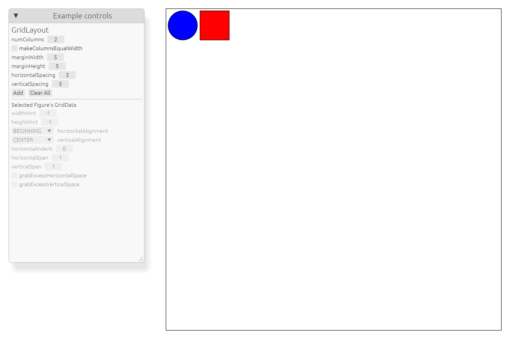

# 官方示例后续实施记录

本批依据 [剩余清单](../../../doc/verification/plans/draw2d-official-examples-next-slices-2026-10-23.md)
推进 K02 的已有契约，并完成 K07 的设计草案。

Grid Native 入口改用普通 MarginBorder/FillLayout，保留左侧控制区，使 Canvas 随 Host
逻辑视口 resize。回归使用同一 Native 入口的两个官方 Shape，设置跨两列和水平
grab/fill/hints，按 1200 × 760、800 × 400、1600 × 1000、1200 × 760 顺序验证
Canvas 尺寸、surface 原点、Shape 宽度/行距和恢复后的 geometry。
旧的 mock 控制面板测试继续使用原有坐标。

Toolbar 回归使用五个官方 Shape，依次切换 stretch 和方向、收缩主轴后恢复，
验证已提交尺寸和相邻 Shape 的连续位置。所有布局消费者定向回归为 16 passed、
0 failed。catalog 修订过时的缺口描述，但仍保持 14 complete、8 in_progress、
3 blocked、22 可运行。

K07 的 [proposal](../../../doc/design/architecture/shared-scene-view-background-proposal.md)
依据上游 Thumbnail 和 InheritBackground 只读源码形成，尚未批准、未实施。
设计选择不可变源快照、destination 资源导入、只读 view 与独立宿主背景帧输入；
不使用两个重复场景模拟共享源。

## 验证记录

`cargo check --workspace`、`cargo clippy --workspace -- -D warnings`、
`cargo fmt --all -- --check` 和 `git diff --check` 已通过。
`cargo test --workspace` 已通过：1,330 passed、1 ignored、0 failed，
包括官方示例 crate 的全部 67 项测试及 workspace 文档测试。
`cargo xtask docs` 通过，检查 347 份 Markdown。
本批没有新增公共 Core API，也没有宣称所有测试目标的严格 Clippy 或未验证平台通过。

Native 使用本批重新构建的二进制执行
`target/debug/draw2d-official-examples --screenshot=GridLayoutExample`，进程退出码为 0。
已检查下图的左侧控制区、两个初始 Shape、Canvas 的边界和完整窗口高度。
该截图验证初始场景，不代替 resize 序列、最小空间或 damage 的视觉验收。

