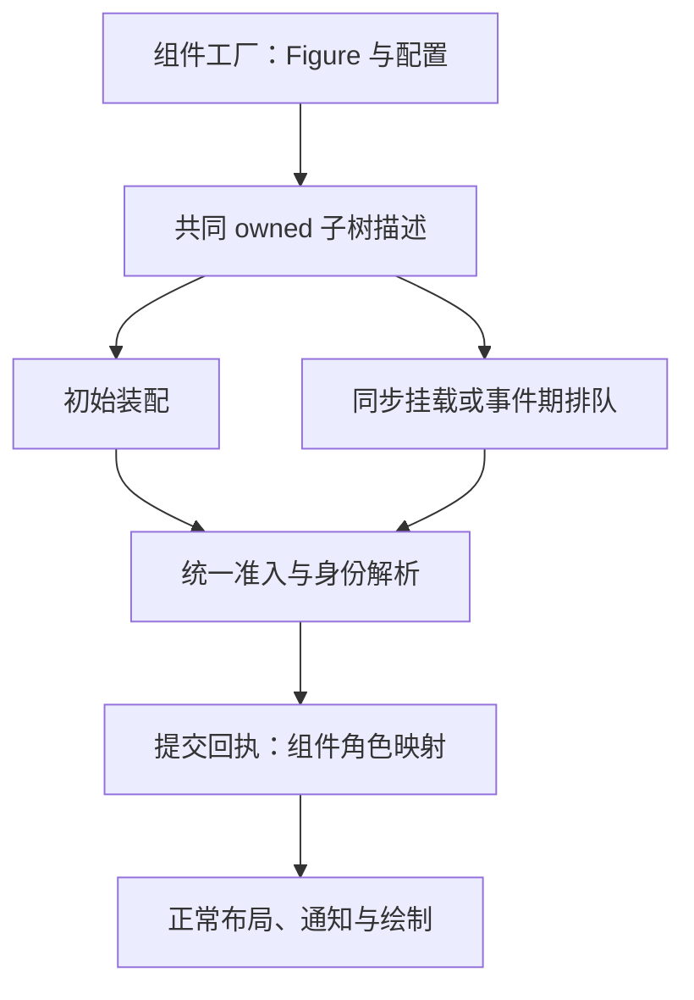

# Draw2D 样例与 API 组合性分析

类型：`verification`

日期：2026-10-19

状态：静态分析完成；优化方向待设计评审，未改动引擎实现。

**判断与范围**

公开 API 仍有优化空间。建议保留 Runtime 单一提交边界、显式领域导入、typed
component/capability 和阶段受限查询，在这些机制上改善组件构造、行为附加、
属性修改和扩展输入。衡量标准是调用方为了表达一个业务动作，需要掌握多少框架细节，
以及一个组件能否在不同场景和生命周期中复用。

本报告先从官方样例推导消费者需求，再定向检查当前实现。官方基线为
`4463d9d0ce13c19d10fbe769d29f28b7345a8cba`，项目 HEAD 为
`3be2d7ee3e0a1151629881c9b765efe1cd2ef433`。分析时工作区还有 connection、
topology、runtime、tree/subtree 和子树测试的未提交修改；这些文件的结论针对
当时工作区，尤其 construction binding 不能仅凭 HEAD 判断。

覆盖范围以[全 25 入口矩阵](../plans/draw2d-official-examples-remaining-contracts.md)
为分母，重点沿多消费者共同依赖的接口深入检查。本次没有逐入口重跑 Java、
Rust UI 或性能基准，因此不宣称完成全量行为验收，也不报告性能收益。
官方样例和 Draw2D 基础类属于同一源码来源；项目代码与 ADR 用于核对迁移状态，
不冒充独立第三方证据。以下严格区分已确认的接口事实、由事实推导的建议和待验证风险。

**官方样例给出的 API 要求**

| 消费者入口 | 从官方行为推导的 API 要求 | 本报告关注点 |
|---|---|---|
| HelloWorld、EllipseHitting | 简单对象直接构造；现成图元可附加事件；改颜色不用重写图元 | 构造、行为、属性 |
| TreeExample、SimpleTreeExample | 组件返回完整子树；新增与初始构造复用；布局可替换；动画可选 | 构造、测量、presentation |
| FlowLayoutExample、GridLayoutExample、ToolbarLayoutExample | 尺寸、preferred-size 和布局约束语义可区分；布局可配置替换 | 测量、属性、构造 |
| ConnectionAndAnchorExample、UMLClassDiagram、ObstructionExample | 连接可引用新节点；定位可读取 owner 与 child 尺寸；路由算法可替换 | 绑定、Locator 输入 |
| ScrollPaneExample、ZoomExample、PathExample | 滚动条可独立使用、替换 thumb、绑定 range；缩放复用统一坐标 | widget 组合、共享模型 |
| BidiBlockExample、MultiLineLabelExample | 共享 range、方向、焦点与只读控件组合；原生控件由宿主承担 | 模型所有权、文字能力 |
| TextFlowExample、CaretExample、TextFlowLargeExample、TextSurroundingFigureExample | 样式可嵌套、fragment 可移动、文字中插入真实 Figure；几何可查询 | 文字结构、身份与测量 |
| DirectedGraphDemo、CompoundGraphDemo | 算法模型与 Figure 投影可分开；切换 fixture 可替换场景 | 构造、算法扩展 |
| ThumbnailExample、InheritBackgroundExample、PrintExample | 同一 source 可被其他显示或输出目标消费；保持资源和生命周期 | source/output 分离 |
| ShapeStylesExample | 绘图合法值与 backend 能力明确；属性变化可重新组合场景 | 输入合同、能力声明 |

这些要求来自官方 main 和直接 helper，不包含 unused 方法或 Zest 上层能力。
具体源码路径、业务初值与功能分母见[全量矩阵的源码证据](../plans/draw2d-official-examples-remaining-contracts.md#源码证据入口)。

**应保留的基础边界**

现行[ADR-019](../../adr/adr-019-composable-api-and-scoped-editors.md)与
[ADR-033](../../adr/adr-033-runtime-subsystem-facade.md)已经解决了重要问题：
detached value 可直接配置，挂载后的修改通过短借用 facade 提交，Runtime
按领域提供 frames/resources/connections 等入口。下面两种现有调用都清楚表达了目的：

```rust,ignore
runtime.figure(id)?.set_bounds(bounds)?;
runtime.figure(id)?.update_component(SetLabelText::new(text))?;
```

保留这个模型。typed update 的 prepare/commit、失效和 receipt 是扩展作者需要的
契约；普通应用使用已经定义好的 payload 即可。取消这些机制会使修改绕过通知、
damage 或资源准入，增加长期维护成本。

[ADR-038](../../adr/adr-038-query-identity-and-failure-semantics.md)的受检查询也应保留。
Rust arena 的 foreign/stale ID 需要显式失败；Java 活对象 getter 的短调用不能
直接成为删除 Result 的依据。已有 immutable snapshot 的 getter 可以简洁，
任意 live ID 的查询仍需校验。

官方样例没有 GEF import。本轮 API 改善由 Core、可替换组件及平台适配承担，
不要求引入 Editor、CommandStack 或业务编辑会话。

**完整组件需要统一的构造描述**

已确认：当前同时存在 FigureTreeBuilder、Runtime FigureMut 和 FigureSubtree。
Builder 使用 `add_child`、`set_figure_style`、`set_preferred_size(id, Option<Dimension>)`；
FigureMut 使用 `add`、`set_style`、`set_preferred_size` 和 `clear_preferred_size`；
FigureSubtree 使用 construction ID 的 `add`、style/layout/constraint 配置，
尚没有与前两者对应的通用尺寸、visible、enabled 等配置面。
见[Builder](../../../crates/novadraw/src/graph/mod.rs#L984-L1143)、
[FigureMut](../../../crates/novadraw/src/runtime/runtime.rs#L355-L562)、
[子树描述](../../../crates/novadraw/src/tree/subtree.rs)。

TreeBranch 的官方构造同时创建 contents Layer 和 title；More Children 直接复用
这个构造。当前 Rust 已提供完整子树准入和回执，方向合理，但组件作者仍需要选择
不同构造入口，并处理 construction ID 到 FigureId 的映射。

建议把 owned subtree 作为“可复用完整组件”的共同输入，让初始装配与运行期挂载
都能消费它。单个 Figure 的短入口可以保留，并委托相同准入。节点配置使用一个
通用 owned 描述表达 style、layout、constraint、size override 和初始交互状态；
逐字段配置和一次配置应共享语义，避免形成两套默认值。

身份分层仍需保持：SubtreeNodeId 表示尚未发布的构造节点，FigureId 表示 live 引用。
可用组件自己的结果类型保存 title/contents 等语义角色，并在 receipt 后统一解析，
减少业务控制器反复查 children 下标。结果类型不拥有第二棵树，也不授予写权限。

工作区新增的 `SubtreeConnectionBinding::prepare` 已能解析预留身份，消除了部分
配对构造缺口。建议下一步验证其他自定义关系能否复用受限身份解析机制，
再决定是否抽出开放 binding payload。单一 Connection 消费者尚不足以支持建立
通用关系框架；也不应不断向子树描述添加各内置类型的专用字段。

取舍：共同描述会减少组件工厂分支，但需要明确资源所属 Runtime、
构造配置覆盖顺序和失败后的 payload 释放。归入现有 K01，不能承诺任意 callback
副作用可回滚。验收应让同一个外部组件工厂分别用于初始场景和 More Children，
比较真实 child order、节点属性和关系，不只比较截图。

**行为应能附加到现成 Figure**

已确认：官方 EllipseHitting 构造 Ellipse 并附加 MouseMotionListener，
事件中只修改 background。Rust 移植的 HoverEllipse 自行实现 paint、椭圆精确命中、
INPUT 注册和事件处理；拖动矩形也自行实现绘制。见
[官方 EllipseHitting](https://github.com/eclipse-gef/gef-classic/blob/4463d9d0ce13c19d10fbe769d29f28b7345a8cba/org.eclipse.draw2d.examples/src/org/eclipse/draw2d/examples/hittest/EllipseHitting.java)、
[Rust HoverEllipse](../../../examples/native/draw2d-official-examples/src/examples/ellipse_hitting.rs#L24-L111)、
[DraggableRectangle](../../../examples/native/draw2d-official-examples/src/examples/connection_and_anchor.rs#L86-L185)。

这证明当前消费者发生了重复实现；它还不能证明所有可能的外部 wrapper 都无法实现。
但公开 observations 主要提供更新、属性和 action 监听，未提供与 Java
MouseMotionListener 对应的现成图元输入附加入口。

建议设计可附加的输入 behavior，让 hover、drag、double-click 等逻辑消费同一
Event Query/Effects。也可采用 owned Figure decorator，但必须解决完整的
capability 委托和 typed component update 转发；只转发 paint 会丢掉 hit、
measurement、border、preparation 或 mutation 能力。

优先选择在同一节点注册 behavior 的方案进行验证，因为其可以保持原 Figure
类型与角色，不必制造额外 child 或重新实现几何。INPUT 的默认 Figure handler
与外部 behavior 需共享 dispatch、capture、坐标转换和错误通道。多个 behavior
的顺序、handled/继续传播、取消和卸载应显式定义。

验收：EllipseFigure 加 hover behavior 后仍使用原椭圆命中；同一 drag behavior
可用于矩形和自定义 Figure；卸载 behavior 后释放 capture；不改 Core 的 concrete
match。便捷 closure 只拿受限 EventContext，不拿 `&mut Runtime`。

**属性修改需要明确的局部更新语义**

已确认：FigureStyle 表达 local override；字段 None 恢复继承。`set_style`
替换整个 local style，tooltip 使用 `Option<Option<String>>` 区分继承、禁止和设置。
见[样式表示](../../../crates/novadraw/src/style.rs#L16-L36)与
[替换实现](../../../crates/novadraw/src/runtime/runtime.rs#L2306)。

Tree 选中 title 时只需白色 foreground，取消时恢复继承。若调用方用
`FigureStyle { foreground: Some(...), ..Default::default() }` 作为完整替换，
其他 local override 也会清除。这是已有替换合同的结果，不能直接当作实现 bug。
它说明“替换样式”和“只改一个属性”需要两个清晰意图。

建议保留完整替换入口，增加 typed 属性更新或明确的 style patch。
patch 的字段应区分“保持当前值、恢复继承、设置值”；tooltip 还需表示禁止。
可在已有 PropertyKey 身份上定义独立 mutation payload，保留同一属性通知链，
但不能把通知日志当作属性存储，也不能假定每个通知 key 都具有可写权限。

API 名称应显式区分 replace 与 patch。font 的字符串解析可以继续作为便利入口，
同时评审可复用的类型化 descriptor，以便非法输入在明确边界失败；不急于
用 FontId 代替样式，因为字体选择和资源身份是不同概念。

验收：改 foreground 后 font/tooltip 不变；clear foreground 恢复祖先颜色；
同步与延迟修改产生相同通知和 damage；第三方可定义同样的 typed 属性，
无内置专用 setter 路径。

**Locator 需要足够的受限输入**

已确认：当前 ConnectionLocatorStrategy 接收 points，可选接收 RouteMetadata，
返回 point/reference。它没有取得被定位 child 的权威 preferred measurement。
当前 EndpointLocator 按切线和法线计算偏移；官方 ConnectionEndpointLocator
还使用 anchor owner bounds、child preferred size、象限、transpose 和 yShift。
见[当前 Locator](../../../crates/novadraw/src/connection/locator.rs#L8-L141)、
[调用入口](../../../crates/novadraw/src/connection/runtime.rs#L653-L680)和
[官方 relocate](https://github.com/eclipse-gef/gef-classic/blob/4463d9d0ce13c19d10fbe769d29f28b7345a8cba/org.eclipse.draw2d/src/org/eclipse/draw2d/ConnectionEndpointLocator.java)。

这是已确认的扩展输入不足。仅调整 u/v 参数不能补齐 child 尺寸参与计算的语义。

建议使用一个 placement query 或受检输入快照，包含 route、endpoint owner 几何、
child measurement 和统一坐标域。纯算法返回布局候选；Runtime 校验并提交。
依赖查询应进入正常失效机制，使 child 字体变化和 owner resize 能重新定位，
避免构造时捕获一份会过期的尺寸。

无需给 Locator 完整 Runtime。简单端点 decoration 可以忽略它不需要的输入，
复杂 Label locator 使用同一入口。最终输出是否扩为 bounds/placement descriptor，
需要结合 decoration 的方向语义评审；不能为官方 EndpointLocator 单独绕过
通用定位流程。归入 K03，两个 Locator 样例共同验收。

**测量扩展的覆盖点还可以减少**

已确认：Figure 同时提供 intrinsic size/measurement、content size/measurement、
minimum 对应方法及 border 绘制方法。测量 owner 根据是否有 border snapshot，
选择 `intrinsic_content_measurement` 或 `intrinsic_measurement`。
见[Figure 测量方法](../../../crates/novadraw/src/figure/mod.rs#L467-L531)、
[测量选择](../../../crates/novadraw/src/graph/layout_measurement.rs#L658-L675)。

这使外部 Figure 作者需要理解 border 已计入与尚未计入两种测量合同。
类型具备默认实现，但“只覆盖一个测量方法后，换一种 border 是否仍正确”
仍需专门核验。本次没有构造该反例，不把风险写成已发生缺陷。

建议以 content measurement 为主要扩展入口，由 owner 统一组合 border/insets
和 container projection；保留 preferred/minimum/maximum、baseline 和 constraints
的区别。FigurePreparation 已提供 prepared measurement，应与此入口协调，
不能再叠加第三套尺寸真值。

新接口先用外部自定义 Figure 和 owner-dependent border 验证，再决定删减哪些旧
hook。目标是明确作者应实现哪一个测量合同，不能机械地把所有测量合成无语义的
`measure()`。归入 K02，与既有 S07 输出准入保持一致。

**ScrollBar 应当成为可独立组合的组件**

已确认：当前 ScrollBarFigure 是公开类型，但 `new` 为私有方法，构造依赖 pane ID
和私有 ScrollPaneRuntime。按钮与 thumb 由一个 Figure 的 paint 绘制，
而不是官方五个真实 child。见
[构造与绘制](../../../crates/novadraw/src/container/scroll_pane.rs#L340-L521)。
官方 ZoomExample 使用独立 ScrollBar 并 `setThumb(Label)`；Bidi 共享两个 viewport
的 vertical RangeModel。这两种消费不能仅靠当前 ScrollPane 组合满足。

建议把 range、滚动条组件和 viewport 协调分开。默认 ScrollBar 工厂返回真实子树，
部件通过 typed role/constraint 绑定；外部可以替换 thumb 或按钮，仍走同一 layout、
input/action 与 repeat 机制。ScrollPane 消费这些公开构造能力，避免内置特权入口。

DefaultRangeModel 已有开放 trait、snapshot、set_all 和 listener，
应复用其基础能力。共享模型本身不违反 Runtime 单一 Figure 提交边界；
需要明确模型变化如何被各 Runtime 接收并转为稳定 scene 更新。
两个 viewport 对 extent/max 的写入冲突、订阅寿命和跨 owner listener ID
需要验证，不能用互相复制 value 的事件回路替代共同模型。

repeat 复用通用单调时钟与调度，但保持独立于动画启用开关。这属于 K04/K07
已有能力补齐，同时也是公开组合边界的改善；不建议额外建设大型 UI 框架。

**文字流需要结构化的公开模型**

已确认：当前 FlowPage 是普通值，不是可挂载 Figure；它保存 paragraph 列表，
paragraph 保存 fragment 列表，InlineTextFragment 只有 String。布局前组合成
文本，公开模型没有 fragment 字体/颜色、嵌套 InlineFlow 或 inline Figure。
见[当前 flow 值模型](../../../crates/novadraw/src/figure/text_flow.rs#L24-L110)。

官方 TextSurroundingFigureExample 在 FlowAdapter 中放真实 Toolbar/Shape 子树，
还在另一个 adapter 中放 RTL FlowPage。TextFlowLarge 会重新挂载首个 fragment。
这些需求表明富文本能力不能仅通过不断增加 TextFlowFigure setter 达成。

建议区分逻辑文字结构、真实 Figure composition 和布局后 immutable geometry。
fragment/paragraph/inline object 有稳定身份和局部样式继承；行内 Figure 使用
正常子树测量、hit、clip、damage 和生命周期。文字位置携带 revision 与 affinity，
保留 UTF-8 边界受检查询，Java UTF-16 适配留在对等迁移边界。

本轮只评审最小 flow 结构和 inline 节点协议，不提前设计文本编辑器、serializer
或通用文档模型。静态 selection/background 是绘制输入，可变 selection 由控制器
或 Editor 所属业务层持有。归入 K05。

**快照与输出先补合同，再评价易用性**

Thumbnail、打印和继承背景证明同一 source 应支持多种输出消费。现有帧提交还具有
backend session、资源 delta 和完成确认；不能直接把它假定成可重复消费的
多窗口 snapshot。本次只核对既有规划与帧边界，未做完整 snapshot 公开面审计。

建议在 K07/K09 中定义 immutable source/output snapshot、资源寿命、epoch 与
各目标独立完成确认。Thumbnail、打印和导出可以共享稳定 source 输入，各自的
缩放、瓦片、分页与宿主功能留在相应 adapter。真实共享需求确定后再抽取协议，
不提前建立万能 render target 或空 crate。

ShapeStyles 的 AA、hairline 等首先属于 Graphics 合法值/backend 能力合同；
原生 Text、Combo、Caret 和 Printer 属于平台适配。它们尚未完成不构成 Core
公开 API 全面重构的证据。

**建议的推进顺序**

| 优先级 | 工作 | 价值与约束 | 接入已有计划 |
|---|---|---|---|
| 优先 | 共同组件构造描述、挂载回执和角色映射 | 初始与动态场景复用工厂；保留构造/live 身份分层 | K01 |
| 优先 | style 局部更新与继承恢复 | 常见 hover/selection/cursor 动作更容易写对 | K01、S08 输入合同 |
| 优先 | 可附加输入 behavior | 减少重复绘制/命中实现；需定义顺序与卸载 | K04，先审独立消费者 |
| 随对应能力设计 | Locator 输入、测量主要 hook | 补足外部实现所需信息；避免快照过期 | K02、K03 |
| 随对应能力设计 | 独立 ScrollBar、部件角色与共享 range | 支持真正组合和替换；保留默认实现 | K04、K07 |
| 随对应能力设计 | flow 结构、inline Figure、fragment 身份 | 支持富文本组合；不引入业务编辑状态 | K05 |
| 后续 | snapshot/output 易用性 | 先冻结资源/epoch/目标完成合同 | K07、K09 |

这是优先级建议，不更改[P2 执行队列](../../roadmap/p2-delta-backlog.md)，
不新开并行整改主链。S08 的输入不变量和 S09 的错误传播继续按现有边界推进，
可为上述设计提供一致的失败合同。

可复用构造与提交的目标关系如下。图中共同描述入口是建议，非已实现声明。



每个切片应使用两个真实消费者和一个外部实现核验：普通调用方不用实现
prepare/commit；组件作者无需复制 paint/hit；第三方使用与默认实现相同的
typed 入口、准入和错误通道。比较调用前后需要掌握的类型、显式生命周期步骤、
重复算法与错误处理义务，不用单纯行数或公开方法数量代替 API 质量。

源码事实由上述链接支撑；候选接口均未编译验证。没有执行用户实验，
“更容易理解”的判断属于基于消费者代码的设计推论，最终需由改写后的样例与
独立消费者确认。
