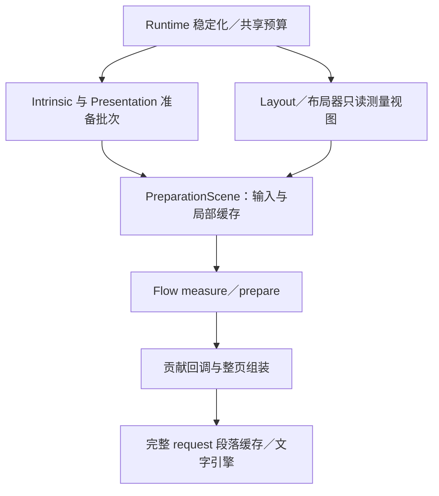

# Flow／Runtime 重复捕获与组装分析

类型：`architecture-review`

日期：2026-11-03。能力归属：Core（`novadraw`）Flow、约束测量、准备与 Runtime
稳定化。Editor、backend、platform 无新增能力。
`api_semantics`：`text.flow`、`text.interaction`、`layout.manager`、
`viewport.scroll_zoom`、`notification.layout_update`。
状态：原始样本复核、冻结驱动请求追踪与当前源码分析完成；候选优化尚未实施。

以上为实施前分析快照。用户随后授权实施，首片结果另见
[FR-01 准备输入复用](flow-runtime-input-reuse-2026-11-03.md)。

用户已要求暂停 ADR-059 B1 扩张，优先分析本问题。
当前执行状态只在 [P2 backlog](../../roadmap/p2-delta-backlog.md)维护。
本报告不修改 ADR-051／059 的合同或默认启用条件。

## 结论与范围

真实 Large 的主要重复工作发生在文字引擎之前：每次测量重建贡献树，
重新产生段落字符串、样式 span 和来源范围，然后才查询完整段落排版缓存。
resize 的 520 次段落请求中有 514 次命中，仍执行 13 次完整贡献组装；
纯滚动的 80 次请求全部命中，仍执行两次测量组装。

Runtime 和布局器又在多个只读阶段重新建立 styles、子树成员集合、source prefix
与 revision 基础数据。当前缓存分别属于 Flow 段落资产或单个 PreparationScene，
没有覆盖整条重复调用链。共享预算句柄不等于共享这些输入缓存。
布局后的活动轮询还会前后捕获整树派生恢复状态；这部分也计入布局阶段自身成本。

这些事实支持优先处理贡献组装和只读输入重建。不能据此删掉布局反馈轮次，
也不能把 contributor／handler 的完整结果直接跨场景缓存。
现有 [ADR-051](../../archive/adr-consolidation-2026-11-03/original/doc/adr/adr-051-exact-flow-layout-reuse.md.txt)明确保留贡献重读，
因为这两个扩展点尚无纯度或 revision 声明。

本次定向审阅实现是为了分析实际重复工作，不是理想架构扫描。
源码结论对应提交 `ef7d46c1`；计时使用 2026-11-02 冻结样本。
新追踪运行同一冻结 release 二进制，没有构建当前源码或进行优化前后性能比较。
因此，本报告确认调用结构与缓存边界，不宣布当前版本的绝对性能或提速比例。

## 证据与统计口径

原始负载有 40 个段落、51,232 个初始文本字节；固定追加后为 51,233 个原生 glyph，
录制 7,889 条命令。原样本设备为 Apple M1 Pro，Rust 1.96.0、release、
电池供电，开启 Runtime 计时；后台负载未受控。
完整口径见[文字性能验证](../performance/text-optimization-validation.md)。

本次重新读取原始压缩样本，以 `kind=fresh-runtime`、`status=work`
筛选各阶段，核对每阶段 1,000 条记录及其调用分布。
另运行冻结二进制三次，开启完整请求诊断：

```bash
/tmp/novadraw-text-validation-20261102-original/textflow-perf \
  3 extended original requests
```

这三次只用于确认调用结构，不能估计性能分位数。
共 3,960 次成功排版请求，无 dropped；三次均保持滚动新增排版调用 0、
resize 新增调用 6、7,889 条命令和 51,233 个原生 glyph。
冻结二进制 SHA-256 与原 manifest 一致：
`ea7e471b3cd2fc56e465a00884e5957a600d02b80d665ccc60d5b8afda996f7b`。

本地文件均不纳入 Git：

- 原样本：`target/verification/text-stages-b-2026-11-02/production-perf-samples.ndjson.gz`，
  SHA-256 为 `ec5e82ab2549664effff5b4fce30460e77c8ebb867b0477c30eda57eb2ec143c`。
- 原构建与环境：同目录的 `production-perf-manifest.json`。
- 新追踪：`target/verification/flow-runtime-repeat-work-2026-11-03/frozen-request-trace.ndjson`。
- 派生收据：同目录的 `analysis-receipt.json`，包含输入和二进制哈希、当前源码哈希、
  逐阶段统计及每次操作的 build／phase／class 分布。

三组追踪的每个 build 都产生 40 个段落请求：

| 操作 | Flow 构建 | measure 构建／请求 | prepare 构建／请求 | 引擎未命中 |
|---|---:|---:|---:|---:|
| 首次稳定化 | 13 | 10／400 | 3／120 | 6 |
| 固定追加 | 5 | 3／120 | 2／80 | 2 |
| 纯滚动 | 2 | 2／80 | 0／0 | 0 |
| resize | 13 | 11／440 | 2／80 | 6 |

resize 的六次 miss 是三个不同完整输入在两个不同宽度下各计算一次。
样本 0 的后两个 prepare build 是 29 与 33，80 个请求全部命中。
measure build 22／23、25／26、31／32 分别有相同请求 class 和 scene revision；
滚动 build 19／20 也相同。完整请求诊断能证明输入重复，
但没有记录 layout container、measurement selection 和重入原因。
这些 build 不能据散列相等被直接合并，也不能被全部判成同一个 callback 的无效重入。

## 成本支持怎样的排序

下表为原始 1,000 个 fresh Runtime 样本的阶段累计 exclusive P95，单位 ms。
每个值扣除了计时树中已记录的子阶段，表示该计时边界的自身耗时；
没有细分计时的内部工作仍包含在其中。各列分位数不能相加。

| 阶段 | 首次 | 追加 | 滚动 | resize |
|---|---:|---:|---:|---:|
| Flow 贡献组装 | 10.357 | 3.903 | 1.612 | 10.042 |
| 布局阶段自身 | 7.481 | 1.720 | 2.237 | 7.167 |
| 分析与 shaping | 4.532 | 2.151 | 无新增调用 | 4.449 |
| Flow 构建自身 | 3.251 | 1.611 | 0.361 | 2.951 |
| 准备批次校验 | 3.070 | 2.055 | 0.844 | 2.371 |
| 准备发布 | 3.138 | 1.350 | 0.005 | 1.953 |

`layout` 的自身耗时包含布局器调用、只读测量视图建立、验证树遍历、
布局效果应用及其他未细分工作，不能全部归因于某一次树复制。
`flow-contribution` 包含 registry 分发、回调、边框度量、文本与来源组装，
不能全部归因于字符串复制。进一步归因需要有界、默认关闭的细分观测。

这批 resize 总 P95 为 36.72 ms，分析与 shaping 累计 P95 为 4.45 ms。
宽度复用仍有价值，但不能单靠省去这一阶段证明达到 16 ms。
原生 glyph 裁剪解决录制和 backend 工作，也不能替代本报告中的稳定化优化。

## 实际调用链与所有权



Runtime 的 work set 对每种工作去重排队。每次稳定化先安排 IntrinsicMetrics、
Layout、DependencyInvalidation、Routing 和 Presentation。
IntrinsicMetrics 和 Presentation 都会调用准备批次；准备后尺寸改变会再次排 Layout，
布局后再次排 Presentation。真实 inline 尺寸、滚动条和布局器反馈可能需要这些轮次。
见[稳定化循环](../../../crates/novadraw/src/runtime/runtime/frame_submission.rs#L504-L648)。

`LayoutMeasurementSession::layout` 每个布局器调用建立整树 styles 和根场景；
布局器返回后应用 LayoutOutput，树的几何和派生 generation 可能改变。
见[布局测量入口](../../../crates/novadraw/src/graph/layout_measurement.rs#L3-L45)
及[布局效果应用边界](../../../crates/novadraw/src/graph/layout_measurement.rs#L674-L744)。
所以复用生命周期首先应限定到一个不可变树借用，不能直接扩大到整个稳定化。

这条链中的“捕获”是准备输入与贡献读取，和 RuntimeScenes 的离屏 SceneCapture
订阅不是同一能力。本轮未修改或诊断离屏捕获、GPU 或 surface present。

## 已确认的重复来源

### 段落缓存位于贡献组装之后

`FlowLayoutService::measure` 每次调用 `build_flow`。
`build_flow` 先建立 FlowAssembly 并递归 visit，完成贡献、边框和来源组装；
之后才逐段构造完整 request 并进入 `FlowWork::layout` 的段落缓存。
完整 prepare 快照缓存不会被 measure 使用。
见[Flow 服务](../../../crates/novadraw/src/figure/flow/snapshot.rs#L218-L331)
及[贡献构建边界](../../../crates/novadraw/src/figure/flow/snapshot.rs#L644-L706)。

因此，段落 hit 只能省去文字引擎及部分几何工作。
它不会省去前面的 registry dispatch、contributor 调用和整页重组。
这是 514／520 命中仍有约 10 ms 贡献成本的结构性原因。

标准文本 contributor 克隆自己的 String 作为 TextContribution；
标准 handler 再把文本追加到段落 String，构造 span、来源 offset 和 ancestors。
registry 为每个节点创建 sink 与 boxed payload，FlowAssembly 还维护成员、遍历顺序、
访问集合和来源 offset。
见[文本贡献与标准 handler](../../../crates/novadraw/src/figure/flow/nodes.rs#L20-L67)
及[段落组装](../../../crates/novadraw/src/figure/flow/assembly.rs#L165-L250)。
这些操作重复发生；本轮没有单独测量其中各项耗时或实际 allocator 分配。

### 缓存活到单个 PreparationScene，多个场景之间重新建立

`PreparationScene::with_budget` 遍历子树创建 members，并初始化 measurement、
revision base 和字体描述符容器。
`for_measurement` 再调用 with_budget 缩小到被测 Figure 子树，
仅继承 measurement path、observations、measurements 和约束。
members、revision base、parsed_fonts 都是新容器。
见[构造与测量投影](../../../crates/novadraw/src/figure/preparation/scene.rs#L81-L157)。

measurements 的 key 包含 Figure、约束、Preferred／Minimum／Both selection 和 text revision。
父视图及其测量投影共享这一容器，但新布局器调用与新准备批次不会继承它。
不同 selection 还可能各自进入 preparation 的 measure_scene。
见[测量缓存](../../../crates/novadraw/src/figure/preparation/scene.rs#L168-L285)。
不能因此直接合并 selection：尺寸 override、所选指标校验和错误行为仍需分别保持。

这里必须更正此前的措辞：当前 `parsed_font` 缓存 FontDescriptor，
并未执行 FontFamily parser、字体选择或 shaping。
复用它减少的是描述符留存及 clone／预算相关工作，其单独收益尚未测量。
见[当前实现](../../../crates/novadraw/src/figure/preparation/scene.rs#L439-L452)。

### 准备批次重复建立检查输入，检查职责仍各自成立

`refresh_prepared_figures` 先计算 resolved styles、筛选准备 owner。
每个 owner 建立场景、source prefix 与 key，用于缓存判断和准备回调。
candidate 验证后，批次验证再建立新的场景并重读 prefix、revision 及 dependencies；
发布阶段再扫描 owner、退休来源和后代。
见[准备批次](../../../crates/novadraw/src/graph/presentation.rs#L132-L289)
及[发布](../../../crates/novadraw/src/graph/presentation.rs#L291-L421)。

只读 tree／styles 的静态内容可以研究共享；
外部 provider 在不可变树借用下仍可能通过内部状态改变 revision，
后续 owner callback 也可能影响先前候选的外部依赖。
候选验证、批次冻结检查和事务发布的职责不同。
不能因为多次读取相同内容就删除末尾的 provider／dependency 重验。

### 布局后的活动轮询前后捕获整树派生恢复状态

Runtime 每次实际执行布局验证后，先调用 `capture_preparation_sources`，
再 `poll_activities`，最后 `rebase_preparation_sources`。
捕获和 rebase 内部各调用一次 `capture_derived_prefix`，遍历全部 Figure，
克隆 DerivedNode、通知队列和已有 viewport checkpoint。
见[派生状态捕获](../../../crates/novadraw/src/graph/derived.rs#L62-L164)。

这些是派生恢复数据，包含 bounds、prepared 引用、route 等；
不是复制 Figure 源组件或整份原始文本。前后对照用于保留活动已提交的变化，
同时保留更早的派生回滚基线。即使活动轮询没有变化，当前路径仍进行这些捕获。
本轮没有该函数的单独计时，不能把布局自身约 7 ms 全部归给它。

后续可评估按活动实际写集合更新恢复前缀，或在有充分依据时避免空轮询的前后捕获。
不能根据 `poll_activities` 返回 false 就删除捕获：返回值与所有已提交副作用
是否被完整记录的关系仍需核验，失败时恢复、通知因果顺序和 viewport 效果不能丢失。
该项属于 Runtime 事务优化，需与只读输入缓存分开实施。

## 与 Draw2D 契约的关系

只读参考仓库提交为 `4463d9d0ce13c19d10fbe769d29f28b7345a8cba`，
范围限定 `org.eclipse.draw2d`；没有使用 Zest 或运行 Java。

Draw2D `FlowPage.getPreferredSize(width, h)` 按 width 保留有限尺寸缓存，
invalidate 清缓存。未命中时临时布局，恢复原 width 后重新安排失效；
`validate` 只在失效状态执行。
`FlowContainerLayout.layoutChildren` 保留子级失效与 validate，
`DeferredUpdateManager` 对 invalid figure 去重并处理 validation。

这些源码支持“尺寸查询可复用、失效后需重算、反馈不得丢失”的行为契约。
它们没有证明 Novadraw 任意 contributor 或 handler 可跨场景复用，
也不要求照搬 Java 的三个缓存槽或可变临时布局。
现行映射仍以 [Draw2D 语义账本](../../parity/draw2d/api-coverage.md)的 `text.flow`
及[ADR-051](../../archive/adr-consolidation-2026-11-03/original/doc/adr/adr-051-exact-flow-layout-reuse.md.txt)为准。

## 候选优化与推进顺序

| 候选 | 要减少的工作 | owner 与实施边界 | 当前判断 |
|---|---|---|---|
| FR-01 同一只读借用的准备输入复用 | 同批次 members、静态 prefix、revision base 和字体描述符重建 | Core preparation 内部；保留 root scope、预算及动态 provider 重验 | 首个小切片候选；收益需实测，不改变 contributor 次数 |
| FR-02 统一贡献复用声明与不可变组装资产 | 跨 measure／prepare 重复 dispatch、文本拼接、span 与来源组装 | Core Flow 的公开扩展合同；内置和外部同入口 | 最大直接成本候选；需新 ADR／修订评审 |
| FR-03 按输入变化范围复用测量与局部结果 | 同输入不同只读阶段的测量重入、纯位置变化的整页准备 | Core Flow／layout／Runtime；基于完整依赖及约束 | 在 FR-02 明确复用资格后推进 |
| FR-04 稳定化事务、工作调度与发布扫描 | 活动轮询前后整树派生捕获、不必要的批次和退休来源重扫 | Core Runtime／graph；保持反馈顺序、原子性及恢复 | 待补捕获耗时、活动写集合和工作排队原因证据 |

FR-01 不扩大到跨树修改的全局 cache。
候选只共享同一不可变 tree／styles 的静态事实；每个子视图的 members、
revision 仍归其 root，measure constraints 与 observations 保留当前调用作用域。
必要的 provider revision 和依赖检查继续执行。
当前 source prefix 包含 provider revision，不能直接缓存整个 prefix；
需要区分静态节点内容与每次重读的动态字段，或保留完整重新验证。
其缓存元数据分配应在生成前使用现有预算，并随只读作用域释放。
若缓存需要跨越布局效果应用或下一次稳定化，这已超出 FR-01。

FR-02 需要同时声明 contributor 与 handler 的复用条件、实例／registry 绑定、
外部可变状态版本以及读依赖。不可变 payload 并不证明产生 payload 的 callback 纯。
边框 renderer／metrics 和真实 inline 测量也需独立分类；无法声明时继续重读。
text、source range、ancestors 和 traversal order 归组装资产；
宽度相关断行、inline placement、交互与绘制几何继续归当前完整结果。
不得根据 StructuredTextFigure 类型建立仅内置可用的路径。

FR-02 可先取得 payload 再重放 handler，也可共享完整 FlowPlan，
但二者节省的工作和所需依赖证据不同。不能将只缓存文本 payload 写成省去整页组装。
设计时需要分别评估持续留存、候选和旧快照共存，不能只计算可见段落字节。

建议先定义 FR-01 的内部范围和计数验收，再形成 FR-02 的具体 ADR。
FR-01 是边界清楚的首片，不应因其局部收益推迟 FR-02 的高成本问题。
当前仅完成分析；没有授权实现新的贡献复用协议或调整稳定化主循环。

## 验证要求和剩余缺口

首片实现前先用默认关闭的现有诊断补足调用归因：
记录 layout container、measurement selection、约束、scene root、
准备 owner、复用／失效原因及 Layout／Presentation 再入队来源。
原追踪没有这些字段，不能精确解释 11 次 measure 中每一次的发起者。
记录应有界、实例持有；不能在热路径打印日志或用计时日志决定缓存资格。

性能验证继续使用同内容、字体、宽度和 release 配置的冻结对照。
先比较实际工作次数、静态遍历与复制分母，再看首次、追加、scroll、resize
及拒绝路径的端到端 P50／P95／P99。保留诊断开关影响及失败样本。
FR-01 预计不会减少 13 次整页贡献组装，验收重点是输入重建是否下降；
FR-02 才应证明复用声明使相应 callback／组装次数下降。
任何阶段收益都不能直接记为 16 ms 或 4 ms 整体验收通过。

行为验证至少覆盖不同 root 权限、相同与不同约束、三个 selection、
隐藏／删除／重挂载、字体与样式更新、外部 provider 内部 revision 改变、
后一个 callback 使前一个候选依赖过期、预算耗尽、失败重试和旧快照留存。
真实 inline 尺寸反馈、border callback 和 measurement cycle 不能丢失，
不得把当前无 inline 的 Large 成功作为这些反例通过。

本次未重新测量当前版本、未细分 allocator 或贡献内部函数耗时，
未证明 13 次构建全部可以省去；这些是后续实施证据，不能写成已完成。
本次报告只关闭重复来源分析；B1、宽度复用、原生可见绘制和整体 LT 继续未关闭。

## 交付复核

原始统计与三次请求追踪分别核对；当前源码和冻结二进制的证据效力分开表述。
成稿按技术写作检查因果、owner、已有合同与候选改动，
再按好好说话核对数字、术语、中文和段落节奏，最后回查缓存边界与未完成状态。
这是一份作者自审报告，没有独立 reviewer 或新优化性能验收。
