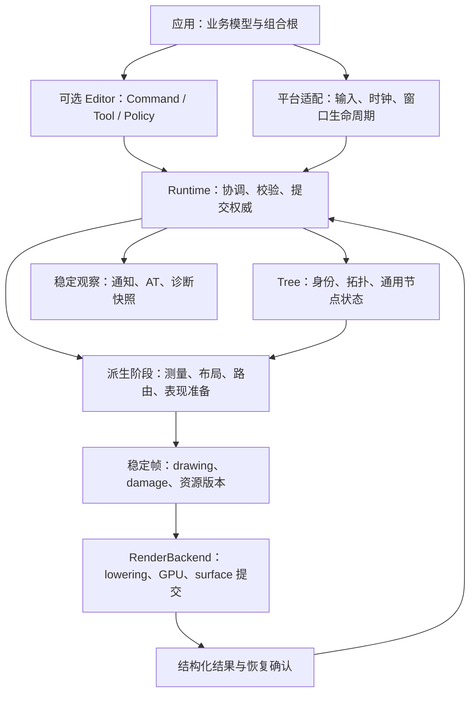

# 图形框架文档时效与架构边界审查

类型：`verification`

日期：2026-10-12

状态：审查完成；架构调整建议待设计评审，不改变现行 ADR 或执行队列。

## 1. 目标、基线与结论范围

目标是使用 Rust 与 WebGPU 建立行为对等 Draw2D、并具有更强组合能力和扩展能力的二维图形框架。对等对象是树、几何、布局、绘制、输入、更新、连接和扩展契约，不是 Java 类数量、方法拼写或 SWT 对象结构。Editor 是可选上层，不能成为使用绘图 Core 的前提。

本次以本地 HEAD `89833d3` 和读取时的文档工作树为基线。此前未提交的 S02–S04 已进入近期提交；读取末尾工作区另有 `examples/scenes/src/uml.rs` 修改，不属于本次审查。文档清点得到 242 份 Markdown，其中 `doc/archive/` 外 230 份：42 份 design、36 份 ADR/索引、9 份 roadmap、4 份 parity、102 份 verification、4 份 migration、26 份 reference、6 份 strategy，以及总索引。

审查方法是全目录清点、关键术语与替代关系检索、核心规范和候选计划定向全文阅读，并对照本地 GEF Classic 的 `Figure.java` 与 `IClippingStrategy.java`。按项目理想架构分析约束，本次未扫描 Novadraw Rust 实现；实现完成事实引用既有完成记录，未重新运行行为、像素或性能测试。未逐篇复核全部历史验证报告、产品策略和迁移教程，其内容正确性不在本次结论范围内。

结论：

- 六个公开 package、平台与后端独立、单 Runtime 提交权威、轻量 Figure 树、短借用上下文和 typed 扩展方向可以继续保留。
- 文档主要问题是新决策未完整传播到规范正文：读者仍能读到已取消的 root/prelude、具体 Figure facade、旧帧入口和旧组件更新合同。
- 架构调整重点应落在状态归属、派生状态发布、固定机制与开放策略的分界，以及公共 API 的权限和失败语义。仅拆文件、增加 facade 或减少方法数不足以证明模块更灵活。
- 已完成迁移计划应退出当前阅读路径；仍有效的主题规范和验证证据应保留。文档日期早、能力未实现，都不足以单独构成归档理由。
- 现有 P2-S05–S09 能承接多数整改。新发现先登记并定级，不能直接借本报告扩大执行范围。

主要状态依据：[P2 backlog](../../roadmap/p2-delta-backlog.md)、[P2-S03 完成记录](p2-s03-runtime-facade-completion-2026-10-10.md)、[P2-S04 完成记录](p2-s04-editor-open-protocol-completion-2026-10-10.md)、[目标调整计划](../../roadmap/goal-alignment-adjustment-plan-2026-09-30.md)。

## 2. 文档归档与保留清单

### 2.1 应退出当前入口的文档

以下是具体处置建议，尚未执行物理移动。归档时必须更新 Markdown 链接、启动规则和 manifest 证据引用；保留旧路径短指引或统一路径映射，不能留下断链。

| 文档 | 判断依据 | 建议处置 | 当前替代入口 |
|---|---|---|---|
| `design/architecture/public-api-experience-proposal.md` | 已批准迁移完成，正文仍推荐 root/prelude、`runtime.label`、具体 facade，并称 capability/session 为后续 | 将旧综合提案全文归档；先将仍有效命名、角色和组合原则提炼到规范公共 API 专题，未完成项映射 S07–S09 | ADR-025/031/032/033/035；新公共 API 专题 |
| `migration/draw2d-gef-semantic-migration-plan-2026-09-15.md` | 仍称待评审；建议内置 enum 加扩展 envelope；仍要求 G6 产品毕业，已被后续决策替代 | 归档历史实施提案；保留方法论通过通用迁移指南承载 | parity、P2 backlog、ADR-034、Editor roadmap |
| `tests/reviews/draw2d-gef-migration-plan-2026-09-16.md` | “当前执行顺序”停在 09-17，含已关闭缺陷、旧 Request 方案及引擎 G6 门禁 | 归档历史调度方案，正文不改写当时判断；审计证据关系继续可追溯 | 语义整改完成页、审计执行清单、P2 backlog |
| `roadmap/editor/implementation-plan.md` | G0–G5 全部完成，仍是实施步骤；与现行 roadmap 和完成记录重复 | 归档已完成实施计划；把仍有效 crate 拆分判据移入架构边界规范 | `roadmap/editor/00-index.md` 与 Editor 设计 |
| `adr/adr-021-public-facade-and-feature-boundary.md` | root/prelude、聚合 Editor、backend features 等主要决策都已被 023/031/035 替代，正文仍完整推荐旧结构 | 参照 ADR-013：归档失效全文，原位置保留替代关系短指引；少量仍有效原则由当前专题承接 | ADR-023/031/035 |
| `tests/reviews/gef-readiness-analysis-2026-09-13.md` | 就绪分析是 G0 前的历史判断；总索引仍将其列为开发 Editor 的第一步 | 退出当前开发阅读路径，留在历史验证索引即可；无需为此移动全部证据 | ADR-015、Editor 架构、ADR-032/034 |

这些判断由旧正文与现行 ADR/roadmap 的直接冲突支持，而不是按文件年龄推断。

### 2.2 有条件归档，或只调整分类

| 文档/组 | 建议 | 原因与保留条件 |
|---|---|---|
| `design/rendering/display-list-protocol.md` | 建议与实验计划合并为一个休眠 proposal，移出默认架构阅读路径；无当前消费者时可归档 | 当前门槛合理；wire format、chunk patch 与远程传输是候选能力，不能宣称其被 RecordedDrawing 完整替代 |
| `design/rendering/displaylist-implementation-plan.md` | 随上述 proposal 合并或归档 | 无活跃实验就不保留一个类似执行入口的计划；恢复时先补消费者、资源和 benchmark |
| `tests/plans/p2-text-direct-edit.md` | 完成矩阵应保留为回归依据；移至长期契约验证矩阵分类，或归档原计划后提炼矩阵 | 计划已 complete，但 IME、长文本、caret 等验收条件仍有价值，不能只因完成而删除 |
| `tests/reviews/*-completion-*`、既有像素和性能报告 | 保留在 verification，以基线标记隔离历史事实 | 完成证据不是过期设计；物理移到 archive 会扩大 manifest 和链接迁移成本 |
| `reference/gef/core-principles.md` | 保留外部分析，移除或迁出第 8 节旧 Novadraw 映射 | 该节仍把 EditPart 映射为 SceneNode、Policy 映射为 OperationHandler，污染外部事实与项目设计边界 |
| `roadmap/product-deliverables.md`、`demo-matrix.md` | 保留既定 M1–M10 分母，明确基线适用范围 | 不作为当前能力总分母；后续 delta 的能力与证据继续由 parity/backlog 维护 |
| `strategy/*`、`migration/java-rust/*` | 保留在各自分类，降低默认架构检索权重 | 产品方向和通用迁移方法不直接约束运行时设计；本次没有足够依据逐篇判定失效 |

### 2.3 不应整篇归档的现行规范

`overview`、`static-architecture`、`dynamic-architecture`、`directory-structure`、`runtime-ownership-and-module-boundaries`、`component-update`、`figure-capability-model`、`derived-state-convergence`、`update-manager`、坐标和 Editor 专题仍承载有效契约，应修订正文。ADR-019、027、031 等只部分被替代，应更新受影响章节和替代声明，不能整篇取消其有效决策。

## 3. 已确认的文档缺陷

“确认”只表示文档之间存在可定位冲突；不等于已经证明当前实现违反契约。

| ID | 优先级 | 文档与位置 | 问题及影响 | 修订方向 |
|---|---|---|---|---|
| DOC-01 | P0 | 总览 §3.4、静态架构 §6、所有权专题 §4、ADR-019 §3/4、ADR-027 §4/7、capability §4.3/9 | 继续允许具体 Figure/Container 专用 facade；ADR-033 已取消内置具体类型例外。外部消费者会得到互相冲突的扩展路线 | 统一 `FigureMut` 节点操作与 typed component/capability update；明确跨对象关系服务的独立角色 |
| DOC-02 | P0 | `component-update.md` §1–3、capability §9 | 组件规范明确不提供 no-op、固定提升 revision，仅覆盖三类失效；S03 完成记录已经包含 no-op、typed property、资源和结构 effect | 将 accepted mutation 合同完整写回规范；明确 no-op 的 revision/work/journal 零变化及 effect 的权限边界 |
| DOC-03 | P1 | ADR-018 §1、ADR-031 §2/3、动态架构 §渲染、UpdateManager §10、文本规范开头、parity paint 行 | 仍把 `Runtime::prepare_submission` 写成唯一公开入口；S03 已将其迁入 Frames facade，且记录旧入口负向验证 | 保留 Runtime 出版权威，更新为子 facade 获取和 prepare/complete 的唯一调用路径 |
| DOC-04 | P1 | 静态架构 §3.2/4.3/10 | 示意接口仍含 accessor、无 Result 的 paint/measure/layout、公开 submission 字段 | “概念接口”不能豁免安全和失败语义；用角色图表达概念，公开示例服从 ADR-027/031/033 及受检输出 |
| DOC-05 | P1 | 目录规范 §2/3、总览 §14、更新规范 §8/9 | `Point/Size/Rect`、`RecordingCanvas/CommandStream` 与当前规范词汇混用；目录图缺少 Graphics/Text/Animation 的完整角色 | 统一领域词汇，标明内部录制实现与公共 Context/RecordedDrawing/Submission 的区别 |
| DOC-06 | P1 | parity 开头、模板、Figure Surface 表、原子添加行 | “当前顺序”指向 archive；active/deferred 表仍停在 M1–M5；模板仍用 Bounded；公开路径含旧 ContainerMut | 将原分阶段分母标记为历史基线；当前能力表使用现行 API 路径、限制和 suite |
| DOC-07 | P1 | `tree-search-and-focus.md` §2/3 | 规范把 enabled 作为全部空间搜索硬门禁；历史迁移提案已提出 disabled 可见 Figure 的几何搜索需求 | 在当前最窄规范明确几何搜索与输入资格策略分开；仅共享坐标、clip、遍历内核 |
| DOC-08 | P1 | `scroll-zoom-gesture-contract.md` §3/4/9、总览不变量 | target/controller 失效后可清除或重选，与会话固定身份和 tombstone 的长期要求不一致 | 保留会话身份至 End/Cancel；失效后拒绝投递，不能在同手势内隐式接管新目标 |
| DOC-09 | P1 | ADR-033 状态、Animation API §2、Layer/Freeform §3、Tooltip/Accessibility API | ADR-033 仍写正在实施；动画仍用 `runtime.animations()`；layer、focus、AT 仍推荐平铺 Runtime 入口 | 状态链接完成记录；专题只维护现行行为和所属领域入口 |
| DOC-10 | P1 | `audit-remediation-workflow.md` §3、总清单 §1、P2 backlog | 工作流把旧 TC 审计当当前总台账，清单又声明状态以 backlog 为准；历史报告和当前状态发生混用 | 历史审计只保存发现快照；backlog 唯一维护 batch 状态，finding 映射与检查清单引用它 |
| DOC-11 | P1 | `doc/00-index.md` 核心 SSOT、AGENTS/CLAUDE 当前顺序、设计索引 | 审计报告被列为核心 SSOT；启动摘要仍写先 S01；设计索引将已完成 proposal 称待评审 | 设计入口、当前队列、历史证据分开；启动文件镜像当前决策和队列链接 |
| DOC-12 | P2 | Editor 设计与 direct edit 状态、P2-M01 概述、Text/Graphics §独立录制 | target/accepted/implemented/complete 混用；M01 概述称下一阶段 C，下文 C 完成；RecordedDrawing 仍被称候选 | 分离规范效力与执行状态，执行状态只链接 roadmap；历史阶段范围保留并明示 |

证据交叉入口：[ADR-033](../../adr/adr-033-runtime-subsystem-facade.md)、[ADR-035](../../adr/adr-035-explicit-domain-imports-and-root-boundary.md)、[ADR-031](../../adr/adr-031-graphics-recording-and-publication-boundary.md)、[组件更新规范](../../design/architecture/component-update.md)、[Capability 规范](../../design/architecture/figure-capability-model.md)、[P2-S03 完成记录](p2-s03-runtime-facade-completion-2026-10-10.md)、[执行工作流](../audit-remediation-workflow.md)。

## 4. 建议保留的架构骨架

### 4.1 分清三个边界

模块表达领域职责；对象表达状态所有权；package 表达依赖、安装和发布边界。三者可以不同：

- Core 内部的 Tree、Layout、Update 可以在 Runtime 事务内短借用协作，不要求人为拆成 package。
- 只含 `&mut Runtime` 的 facade 表达权限和导航，不能算独立服务状态 owner。
- 具体 GPU backend 和平台 adapter 有真实依赖差异，独立 package 有意义。

现行 ADR-023 的六包边界符合这个方向。当前没有证据支持再拆 Geometry、Render IR、Tree 或新增万能 plugin crate。将来出现独立复用、编译隔离或发布需求，再按消费者证据评估。

### 4.2 目标职责与数据流

下面描述建议用于修订总览的领域图，保持现行单 Runtime 提交模型：



箭头表示调用或数据流，不表示一切对象互相拥有。平台 window/canvas 生命周期和 GPU surface/device 生命周期分别由对应 adapter/backend 承载，具体句柄通过受限 interop 组合；谁创建、resize、suspend、重建和释放必须形成职责表，避免两篇文档同时说“拥有 surface”而没有协议分工。

### 4.3 模块职责建议表

| 领域 | 持有/表达什么 | 不应承担什么 | 外部扩展或消费入口 |
|---|---|---|---|
| Geometry | Point/Vec2/Dimension/Rectangle/Insets/Affine2D/Path 与有限几何运算 | Figure 身份、布局调度、GPU | 受检值和纯算法 |
| Graphics | 绘制状态与统一图文操作、Measure/Paint 阶段权限 | 节点拓扑、frame/session 身份 | Graphics、MeasureContext、PaintContext |
| Text | 字体描述、不可变 TextLayout、交互几何、排版与轮廓 provider 合同 | Editor draft、GPU buffer 格式 | TextLayoutEngine、GlyphOutlineProvider |
| Figure | 具体私有内容、绘制/命中行为、owned capability descriptor | parent/children、通用节点状态、独立 timer | Figure、typed updates、capability registration |
| Tree | 代际身份、拓扑、NodeState、关系数据和只读查询 | 平台调度、可逃逸的 attached 写权限 | Builder、只读视图、受检查询 |
| Layout | 容器测量、约束与 placement 计算 | 修改其他 Figure、通知平台、直接写共享模型 | LayoutSceneQuery → checked LayoutOutput |
| Connection | endpoint/anchor/router/locator、依赖与 routing batch | 业务连线语义、Editor history、第二份拓扑 | 只读 RouteRequest → checked output |
| Runtime/Update | source commit、失效传播、稳定化、damage、journal、出版确认 | 业务 schema、具体后端、所有领域动词平铺 | 通用 mutation 与领域 facade |
| Animation | timeline/behavior 与可丢弃 presentation override | 修改 committed 真值、私有 Figure 时钟 | typed value/binding/family |
| Render | command/drawing/submission、资源版本和 backend 合同 | shaping、命中、业务状态 | Backend consumer、资源闭合录制 |
| Host/Platform | scheduling、归一化输入、时钟、IME/AT 适配 | 布局、命中、Figure callback 规则 | PlatformHost 与平台 bridge |
| Editor | 模型到视图投影、选择、工具、策略、命令历史 | Core 绘制机制、强制业务模型层次 | ModelAdapter、Part、Tool/Request/Policy/Handle |
| Inspector | 读取稳定事实与订阅生命周期 | 创建新的提交权威、吞掉 fault | 只读 snapshot、subscription |

每个模块规范需要列出持有的数据、可读输入、可发布输出、错误和禁止的依赖。文件名和函数数量作为维护指标，不能替代这张表。

## 5. 需要评审的架构调整

### 5.1 Figure 统一：统一提交机制，保留领域差异

建议继续区分四类对象：

1. 纯领域值：Paint、StrokeStyle、FontDescriptor、几何和配置。
2. 实例身份：FigureId、EditPartId、资源身份，带各自 namespace/lifetime。
3. 扩展行为身份：CapabilityKey、RequestKey、PolicyKey、ToolKey、HandleActionKey。
4. 派生结果与权限视图：LayoutSceneQuery、FigurePresentation、RecordedDrawing、FigureMut、ToolContext。

“统一”应意味着内置与第三方采用相同契约、权限和错误通道，不意味着所有对象都叫 Node、所有数据都进属性表、所有操作都经一个 registry。私有组件用 typed component update；跨类型消费者才需要 capability；多个类型共享普通模型可以使用组合或泛型。

实例 ID、协议 key、ModelId 不能为减少类型数而合并。注册阶段必须写清 key 唯一性、descriptor/payload 匹配、存活期、删除规则和拒绝行为。内部可复用 typed identity 原语，公共层继续保留各领域名称；当前无需一个公开万能 Key/Plugin 协议。

依据：[ADR-027](../../adr/adr-027-open-figure-capability-registry.md)、[ADR-034](../../adr/adr-034-editor-tool-request-handle-protocol.md)、[ADR-035](../../adr/adr-035-explicit-domain-imports-and-root-boundary.md)。

### 5.2 Runtime Facade：以任务和权限裁决分组

ADR-033 的分组方向保留，但需要补齐领域 facade 与统一 Figure mutation 的分界：

- Figure 的本地 committed 内容与节点状态通过 FigureMut 更新。
- 多对象关系、anchor/router 注册、viewport 与 scale 联动、layer membership、frame/resource lifecycle 由具名领域操作提交。
- facade 本身不缓存、不延迟提交、不在 Drop 做隐式事务。
- 只读查询优先 `&self` 或不可变 snapshot；需要运行扩展计算、更新缓存或排空队列的方法显式使用可变权限。
- 不为每个 facade 机械增加 `Read/Mut/Service/Handle` 四层包装；只有消费者确需独立权限时再拆视图。

Runtime 的 25 方法预算是防止回退的现行门禁，保留即可；架构验收还必须观察 consumer 是否需要连续跨多个 facade 才能完成一个应原子的领域任务。若需要，设计具名 prepared operation，不能把复杂性只从 Runtime 搬给调用者。

S03 完成记录出现 RuntimeViewports/RuntimeLayers，而 ADR-033 的表尚未包含它们。需要明确这是关系服务还是具体 Figure mutation，写入实际合同，不能仅靠“方法已迁移”解释合理性。

### 5.3 组件更新：补齐 no-op、effect 与提交权限

现有组件更新规范不够表达 S03 完成后宣称的行为。应修订为统一的执行骨架：

```text
验证 target/type/key/revision
→ prepare 读取当前 Figure 与只读上下文
→ 得到 NoChange 或受检候选和 effect 描述
→ Runtime 验证全部 effect 的目标、权限、资源和几何
→ commit 候选
→ 发布 revision / committed facts / dependency work / old-new damage
```

建议明确：

- prepare 能读取当前状态，保证 no-op 判定和 typed old/new property 来自实际 committed 值。
- NoChange 不调用 commit、不提升 revision、不排 work、不通知、不产生 damage。
- effect 描述包含“请求什么变化”，不能直接获得可变 Runtime、任意 registry 或其他 Figure。
- resource dependency 和结构 effect 必须限定目标范围及授权关系；外部与内置走同一校验。
- 单 Figure 私有更新、关系复合操作、Editor 投影批次的原子性分别定义，不把任意 effect 扩张为通用事务。
- commit 中 panic 进入 fault；不承诺回滚扩展 interior mutation 或外部副作用。

该更新应先统一 DOC-02 的规范缺口，再判断是否需要新增实现。S03 完成记录不能代替长期协议正文。

### 5.4 派生状态：按依赖阶段统一发布

P2-S05 的布局/文字反例揭示的是 snapshot 与最终 geometry 的一致性风险。总览、UpdateManager 和收敛专题应使用一条统一阶段合同：

```text
source/resource 输入
→ natural/constrained measurement
→ child geometry 与容器关系状态
→ routing 与 locator/extent/range
→ final FigurePresentation
→ animation presentation 合成
→ damage/recording/submission
```

每个快照应绑定它实际依赖的 source、style/resource revision、约束和 geometry generation。布局改变 Label bounds 后，同一 stable frame 不得继续使用旧约束、旧 origin 或旧 clip 的文字表现。

保留固定 typed worklist、优先级和收敛预算。跨阶段反馈应明确允许的边，而不是让所有 provider 注册任意 DAG。对于纯表现 refresh，禁止改变 source 或布局贡献；重新测量影响尺寸的工作回到对应测量阶段。

现行收敛规范一处允许“内置 sealed layout effect”，另一处又要求外部组件同样能发布私有快照。需要界定：引擎结构 effect 可以受限，但标准容器状态协议必须让外部实现以相同语义接入，不能出现内置布局器可写 RangeModel、外部只能改 bounds 的特权路径。

这是待评审的合同修订；本次未证明具体实现仍存在该特权。通过外部 wrapping Figure、自定义容器和布局器共同验证，而不是只测试内置 Label。

依据：[收敛规范](../../design/architecture/derived-state-convergence.md)、[UML F-01](uml-extension-capability-2026-10-05.md)、[ADR-014](../../adr/adr-014-extensibility-and-lifecycle-boundaries.md)。优先由 P2-S05 承接。

### 5.5 固定 Pipeline 与开放策略：先声明兼容边界

Draw2D `Figure.paint` 默认执行 self → client/children → border，但这些步骤通过可覆盖方法实现；`paintChildren` 又消费可替换 `IClippingStrategy`，允许多个 clip rectangle。Novadraw 固定 scheduler 可以提高可预测性，但应在 parity 明确其扩展替代方案和收窄范围，不能把默认模板顺序直接写成 Draw2D 禁止覆盖的公理。

建议：

- scheduler、提交、身份与恢复顺序固定。
- child projection、clipping、hit participation、measurement、router 等提供窄策略输入和受检输出。
- 若需要 foreground/underlay 等绘制位置，先证明真实用例，设计固定阶段的 typed painter/provider；不开放任意 renderer 重入。
- clip provider 返回受检几何与明确坐标域；paint、hit 和 damage 使用一致的有效区域或明确的可观察保守近似。
- 多矩形重叠必须处理重复 alpha 合成问题，不能机械对每个 clip 重放 Figure。
- 普通几何搜索能发现显示的 disabled Figure；输入 target 搜索再加入 enabled/handler/focus 资格。

跨 viewport clip 优先并入 P2-C03 的 Design；一般多区域策略若范围超出该 delta，应单独登记，不隐式扩张。固定控制流枚举可以保留；列举可新增 Figure/Tool/业务能力的中心枚举不能以“内置”获得例外。

源码依据：[Figure.java](file:///Users/bytedance/Documents/code/GitHub/gef-classic/org.eclipse.draw2d/src/org/eclipse/draw2d/Figure.java#L1240-L1358)、[IClippingStrategy.java](file:///Users/bytedance/Documents/code/GitHub/gef-classic/org.eclipse.draw2d/src/org/eclipse/draw2d/IClippingStrategy.java)。适用范围限定 `org.eclipse.draw2d`，未使用 Zest。

### 5.6 Editor：准备发布与命令历史分开

Editor 保留模型、Part、Figure 三种身份和两个真值边界：模型是业务真值，Runtime 是视觉状态提交权威。

P2-S06 应明确：

- PartProjectionPlan 准备 Part/visual/registry/activation 变化。
- ConnectionProjectionPlan 准备关系、anchor/router binding 和 connection visual。
- OverlayBatch 准备临时视觉及其 owner/action。
- 全部预检完成后，由 Viewer/Runtime 协调发布引擎内部状态；失败时未发布部分正常释放。
- 外部 factory/activate callback 的副作用不在内部回滚保证内；未知状态进入 fault。
- 模型 Command 成功后投影失败，不得伪装为模型也回滚。history、model revision、Viewer fault 与可重建路径分别报告。

Tool/Request/Policy 的 typed registry 继续保留，不因准备批次再造第二套请求语言。RootLayerFactory、SelectionPolicy、tracker 的开放程度应通过真实 consumer 确认；架构“扩展点列表”中的名字本身不是实现或可替换证据。

依据：[Editor 规范](../../design/editor/architecture.md)、[ADR-032](../../adr/adr-032-viewer-edit-session-and-drive-boundary.md)、[ADR-034](../../adr/adr-034-editor-tool-request-handle-protocol.md)。

### 5.7 公共 API：按权限、单位与失败语义收敛

建议新增 `design/architecture/public-api-contract.md`，承接旧 proposal 中仍有效的规范。内容应包含：

| 边界 | 建议合同 |
|---|---|
| 导入 | 每个符号唯一领域路径；框架无全局 prelude；签名引用其他领域类型时不重复 re-export |
| 构造 | 纯值和 detached Figure 可独立组合；有不变量的输入通过 fallible constructor/配置验证 |
| Identity 查询 | foreign/stale/unknown 用结构化错误；已验证对象的合法缺失用 Option；不是全部查询都套 Option |
| 几何转换 | 非法身份与不可逆变换分开；明确 local/parent content/logical surface/physical pixel |
| Source mutation | 成功变化、合法 no-op 与拒绝分开；错误不发布本次操作，panic/fault 不冒充 no-op |
| Deferred mutation | 入队不等于提交；指定目标权限、因果 FIFO、迟到身份拒绝和结果观察渠道 |
| 服务计算 | `measure/layout/prepare/check` 可能运行扩展和缓存逻辑，权限与成本明确；getter 不隐式驱动场景 |
| Drawing | Graphics/Context 使用同一语言；RecordedDrawing 保有匹配资源，只是录制结果 |
| Frame | prepare、backend result、Runtime acknowledgement 分离；GPU 完成与 compositor present 不混称成功 |
| 订阅 | 明确 token/guard、解除责任、drain cursor 和 fault；不能以空集合隐藏内部失败 |
| 注册 | 一个 fallible 入口；duplicate/type mismatch/retired 区分；不保留 panic alias 与 try 双入口 |

P2-S07 负责身份与查询；S08 负责受检领域值；S09 负责 service fault、注册、订阅与 error source。合法非 fallible getter、已验证值的安装、纯历史 `has_*` 查询无需机械返回 Result。

S08 不应为所有 f64 创建新类型：坐标允许负值，尺寸、alpha、stroke、字体各有不同不变量；区分非法 clamp 和合法的 viewport range clamp、圆角按目标几何适配。构造验证和 backend 精度/能力验证也不能互相替代。

### 5.8 图布局与资源扩展：保持领域模型简单

P2-L01 应与 FigureTree 的容器 LayoutManager 分开建模。图算法输入是独立的 node/edge/compound graph snapshot，输出是确定性的 node placement 和可选 routing hints；adapter 通过公开 Layout/Connection/Runtime 操作提交。外部算法的节点类型不得进入 Core，算法不能为方便取得整份可变 Runtime。

资源规范 §12 仍以“新增 payload variant、Registry kind”描述新资源扩展。当前 Image/Font 固定资源合同可以保留，但不能据此声明任意资源类型已开放。应区分：

- 既有标准资源的 provider 可替换；
- backend-local atlas/grid/shader 数据完全由后端拥有；
- 真正跨 Core/backend 的新资源类型，只有出现 consumer 后才设计 typed resource descriptor、身份、版本和能力协商。

同样，公开 Render IR 的可演进性不等于任意插件可以注入未知 GPU command。每条新命令需要明确语义、所有启用后端完整消费或预先拒绝，以及失败/资源/版本门禁。统一原则不能被用来建设没有消费者的通用资源和 shader 插件系统。

依据：[资源规范 §12](../../design/architecture/resource-lifecycle.md)、[图布局 backlog](../../roadmap/p2-delta-backlog.md)、[文字后端边界](../../design/rendering/text-graphics-integration.md)、[ADR-023](../../adr/adr-023-crate-consolidation-and-extension-boundaries.md)。

## 6. 文档体系调整

建议继续使用当前目录体系，收敛权威职责：

| 文档层 | 唯一作用 | 不再重复保存 |
|---|---|---|
| 总览 | 领域地图、状态 owner、依赖和不变量 | 历史方案、函数全表、迁移状态 |
| 静态架构 | 状态所有权、权限与借用关系 | 失效旧代码示意、物理文件清单 |
| 动态架构 | source → stabilize → presentation → submission → ack 的时序 | 每个专题的完整算法 |
| 目录规范 | module/package 边界及拆分判据 | 与总览重复的所有领域类图 |
| 领域专题 | 完整行为、输入输出、错误、扩展点与验收条件 | 多份进度表和旧接口候选 |
| 公共 API 专题 | 角色、权限、路径、命名、单位、失败、组合规则 | 每个领域所有函数 |
| ADR | 决策原因、取舍、后果、替代范围 | 持续滚动执行状态 |
| Parity | 外部行为与采用/调整/收窄/待补、公开入口和证据 | 当前调度顺序 |
| Backlog | batch 状态、依赖、完成门禁和证据链接 | 历史 finding 正文 |
| Review | 固定基线发现与验证结果 | 当前状态真源 |

所有权专题应保留 Runtime/tree/update 协作的具体约束，但其文件路径与 GA-4 完成过程移入完成记录，避免规范变成实现清单。

替代关系要按章节维护，例如 ADR-019 保留 detached/build/attached 分阶段和短借用原则，attached facade 分组受 ADR-033 修订。不能仅在新 ADR 写一句“修订旧 ADR”，旧正文仍继续推荐旧接口。

文档门禁建议增加：

- 现行规范声明 `applies_to`、`superseded_by`、有效章节范围和唯一状态链接。
- 当前阅读入口不能将 archive 或历史审计列为当前契约。
- 公共 API 使用示例采用可编译的真实签名；概念时序和角色改用图/表，减少 `rust,ignore` 隐藏漂移。
- 旧符号检查区分历史背景、负向示例和当前推荐代码，不能全文关键词禁令误报 ADR 背景。
- 独立 consumer 检查域路径、值不变量、失败与 no-op；snapshot 检查导出表面，不能替代语义测试。

## 7. 建议执行顺序与完成证据

本报告中的 DOC 编号是审查发现 ID，不是新增 roadmap milestone 或已批准 delta。

| 顺序 | 批次 | 工作 | 完成证据 |
|---|---|---|---|
| 1 | 文档事实与替代同步 | 修正 DOC-01–06/09/11 的已接受决策漂移；按清单归档失效提案，更新入口和链接 | docs、diff check；推荐路径与现行 ADR 一致；无新架构被隐式接受 |
| 2 | 架构设计评审 | 形成公共 API 专题、模块/状态职责表；评审 mutation effects、sealed layout effects 和策略替代边界 | 外部 consumer 场景、失败与权限表、ADR/专题修订草案 |
| 3 | P2-S05 | 最小复现嵌套布局/文字，按阶段依赖修复稳定快照 | Headless geometry/drawing 与 Native/Vello 同帧像素；old/new damage；工作量计数 |
| 4 | P2-S06 | Part/Connection/Overlay prepared publication | fault injection 前后引擎结构快照；外部 callback 副作用边界；模型/投影失败分离 |
| 5 | P2-S07–S09 | 身份查询、受检值、服务错误/注册/订阅 | foreign/stale/no-op/fault 负测与外部消费者；error source 保留 |
| 6 | 能力增量 | 按 backlog 评审 P2-L01、C03，补齐一般 clip 策略和资源扩展的真实需求 | 算法或策略在独立 consumer 中替换，无 Core 特权分支 |
| 7 | 平台与发布证据 | G01 surface、M01-D、GA-2/GA-3 和 AT | 实际窗口/浏览器、DPI/IME/恢复、关键帧和端到端性能证据 |

第 1 步是事实同步，可在不改变行为的文档批次完成。第 2 步产生的新取舍按项目规则评审后再执行；第 3 步以后保持同一时刻一个 Execute 批次，不借本次审查并行改写坐标、渲染、布局和 Editor。

“更强、更灵活”的毕业证据应具体化为：第三方 Figure/Container/Layout/Router/Tool/Policy 使用与内置相同 API；同一真实场景能替换策略且不改 Core；失败不留下半发布状态；无动画和不安装 Editor 的应用仍成立；后端完整消费公共命令或显式拒绝；性能与平台支持声明有独立证据。

## 8. 本次交付与限制

本次新增审查报告和 review 索引引用，没有执行归档移动、修改现行架构契约或 Rust 实现。归档表是可执行清单，架构表是待评审调整建议，不能引用本报告宣称相关能力已经整改。

未确认的问题包括：标准容器 effect 的实现是否仍存在内置特权、RootLayerFactory/SelectionPolicy/tracker 的当前外部可达性、新资源类型的实际消费者、一般多区域裁剪是否已经有产品需求。它们应先以公开 consumer 或最小反例定向验证。

## 9. 证据与阅读入口

- 当前决策：[ADR-014](../../adr/adr-014-extensibility-and-lifecycle-boundaries.md)、[ADR-023](../../adr/adr-023-crate-consolidation-and-extension-boundaries.md)、[ADR-027](../../adr/adr-027-open-figure-capability-registry.md)、[ADR-031](../../adr/adr-031-graphics-recording-and-publication-boundary.md)、[ADR-032](../../adr/adr-032-viewer-edit-session-and-drive-boundary.md)、[ADR-033](../../adr/adr-033-runtime-subsystem-facade.md)、[ADR-034](../../adr/adr-034-editor-tool-request-handle-protocol.md)、[ADR-035](../../adr/adr-035-explicit-domain-imports-and-root-boundary.md)。
- 核心规范：[总览](../../design/architecture/overview.md)、[静态架构](../../design/architecture/static-architecture.md)、[动态架构](../../design/architecture/dynamic-architecture.md)、[目录边界](../../design/architecture/directory-structure.md)、[Runtime 所有权](../../design/architecture/runtime-ownership-and-module-boundaries.md)、[组件更新](../../design/architecture/component-update.md)、[Capability](../../design/architecture/figure-capability-model.md)、[派生收敛](../../design/architecture/derived-state-convergence.md)、[UpdateManager](../../design/rendering/update-manager.md)。
- 对等与状态：[Draw2D parity](../../parity/draw2d/api-coverage.md)、[Editor 架构](../../design/editor/architecture.md)、[P2 backlog](../../roadmap/p2-delta-backlog.md)、[整改总清单](../checklists/audit-remediation-execution.md)、[平台矩阵](../../roadmap/platform-support-matrix.md)。
- 历史发现：[公共 API 复审](framework-public-api-follow-up-audit-2026-10-07.md)、[API 架构 Review](api-architecture-review-2026-10-09.md)、[UML 扩展验证](uml-extension-capability-2026-10-05.md)、[语义整改完成页](draw2d-gef-semantic-remediation-2026-09-16.md)。
- 外部源码：本地 GEF Classic `org.eclipse.draw2d` 的 Figure 与 IClippingStrategy；既有参考文档注明基线 `4463d9d0c`。本次源码核验用于确认默认模板和 clipping 扩展事实，不据此把 Java 存储模型或默认算法直接提升为 Novadraw 不变量。
