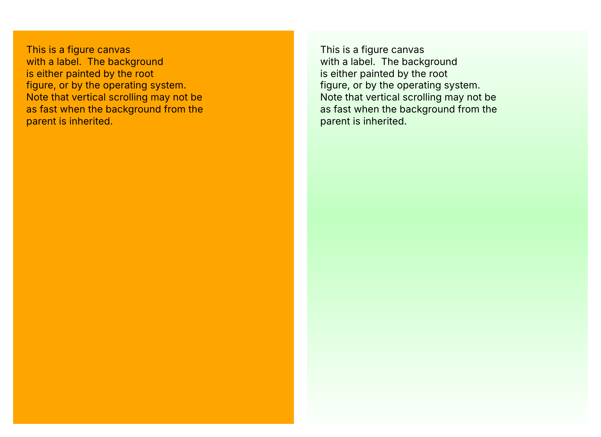
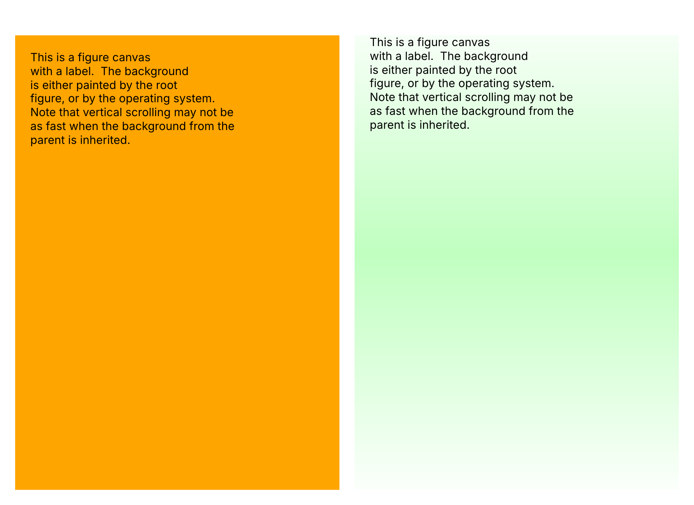
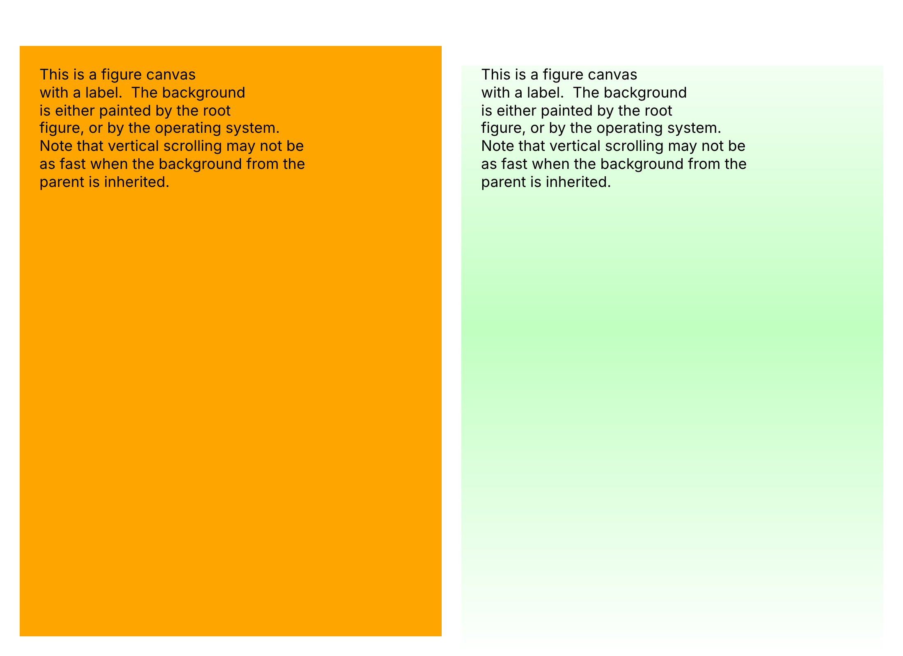
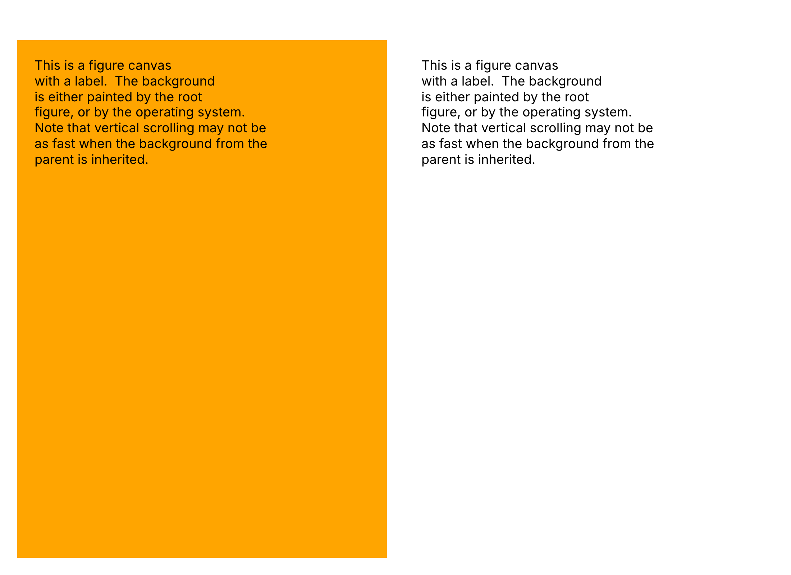

# 双 Canvas 背景继承验收

类型：`verification`

日期：2026-10-23

范围：K07-6、ADR-045，官方 InheritBackground 的 Canvas 行为。

## 宿主背景和 Canvas 内容分别拥有

独立二进制 [`inherit-background`](../../../examples/native/draw2d-official-examples/src/bin/inherit-background.rs)
在一个 winit Window 中拥有两个 Canvas、两个 Runtime 和两个 Vello 纹理消费者。
左侧 root 不透明并绘制橙色，右侧 root 透明，两侧显示同一段官方文字。
文字使用内置 Inter；SWT Group、Shell 和原生滚动条外观不属于本次对等范围。
滚轮通过 Core Viewport 滚动，窗口内 Canvas 的坐标和输入由平台 Canvas 桥接处理。

宿主注册 [`ParentGradient`](../../../examples/native/draw2d-official-examples/src/inherit_background.rs)，
通过公开 typed provider registry 录制白色、浅绿色、白色的纵向背景。
渐变中点为宿主 y=400，终点为 y=800，与官方输入一致。
每个 Runtime 分别取得 request 并受检接收候选；帧准备将背景与 Canvas 一起冻结。
Figure 树不绘制该渐变，provider 不在 Core 内执行。

## Native 像素反例通过

稳定入口为 `cargo xtask verify example.inherit-background`。
此次 macOS 实际 scale factor 为 2；同一 Native GPU 还验证了合成输入 2.5，
再恢复为 2。该切换是确定性宿主输入测试，不代表跨显示器系统事件验收。

| 操作 | 已验证结果 |
|---|---|
| 初始两侧 Canvas | 橙色遮住背景；透明区透出渐变；两侧文字均可见 |
| 只滚动右侧内容 | 文字位置改变，背景样本和冻结的宿主输入不变 |
| 移动右侧 Canvas | 背景按新宿主位置取样，position version 增加 |
| 只改宿主渐变 | Canvas 重绘，Viewport 内容原点不变 |
| backend session reset | 完整重建后图像逐字节一致 |
| Canvas 暂停后恢复 | 完整修复后图像逐字节一致 |
| DPI 2 → 2.5 → 2 | dpi version 增加，纹理重新分配；恢复后图像逐字节一致 |
| 移除背景 | 透明区旧像素擦除为明确白色，橙色侧保持不变 |

源契约和 CPU 回归另验证两个 Canvas 都发布 glyph 命令、双轴滚动改变 Canvas 命令，
背景帧输入保持不变。失败、迟到、Retry、资源 lease 和 capability 拒绝仍由
[K07-5](k07-5-host-background-evidence-2026-10-23.md)的契约与 GPU 反例覆盖。

已检查图 1 至图 4，并保留
[DPI 图像](../evidence/k07-background/dpi.png)、
[背景独立变化图像](../evidence/k07-background/background-only.png)和
[机器结果](../evidence/k07-background/result.txt)。
运行日志位于 `target/verification/k07-6-suite.log`。

## 支持范围

本次证明 macOS Native 双 Canvas 和 Vello 纹理路径；K07-5 证明 Core 的不支持后端
受检拒绝。Web 编译与公共 API 门禁不能替代 Web 背景像素验收。
Windows/Linux 原生 runner、Web 背景交互及跨显示器系统 DPI 验收仍未完成。

K07 的六个批准切片分别具备证据，Thumbnail 和 InheritBackground 不再阻塞。
全部 25 个官方入口中，16 complete、8 in_progress、1 blocked，24 个可运行；
其中 InheritBackground 使用独立宿主，通用面板仍有 23 个入口。
K06 动画、K08 AA/SVG 等其他批次保持原状态。
