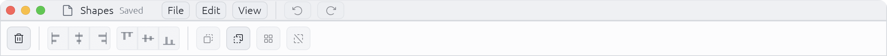
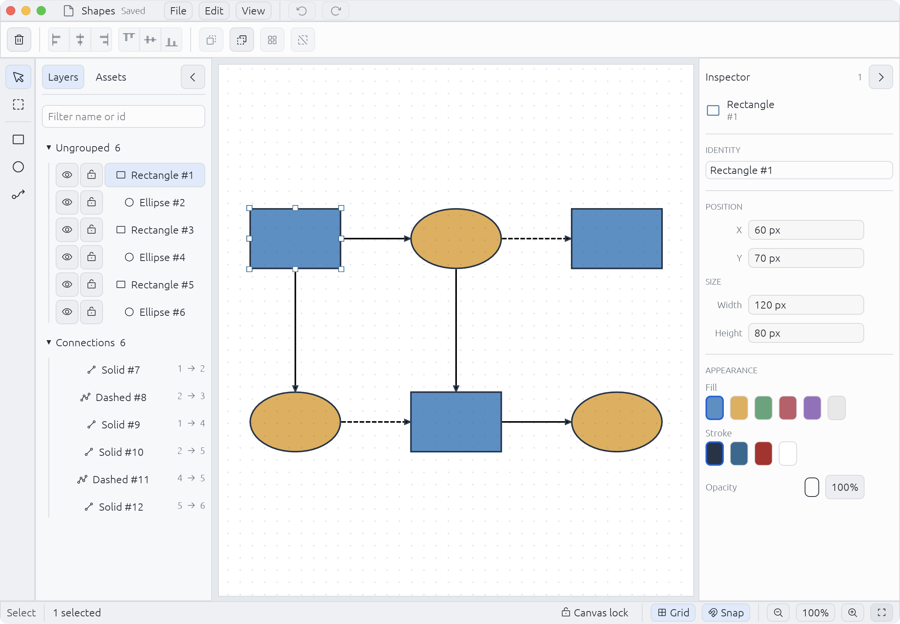
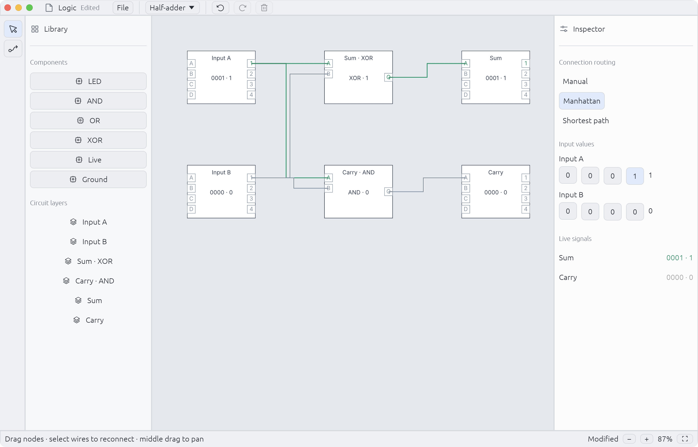

# GEF 样例工作台

类型：`implementation-guide`

归属：`novadraw-example-support` 和两个 Native 样例的应用壳层。
Core 与 Editor 继续提供现有绘制、输入和编辑契约。

Shapes 与 Logic 通过可选的 `egui-workbench` feature 共用
[`workbench`](src/workbench.rs)。该模块管理配色、字号、控件尺寸、面板、
文档标题和窗口配置；样例各自持有 UI 状态，编辑动作仍交给原有 Session。
后续样例可复用这些组件，无需给 Core 或 Editor 加入 GUI 依赖。

## 界面结构

参考 [Vectorcraft](https://github.com/storytold/vectorcraft/tree/main) 的
[浅色工作台](https://github.com/storytold/vectorcraft/blob/main/docs/images/shot-7-dimensions.png)
和 [主题定义](https://github.com/storytold/vectorcraft/blob/main/crates/ui-egui/src/theme.rs)，
采用文档区、工具列、中央画布、分组侧栏和状态栏。代码与图标资源沿用本项目的
egui、Phosphor 和 Vello 接入。

- macOS 使用系统窗口按钮，内容延伸到透明标题栏；预留按钮空间，标题栏空白处可拖动窗口。
  其他桌面平台保留系统窗口装饰。
- 文档区显示名称与保存状态；文件路径和保存、打开操作放进 File 菜单。
- Shapes 保留 Layers / Assets 与 Inspector，选择操作栏位于两侧面板上方。
  Inspector 内容独立滚动，小窗口也能访问描边与透明度。
- Logic 左侧放组件库和电路图层，右侧放路由、输入值与实时信号；
  首帧按实际画布尺寸适配半加器，预设切换继续适配新电路，状态栏提供 Fit。
- 浅灰背景区分窗口、侧栏和画布，蓝色标识选中与焦点，主要控件高 32 pt。
  macOS 菜单行高 28 pt，行内控件高 24 pt，与系统窗口按钮共用中心线；
  工具栏高 48 pt，所有按钮组高 32 pt，边框和内边距一并计入居中布局。
  状态栏使用 24 pt 控件，组内留 4 / 8 pt 间距，组间留 16 pt。
- Logic 的默认存档位于对应样例目录的 `logic.json`，File 菜单可修改路径。

## 运行与核验

在仓库根目录执行：

```sh
python3 tools/scripts/run_gef_macos.py
python3 tools/scripts/run_gef_macos.py --demo logic
cargo test -p gef-editor-demo -p gef-logic-demo --lib
```

2026-11-02 磁盘恢复后完成本次 UI 补验。为避开工作区中正在实施、尚缺模块的
Editor 吸附代码，使用提交 `d30570d2` 加本次样例 UI 改动的独立检出目录；
结果只覆盖这套 UI 改动，不代表当前工作区的其他改动已通过。

- Shapes 29 项测试、Logic 21 项测试通过；2 项原有手动成本测试保持忽略。
  Inspector 滚动和 Logic Fit 调整后分别重跑受影响包测试，通过。
- 两套 release 应用通过标准 bundle 脚本构建，并取得真实 macOS 窗口截图。
- 本次三个 UI 包的 Clippy（`--lib --no-deps -- -D warnings`）、格式和文档检查通过。
  包含依赖的严格 Clippy 被基线 Core 的三条既有 lint 阻断：
  `chunks_exact_to_as_chunks` 一条、`drain_collect` 两条。
- Shapes 核验了系统窗口按钮、标题栏拖动、File 菜单、默认与最小窗口尺寸、
  Fit、原生节点拖动、Undo / Redo 和 Inspector 滚动。拖动后坐标从
  `(60, 70)` 变为 `(92, 102)`，Undo 恢复原值，Redo 恢复拖动值。
- Logic 核验了默认与最小尺寸、Fit 和输入切换；Input A 最低位切换后，
  节点、导线和右侧 Sum 同步显示 `0001 · 1`，Carry 保持 `0`。
- 跨显示器 DPI、Windows / Linux、完整系统输入组合及性能采样未包含在本次视觉补验中。

2026-11-02 对齐修订：修复系统按钮与菜单的垂直偏移，以及工具栏内嵌按钮组的偏移。
新增两个几何回归测试，分别约束标题栏控件中心线和工具栏按钮／按钮组中心线。
本轮在当前工作区运行 Shapes 31 项、Logic 21 项测试，全部通过，另 2 项手动成本测试保持忽略；
三个 UI 包的 Clippy（不检查依赖）通过。两套应用重新构建并更新真实窗口截图，
Shapes 标题栏拖动、File 菜单和最小尺寸 Inspector 滚动再次通过原生输入核验。

### 真实窗口

修订后的菜单栏与工具栏：



Shapes，1180 × 820 pt：



Logic，1280 × 820 pt；图中 Input A 为 1，显示实时信号：



两套应用的最小尺寸均为 1000 × 640 pt：
[Shapes Inspector 滚动](screenshots/shapes-minimum-inspector.png)、
[Logic Fit](screenshots/logic-minimum-fit.png)。
