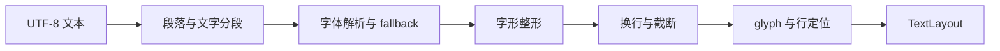

# 7. 文本排版与字形管线

> **本章解决的问题**：一段 Unicode 文本如何在字体资源、宽度约束和多语言规则下形成
> 稳定尺寸、字形位置、交互几何与绘制命令，同时不让布局和后端各自解释一次文本？

文字不是一串等宽字符。一个用户可见字符可能由多个 Unicode 标量组成，一个字形也可能
对应多个字符；字体替换、双向文本、连字和换行都会改变最终位置。若测量、绘制和命中
分别排版，同一段文字会得到互相冲突的宽度、像素和插入点。

核心结论是：

> 文本布局引擎在测量阶段生成不可变 `TextLayout`。布局、绘制和文本交互共享这一结果，
> 后端只把已经定位的 glyph 转成像素。

## 7.1 文本管线的输入和输出

`FontMetrics` 的下划线指标来自已解析字体实例，包含 size 与 normalized coordinates。
`FontDecorationMetrics` 保存 Canvas 向下为正的 baseline offset 和线宽；缺少字体数据时，
`underline()` 返回 `FontMetricsUnsupported`，不能用固定像素值冒充字体指标。默认引擎与
外部引擎共用这一受检值。单行文字可将范围的水平几何与 baseline、offset、thickness
组合绘制；混合字体的多段文字还需要逐段选择实际字体，本能力不替代该排版步骤。

一次排版至少需要四类输入：

- UTF-8 文本内容；
- 字体描述与已注册字体资源；
- 最大宽度等排版约束；
- 换行、截断和对齐策略。

输出不是一个宽高二元组，而是一组保持同一 revision 的结果：

```text
TextLayout
├── TextMetrics
├── line metrics
├── glyph runs
├── ink bounds
└── TextInteractionMap
```

`TextMetrics` 描述布局盒、完整行宽、基线和每行指标。glyph run 保存精确字体实例、
glyph ID、字号、变体坐标和已经计算好的位置。交互映射保存 UTF-8 offset、行、caret
和选区几何之间的对应关系。

这些结果必须来自同一次排版。不能用一个引擎测量，再让另一个后端重新选择字体和字形。

## 7.2 字体身份与字体选择

字体描述（`FontDescriptor`）表达 family、size、weight 和 style。它是排版请求，不是
GPU 字体句柄。`TextSystem` 保存显式注册的字体集合，并为每次字体内容变化分配新的资源
revision。

排版时，`TextLayoutEngine` 在当前字体集合中解析字体实例。解析结果通过
`FontFaceRef` 和 revision 绑定到具体资源：

```text
FontDescriptor
-> 已注册字体集合
-> 精确 face 与 variation
-> glyph runs
```

family 名称相同但 revision 不同的字体不能共享旧 glyph 结果。删除、替换或重新注册字体
后，依赖该字体的排版结果必须失效。

默认实现可以提供内置字体，但内置字体仍走注册、revision 和资源同步协议，不是绕过
资源系统的特殊路径。

## 7.3 从文本到 glyph run

排版管线按固定顺序处理文本：



字形整形（shaping）把字符序列、字体实例和书写方向转换为 glyph ID、advance、offset
和 cluster。换行随后根据宽度约束决定行边界，最终定位给出每个 glyph 的逻辑坐标。

字符数量不能用于推导 glyph 数量。连字可能把多个字符变成一个 glyph，组合字符可能与
前一个 glyph 共用视觉范围，字体 fallback 也可能在同一行形成多个 glyph run。

## 7.4 宽度约束让测量具有方向

普通图形常被误解为“给定内容即可得到唯一 preferred size”。可换行文本没有这样的
唯一尺寸：宽度约束改变行数，行数又改变高度。

当前 `TextConstraints` 表达可选最大宽度：

```text
UNBOUNDED
-> 求不换行或策略允许下的自然宽度

max_width = W
-> 在 W 内换行
-> 得到对应高度和基线
```

因此，给定宽度求高度与无约束测量是两次不同查询。布局器必须把宽度提示显式传入测量，
不能先取一次无约束宽高，再靠裁剪伪装成换行结果。

高度不是当前 `TextConstraints` 的独立输入。需要限制可见行数时，`TextFlowFigure`
通过截断策略重新排版并生成带省略标记的结果。

### 给定高度不能直接反求宽度

固定内容、字体和换行策略后，可以把排版高度看作宽度的函数 `H(W)`。允许更宽的行可能
减少行数，但高度变化发生在换行边界，通常呈阶梯状。多个宽度可能得到相同高度，因此
给定高度没有唯一的反向宽度。

如果应用需要“在高度预算内完整显示文字”，还必须规定可选宽度范围和选择规则，例如
寻找满足 `H(W) <= height_budget` 的最小候选宽度。这需要对候选宽度重新排版；不能把一次
测量得到的宽高交换，也不能假定所有替换引擎的高度函数都满足同一种单调性。

当前 Core 不提供按高度反求宽度的文本查询。父级布局应先确定可用宽度，再把宽度提示
传入文字测量。高度不足时，明确选择扩大布局、滚动、截断或裁剪；裁剪只减少可见像素，
不会减少实际排版行数。

因果顺序是：

```text
父级确定可用宽度
-> 按该宽度生成 TextLayout
-> 读取高度和基线
-> 父级安排最终 bounds
-> 宽度若再次改变，重新测量
```

## 7.5 MeasureContext 与 PaintContext 分工

`MeasureContext` 借用 Runtime 拥有的文字服务，用于字体指标、文本测量和布局：

```text
布局阶段
-> MeasureContext::layout_text
-> TextLayout
-> FigureMeasurement
```

`PaintContext` 只消费已经完成的 `TextLayout`：

```text
绘制阶段
-> PaintContext::fill_text / stroke_text
-> glyph 绘制命令
```

绘制阶段不接受原始字符串重新排版。这个边界保证布局看到的宽高、绘制使用的 glyph
位置和文本交互几何来自同一结果，也防止绘制热路径隐式修改文字缓存。

完整 `Graphics` facade 可以同时提供测量和绘制方法，但它仍遵循“先布局、后绘制”的
因果顺序。已有 `TextLayout` 不会因为 Graphics 当前字体改变而被重新解释。

## 7.6 文本坐标域

`TextLayout` 中的 glyph 位置位于文本布局坐标域，原点由排版结果定义。Figure 再根据
对齐方式把布局原点放入节点本地域：

```text
glyph layout position
-> 加上 Figure 内的文本 origin
-> 节点本地域
-> 沿 Figure 祖先变换链
-> 逻辑表面域
```

文字基线、ink bounds、caret 和 selection quad 都必须使用同一 origin。只给绘制加
偏移、却让命中继续读取未偏移几何，会产生“文字在这里，插入点在别处”的错误。

`TextFlowViewport` 可以给已完成的排版增加内容偏移。这个偏移同时进入绘制 origin 和
文本交互几何，所以滚动后 caret、selection 和命中仍然对齐。但裁剪只发生在绘制阶段：
`clipped` 视图在 paint 时把命令裁剪到 Figure bounds，命中、caret 和 selection 查询
不会因此被拒绝。需要限制交互范围时，必须由 Figure 显式提供相应的可命中区域，不能
假定 paint 裁剪自动改变了交互语义。

偏移不改变已经完成的 shaping，也不把滚动位置写回文本内容。

## 7.7 布局盒、墨迹范围与视觉边界

文本至少有三种不同范围：

| 范围 | 含义 | 主要消费者 |
|---|---|---|
| 布局盒 | advance、行高和换行形成的尺寸 | LayoutManager |
| ink bounds | glyph 实际可能覆盖的范围 | damage、诊断 |
| Figure visual bounds | 文本墨迹与其他装饰合并后的保守范围 | 重绘和裁剪 |

glyph 的墨迹可以伸出 advance box，例如斜体、重音和部分书写系统。布局不能用 ink
bounds 代替 advance，damage 也不能只使用布局盒而漏掉外伸墨迹。

## 7.8 TextFlow 的段落与交互映射

`TextFlowFigure` 以 `FlowPage`、`FlowParagraph` 和 `InlineTextFragment` 保存文本结构。
当前片段只承载文本内容；段落之间通过明确换行连接。排版后，Figure 保存
`FlowLayoutSnapshot`，其中包含：

- `TextLayout`；
- 段落到全局 UTF-8 offset 的映射；
- 对齐后的本地 origin；
- 内容、字体、引擎、bounds、换行和对齐组成的缓存键。

文本命中、caret、selection 和移动操作都读取同一 `TextInteractionMap`。位置使用
UTF-8 byte offset、affinity 和 layout revision，不能用 Rust `char` 序号或 glyph 序号
替代。

revision 可以拒绝迟到的文本位置。布局刷新后，旧 revision 的 caret 或 selection
不得静默解释到新排版。

### 结构化流：贡献协议

`TextFlowFigure` 以一棵结构化的 `FlowPage` 描述整段文本。Core 另外提供
`FlowPageFigure` 作为同一排版服务在 Figure 树上的入口：容器不直接持有完整字符串，
而是让每个子 Figure 通过 `FlowContributor` 提交贡献。

贡献身份是 typed 的 `ContributionKey<P>`，payload 实现 `FlowContributionPayload`。
标准库通过 `FlowContributionRegistry::standard()` 注册 `TEXT_CONTRIBUTION`、
`GROUP_CONTRIBUTION`、`BLOCK_CONTRIBUTION`、`BORDERED_BLOCK_CONTRIBUTION`、
`FIGURE_BOX_CONTRIBUTION` 和 `BORDER_CONTRIBUTION`；它使用的是与外部实现完全相同的
`register` 入口，没有内建快路径。key 的 `name` 只用于诊断，实际分派按 payload 类型
进行。外部 crate 可以注册新的贡献类型，并进入同一冻结、验证和排版流程。

贡献在冻结的 `PreparationScene` 上展开。`FlowAssembly` 收集文本、子组、块级样式、
片段边框和内联 Figure box；排版后得到 `FlowSnapshot`，其中包含：

- 按段落保存的 `StyledTextLayout` 与来源范围；
- 每个 `FlowFragment` 的 `source`、段落、行和局部 bounds；
- 供外部 Figure 使用的 `placements`；
- 整个流的内容尺寸和片段边框绘制数据。

文本位置由 `SourceTextPosition` 表达，同时携带来源 `FigureId`、byte offset、
affinity 和快照 revision。命中先落到实际片段而不是包围盒，再换算回来源 Figure 的
偏移；这样同一段落里的多个来源不会互相串位。

`FlowFragmentBorder` 让块级或内联片段拥有独立边框，边框绘制数据随快照一起发布。
文本样式由继承的 `FigureStyle` 解析为 `TextStyle`（字体与颜色），排版结果
`StyledTextLayout` 保留按样式切分的 glyph run 与内联 box 位置。绘制时
`fill_styled_text` 逐个 run 设置颜色并复用同一 `TextLayout` 坐标，不在绘制阶段
重新 shaping。

旧的 `TextFlowFigure` 与新的 `FlowPageFigure` 当前并存：前者接收完整 `FlowPage`
描述，后者从 Figure 子树收集贡献。二者共享同一 `FlowLayoutService::measure` 入口
与 `FlowSnapshot` 语义，因此测量、绘制和交互不会出现两套排版结果。

## 7.9 多语言文本的基本约束

多语言排版必须保持以下边界：

- UTF-8 byte offset 只能落在合法字符边界；
- 用户可见移动应按 grapheme、word、line 等语义执行，不能逐字节移动；
- 双向文本的视觉顺序与逻辑文本顺序不同，affinity 用于消除边界歧义；
- 字体 fallback 可能让一行包含多个精确字体实例；
- 字体实例、glyph ID 和 variation 坐标必须一起解释。

Core 不要求 Figure 自己实现 Unicode 分段或双向算法。`TextLayoutEngine` 负责这些排版
语义，并返回受检结果；Figure 负责保存内容、约束和结果的所有权。

## 7.10 字形轮廓与后端执行

默认后端可以直接消费 glyph run 和字体资源，由后端内部完成 glyph 缓存与栅格化。
需要后端中立曲线时，`GlyphOutlineProvider` 根据精确字体实例和 glyph ID 提取轮廓：

```text
TextLayout
-> positioned glyph
-> GlyphOutlineProvider
-> font-local curve
-> glyph-to-layout transform
-> 后端专有预处理
```

轮廓提供者不能重新选择字体、执行 fallback 或改变 advance。分网格、GPU buffer 和
片段着色器格式属于具体后端，不进入 `TextLayout`，也不改变布局结果。

默认 glyph 路径和自定义轮廓路径不能同时执行同一个 glyph。选择哪条路径由运行时安装的
`TextLayoutEngine` 决定：默认 Runtime 使用原生 glyph 路径；需要轮廓时，用
`OutlineTextEngine` 包装原引擎并安装 `GlyphOutlineProvider`。它保持 shaping 不变，
只把选定 glyph 的轮廓附加到排版结果上。换 provider 会产生新的引擎 revision，使依赖
旧轮廓的缓存失效。这个选择不进入单个 Figure，也不是后端凭能力自行切换。

## 7.11 缓存键与失效

文本缓存只有在输入语义完全相同时才能复用。典型缓存键包括：

- 文本或 `FlowPage` revision；
- 已解析 `FontDescriptor` 与字体资源 revision；
- `TextLayoutEngine` revision；
- 宽度约束或最终 bounds；
- 换行、截断和对齐策略。

变化后的影响不同：

| 变化 | 必需动作 |
|---|---|
| 文本、字体、字号、字重 | 重新排版、重新测量并重绘 |
| 最大宽度或 Figure 宽度 | 重新换行、重新测量并重绘 |
| 对齐 | 对齐进入 `FlowLayoutKey`，按新键重新排版并重绘 |
| 前景色 | 保留排版，重绘 |
| 字体资源 revision | 重新解析字体并排版 |

缓存缺失只影响性能。缓存命中必须与重新排版得到语义等价结果。

## 7.12 与直接文本编辑的边界

Core 的 `TextLayout` 和 `TextFlowFigure` 提供不可变排版事实与交互几何。编辑草稿、
caret、selection 和 IME composition 属于 Editor 会话：

```text
平台文本事件
-> Editor 草稿与 composition
-> 使用 TextInteractionMap 定位
-> Feedback 绘制 caret、选区和 preedit
-> 用户确认
-> Command 修改业务模型
-> Viewer 同步新的 TextFlow 内容
```

预编辑期间不能把草稿逐键写入业务模型，也不能把 caret 和 selection 保存进
`TextFlowFigure`。取消编辑只清理 Editor 草稿和反馈，不回滚 Core 场景事务。

## 7.13 失败语义

文本失败按阶段分类：

- 字体描述或字体 bytes 非法：资源或字体解析错误；
- 排版值、约束或 glyph 数据非法：`TextError`；
- outline 缺失、字体 revision 不匹配：`FontError`；
- caret、selection 或 position revision 失效：`TextInteractionError`；
- 后端不支持所需 glyph 能力：提交准备失败。

失败的候选布局不能进入成功缓存，也不能覆盖旧稳定布局后再返回错误。若当前内容没有
可用布局，Figure 应明确处于不可用状态，而不是伪造零尺寸成功。

## 7.14 必须保持的不变量

1. 测量、绘制和文本交互消费同一 `TextLayout`；
2. 绘制阶段不重新 shaping；
3. glyph ID 只在对应字体实例和 revision 中解释；
4. 宽度约束变化会使换行和高度失效；
5. 布局盒、ink bounds 和视觉边界不互相替代；
6. UTF-8 offset、affinity 和 layout revision 共同约束文本位置；
7. 字体替换不复用旧 revision 的 glyph 结果；
8. 后端预处理不反向修改排版位置。

## 7.15 常见错误设计

### 用字符数乘平均字宽

连字、fallback、组合字符和比例字体都会使结果错误。

### 测量和绘制分别排版

两次字体解析或换行可能不同，Figure bounds 与像素不再一致。

### 用布局盒裁剪所有 glyph 墨迹

斜体或重音可能伸出 advance box，边缘像素被错误裁掉。

### 把 glyph run 当成文本编辑模型

glyph 顺序是视觉执行结果，不能替代逻辑文本、段落和 UTF-8 offset。

### 字体变化只请求重绘

字体指标和换行可能变化，必须重新测量和稳定布局。

### 后端重新选择字体

后端得到的 glyph ID 只属于排版时选定的字体实例，重新 fallback 会破坏身份。

## 7.16 与前后章节的关系

第 6 章定义测量、约束和稳定化。本章把文字作为一种受约束派生状态，说明它如何形成
尺寸、基线、glyph 和交互几何。下一章使用已完成的文字结果录制绘制命令，并把字体资源
纳入渲染提交包。

第 10 章解释平台文本输入为何独立于键盘事件，第 13 章再说明直接编辑如何把临时草稿
提交为业务命令。

## 7.17 思考题

1. 为什么可换行文本没有唯一的无条件 preferred size？
2. 为什么 `PaintContext` 不应接收原始字符串重新排版？
3. 布局盒、ink bounds 和 Figure visual bounds 分别服务什么问题？
4. 字体资源 revision 改变后，哪些缓存必须失效？
5. UTF-8 offset、grapheme 和 glyph ID 为什么不能互相替代？
6. 为什么 glyph outline provider 不能执行字体 fallback？
7. 直接文本编辑的草稿和 selection 为什么属于 Editor 会话？
8. 为什么给定高度不能唯一反求宽度，裁剪又为什么不能代替重新换行？
