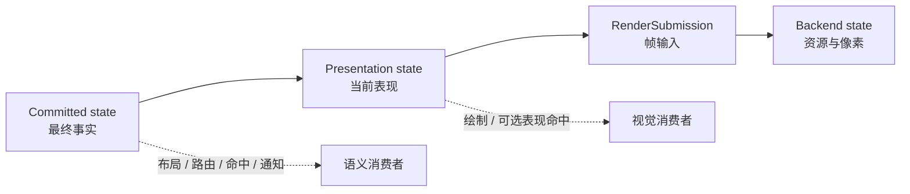
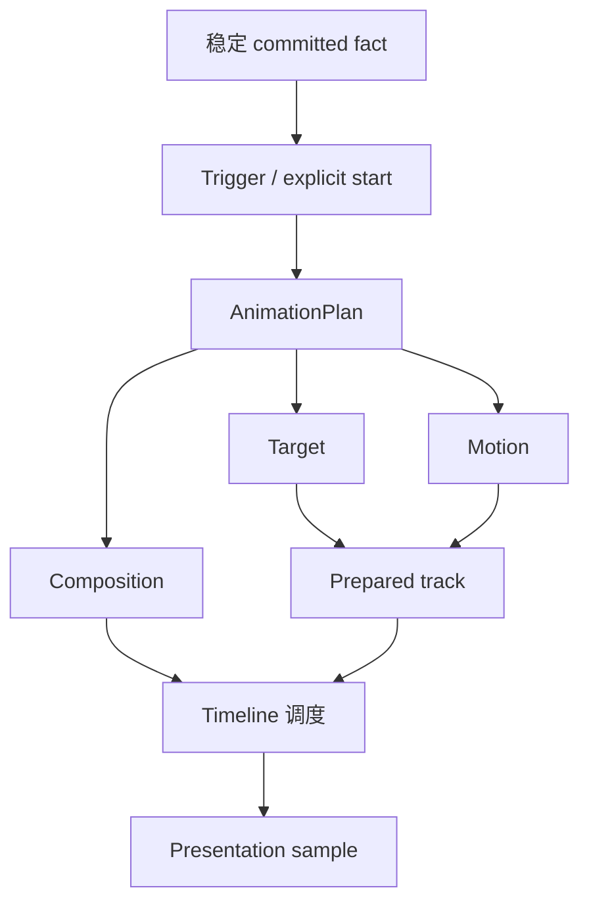
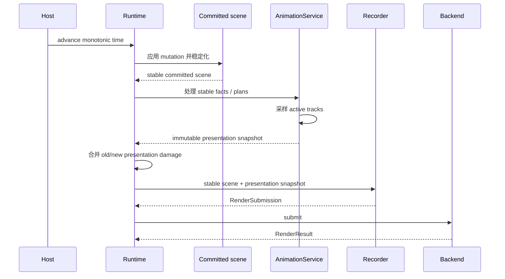

# 8. 动画与表现平面

> **本章解决的问题**：如何让属性、布局、连接和视口产生连续视觉过渡，同时保证模型、
> Figure、布局、命中、通知和撤销仍然只认同一份最终事实？

动画最容易破坏一致性的地方，不是插值公式，而是状态归属。若每一帧都修改 Figure
bounds、连接路径或业务属性，布局、通知、命中、撤销和重放都会把视觉中间值误认为
新的事实。

核心结论是：

> 权威状态立即提交最终结果；动画只在 Runtime 拥有的 Presentation Plane 中生成可丢弃
> 的表现值。

## 8.1 为什么逐帧修改源状态是错误模型

考虑把节点从 A 移到 B，并播放 300 毫秒动画。若每一帧都调用一次 `set_bounds`：

- 布局器会把中间位置当作新输入；
- 连接路由可能每帧重新计算；
- 属性观察者收到大量不代表业务操作的通知；
- CommandStack 无法判断一次移动对应多少次修改；
- 取消动画时必须猜测应该恢复哪个值；
- 不同刷新率会产生不同状态序列。

动画真正需要的是“最终事实已经是 B，但当前画面暂时显示在 A 与 B 之间”。这要求把
状态分成不同平面，而不是让一个字段承担两种时间语义。

## 8.2 三个状态平面

Novadraw 区分三层状态：



### Committed state

这是唯一权威：

- Figure topology、bounds、style 和 content；
- layout 与 route 的最终结果；
- Viewport 的逻辑 origin 和 scale；
- model、selection 与 command history；
- accessibility role、state 和 action。

源事务必须先完成验证和派生状态收敛。动画不能延迟业务提交。

### Presentation state

这是 Runtime-owned、可丢弃的派生层：

- 当前 opacity、transform、paint；
- layout bounds 或 route 的当前表现 geometry；
- temporary visual；
- endpoint decoration override；
- sampled visual envelope。

它不产生 FigureMoved、业务属性通知、route notification 或 undo entry。清除该层后，
画面直接显示已经存在的 committed final state。

### Backend state

后端只消费 RenderSubmission，并管理 GPU 或软件资源。后端可以优化表现值的降低方式，
但不能定义动画时间、取消语义或最终状态。

## 8.3 正交模型

动画由四个相互独立的问题组成：

| 维度 | 回答 | 不负责 |
|---|---|---|
| Target | 哪个 subject 的哪个表现 channel 变化 | 时间曲线 |
| Motion | 给定时间如何采样值 | 查找 Figure、提交帧 |
| Trigger | 何时创建或 retarget plan | 插值与组合 |
| Composition | Track 如何并行、顺序、错峰或重复 | 修改源状态 |



显式调用直接创建 Plan，不需要构造一个虚假的 ExplicitTrigger。Trigger 属于可选的
AnimationBehavior，用于观察稳定 fact 后创建 Plan。两条入口最终进入同一 admission、
channel ownership 和采样管线。

## 8.4 Target 与 Presentation Channel

Target 由 subject identity 和 typed channel identity 组成。常见 channel 包括：

- opacity、local transform、Color 或 Paint；
- layout result 的 child presentation bounds；
- Connection route presentation；
- Viewport pan、zoom 和 fit transform；
- dash phase 和 route visual progress；
- temporary visual 的完整 FigurePresentation；
- 外部 Figure 声明的 typed presentation binding。

Channel 不是覆盖所有 Figure 私有状态的中心枚举。Core 提供通用 channel；Connection、
Viewport 和外部 Figure 可以通过 typed descriptor 增加领域 channel。

同一 subject/channel 同时只有一个 owner，除非该 channel 明确声明可组合代数。

## 8.5 Motion 只负责采样

Motion 把时间映射为值：

- Tween：start/end 与 easing；
- Keyframes：有序 key time/value；
- Spring/Decay：具有终止预算的 simulation；
- Procedural：接受显式时间的纯采样器。

Motion 不能：

- 读取墙钟；
- 查询或修改 Runtime；
- 请求重绘；
- 修改 Figure 或模型；
- 决定 channel 冲突；
- 返回后端专有类型。

同一绝对时间必须产生确定结果。掉帧后直接采样新的单调时间，而不是循环补做每个中间
刷新步。

## 8.6 Composition 与 Timeline

Composition 组织 Track 时间：

```text
Parallel
Sequence
Stagger
Delay
Repeat / Reverse
```

Sequence 和 Stagger 使用稳定 child 顺序。有限动画必须能证明结束时间；Spring 和
Decay 需要 settle tolerance 与最大时长；无限 Procedural 只能位于允许 continuous 的
根组合中，不能阻塞 Sequence 的后续节点。

Pause 是 active timeline 的运行状态，不是与 Delay 重复的 composition node。

## 8.7 Runtime 拥有时间与服务

Runtime 独占 AnimationService：

```text
Runtime
├── FigureTree / UpdateManager
├── Layout / Connection / Input services
└── AnimationService
    ├── mode
    ├── active timelines
    ├── presentation overrides
    ├── temporary visuals
    └── next wakeup
```

Host 只通过统一单调时间入口驱动 Runtime。动画不创建第二个 run loop、线程、全局 clock
或 Figure 私有 timer。

active set 为空时：

- 不扫描 FigureTree；
- 不请求持续 wakeup；
- 不产生 animation damage；
- 不提交空帧。

因此，没有使用动画的应用不承担持续帧成本。

## 8.8 一帧中的因果顺序



Committed state 的通知只依赖源事务已经稳定，不依赖动画是否完成，也不依赖当前帧是否
Presented。后端失败不能回滚源状态；动画失败也只能清除表现覆盖并显示最终事实。

## 8.9 Stable Fact 与 AnimationBehavior

Core 默认不为普通 mutation 安装隐式动画。普通属性变化仍直接显示最终静态结果。

应用可以安装 AnimationBehavior：

```text
Behavior {
    scope,
    trigger,
    plan_factory,
    reduced_motion_fallback,
}
```

Behavior 在 source transaction 稳定后消费合并后的 committed fact。factory 读取同一
stable epoch 的只读事实与 StableSceneQuery，返回 Plan 或不采取动作。

Behavior 不能作为普通 listener 回调重入 Runtime，也不能在 Motion 采样阶段重新解释
Trigger。Trigger 只决定“何时建计划”，不决定“如何插值”。

## 8.10 Before/After Capture

属性 Tween 可以显式提供 start/end value。布局、路由、换父和生命周期过渡则需要真正
的旧几何，不能在 mutation 后从新状态反推。

```text
capture selected stable presentation
-> 提交 source mutation
-> 收敛新的 committed scene
-> 比较 before / after
-> admission
-> 建立 presentation transition
```

capture 是 Runtime-scoped、one-shot 的拥有值。它不锁住 FigureTree，也不承诺 source
rollback。

若 transition admission 失败：

- source mutation 保持已提交；
- 不创建半个 timeline；
- 不留下 channel owner、override 或 wakeup；
- 画面直接显示 committed final state。

## 8.11 Damage 与视觉包络

每次采样必须同时给出 old/new visual envelope：

```text
damage =
    union(old_presentation_envelope,
          new_presentation_envelope)
```

包络需要覆盖：

- stroke 与 shadow outset；
- transform 后的保守范围；
- Connection decoration；
- temporary visual 的创建、移动和删除；
- cancel 后当前表现与 committed final visual 的差异。

只有值而没有包络的 presentation effect 不能进入可见管线。后端可以优化实际绘制，但
不能缩小 Core 无法证明安全的 damage。

## 8.12 Channel 冲突与 Retarget

同一 channel 出现新计划时，可以选择：

- Replace：从当前 presentation value 原子 retarget；
- Queue：等待当前 owner 结束；
- Ignore：保留现有 owner；
- Additive：仅当 channel 声明组合代数时使用。

交互状态通常使用 Replace。Retarget 必须先完整预检 replacement，再采样当前表现并
转移 owner。若预检失败，旧计划原样继续，不能短暂闪到 committed final state。

## 8.13 Cancel 不回滚事实

取消动画的默认语义是：

1. 移除 track、temporary visual 和 wakeup；
2. 清除 presentation override；
3. 显示已经存在的 committed final state；
4. damage 覆盖当前表现与最终视觉范围。

“停在当前值”会让没有 owner 的表现状态永久残留，因此不能作为普通 cancel mode。
若要从当前值继续，必须 retarget；若要回到历史起点，必须创建以历史值为目标的新
source operation 或新 Plan，而不是回滚 committed state。

## 8.14 Disabled、Enabled 与 ReducedMotion

| 模式 | 行为 |
|---|---|
| Disabled | 不创建或保留 timeline，直接显示 committed final state |
| Enabled | 执行显式 Plan 与已安装 Behavior |
| ReducedMotion | 使用声明过的短时、离散或静态 fallback |

全局 Disabled 高于局部请求。切换到 Disabled 时，Runtime 原子终止 active plan、清理
override/temporary visual、重算 damage 和 wakeup。

切回 Enabled 不自动复活已终止计划。模式切换只有在像素实际变化时才请求帧。

## 8.15 Suspension 与不可见状态

Surface suspended 或 target effectively hidden 时，每个计划需要明确策略：

- Advance：逻辑时间继续，恢复时采样当前绝对时间；
- Pause：恢复后平移 local time；
- Finish：清除 override，直接显示 committed final state。

持续 Connection 效果通常使用 Pause；短时业务 transition 通常使用 Advance。不能由
每个 Figure 私自实现另一套隐藏计时规则。

## 8.16 交互与 Accessibility

可见 Track 必须声明交互几何：

- Committed：命中使用最终几何；
- Presentation：命中使用当前采样几何；
- NonInteractive：temporary visual 不参与输入。

表现几何参与命中时，绘制和命中必须消费同一 sampled presentation snapshot。否则会
出现“看得见但点不到”或目标随下一帧跳变。

Accessibility 的 role、state 和 action 始终来自 committed scene。Temporary visual
默认不进入 accessibility tree；presentation bounds 是否更新必须由平台合同显式决定。

## 8.17 领域能力如何接入

### 属性过渡

Committed property 立即变成最终值；Track 只覆盖 opacity、transform、Color 等表现
channel。未安装 Behavior 时保持静态行为。

### Layout result transition

LayoutManager 只计算一次 final bounds。动画在 before/after stable snapshot 之间插值
presentation bounds，不每帧重新布局。

### Connection route transition

Router 只计算 final route。兼容 topology 可以插值；不兼容 topology 使用 old temporary
route 与 new route 的 opacity crossfade，不伪造通用 path morph。

### Viewport transition

Committed origin/scale 先到最终值，presentation transform 再过渡。直接用户输入默认
抢占自动 pan/zoom；auto-expose 仍是输入控制器，不伪装成固定 Tween。

### 持续效果

Dash flow、moving pulse 等使用 Procedural track，共享 Runtime clock。它们不修改 route、
通知、history 或 hit-test，并受 active-track 与 temporary-visual 预算约束。

## 8.18 失败语义

Animation admission 在修改任何表现所有权前验证：

- 单调时间；
- duration、key time、value 和 simulation 参数；
- target namespace 与 generation；
- channel capability 与冲突策略；
- interaction geometry；
- visual envelope；
- active track 和 temporary visual 预算。

失败边界：

- admission 失败不创建 ID、owner、override、wakeup 或 damage；
- retarget 失败保留旧计划；
- sample/provider error 终止当前计划并显示 committed final state；
- provider panic 沿 Runtime fault boundary 处理；
- target dispose 同一事务清理 track、temporary visual 和 wakeup；
- backend 不支持时在提交前拒绝或使用已声明 fallback。

动画失败从不回滚已经提交的模型、布局或路由。

## 8.19 复杂度与确定性

动画热路径应按 active animation 数量增长，而不是按 FigureTree 大小增长：

```text
advance/sample = O(active tracks)
presentation lookup = O(animated subjects/channels)
damage merge = O(sampled visual effects)
```

所有随机数、时钟和平台尺寸必须作为显式输入。Headless 用固定 MonotonicTime 重放时，
相同计划、相同输入和相同时间点必须产生语义等价的 presentation snapshot。

性能降级不能改变最终 committed state。预算耗尽只拒绝新计划，不能驱逐无关 active
plan 或静默修改组合语义。

## 8.20 必须保持的不变量

1. Committed state 是模型、布局、路由、通知和历史的唯一事实；
2. Presentation state 由 Runtime 拥有且可随时丢弃；
3. 动画采样不产生 source mutation 或 derived-state work；
4. 所有时间来自同一 Runtime 单调时间入口；
5. 每个可见 sample 都提供保守 old/new envelope；
6. 同一 subject/channel 的 owner 唯一；
7. Cancel 清除表现覆盖并显示 committed final state；
8. Retarget 失败时旧计划原样继续；
9. 交互几何策略必须显式；
10. 无 active animation 时不持续扫描、唤醒或提交。

## 8.21 常见错误设计

### 每帧修改 Figure bounds

中间值污染布局、连接、通知和撤销历史。

### 每个 Figure 创建 timer

多个时钟无法统一暂停、重放、取消和资源清理。

### Backend 自行推进动画

Core 无法统一 damage、Headless 结果、ReducedMotion 和取消语义。

### Cancel 保留当前 override

Timeline 已结束但表现状态仍存在，形成没有 owner 的第二权威。

### Layout 动画每帧重新运行 LayoutManager

动画帧率改变布局计算次数，源状态和最终结果不再确定。

### 用字符串 property path 找目标

值类型、命名空间和外部扩展边界只能在运行时猜测。

### Temporary visual 默认可命中

预览对象意外成为输入和 accessibility 目标。

## 8.22 与前后章节的关系

第 7 章定义稳定场景、damage、RenderSubmission 和 backend completion。本章在不改变
committed scene 的前提下，为帧录制增加只读 presentation snapshot。

下一章从平台输入进入场景。输入命中默认读取 committed geometry；只有 Track 明确选择
Presentation 策略时，命中才读取与当前帧一致的表现几何。第 10 章的 Viewport 和
Connection 则是 Presentation Plane 的典型领域消费者。

## 8.23 思考题

1. 为什么布局动画不能每帧调用 LayoutManager？
2. Source 已经是最终值时，取消动画为什么不需要回滚？
3. Retarget 为什么必须在替换 owner 前完成预检？
4. Viewport 使用 Presentation 命中时，输入系统必须共享什么快照？
5. 不兼容 Connection route 为什么应 crossfade，而不是强行逐点插值？
6. Disabled 模式为什么仍需要清理旧 override 和 damage？
7. active set 为空时，如何证明动画服务没有持续成本？
