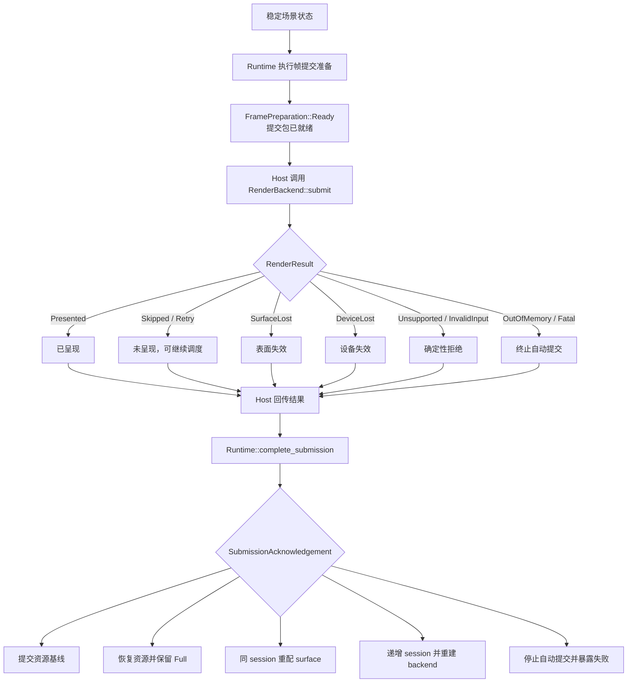

# 8. Damage、绘制与帧提交

> **本章解决的问题**：场景变化后，如何既清除旧像素、生成新内容，又正确管理跨 CPU、
> GPU 和窗口系统的帧生命周期？

绘制正确不等于调用了正确的 path API。节点移动以后，旧位置必须被修复；资源必须属于
当前渲染会话；后端异步完成也不能反向篡改场景。

核心结论是：

> 稳定场景状态只证明“可以生成这一帧”，后端完成反馈才证明“这一帧的提交生命周期
> 结束”。

## 8.1 Dirty 与 damage

**Dirty** 描述引擎内部哪些事实需要重新计算，例如布局失效、文字排版失效或连接待
路由。

**Damage** 描述逻辑表面上哪些区域的像素可能不再正确。

两者不等价：

- 文本内容变化可能同时产生测量 dirty 和视觉 damage；
- 一个不可见子树可以 dirty，但暂时没有 surface damage；
- 遮挡关系变化可能没有节点几何 dirty，却需要重绘重叠区域。

dirty 驱动稳定化，damage 驱动呈现修复。

## 8.2 旧新视觉范围

节点从 A 移到 B 时，正确 damage 是：

```text
damage = old_surface_visual_bounds
       union new_surface_visual_bounds
```

旧范围用于清除残留像素，新范围用于绘制新内容。visual bounds 必须包含边框、阴影、
装饰和可能溢出的子内容。

如果祖先滚动、缩放或裁剪变化，旧新祖先变换链也不同。Runtime 必须在覆盖状态前保留
旧变换摘要。

## 8.3 Damage 的保守原则

damage 是正确性边界，允许多报，不允许漏报：

```text
所有可能变化的像素 ⊆ damage
```

区域合并可以降低提交数量，但不能通过过度细碎的几何优化冒险漏像素。复杂滤镜或无法
精确界定的效果，应提升到可证明的祖先范围，必要时使用整表面 damage。

全量 damage 是合法降级策略，但不能掩盖场景状态不一致。

## 8.4 场景状态稳定前不能录制

绘制命令必须读取同一稳定 epoch。若布局只更新了一半，录制结果可能同时包含旧连接和
新节点位置。

帧准备顺序是：

```text
接受 mutation
-> 收敛布局和派生状态
-> 冻结本次稳定场景状态的只读视图
-> 汇总 damage
-> 录制绘制命令
-> 生成 RenderSubmission，提交包已就绪
```

“冻结”不一定复制整棵树，但必须保证录制期间结构和相关状态不会被重入修改。

## 8.5 递归绘制

Renderer 按 Figure 树递归执行：

1. 检查可见性和 damage 相交；
2. 保存 Graphics 状态；
3. 应用节点变换；
4. 应用节点裁剪；
5. 绘制节点背景、边框和自身内容；
6. 切换到子内容域；
7. 按 children 顺序绘制；
8. 绘制节点前景或装饰；
9. 恢复 Graphics 状态。

具体阶段可按协议调整，但遍历、状态恢复和 Z-order 必须由统一 Renderer 管理。

## 8.6 Graphics 是命令录制接口

Graphics 提供后端中立的绘制语义：

- 保存与恢复状态；
- 变换和裁剪；
- 填充与描边；
- 图像和文字；
- 透明度与合成；
- 字体指标和测量所需的统一入口。

Figure 调用 Graphics 录制命令，不直接访问 GPU 对象。这样 Figure 行为可以在不同后端
复用，命令也可以被测试、诊断或离线检查。

Graphics 不是场景查询接口。绘制回调不应通过它修改 Figure 树。

### 录制完成不等于提交包就绪

独立调用者可以通过命令录制器（`CommandRecorder`）和绘制上下文（`PaintContext`）
生成 `RecordedDrawing`。它只表示一段已经通过绘制语法校验的命令记录，不携带 surface、
backend session 或 frame identity，也不等于可以交给后端的帧。

图形对象、形状和边框使用同一套 `PaintContext` 语言。绘制回调返回结构化
`GraphicsError`；Renderer 可以恢复内部状态栈，但只要任一回调失败，本次就不能生成
提交包。

只有 Runtime 能把录制结果提升为 `RenderSubmission`。提交包就绪前，它还必须：

- 确认派生状态已经稳定；
- 冻结重绘区域和资源同步；
- 校验 backend capability 和设备输入；
- 分配 session/frame identity；
- 建立 in-flight 状态。

因此，公开录制器负责“命令是否有效”，Runtime 负责生成带 session/frame 身份并纳入
in-flight 管理的正式提交包。把两个边界合并，会允许 Figure 或应用绕过稳定化、资源
基线和完成确认。

## 8.7 状态栈

每个节点进入时保存状态，退出时恢复。否则一个 child 的 transform、clip 或 opacity
会泄漏到 sibling。

状态栈必须满足：

- push/pop 平衡；
- 失败路径也能恢复；
- clip 只会进一步约束当前范围；
- 当前变换与坐标服务约定一致；
- 命令录制结束时回到初始深度。

不平衡应在提交前被诊断为录制错误，而不是交给后端猜测。

## 8.8 RenderSubmission

一次提交携带后端完成当前帧所需的全部拥有数据：

```text
RenderSubmission {
    session_id,
    frame_id,
    surface,
    damage,
    commands,
    resources,
}
```

- `session_id` 区分 backend 重建前后的资源宇宙；
- `frame_id` 在 session 内单调标识提交；
- `surface` 描述本次提交使用的逻辑和物理表面信息；
- `damage` 指示需要修复的表面区域；
- `commands` 是后端中立绘制记录；
- `resources` 是当前 session 的完整快照或相对已确认基线的增量。

`stable_epoch` 属于 Runtime 内部因果边界：Runtime 只允许从一个稳定 epoch 生成上述
提交，但后端不需要据此查询场景。后端只消费提交，不获得 Runtime 所有权。

## 8.9 Session 与 Frame

设备丢失、后端切换或其他需要重建 backend resource universe 的故障会开启新 session。
单纯的 surface lost 通常只要求在同一 backend session 中重新配置表面，不应自动递增
session。旧 session 的迟到完成不能被当成新 session 当前帧的结果。

```text
(session 4, frame 120) != (session 5, frame 120)
```

frame identity 也用于：

- 对齐资源使用期；
- 忽略重复完成；
- 记录丢帧和重试；
- 关联截图与诊断证据。

身份必须由 Runtime 或呈现协调器分配，不能由后端自行推测。

## 8.10 资源增量

字体、图像和 glyph 轮廓等资源可能跨帧复用。资源管理需要区分：

- 场景引用仍存在；
- 某帧命令仍引用资源；
- GPU 是否完成该帧；
- 新 session 是否需要重新上传。

Figure 销毁不意味着 GPU 资源可以立即释放。资源生命周期通常要等待所有引用帧完成。
反过来，后端缓存也不能成为文字或图像语义的权威来源。

### 资源来源不属于场景运行时

文件路径、URL、同步文件 I/O 和 Web fetch 属于不同平台语义。Runtime 不保存统一
ResourceProvider，也不主动读取文件或轮询异步任务。

资源进入场景的规范顺序是：

```text
应用选择 Native/Web provider
-> provider 取得 bytes
-> Core 纯解码
-> Runtime 完成资源请求
-> 依赖该资源的图形对象失效
```

每次异步加载都绑定资源请求令牌（`ResourceRequestToken`）。同一资源开始新请求后，
旧令牌的迟到完成必须返回 stale，且不能改变资源状态、revision、待提交资源增量或依赖
图形对象的失效状态。

同步资源修改同样会使活动令牌失效。令牌保护的是 Runtime 内的发布顺序，不承诺取消
平台 I/O。provider 读取错误、字节解码错误和 Runtime 资源 mutation 错误也属于不同
失败域，不能压缩成一个字符串。

### 图像的三组尺寸

图像至少包含三组不能混用的几何：

- **物理像素尺寸**：解码后像素缓冲区的宽高；
- **逻辑尺寸**：Figure 在逻辑坐标中采用的自然尺寸，通常由像素尺寸和资源 scale 得到；
- **源矩形**（`ImageRegion`）：在源图像像素域中选择参与绘制的区域。

绘制时还要提供目标逻辑矩形。完整关系是：

```text
源图像像素
-> ImageRegion 选择源像素矩形
-> 按资源 scale 得到逻辑尺寸
-> 映射到 Figure 的目标逻辑矩形
-> 经 Figure 坐标链到逻辑表面域
```

源矩形使用像素坐标，目标矩形使用逻辑坐标。把二者都解释成逻辑单位，会在高 DPI 或
spritesheet 场景中重复缩放。若没有显式源矩形，默认选择完整像素范围；若没有显式目标
尺寸，Figure 才可以采用图像的逻辑自然尺寸。

### 替换图像的失效级别

资源内容和布局尺寸是两个不同事实。图像 revision 变化时，Runtime 先比较新旧逻辑
尺寸和绘制内容：

| 变化 | 必需动作 |
|---|---|
| bytes 改变，逻辑尺寸不变 | 资源 revision 更新并重绘 |
| 像素尺寸或 scale 使逻辑尺寸改变 | 重新测量、布局并重绘 |
| `ImageRegion` 改变但目标尺寸固定 | 重绘，并重算可能的采样边界 |
| 目标逻辑矩形改变 | 更新 Figure 几何和旧新 damage |

后端纹理缓存只能按资源身份与 revision 加速上传，不能决定 Figure 的自然尺寸。旧 revision
仍被 in-flight frame 引用时，也不能因为新图像已经发布就立即释放。

### 异步加载状态与错误分域

异步图像 Figure 应显式表达当前内容状态，例如未请求、加载中、已就绪或失败。占位内容
是 Figure 或应用策略，不是 Runtime 隐式伪造的成功图像。状态变化按时间顺序发生：

```text
创建 ResourceRequestToken
-> Figure 进入加载中并绘制明确占位
-> provider 返回拥有的 bytes 或平台错误
-> Core 解码为图像资源或返回解码错误
-> Runtime 仅接受当前 token
-> 发布新 resource revision
-> 按尺寸差异触发布局或重绘
```

新请求开始后，旧 token 的成功或失败结果都只能被判为 stale，不能覆盖当前状态。

错误也不能混为一类：

- provider 错误说明文件、网络或平台读取失败；
- decode 错误说明 bytes 不是受支持的有效图像；
- Runtime mutation 错误说明身份、token 或事务状态不合法；
- RenderBackend 错误说明已解码资源在上传或提交时失败。

解码错误发生在图像进入场景之前，渲染错误发生在有效资源进入提交之后。前者可以保留
失败占位并等待新请求，后者必须走本章的提交恢复协议。

## 8.11 提交状态机



`RenderResult` 把正常处置与运行失败分开：

```text
RenderDisposition = Presented | Skipped | Retry

RenderFailure =
    Unsupported | InvalidInput
  | SurfaceLost | DeviceLost
  | OutOfMemory | Fatal
```

Backend 负责分类提交结果；Runtime 负责确认资源和 session 状态；Host 只按照
acknowledgement 执行重新调度、surface reconfigure、backend rebuild 或停止提交。
三者不能互相越权。

## 8.12 完整案例：移动带边框节点

节点原本在 A，具有向外扩张 2 像素的边框，现移动到 B。

1. Runtime 在 mutation 前读取 A 的旧表面视觉包围盒；
2. 原子更新 bounds；
3. 布局、连接和相关容器进入失效集合；
4. 稳定化得到最终 B 和新连接路径；
5. Runtime 计算 A 外扩范围与 B 外扩范围的 union；
6. Renderer 以该 damage 为裁剪提示遍历稳定树；
7. 背景或下层内容先修复 A；
8. 节点及其边框在 B 录制；
9. 命令、资源和 damage 封装为新 frame；
10. 后端返回完整 `RenderResult`；
11. Host 把结果交回 Runtime；
12. Runtime 确认资源基线、完整重绘需求和 session 状态；
13. Host 根据 acknowledgement 决定是否继续调度。

如果 B 被其他节点遮挡，damage 仍需覆盖 A；如果节点移动到表面外，旧 A 仍必须修复。

## 8.13 后端边界

后端可以：

- 校验或降低 Render IR；
- 管理设备资源；
- 执行局部或全量呈现；
- 返回 Presented、Skipped、Retry 或结构化 RenderFailure；
- 保存后端本地原始错误用于诊断。

后端不能：

- 修改 Figure bounds；
- 决定业务模型状态；
- 改写 damage 的场景语义；
- 因为优化方便而重排有可见语义的命令；
- 把后端专有类型暴露回 Core 公共协议。

失败诊断必须保持 backend-neutral。Core 可以接收稳定摘要和 source chain 文本，但不能
把 Vello、WGPU 或平台错误类型放进公共签名，也不能通过字符串匹配决定失败分类。

## 8.14 部分重绘与完整场景

damage 可以限制需要修复的区域，但命令生成仍应保持完整场景语义。实现可以裁剪遍历，
也可以录制完整命令后由后端裁剪，只要结果等价。

局部重绘最危险的假设是“只画发生变化的节点”。旧区域需要重建其下方所有内容，透明、
裁剪和叠放也可能要求绘制未变化对象。

## 8.15 失败与恢复

### 录制失败

尚未提交后端。稳定场景状态保持不变，但本帧未生成。错误应携带失败节点或资源上下文。

### Skipped 与 Retry

二者都表示当前帧未呈现。Runtime 恢复 in-flight 资源并保留完整重绘需求。Host 可以
根据可见性和 wakeup 规则再次请求 redraw，但动画时间和已提交场景状态不回退。

### SurfaceLost

表面获取或配置失效时，Runtime 保持当前 backend session，恢复资源并保留完整重绘。
Host 让现有 backend 重新配置 surface，成功后再请求帧。

### DeviceLost

已提交场景状态保持不变，但 backend 资源宇宙失效。Runtime 是唯一递增 session 的
权威，并要求下一帧发送资源快照和完整重绘。Host 重建 backend，但不能再次擅自重置
session。

### Unsupported 与 InvalidInput

这是确定性拒绝，不能自动循环重试。Runtime 恢复资源和完整重绘需求，Host 停止自动
提交并把失败暴露给应用。

### OutOfMemory 与 Fatal

Runtime 终止当前自动提交链路。OOM 不自动重试，避免无界失败循环；应用可以选择释放
资源、重建更高层宿主或结束会话。

### Completion 身份不匹配

无 in-flight frame、session/frame 不匹配、Runtime faulted 或 session ID 耗尽都属于
结构化 completion error。它们不能折叠为一个布尔值，也不能提交错误资源基线。

## 8.16 必须保持的不变量

1. 最终命令只读取稳定场景状态；
2. damage 保守覆盖所有旧新像素影响；
3. 绘制顺序来自 Figure 树；
4. Graphics 状态栈在任何路径都平衡；
5. 资源与 session/frame identity 绑定；
6. 后端结果不反向改写已提交场景状态；
7. 只有 Runtime 可以确认资源基线和递增 backend session；
8. 未呈现或失败的提交保留完整重绘需求；
9. 确定性拒绝和终止失败不得自动循环重试；
10. 录制结果不携带帧身份，只有 Runtime 可以生成正式渲染提交包；
11. 平台 provider 不进入 Runtime，异步资源完成必须验证请求令牌；
12. 图像源矩形属于像素域，目标矩形属于逻辑域；
13. 图像尺寸变化触发重新测量，纯内容变化只触发资源同步与重绘。

## 8.17 常见错误设计

### 只 damage 新 bounds

旧位置留下残影。

### Figure 直接调用后端

后端类型穿透 Core，命令无法统一验证或回放。

### 应用把录制结果直接包装成提交

应用绕过场景稳定化、重绘区域、资源基线和 session/frame identity，形成一条绕过
Runtime 的提交包生成路径。

### 绘制中修改 Figure

录制读取的快照不再稳定，后续节点看到不同 epoch。

### 后端失败就回滚模型

把呈现故障错误地升级为业务事务失败。

### Host 根据 RenderFailure 自行修改 session

Runtime 与 Host 对资源宇宙产生两个权威，迟到 completion 无法正确拒绝。

### 把所有失败都当作 Retry

Unsupported、InvalidInput、OOM 和 Fatal 会形成无界提交循环，并掩盖确定性错误。

### Runtime 直接读取文件或 URL

平台 I/O 穿透 Core，Native/Web 形成不同公共表面；迟到完成也无法判断是否仍属于当前
资源请求。

### 用纹理尺寸直接作为 Figure 尺寸

物理像素和逻辑单位被混用，高 DPI 图像会在布局中得到错误大小。

### 图像新请求复用旧请求身份

迟到的旧 bytes 可以覆盖新选择，资源 revision 和 Figure 状态失去因果顺序。

### 以“变化节点列表”代替 damage

透明和叠放要求重建区域内容，不等于重画变化对象。

## 8.18 共享捕获复用稳定化，保留提交权限

`RuntimeScenes::capture` 先提交待处理输入并稳定化，再在 source Runtime 内录制
指定子树。入口抵消 source 的外部 placement，冻结 resolved style，并固定外层捕获
clip。内部子树仍走 `FigureRenderer` 原有递归绘制，presentation 动画快照不参与。
`set_transform` 保留捕获原点约束，不能恢复到主窗口的 surface 坐标。

录制成功后，Core 按 image/font 命令逐项保留 `ResourceRegistry::snapshot_resource`
返回的不可变 payload，核验 revision、类型和图像尺寸，形成 `SceneSnapshot`。
只有完整校验成功的结果才能进入有界交接槽；资源 pending log 不被排空。
因此 source surface 暂停或存在旧在途帧时，CPU 场景仍可独立捕获。

捕获输入用 FigureTree 与 UpdateManager 通知队列的单调 serial、宿主活动时间及
TextEngine revision 辨识。字体替换即使没有显式 Figure dependency，也会重新稳定化，
避免旧 glyph run 引用新的字体 payload。
同一稳定输入只改订阅配置时复用稳定结果，不晋升 source epoch。
serial 或 epoch 耗尽会返回错误，不回绕。失败尝试记住输入版本，宿主需等待新输入、
变更配置或显式重试，不能因错误形成持续唤醒。

source、subscription 与配置版本分别由 producer 管理。删除 source Figure 时，
Runtime 在结构释放后发布终止事件；释放 Runtime 时，producer 仍向 owned handoff
写入 `Closed`。宿主接管事件与 destination 的帧呈现确认是两条独立协议。
目标资源导入独立于源帧确认；背景合成按 ADR-045 的后续切片实现。

`SceneBindingGroup` 仅保存参与者的父关系、捕获根和视图来源，Core 根据完整子树
生成依赖边，忽略绘制矩形和可见性。私有候选固定当前 graph revision；
提交保护中再次检查版本和环，然后一起安装本地结构与依赖元数据。
另一个 Runtime 已提交时，旧候选返回 `StaleSceneAdmission`，不运行本地写入。
组件批次先完成所有 Effect 的预检，结构和资源写入先提交；扩展组件的 `commit`、
挂载回调和用户对象析构随后执行，避免在持有共享组保护时重入。
回调 panic 仍使 Runtime faulted，已提交结构保持一致。

整棵子树替换在一次准入中移除旧树并发布新树，旧节点作为 owned retired value
交回 Runtime，之后清理资源引用、通知和生命周期。批量插入同样只晋升一次图版本。
纯几何的 LayoutOutput 不改变成员关系；未来增加结构 Effect 时必须复用这个提交器。
快照的结构证据只用于追溯，独立于 drawing 内容身份。

目标按 producer namespace、source ResourceId、source revision 和资源 kind 建立导入键。
同键复用目标 ID，不同 revision 使用不同 ID，每个 ID 只维护一个不可变 Ready revision。
候选校验整棵 drawing 的精确闭包，再在私有 Registry 副本中分配资源并重写所有引用。
安装前核验 binding、期望 source/subscription/config 和 epoch；实际提交再核验当前
group 的 source 成员版本与完整结构边。候选失败不会替换可见结果或目标导入表。

`SceneViewHandle` 只公开测量、准备和已安装结果的读取。默认与外部 Figure 通过
同一个 typed descriptor 解析句柄；展示策略的回调在锁外运行，Core 保留写入权限。
展示准备输出普通 `FigurePresentation`，其 drawing 在目标 Graphics 中回放冻结命令，
保留外层 clip，并将 source 的绝对 transform 映射到目标入口。
更新、重绑和终止请求完整重绘，因此跨多个 epoch 的 mailbox 合并也能擦除旧像素。

导入表用弱引用观察 CPU lease，已安装结果、保留结果、准备缓存和在途帧持有强引用。
公开资源修改拒绝不可变导入 ID。最后强引用释放后，在下一次成功帧准备中登记 Remove。
reset 先把旧在途 lease 接入恢复前缀，再释放旧 token；新准备持有当前命令所需 lease
后释放恢复前缀，新 session Snapshot 包含所有仍需保留的资源 ID。

源码入口为
[`scene.rs`](../../../novadraw/src/scene.rs)、
[`scene/group.rs`](../../../novadraw/src/scene/group.rs)、
[`scene/import.rs`](../../../novadraw/src/scene/import.rs)、
[`scene/view.rs`](../../../novadraw/src/scene/view.rs)、
[`scene_capture.rs`](../../../novadraw/src/runtime/runtime/scene_capture.rs)；
外部消费者测试见
[`p2_scene_capture.rs`](../../../novadraw/tests/p2_scene_capture.rs)和
[`p2_scene_group.rs`](../../../novadraw/tests/p2_scene_group.rs)以及
[`p2_scene_view.rs`](../../../novadraw/tests/p2_scene_view.rs)。

## 宿主背景在 Runtime 内合成

`BackgroundState` 只保存受检输入、request、已接受 drawing 与 CPU lease；
typed provider registry 留在 Host。`complete_background` 在候选副本中验证闭包、
创建来源到目标的资源映射，成功后一次替换当前背景。
request generation 和 content revision 与 backend session/frame 分别比较，
移除或换源使旧投递失效。

帧准备先检查当前背景输入与 surface，再稳定 Figure 场景。
背景参与时完整录制 Canvas，将背景前缀拼在 Canvas 前，随后共同检查 Graphics、
backend capability 与设备数值，再冻结资源同步前缀与 in-flight lease。
`clear_color` 由后端清屏消费，`background_input` 保存该帧坐标版本。
清屏要求 Full repair，因此不会用完整清屏配合仅有局部 Figure 的录制结果。
Retry 和 reset 复用 scene 导入表的恢复 lease，Presented 只确认旧前缀。
实现见 [`background_submission.rs`](../../../novadraw/src/runtime/runtime/background_submission.rs)。

## 8.19 与后续章节的关系

本章从稳定场景状态走到像素提交。下一章在已提交场景状态与 RenderSubmission 之间
加入可丢弃的表现状态层，解释可选表现覆盖快照如何复用同一 damage、资源和帧合同而
不污染源状态。第 10 章再从平台事件反向进入场景，第 11 章展示视口和连接如何同时产生
派生几何与表现覆盖变化。

## 8.20 思考题

1. 为什么 dirty 集合不能直接作为后端的 damage？
2. 节点完全移出视口后，为什么仍可能需要一帧提交？
3. Skipped、Retry 和 SurfaceLost 为什么都要保留完整重绘，但恢复动作不同？
4. DeviceLost 后为什么只有 Runtime 可以递增 session？
5. Unsupported 为什么不能自动当作 Retry？
6. 局部重绘为什么不能只录制发生变化的 Figure？
7. stable epoch、frame ID 和 session ID 分别解决什么问题？
8. 为什么 `RecordedDrawing` 不能直接视为 `RenderSubmission`？
9. 资源请求令牌过期时，哪些状态必须保持不变？
10. 图像 bytes 改变但逻辑尺寸不变时，为什么不必重新布局？
11. 图像解码错误和后端纹理上传错误分别位于哪条失败边界？
