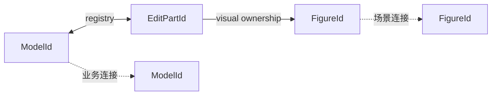
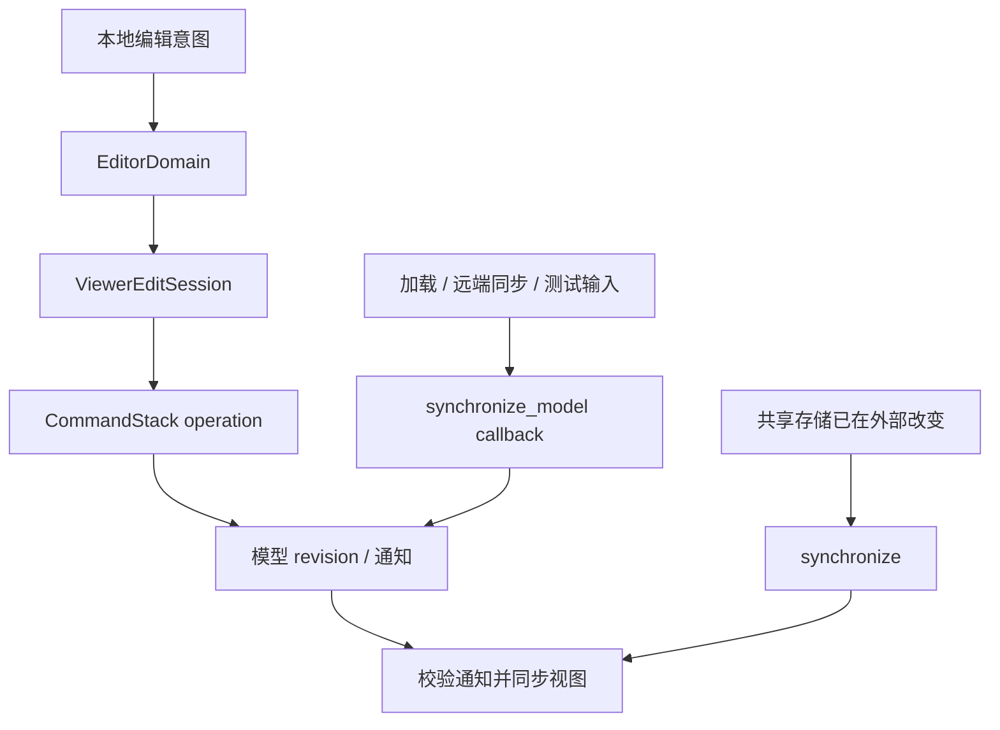

# 12. 模型、EditPart 与确定性视图派生

> **本章解决的问题**：业务对象如何被稳定地映射成 Figure 树，而不让视图成为第二份
> 模型？

图形编辑器必须允许关闭并重开 Viewer、同时显示多个视图、撤销业务修改和重建渲染
Runtime。若业务事实保存在 Figure 中，这些操作都会改变语义。

核心结论是：

> Viewer 可以被销毁和重建，而业务事实、命令语义和最终派生视图必须保持不变。

视图派生是 Viewer 根据单一模型 revision 构建或同步 Part/Figure 视图的确定性过程。
模型是业务事实，派生视图可以销毁和重建。

## 12.1 模型与 Figure 的不同生命周期

业务模型需要：

- 持久化和序列化；
- 参与命令和撤销；
- 独立于窗口存在；
- 被多个 Viewer 读取；
- 使用领域身份表达关系。

Figure 需要：

- 适应当前视口、主题和 DPI；
- 保存布局与绘制派生状态；
- 参与命中和输入；
- 随 Runtime 创建和销毁。

因此，Figure 是业务对象在某个 Viewer 派生视图中的场景表示，不是模型本身。

## 12.2 ModelAdapter

Editor 不应假设所有业务模型都使用同一种对象系统。`ModelAdapter` 提供最小稳定读取：

```text
snapshot() -> ModelSnapshot
subscribe(after_revision) -> ordered changes
apply(command) -> new revision
```

快照应提供：

- 稳定 `ModelId`；
- containment 关系；
- connection 关系；
- 创建 Part 所需的领域属性；
- 单调或可比较的 `ModelRevision`。

Adapter 是业务系统与 Editor 的边界，不应把 Figure 或 Runtime 类型写回模型。

## 12.3 EditPart 的职责

编辑部件（EditPart，后文简称 Part）是 Viewer 内的视图控制器。它把一个模型对象或
一种视图角色连接到 Figure，但它本身既不是业务对象，也不是 Figure。

Part 负责：

- 选择适当 Figure 构造；
- 把模型属性刷新到 Figure；
- 建立 child Part；
- 安装编辑 Policy；
- 管理该派生视图的视觉所有权。

Part 不应复制整份业务模型。它可以缓存最近应用 revision 或派生展示值，但模型变化后
应从稳定快照刷新。

为了让所有 Part 共享同一结构协议，同时允许不同领域对象选择不同视觉和行为，可以把
职责拆成两部分：

- `PartNode` 保存身份、父子关系、模型映射、Figure 关联和已安装 Policy 等通用状态；
- `EditPartBehavior` 提供创建 Figure、选择 content pane、刷新视觉、创建 Policy、
  解析 anchor 或 router 等差异行为。

Viewer 拥有由 `PartNode` 组成的 Part 树（`PartTree`）。行为对象参与候选计算，但不能
绕过 Viewer 直接发布半完成结构。

### 三种 Part 角色

| 角色 | 含义 | 是否进入 containment children |
|---|---|---|
| Root Part | Viewer 创建的合成根，承载图层和顶层视图，不代表业务模型 | 作为树根 |
| Containment Part | 为业务 containment 中的对象构建视图 | 是 |
| Connection Part | 为业务连接及其 source/target 关系构建视图 | 否 |

Root Part 没有业务模型身份。Connection Part 仍使用 `EditPartId`，只是经过角色校验后
以 `ConnectionPart` 参与连接 API；它不建立第四种身份域。

## 12.4 三个身份域

Viewer 显式维护映射：



- ModelId 跨 Viewer 稳定；
- EditPartId 只在一个 Viewer 中有效；
- FigureId 只在一个 Runtime 中有效。

视觉事件从 FigureId 找到 Part，再由 Part 找到 ModelId；命令只保存业务身份和值。

## 12.5 Visual ownership

视觉所有权（visual ownership）说明谁负责某个 Figure 的创建、事件归属和销毁。一个
Part 的稳定视觉不一定只有一个 Figure：

- primary Figure 表示该 Part 的主要外观；
- content pane 是接纳 child Part 视觉的容器；
- internal visuals 是标签、图标或其他只服务于该 Part 的内部子树。

content pane 可以等于 primary Figure，也可以是其内部后代。child Part 挂到 content
pane，不表示 content pane 获得新的 Part 身份。

视觉所有权回答：

- 谁负责创建和销毁 Figure；
- Figure 事件映射回哪个 Part；
- Part 删除时清理哪些视觉；
- 哪些 Overlay Figure 不属于稳定 Part。

树父级不一定等于视觉所有者。例如连接 Figure 可以挂在连接层，却由 ConnectionPart
拥有。所有权和拓扑必须分别记录。

### Overlay 与稳定 Part 视觉

覆盖视觉（Overlay）是 Viewer 管理、位于业务内容之上的临时 Figure 子树。它不是业务
模型，不是 Part，也不是一棵平行场景树。Overlay 中的 Figure 仍挂在显式根图层下，
继续服从 Core 的坐标、裁剪、damage 和生命周期规则。

Overlay 包含两类主要对象：

| 对象 | 身份 | 用途 | 生命周期 |
|---|---|---|---|
| Handle | `HandleId` | 选中对象的可交互控制点或装饰 | 随选择或编辑模式存在 |
| Feedback | `FeedbackId` | 当前手势的候选结果、提示或拒绝视觉 | 随手势创建、替换和清理 |

Handle 和 Feedback 可以关联某个 owner Part，但该关联只表达 targeting 与清理责任，
不把它们变成 Part 的 containment children。Viewer 维护从 `FigureId` 到 Part、Handle
或 Feedback 所有者的映射；命中内部 Figure 时，可以沿祖先链找到最近的已登记所有者。

“Overlay”也不等于一个固定图层。缩放反馈、非缩放反馈和 Handle 可以使用不同根图层，
以获得不同坐标和叠放语义。Part 被删除时，Viewer 必须同步清理选择、焦点和与其关联的
Overlay，不能等待孤立 Figure 自行失效。

## 12.6 Containment 视图构建

业务 containment 决定 Containment Part 树的主要结构。代码标识符和检索词中常把这
一过程写作 containment projection；本书称为 containment 视图构建。过程如下：

1. 从模型快照读取根身份；
2. 创建合成 Root Part，并为每个模型对象选择 Containment Part 行为；
3. 建立 ModelId 到 EditPartId 映射；
4. 按稳定业务顺序规划 child Part；
5. 为 Part 创建或复用 Figure；
6. 把 Figure 挂到父 Part 的 content pane；
7. 刷新属性；
8. 发布完整 Viewer revision。

Part 树与 Figure 树通常相关，但不要求完全同构。图层、装饰和连接会引入额外 Figure。

## 12.7 连接视图构建

业务连接通常引用 source/target ModelId。Viewer 只有在端点 Part 可解析后，才能建立
连接视图。代码标识符和检索词中常写作 connection projection。ConnectionPart 是
`EditPartId` 的受检角色视图，而不是新的身份：它与其他 Part 共用 registry、Policy
和生命周期协议，但不作为 source 或 target 的 containment child。Viewer 另行维护
source/target 以及 incoming/outgoing 关系索引。

过程是：

1. 读取连接模型及端点身份；
2. 解析 source/target Part；
3. 创建或复用 ConnectionPart；
4. 选择 anchor 描述并创建 Connection Figure；
5. 把 Figure 挂到连接层；
6. 原子登记 source/target 关系和视觉所有权；
7. 由 Core 稳定化路径。

端点暂时缺失时，连接视图应进入显式 pending/unresolved，而不是把任意现有 Figure
当作端点。Core 路径进入 unresolved 也只表示当前场景依赖尚不可解析，不会自行删除
业务连接或 ConnectionPart。

## 12.8 稳定快照

视图派生必须基于单一 model revision。若读取 children 后模型又变化，再读取连接会得到
混合快照。

ModelAdapter 应提供：

- 不可变快照；
- 或带 revision 的多次读取，并在结束时验证 revision 未漂移；
- 或能重试的一致读取事务。

Viewer 不能把“每次查询都成功”误认为整体一致。

## 12.9 Plan、Validate、Commit、Publish

视图同步同样采用四阶段事务。

### Plan

比较当前 Viewer 状态与目标快照，形成操作计划：

- create parts；
- update parts；
- reorder children；
- remove parts；
- create/remove connections；
- restore or clear selection。

Plan 不修改现有 Viewer。

### Validate

检查：

- ModelId 唯一；
- containment 无环；
- Part 类型可创建；
- 视觉父级可接纳；
- connection 端点可解析或允许 pending；
- source revision 仍有效。

### Commit

按能保持引用完整的顺序应用：

1. 创建新 Part 和基础视觉；
2. 建立 containment；
3. 刷新属性；
4. 建立连接；
5. 删除不再存在的连接；
6. 删除旧 Part 和视觉；
7. 修复选择、焦点和工具会话。

具体顺序可以变化，但不能让已发布关系指向未创建或已销毁对象。

### Publish

派生视图和 Core 场景稳定后，Viewer 发布新 revision、选择变化和可观察事件。

## 12.10 为什么视图派生要确定

给定同一模型快照、Viewer 配置和主题，视图派生应得到语义等价结果：

```text
derive_view(snapshot, config) -> equivalent view
```

确定性要求：

- child 顺序有明确来源；
- Part 类型选择不依赖哈希遍历偶然顺序；
- 相同关系不重复创建；
- connection 分组和路由输入稳定；
- ID 分配差异不影响可见语义。

这使重建、测试和回放具有可比较结果。

## 12.11 节点重排

模型只改变同一父级 children 顺序时，Viewer 应：

1. 读取新 revision；
2. 识别身份集合未变；
3. 生成 reorder 计划；
4. 保留 Part 和 Figure 身份；
5. 原子更新 Part 顺序和 Figure Z-order；
6. 重新计算受影响命中与 damage；
7. 发布一个 Viewer revision。

不应销毁并重建所有节点，否则选择、工具目标和缓存会无谓失效。

## 12.12 删除

删除模型节点时，计划必须同时处理：

- containment descendants；
- 以其为端点的连接；
- Viewer 选择；
- 活跃 Tool 会话；
- Part registry；
- Figure visual ownership；
- Core 输入和 damage。

模型通知只描述业务事实，Viewer 负责把影响扩展到当前视图。删除不能依赖各 Part 收到
无序回调后自行清理。

## 12.13 撤销和重建

撤销恢复模型 revision 后，Viewer 从模型事实重建视图。旧 FigureId 不需要恢复；需要
恢复的是业务语义：

- 同一 ModelId 再次出现；
- 属性和 containment 恢复；
- 连接端点恢复；
- 可选地按 ModelId 恢复选择。

因此，Command 绝不能保存 FigureId 作为业务目标。

## 12.14 Revision 连续性

增量通知应声明前后 revision：

```text
ChangeBatch { from_revision, to_revision, changes }
```

Viewer 只有在 `from_revision` 等于当前已应用 revision 时才能增量执行。若丢失批次或
顺序不连续，应放弃增量并从新快照重建。

“尽量应用剩余事件”会让 Viewer 永久偏离模型。

## 12.15 模型变化只有两个入口

Viewer 可以长期提供只读模型访问，但不能把完整模型可变引用交给普通调用者。否则调用者
可以绕过命令历史、revision 通知和视图同步，模型与视图将停在不同因果前缀。

模型变化只从两个入口进入：



本地可撤销编辑必须经过 EditorDomain 和 Command。`ViewerEditSession` 是 crate 内短生命
周期对象，它把 CommandStack 操作、通知校验和视图同步关闭在同一会话中。

不进入本地 undo history 的加载、远端同步或测试输入，可以通过
`synchronize_model(callback)` 获得不逃逸的短可变借用。共享存储已经在外部提交变化时，
调用方只调用 `synchronize()` 消费通知并同步视图。

同步成功但没有新 Viewer revision 是合法空操作。revision gap、stale event、root 变化
或部分视图同步失败会使 Viewer 进入故障锁定状态；Viewer 不能猜测缺失变化。

## 12.16 宿主驱动与领域编辑分离

窗口循环需要驱动 frame、surface、时间、焦点和启动资源，但不应因此取得 Viewer 内部
编辑状态的任意修改权。

查看器驱动 facade（`ViewerDrive`）提供短借用，只允许宿主执行：

- 准备和完成渲染提交；
- 重置 backend session；
- 调整逻辑视口和请求完整重绘；
- 推进时间和查询下一唤醒时刻；
- 取消手势和释放焦点；
- 注册宿主初始化所需的 packaged resources。

它不暴露 Runtime、图形对象树、模型可变引用、CommandStack、EditorDomain、Part registry、
Router、EditPolicy 或 selection。输入仍由 EditorDomain 仲裁，不在 `ViewerDrive` 中
建立第二套工具和选择协议。

这个边界把“宿主必须驱动 Viewer”与“宿主可以编辑 Viewer 内部事实”分开。facade 调用
结束后，所有内部借用同时结束，宿主只能保存 Viewer 自身和平台对象。

## 12.17 重复身份

同一快照中若两个对象声明相同 ModelId，Viewer 无法建立双射。正确结果是拒绝构建视图，
保留上一稳定 Viewer 或进入明确故障状态。

自动给其中一个对象换 ID 会篡改业务语义，不能由视图层完成。

## 12.18 读取期间漂移

若 Adapter 不能提供不可变快照，Viewer 应：

1. 读取起始 revision；
2. 收集完整视图派生输入；
3. 读取结束 revision；
4. 若不一致，丢弃计划并重试；
5. 达到重试预算后报告模型繁忙或一致性失败。

不能把不同 revision 的 containment 和 connection 拼在一起。

## 12.19 多 Viewer

多个 Viewer 可以共享同一模型，但各自拥有：

- Part registry；
- Figure Runtime；
- 选择和工具状态；
- viewport 和主题；
- Viewer revision。

一个 Viewer 的销毁不影响模型，也不使另一个 Viewer 的 Part/Figure ID 失效。模型
Command 完成后，各 Viewer 独立消费同一业务 revision。

## 12.20 必须保持的不变量

1. 模型是业务事实的唯一权威；
2. Viewer 必须基于单一稳定 revision 派生视图；
3. 每个 Viewer 内 ModelId 到主 Part 唯一；
4. Command 不保存 PartId 或 FigureId；
5. visual ownership 与 Figure 拓扑分别明确；
6. Viewer 只发布完整的新 revision；
7. revision 断裂时重建，不猜测；
8. Viewer 不暴露长期模型可变引用；
9. 每次模型变化都以通知校验和视图同步关闭；
10. 宿主只通过 `ViewerDrive` 驱动平台职责，不取得编辑内部所有权；
11. ConnectionPart 复用 EditPartId 身份域，不进入 containment children；
12. Overlay 仍是统一 Figure 树中的临时 Figure 子树，不成为稳定 Part。

## 12.21 常见错误设计

### Figure 直接保存并修改业务对象

多 Viewer 和撤销会产生多个写入路径。

### 每个模型事件立即修改局部视图

事件批次的中间态对外可见，连接可能先于端点创建。

### 用 FigureId 作为命令目标

Viewer 重建后命令历史失效。

### Part 保存完整模型副本

需要双向同步，Part 变成第二份模型。

### 把 Handle 或 Feedback 建成 Part

临时交互视觉进入稳定派生视图后，选择变化和取消手势都会被误解为模型结构变化。

### 让 ConnectionPart 成为端点的 containment child

业务 containment 与连接关系混在一棵树中，重排或删除父子结构时会错误改变连接语义。

### revision 断裂仍继续应用

Viewer 无法证明自己对应任何真实模型快照。

### 公开 `model_mut` 后要求调用者手工刷新

命令历史、模型 revision 和 Viewer 视图同步的关闭动作依赖调用者记忆，遗漏一步就会形成
不同状态前缀。

### 宿主循环长期持有 Viewer 内部可变入口

平台驱动和领域编辑没有类型边界，frame、输入、选择和模型修改可以绕过各自协议。

## 12.22 与后续章节的关系

本章解释模型如何形成稳定视图。下一章从反方向说明输入如何经 Tool、Request 和 Policy
形成只修改模型的 Command，再由本章的视图派生闭环返回 Figure。第 14 章则处理 Figure 和
Part 如何通过类型化扩展保持开放。

## 12.23 思考题

1. 为什么 Part 树与 Figure 树不必完全同构？
2. 节点重排时保留 Part/Figure 身份有什么价值？
3. connection 端点缺失时，为什么不能选择“最近的 Figure”代替？
4. 多 Viewer 共享模型时，哪些状态绝不能共享？
5. revision 断裂后全量重建为何比补猜事件更可靠？
6. 为什么 `synchronize_model` 不能替代普通编辑命令？
7. `ViewerDrive` 为什么不能暴露 selection 或 CommandStack？
8. ConnectionPart 为什么使用 EditPartId，却不进入 containment children？
9. Overlay Figure 与 Part 的 internal visual 有什么所有权差异？
