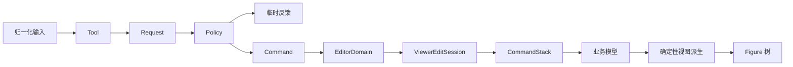
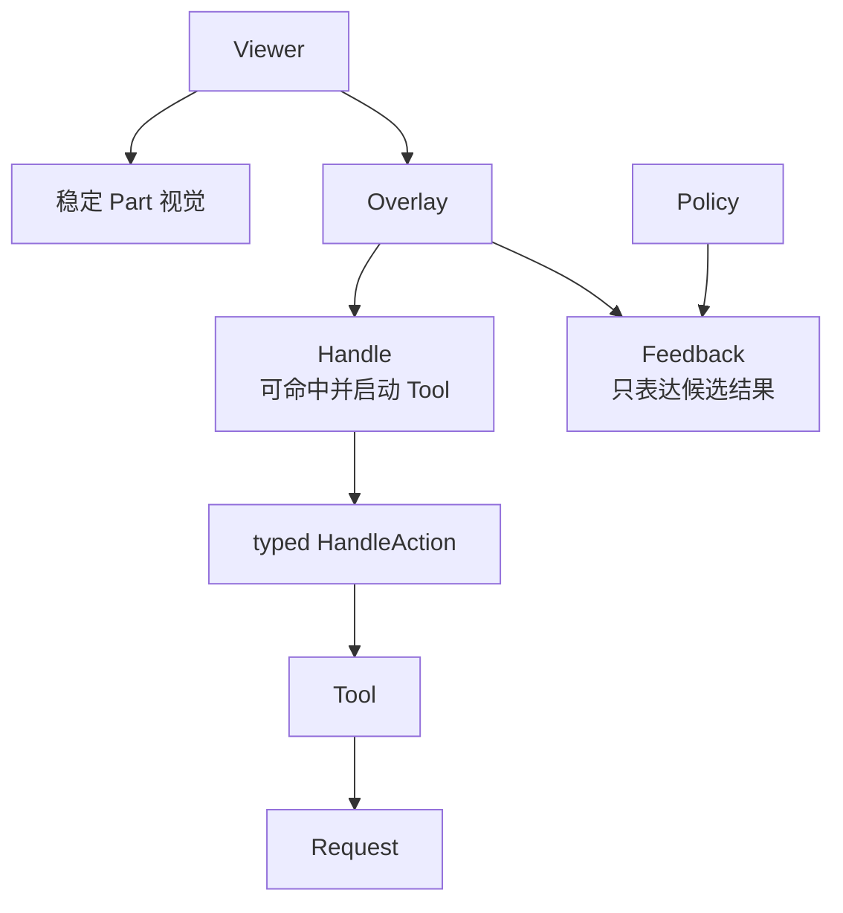

# 13. Tool、Request、Policy 与 Command

> **本章解决的问题**：连续、可取消的平台输入，如何转化为可验证、可撤销的业务模型
> 修改？

拖拽过程包含数十个 move 事件，但用户通常期望一次撤销恢复整个操作。连接预览可以
不断变化，却不能提前创建业务连接。要满足这些要求，输入、意图、反馈和提交必须分层。

核心结论是：

> 输入不是命令，反馈不是模型，Figure 变化也不是业务提交；四者必须由明确协议连接。

## 13.1 四个角色

### Tool

Tool 是手势状态机。它实现 object-safe `Tool<A>`，解释事件序列，持有来源目标、初始
位置、当前阶段和模型 revision。`EditorDomain` 只保存 `Box<dyn Tool<A>>`，内置与外部
Tool 经同一生命周期运行。Tool 只能通过窄 `ToolContext` 访问目标、分派请求和提交命令。

### Request

Request 是平台无关的编辑意图，例如“把这些对象移动到候选位置”或“尝试连接到该目标”。
它不包含鼠标按钮等设备细节。每个 request family 由 `RequestProtocol<A>` marker、
`RequestKey<R>`、typed payload 和 contribution 组成；公共 API 不暴露 `Any`。

### Policy

Policy 在目标上下文中解释 Request，判断是否允许，生成反馈和候选 Command。它通过
`PolicyKey<S>` 安装，并由 `PolicyHandlerBuilder` 注册 typed handler；存在 handler
本身就表示理解该 request，不再维护独立的 `understands` 分支。

### Command

Command 描述对业务模型的最终改变，支持执行、撤销和重做。它不操作 Figure。



## 13.2 Tool 是有版本的状态机

Tool 开始会话时应锁定：

- source Part/Model 身份；
- 起始 model revision；
- pointer 或 focus identity；
- 初始表面位置；
- 当前模式和修饰键语义。

后续事件先验证会话仍有效。模型删除目标、工具切换或 capture 丢失时，应取消，而不是
继续把新事件应用到旧假设。

## 13.3 Request 的设计

好的 Request 表达“想做什么”，而不是“如何修改”：

```text
MoveRequest {
    subjects: [ModelId],
    candidate_delta: Vector,
    phase: Preview | Commit,
}
```

Request 应：

- 使用稳定业务或 Part 身份；
- 明确坐标域；
- 包含解释意图所需上下文；
- 不携带内部可变引用；
- 可在测试中直接构造。

所有请求共享的 interaction revision 与 source parts 位于 `RequestMetadata`，其余字段
只属于具体 payload。内置 request marker 与外部 marker 使用同一个 registry 和 reducer，
不存在闭合 request enum。

若 Request 直接包含“把 Figure bounds 改成某值”，它已经越过模型和 Policy 边界。

## 13.4 Policy 的职责

Policy 回答：

- 目标是否支持该请求；
- 需要哪些模型对象共同参与；
- 当前约束是否允许；
- 预览应显示什么；
- 提交时贡献什么 Command。

多个 Policy 可以参与同一 Request，但组合规则必须稳定。例如父容器负责接纳，节点
负责移动约束，连接 Policy 负责相关业务关系。

Policy 不应执行 Command，也不应直接持久化模型。

## 13.5 Overlay、Handle 与 Feedback

覆盖视觉（Overlay）是 Viewer 在稳定 Part 视觉之上管理的临时 Figure。它把交互状态
画出来，但不把交互候选写入模型或稳定 Part 树。Overlay 主要分为 Handle 和 Feedback。

控制柄（Handle）是可命中的交互入口，例如缩放点、连接端点或折点控制点。它具有 Viewer
命名空间内的实例身份 `HandleId`。Handle 的实例身份与行为身份
`HandleActionKey<R>` 分离：每个 Handle 最多绑定一个 typed action，外部 action 可以
注册自己的 Tool factory，不需要修改 Editor。

反馈图形（Feedback）是候选结果的临时可视化，例如：

- 移动轮廓；
- 对齐线；
- 连接预览；
- 插入位置；
- 拒绝指示；
- 文本 preedit。

Feedback 具有 `FeedbackId`，可以关联 owner Part 以便定位和清理，但它不接收稳定业务
身份，也不成为 ConnectionPart。它由 Viewer 中具有匹配缩放语义的 feedback layer
持有，可在每次 move 后替换，并在完成或取消时清理。



Handle 与 Feedback 都是普通 Figure 子树，因此继续使用同一坐标转换、裁剪、damage 和
销毁协议。二者的差异在于交互语义：Handle 可以成为输入目标并启动动作；Feedback
通常只展示当前候选，不成为下一次业务命令的稳定目标。

Overlay 的典型生命周期按因果顺序发生：

1. selection 或 Tool 会话决定需要哪些 Overlay Figure；
2. Viewer 创建 Handle 或 Feedback 身份；
3. Figure 挂入具有正确缩放语义的 overlay layer；
4. visual ownership registry 登记 Figure 与临时所有者；
5. 输入命中通过 registry 解析 Handle action 或 owner Part；
6. selection 变化、完成、取消或 Part 删除时，Viewer 注销并销毁整棵临时子树。

Feedback 不是模型，也不应被命令历史记录。若预览需要计算布局或坐标，应查询稳定
场景状态并使用候选数据，不能先改真实 Figure 再观察效果。

连接预览尤其不能提前创建稳定 ConnectionPart。它可以复用 Core 的连接 Figure 与路由
能力，但其所有者仍是 Feedback；只有最终 Command 创建业务连接后，Viewer 才在下一次
稳定视图中创建 ConnectionPart。

## 13.6 Command

Command 保存执行和撤销所需的业务身份和值：

```text
MoveNodes {
    nodes,
    before_positions,
    after_positions,
    expected_revision,
}
```

它应满足：

- 只修改模型权威；
- 可判断当前是否可执行；
- 执行后产生明确 revision；
- undo 恢复业务语义；
- redo 重放已确认意图；
- 不保存 Viewer 或 Runtime 私有身份。

Command 不负责刷新 Figure。模型变化发布后，Viewer 走第 12 章的视图同步流程。

## 13.7 移动案例

### 开始

1. pointer down 命中 Figure；
2. Viewer 解析到 Part 和 ModelId；
3. Tool 锁定选择集合与起始 revision；
4. 建立 capture。

### 预览

1. pointer move 转换为稳定坐标域中的 delta；
2. Tool 构造 `MoveRequest::Preview`；
3. Policy 应用网格、边界和父级规则；
4. 返回候选位置与反馈；
5. Viewer 替换反馈层内容。

### 提交

1. pointer up 形成 `MoveRequest::Commit`；
2. Policy 基于最终模型快照重新验证；
3. 生成一个 Move Command；
4. 清理反馈；
5. EditorDomain 在 ViewerEditSession 中执行 CommandStack 操作；
6. 会话校验模型通知并同步 Viewer 视图；
7. Viewer 显示新 revision 对应的 Figure。

整个拖拽只产生一个业务命令。

## 13.8 创建连接案例

连接工具开始于 source anchor 候选，移动时不断查询 target：

1. down 锁定 source ModelId 和 source role；
2. move 命中候选 target Part；
3. Policy 检查类型、方向、重复连接和业务约束；
4. Feedback 显示 resolved 或 rejected 预览；
5. up 时再次验证 source、target 和 revision；
6. Command 创建业务连接；
7. Viewer 构建新的 ConnectionPart；
8. Core 计算 anchor 和 route。

预览连接可以是 Figure，但它位于反馈层，不是最终业务连接的提前实例。

## 13.9 直接文本编辑案例

文本编辑包含 focus、IME 和业务提交：

1. Tool 进入 direct-edit 会话并锁定 ModelId；
2. 编辑控件维护临时字符串、选区和 preedit；
3. 模型原值保持不变；
4. commit text 更新临时编辑值；
5. 用户确认时 Policy 校验格式和业务规则；
6. 生成 ReplaceText Command；
7. ViewerEditSession 执行命令并校验新 revision；
8. Viewer 关闭编辑反馈并同步文本 Figure。

取消只丢弃临时编辑值，不需要执行反向模型命令。

## 13.10 编辑会话关闭命令模型事务

命令执行和 Viewer 刷新不能是两个依赖调用者记忆的公开步骤。EditorDomain 创建一个
短生命周期查看器编辑会话（`ViewerEditSession`），并在会话内完成 execute、undo 或
redo。

会话开始前，Viewer 先同步已经存在的外部通知。这样命令总是建立在已同步的稳定 revision
前缀上。会话只向一次 CommandStack 操作提供短期模型可变借用，并且必须以三种结论之一
关闭：

| 结论 | 适用情况 | 关闭动作 |
|---|---|---|
| commit | execute、undo 或 redo 成功 | 校验并消费通知，然后同步视图 |
| reject | 明确拒绝或可恢复错误 | 要求模型 revision 和待发布事件保持不变 |
| fault | panic、unknown-state 或不可恢复错误 | 不从未知模型派生视图，使 Stack 和 Viewer 故障锁定 |

会话没有显式关闭就离开作用域，Viewer 也进入故障锁定状态。析构过程不猜测模型状态，
也不自动提交。

可恢复命令错误必须真正做到“不修改模型”。若 reject 路径观察到 revision 前进或新通知，
错误将升级为 Viewer 故障。这把原本依赖 Command 作者自律的合同变成了可执行门禁。

## 13.11 CommandStack

CommandStack 是命令历史的权威，负责：

- 执行；
- undo；
- redo；
- 保存点或 dirty 标记；
- 合并连续兼容命令；
- 阻止重入执行。

栈中保存的是成功提交的命令。prepare 失败或被拒绝的候选不能进入历史。

查询“是否存在历史”和调用扩展 Command 判断“当前是否允许撤销”是两种不同操作：

```text
has_undo / has_redo
    -> 只读查询 history 和 fault 状态

check_undo / check_redo
    -> 调用顶部 Command 的能力检查
    -> 返回允许、明确拒绝或结构化错误
```

`has_*` 不调用扩展代码，也不改变状态。`check_*` 若捕获扩展 panic，则返回
`CommandStackError` 并使 Stack 故障锁定；它不能把“无历史”“扩展拒绝”和“扩展故障”
压缩成同一个 `false`。实际 undo/redo 仍需在执行点重新检查。

## 13.12 CompoundCommand

一个业务意图可能包含多个原子子命令，例如移动节点并更新业务容器顺序。

CompoundCommand 需要：

1. 在执行前验证所有子命令；
2. 按稳定顺序执行；
3. 任一失败时按逆序补偿已执行部分，或由模型事务保证原子性；
4. undo 按执行的逆序进行；
5. redo 使用确定的原顺序。

如果无法证明补偿完整，就不应把多个独立副作用包装成“原子命令”。

## 13.13 版本冲突

Tool 开始后模型可能被其他来源修改。提交时应比较起始假设和当前 revision：

- 不相关变化可由 Policy 重新解释；
- 目标属性已改变时可以拒绝或重新计算；
- 目标被删除时取消；
- 不能静默覆盖新事实。

是否允许 rebase 由业务策略决定，但必须显式，不得由 Figure 当前位置猜测。

## 13.14 Selection 与操作对象

选择状态属于 Viewer，不等于模型属性。`SelectionModel` 保存有序 `ModelId` 集合：

- `replace` 用一个对象或一组对象替换当前选择；
- `append` 保留已有顺序并追加尚未选中的对象；
- `toggle` 在集合中添加或移除指定对象；
- `clear` 清空集合；
- `reconcile` 根据当前模型身份集合修复过期选择。

顺序有交互含义。集合末项是 primary selection，决定单一属性面板目标、主控制柄或下一次
键盘扩展的锚点。多选命令仍应保存完整 `ModelId` 集合，不能只保存 primary，也不能保存
Figure 顺序来替代用户选择顺序。

### Selection 与 focus

Selection 表达“哪些业务对象是当前操作集合”，focus 表达“哪个交互目标接收键盘或文本
输入”。二者可以重合，但不是同一事实：

- pointer 单击可以同时替换 selection 并把 focus 交给画布；
- 键盘焦点进入直接编辑控件时，业务 selection 可以保持不变；
- 清除 focus 不要求清空 selection；
- 删除 focused Part 时，需要独立执行 focus 修复和 selection reconcile。

把 focus 隐式绑定到 primary selection，会使属性面板切换、文本编辑和键盘导航互相抢夺
状态。

### 选择变化的传播

Selection 变化先提交到当前 Viewer，再驱动依赖它的 Editor 状态：

```text
SelectionModel revision
-> 重新计算 Handle / Feedback
-> 更新 Tool 可操作对象
-> 更新命令可用性与宿主选择摘要
```

这条传播不修改业务模型，也不直接改稳定 Part 树。Handle 和 Feedback 由 Overlay 重建；
Tool 在开始会话时锁定选择 revision，进行中的手势不会静默吸收后来发生的 selection
变化。

模型变化后，Viewer 按身份修复选择：

- 仍存在的对象保持选择；
- 删除对象移出集合；
- 新建对象是否选中由操作结果明确决定；
- primary 被删除后，由剩余顺序的末项成为新的 primary；
- 多 Viewer 的选择互不影响。

每个 Viewer 拥有自己的 `SelectionModel`。同一业务模型可以同时被两个 Viewer 展示，
一边的选择、primary 和 focus 不会自动写入另一边；需要联动时，应由应用显式桥接。

### 框选的边界

框选（marquee selection）是“区域命中 + SelectionModel 操作”的组合。区域应先变换到
明确坐标域，再按完全包含、相交或方向相关规则选择 Part，最后一次性执行 replace 或
append。Figure 的 visual bounds 只能作为保守候选范围，精确规则仍由目标 Policy 决定。

当前 Editor 没有通用 marquee API。应用或外部 Tool 可以基于场景查询和现有 selection
操作实现框选，但不能把某个示例的区域命中规则写成框架既有合同。

## 13.15 跨容器拖放

画布内部拖放仍沿用 Tool、Request、Policy 和 Command，不需要第二套拖拽事务。关键是把
来源容器与候选目标容器分开解释：

1. source Tool 锁定被拖对象、原父容器和 model revision；
2. pointer move 在当前稳定场景中发现候选 drop target；
3. source Policy 说明对象能否离开，target Policy 说明能否接纳及插入位置；
4. Feedback 显示目标轮廓、插入线或拒绝状态；
5. pointer 离开 viewport 时，可由第 11 章的 auto-expose 继续滚动并重新命中；
6. drop 时重新验证 source、target、坐标和 revision；
7. 一个 Command 原子修改父关系、顺序及必要业务约束。

drop indicator 是 Feedback，不是目标容器中的临时业务 child。拖拽取消、capture 丢失或
目标失效时，只清理反馈并恢复表现状态；模型从未改变，因此不需要用 undo 制造回弹。
若需要视觉回弹，可以在表现状态层播放，不应提交反向 Command。

这套协议描述的是 Novadraw 画布内的 pointer 拖放。当前项目没有通用系统 DnD API；
跨窗口、拖入文件或与其他应用交换数据需要平台 adapter 提供拥有数据的事件，再由宿主
映射为 Editor Request。平台数据格式和安全策略不能泄漏进 Core Policy。

## 13.16 复制和粘贴

复制的权威内容是可序列化业务模型数据，不是 Figure、EditPart 或 Runtime ID。粘贴按
正常编辑闭环执行：

```text
选择 ModelId
-> 应用序列化业务 payload
-> 目标 Viewer / 容器 Policy 校验
-> Paste Command 分配新的 ModelId
-> 模型发布新 revision
-> Viewer 正常派生 Part 与 Figure
```

新对象必须获得新的 `ModelId`。保留来源 FigureId 或 EditPartId 会把一个 Viewer 的临时
身份带入另一个 Viewer；复用来源 ModelId 则会破坏模型唯一性。

跨 Viewer 粘贴只在二者理解同一 payload schema、业务引用可重写且目标 Policy 接受时
成立。外部资源引用、连接端点和父容器身份都应在 prepare 阶段解析，不能先创建半个模型
再等待缺失对象。

当前 Editor 没有通用 `ClipboardAdapter` 或 `Serializer` API。以上是复制粘贴应遵守的
协议边界，不是已经可调用的系统剪贴板实现。平台剪贴板的 MIME、权限和异步读取由宿主
负责；Editor 只接收拥有的业务 payload，并通过 Command 提交。

## 13.17 Policy 组合

当多个 Policy 贡献结果时，需要明确组合代数：

- 全部允许才执行；
- 任一拒绝终止；
- 多个 Command 按稳定顺序组成 CompoundCommand；
- Feedback 按语义层合并；
- 重复目标或冲突修改在 commit 前拒绝。

不能依赖注册顺序偶然决定谁覆盖谁。

## 13.18 取消路径

以下事件都应进入统一 cancel：

- Escape；
- pointer cancel；
- capture owner 丢失；
- Tool 切换；
- Viewer 销毁；
- model target 删除；
- revision 冲突不可重基；
- Runtime fault。

取消过程只清理会话、capture、feedback 和临时资源。若模型命令尚未执行，不能调用
undo 伪装成取消。

## 13.19 测试边界

五层可以分别测试：

- Tool：事件序列到 Request；
- Policy：Request 和快照到反馈/Command；
- Command：模型 before/after/undo/redo；
- ViewerEditSession：commit/reject/fault 与通知同步；
- Viewer：模型 revision 到 Figure 视图。

端到端测试再验证完整闭环。分层后，核心业务规则不需要窗口或 GPU 才能测试。

## 13.20 必须保持的不变量

1. Tool 锁定稳定目标和会话版本；
2. Request 不携带平台或 Runtime 私有可变状态；
3. Policy 计算候选，不直接提交模型；
4. Feedback 不成为业务事实；
5. Command 只引用业务身份；
6. 历史只记录成功提交；
7. cancel 不产生最终模型变化；
8. Viewer 只通过模型 revision 同步稳定视图；
9. CommandStack 操作和 Viewer 同步在同一 ViewerEditSession 中关闭；
10. reject 必须证明模型、revision 和待发布事件均未改变；
11. `has_*` 是纯查询，`check_*` 的扩展故障必须结构化暴露；
12. Handle 与 Feedback 都由 Viewer 管理，不进入稳定 Part 树；
13. 连接预览不能提前创建业务连接或稳定 ConnectionPart；
14. Selection 与 focus 分别拥有状态，primary 由有序选择集合决定；
15. 跨容器拖放只在最终 Command 中修改模型；
16. 粘贴创建新的 ModelId，不复用任何 Viewer 或 Runtime 身份。

## 13.21 常见错误设计

### Tool 直接改 Figure

拖拽完成后模型、撤销和多 Viewer 都无法同步。

### 每个 move 执行一个 Command

命令历史粒度错误，取消和撤销产生大量中间状态。

### Policy 内直接写模型

多个贡献无法整体验证，CommandStack 也无法管理历史。

### Feedback 复用业务 Figure

预览污染稳定场景状态，取消需要猜测如何恢复。

### 把连接预览注册为 ConnectionPart

候选关系获得了稳定视图身份，取消手势时只能模拟一次结构删除，也可能被选择和 Policy
误认为已提交业务连接。

### Handle 直接执行模型修改

Handle 绕过 Tool、Request 和 Policy 后，外部 action 无法复用统一校验、取消和命令历史。

### Command 保存 EditPart

Viewer 重建后历史失效，也可能意外延长视图生命周期。

### 命令成功后由调用者手工刷新 Viewer

成功、拒绝和模型状态未知没有统一关闭动作；遗漏同步会让 history、模型和视图停在
不同前缀。

### 用 `can_undo() -> bool` 隐藏扩展检查

UI 查询可能调用扩展代码并使 Stack 故障，却只返回 `false`，调用者无法区分无历史、
明确拒绝和扩展 panic。

### 把 primary selection 等同于 focus

键盘输入、直接编辑和多选操作共享一个隐式目标，任一变化都会错误清除另一类状态。

### 把 drop indicator 插入业务容器

预览参与布局和模型派生，取消拖拽时只能猜测哪些结构需要回滚。

### 复制 Figure 或 EditPart

粘贴携带来源 Viewer 的临时身份、缓存和父链，无法通过正常模型派生重建。

## 13.22 与后续章节的关系

Editor 闭环至此完成。下一章讨论这些层中的扩展对象如何分类：哪些属于基础协议，哪些
是可发现 Capability，哪些只是具体 Figure 的共享数据或 typed update。第 15 章再统一
处理命令和 Runtime 事务的失败证据。

## 13.23 思考题

1. 为什么移动预览和最终移动命令可能使用不同的校验时机？
2. Tool 应保存 ModelId、EditPartId 还是 FigureId？答案取决于什么？
3. CompoundCommand 在什么条件下才能声称原子？
4. 直接文本编辑为什么不能每次 preedit 都写模型？
5. 多个 Policy 同时贡献 Command 时，需要定义哪些冲突规则？
6. reject 路径观察到模型 revision 前进时，为什么必须升级为故障？
7. `has_undo` 与 `check_undo` 分离后，UI 和实际 undo 各自应使用哪个入口？
8. 为什么 Handle 可以命中并启动 Tool，而 Feedback 通常不应成为稳定目标？
9. 连接预览复用 Core 路由能力时，为什么其所有者仍应是 Feedback？
10. primary selection 被删除后，为什么应由有序集合决定继任者？
11. 跨容器拖放为什么需要 source Policy 和 target Policy 分别解释？
12. 为什么系统剪贴板适配不应成为 Editor Core 的隐式全局服务？
