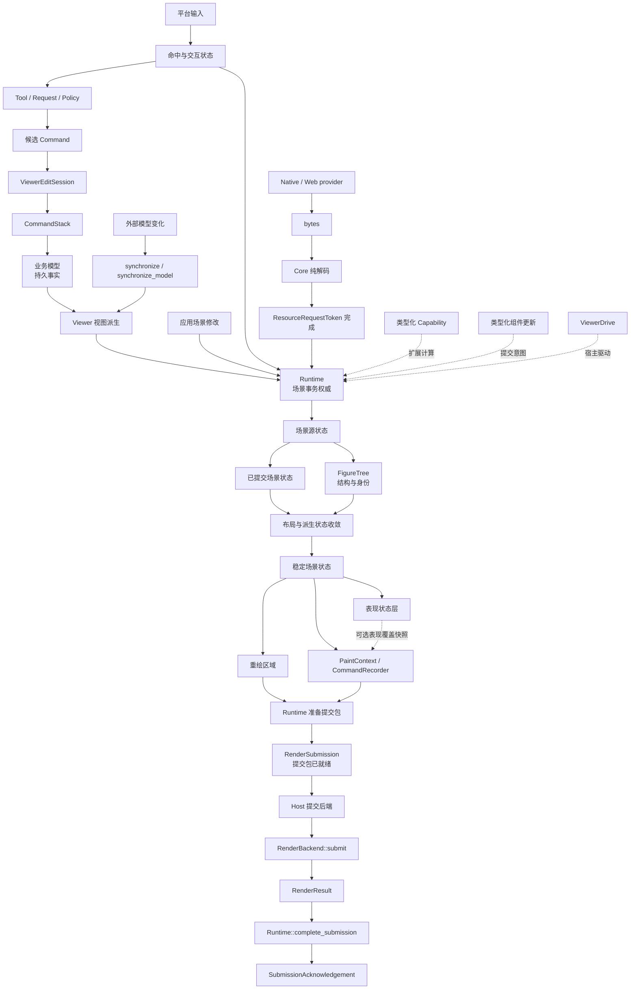
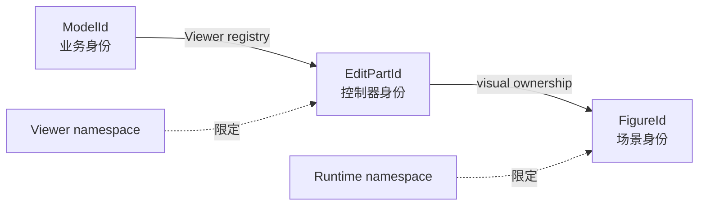
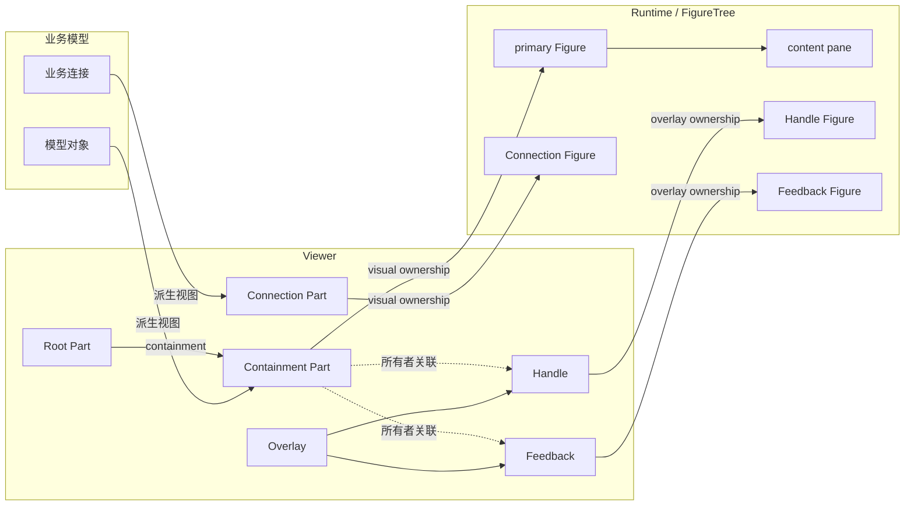
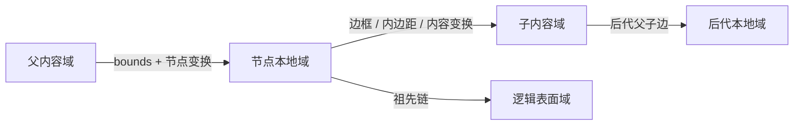
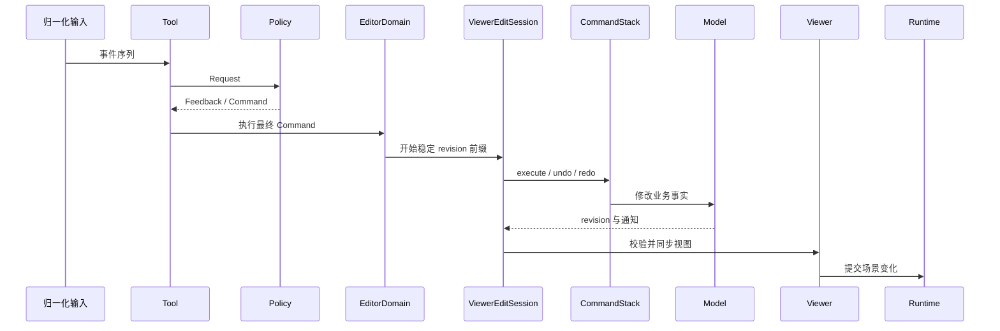
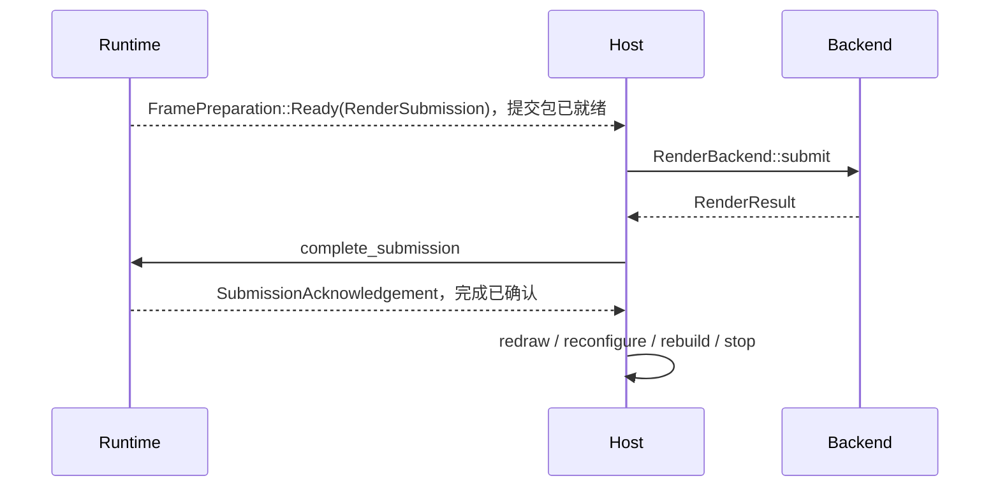

# 附录：核心概念关系图

本附录用于回顾全书的因果、所有权和身份关系，不替代各章中的推导。

遇到一个新问题时，先判断它属于哪类状态，再判断由谁提交、使用什么身份，以及失败
后哪些事实必须保持不变。

## 一致性总图



箭头表示允许的因果方向，不表示所有对象互相拥有。最重要的禁止方向是：

- 后端结果不能改写业务模型或已提交场景状态；
- 表现状态不能回写已提交场景状态；
- Tool、Policy 和 Capability 不能绕过权威提交者；
- 平台 provider 不能直接修改 Runtime 内部资源表；
- Host 不能通过 ViewerDrive 取得模型、选择或编辑策略所有权。

## 六类状态与所有者

| 状态类别 | 典型内容 | 长期所有者 | 合法变化入口 | 可否重建 |
|---|---|---|---|---|
| 业务源状态 | 节点、连接、领域属性 | 应用模型 | Command 或明确外部同步 | 不能从视图反推 |
| 场景源状态 | Figure 拓扑、bounds、样式 | Runtime | 场景事务或 Viewer 视图派生 | 可从模型部分重建 |
| 派生状态 | 布局、路径、文本排版、内容范围 | Runtime | 稳定化工作列表 | 必须可从依赖重建 |
| 交互临时状态 | hover、capture、手势、preedit | 输入状态机或 Editor | 事件会话 | 会话结束即丢弃 |
| 表现状态 | 表现覆盖值、采样表现几何、动画临时绘制项 | Runtime 的表现状态层 | Animation plan/track | 可随时丢弃 |
| 后端状态 | GPU 资源、surface、已呈现像素 | RenderBackend | RenderSubmission | 从稳定场景状态和源资源恢复 |

判断一个字段属于哪类状态时，应问：

1. 它是用户最终编辑的事实，还是由其他事实计算得到？
2. 它是否只在一次交互或若干表现帧中存在？
3. 丢失后能否从稳定输入重建？
4. 后端是否只消费它，而不能定义它？

## 场景状态的三个阶段

| 阶段 | 包含什么 | 可观察边界 |
|---|---|---|
| 场景源状态 | Runtime 直接拥有、由场景事务写入的状态 | 等待 Runtime 校验和提交 |
| 已提交场景状态 | Runtime 已经接受并原子写入的状态前缀 | 可以作为后续派生工作的输入 |
| 稳定场景状态 | 已提交源状态及当前 stable epoch 的派生结果 | 可供稳定查询、通知和帧录制读取 |

已提交不等于稳定。场景事务完成后，布局、连接、文本排版或容器范围仍可能等待收敛。
稳定场景状态不包含表现覆盖、后端资源或已经呈现的像素。

## 三种身份域



| 身份 | 有效范围 | 跨重建稳定性 | 主要消费者 |
|---|---|---|---|
| `ModelId` | 业务模型 | 应保持语义稳定 | Command、ModelAdapter、持久化 |
| `EditPartId` | 单个 Viewer | Viewer 重建后可变化 | 选择、Policy、Part registry |
| `FigureId` | 单个 Runtime | Runtime 重建后可变化 | 树、布局、输入、连接、渲染查询 |

Command 保存业务身份，不保存 Part 或 Figure 身份。输入捕获可以保存当前 Figure 身份，
但目标删除时必须取消会话，不能让旧代际身份“复活”。

## Editor 核心对象与所有权



| 概念 | 属于哪一层 | 负责什么 | 不负责什么 |
|---|---|---|---|
| Part | Viewer | 控制模型到稳定 Figure 的视图派生、Policy 和视觉所有权 | 不保存业务事实，不直接绘制 |
| ConnectionPart | Viewer | 控制业务连接的 source/target 关系与连接视觉 | 不成为端点 Part 的 containment child |
| Connection Figure | Core | 解析 anchor、保存派生路径并绘制 | 不决定业务连接是否存在 |
| Overlay | Viewer | 统称稳定内容之上的临时 Figure 子树所有权 | 不是单一图层，也不是平行 Figure 树 |
| Handle | Viewer | 提供可命中的类型化交互入口 | 不直接修改模型 |
| Feedback | Viewer | 显示候选结果、提示或拒绝状态 | 不成为稳定 Part 或命令历史 |

Part 树、视觉所有权和 Figure 树是三种不同关系。Part 树表达控制器 containment；
视觉所有权表达谁创建、解析和销毁 Figure；Figure 树表达绘制、命中、坐标与 Z-order。
同一对对象在三种关系中不必具有相同父子结构。

动画临时绘制项与 Editor Overlay 也不属于同一机制：

| 概念 | 所有者 | 是否进入 Figure 树 | 默认交互 |
|---|---|---|---|
| `TemporaryVisual` | Runtime 的动画服务 | 否 | 不参与命中和 accessibility |
| Overlay | Viewer | 是 | 由具体 Handle 或 Feedback 决定 |
| Handle | Viewer | 是 | 可命中并产生类型化动作 |
| Feedback | Viewer | 是 | 通常只表达候选结果 |

“Connection”还跨越三个层次：业务连接是持久事实，ConnectionPart 是单个 Viewer 的
视图控制器，Connection Figure 是 Runtime 中可重建的场景对象。只有第一层应进入业务
Command；后两层可以随 Viewer 或 Runtime 重建。

## 四种版本域

| 版本身份 | 证明什么 | 不证明什么 |
|---|---|---|
| 模型 revision | 业务变化的连续前缀 | 场景已经稳定 |
| 稳定 epoch | 派生状态对应同一稳定输入 | 后端已经呈现 |
| backend session | 资源基线属于同一后端资源宇宙 | 某一帧已经完成 |
| frame ID | session 内一次待完成提交 | 业务模型发生了新变化 |

这些版本不能合并为一个全局计数器。一次模型 revision 可以引发多个表现帧；一次 backend
session 可以跨越多个模型 revision；稳定 epoch 完成后，后端仍可能拒绝或延迟提交。

## 四个坐标域



| 坐标域 | 典型数据 | 主要使用者 |
|---|---|---|
| 父内容域 | child bounds、布局输出 | LayoutManager、FigureTree |
| 节点本地域 | 自绘、局部命中、visual bounds | Figure、PaintContext |
| 子内容域 | 后代布局和内容变换 | 容器、Viewport、ScalablePane |
| 逻辑表面域 | 平台输入、最终重绘区域 | Host、输入系统、帧准备 |

绘制沿正向链下降，命中沿逆链降域，重绘区域沿正向链变换到逻辑表面域。三者必须读取
同一份父链状态。

## 固定事务管线

```text
输入意图
-> 建立稳定快照
-> prepare 候选结果
-> validate 身份、版本和值
-> commit 权威状态
-> stabilize 派生状态
-> 形成可选表现覆盖快照
-> record 受检绘制命令
-> 生成 RenderSubmission，提交包已就绪
-> Host 提交后端
-> 后端返回 RenderResult
-> Runtime 确认完成结果
```

扩展可以替换 prepare、测量、布局、路由、绘制和 Policy 等差异算法，但不能改变阶段
顺序，也不能自行提交全局副作用。

## 编辑闭环



会话只允许三种结论：

- `commit`：命令成功，通知有效，视图同步；
- `reject`：可恢复拒绝，并证明模型没有变化；
- `fault`：模型状态未知或协议破坏，Stack 与 Viewer 故障锁定。

## Selection 与 focus

```text
Viewer 的有序 ModelId 集合
-> 末项是 primary selection
-> 选择 revision 驱动 Handle、Tool 对象和命令可用性

平台 / 控件 focus
-> 决定键盘和文本输入目标
```

Selection 与 focus 分别拥有状态。模型 revision 前进后，Viewer 用当前 `ModelId` 集合
执行 reconcile；删除对象退出选择，剩余末项成为新的 primary。每个 Viewer 保持独立
选择，应用若需要联动，必须显式桥接。

框选、拖放和粘贴最终都复用 SelectionModel、Policy 和 Command。当前框架没有通用
marquee、系统 DnD 或 ClipboardAdapter API，不能把宿主集成误写成已实现的 Editor
能力。

## 文本派生闭环

```text
UTF-8 内容 + FontDescriptor + 字体资源 revision + TextConstraints
-> 分段和字体 fallback
-> shaping
-> 换行、截断和定位
-> 不可变 TextLayout
-> TextMetrics + glyph runs + ink bounds + TextInteractionMap
```

测量、绘制和文本交互共享同一 `TextLayout`。`MeasureContext` 生成布局，
`PaintContext` 只绘制已定位 glyph。字体、内容、宽度、换行策略或文字引擎 revision
变化后，旧布局失效；前景色变化只要求重绘。

布局盒服务布局，ink bounds 服务文字墨迹，Figure visual bounds 合并装饰后的像素影响。
三者不能互相替代。

## 帧提交与恢复闭环



| 后端结果 | Runtime 语义 | Host 动作 |
|---|---|---|
| Presented | 提交资源基线 | 仅在仍有工作时继续 |
| Skipped / Retry | 恢复资源并保留完整重绘 | 按可见性或唤醒规则重调度 |
| SurfaceLost | 保留 session，表面失效 | 重配 surface |
| DeviceLost | 递增 session，旧资源宇宙失效 | 重建 backend |
| Unsupported / InvalidInput | 确定性拒绝，不自动重试 | 暴露失败并停止自动提交 |
| OutOfMemory / Fatal | 终止当前自动提交链路 | 释放资源、诊断或退出 |

Host 执行恢复动作，但只有 Runtime 能确认资源基线和递增 backend session。

## 资源加载闭环

```text
应用选择 provider
-> Native file 或 Web fetch 取得 bytes
-> Core 解码为 ImageData/FontData
-> 使用 ResourceRequestToken 完成 Runtime 请求
-> Runtime 更新资源 revision 和 ResourceDelta
-> 依赖 Figure 失效
-> 下一 RenderSubmission 同步资源
```

新请求、同步资源修改、资源失败或移除都会使旧 token 失效。迟到完成只能返回 stale，
不得改变资源状态或触发图形失效。

图像资源还区分物理像素尺寸、逻辑尺寸和像素域中的 `ImageRegion`。纯内容替换只要求
资源同步和重绘；逻辑尺寸变化会继续触发测量和布局。

## 线程边界

```text
平台或工作线程
-> 拥有的输入、bytes、解码结果或结构化错误
-> 宿主队列
-> Runtime 单一 owner 串行 drive
-> 拥有的 RenderSubmission
-> Host / RenderBackend
-> 拥有的 RenderResult
-> Runtime owner 完成确认
```

单个 Runtime 不支持并发 mutation。局部 trait 的 `Send + Sync` 不能推出 Runtime 可以
被多个线程同时 drive。平台主线程和 GPU 调用限制由具体 adapter/backend 声明，Core
只规定所有结果回到 owner 后仍要经过 identity、token 和事务验证。

## 15 章的因果位置

| 章节 | 主要输入 | 稳定输出 | 核心不变量 |
|---|---|---|---|
| 1. 图形编辑框架 | 业务变化和平台输入 | 双闭环总模型 | 所有子系统对同一变化得出一致结果 |
| 2. 状态、身份与所有权 | 对象和关系 | 单一权威与命名空间身份 | ID 不跨域解释 |
| 3. 固定管线与扩展 | 扩展差异 | 受控候选结果 | 调度权属于框架 |
| 4. Figure 树 | 结构意图 | 无环有序树 | 绘制、命中和坐标共享拓扑 |
| 5. 几何与坐标 | 带域几何 | 可逆坐标变换或保守表面包围盒 | 绘制、命中和重绘共享变换链 |
| 6. 布局与稳定化 | 约束和测量 | 稳定节点几何 | 过期输出不得提交 |
| 7. 文本排版 | 内容、字体和宽度约束 | 不可变 TextLayout | 测量、绘制和交互共享排版结果 |
| 8. 绘制与帧 | 稳定场景状态和可选表现覆盖快照 | RenderSubmission 与 acknowledgement | 录制完成不等于提交包就绪 |
| 9. 动画与表现状态层 | 已提交状态和时间 | 稀疏表现覆盖快照或无快照 | 表现不反向改写已提交状态 |
| 10. 输入与交互 | 离散平台事件 | 可完成或取消的会话 | capture、focus、hover 分离 |
| 11. 图层、视口与连接 | 跨节点查询 | 可追踪派生几何 | 查询记录身份与版本依赖 |
| 12. 视图派生 | 单一模型 revision | 完整 Viewer 视图 | 模型变化必须受控同步 |
| 13. 编辑协议 | 连续输入和 Request | 可撤销 Command 结果 | 会话关闭模型与视图同步事务 |
| 14. Capability | 新扩展概念 | 正确分类的扩展对象 | Capability 必须有独立消费者 |
| 15. 正确性与演进 | 变化、故障和异步结果 | 可重复证据 | 失败和线程边界前后状态必须可描述 |

## 全书失败分类

| 分类 | 权威状态 | 会话或调度 | 典型处理 |
|---|---|---|---|
| 合法缺失 | 未改变 | 可继续 | 返回空结果或取消局部操作 |
| 明确拒绝 | 未改变 | 当前操作结束 | 修正输入或保持旧状态 |
| 会话取消 | 候选业务变化未提交 | 清理临时状态 | 释放 capture、feedback、preedit |
| 可重试失败 | 已知且一致 | 保留必要工作 | 等待条件变化后重试 |
| 确定性失败 | 已知且一致 | 停止自动循环 | 向应用暴露错误 |
| 状态未知 | 无法证明 | 故障锁定 | 重建模型、Viewer、Runtime 或 backend |

“返回错误”本身不说明属于哪一类。每个错误合同都应说明状态是否变化、能否重试、需要
清理什么身份，以及由谁执行恢复。

## 三本书的概念边界

| 问题 | 阅读入口 |
|---|---|
| 如何调用和组合这些能力 | 《Novadraw 应用开发与扩展指南》 |
| 为什么必须采用这些关系 | 《深入理解 Novadraw》 |
| 如何在当前仓库中修改它们 | 《Novadraw 贡献者指南》 |
