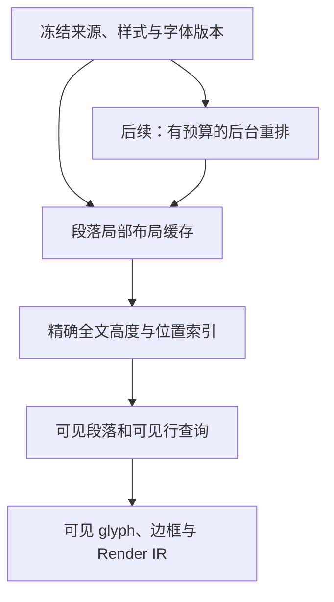

# TextFlow 性能优化方案

类型：`proposal`

日期：2026-10-23。状态：提案，尚未实施。

分析对象是 Novadraw 移植的官方 `TextFlowLargeExample`。Java 官方源码用于核对样例语义，Zed 源码用于研究性能机制。本次没有运行性能基准，也没有修改引擎或样例代码；下文的成本分析来自静态源码，优先级仍需由 release 模式的测量校准。

建议先消除字体初始化、快照构建和绘制数据中的重复工作，再实现按可见段落及可见行绘制。对于更大的文档，最后引入有预算的后台重排。当前样例应先保持精确的全文测量，避免过早引入估算高度和滚动位置修正。

**现有样例规模与语义**

Large 保留四十个 block：二十个正文 block 和二十个居中字号 block。每个正文 block 包含一条短句和四份长句；每个字号 block 包含二十个文字来源。加上首段可追加的目标，合计五百零一个文字来源。不同 Figure 来源身份、嵌套 inline、字号、baseline、tooltip 和首来源追加必须保留。[样例构造](../../../examples/native/draw2d-official-examples/src/examples/text_examples.rs#L236-L278)

Java 官方示例明确用于测试文档变化后的布局性能，允许向首个 TextFlow 追加字母和空格。因此优化要同时评估启动、首次稳定布局、滚动、追加文字和 resize。[官方源文件](file:///Users/bytedance/Documents/code/GitHub/gef-classic/org.eclipse.draw2d.examples/src/org/eclipse/draw2d/examples/text/TextFlowLargeExample.java)

**已经确认的成本点**

| 环节 | 源码事实 | 对性能的含义 |
|---|---|---|
| 字体初始化 | 共用 `canvas()` 注册四份 BuiltinFont，再注册 Hebrew 和 JP；JP 文件为 9,589,900 字节 | 当前 Large 的内容为拉丁文字，多语言字体初始化值得独立计时；不应让所有文字样例共用相同的预加载清单 |
| 字体集合更新 | `register_font` 验证字体、复制字节，并调用 `rebuild_font_context`；后者重新注册所有已有字体 | 逐份注册重复解析已有字体；注册 m 份字体会出现累计重建工作 |
| 测量 | `FlowLayoutService::measure` 直接调用 `build_snapshot`，不查 service cache | 测量也执行段落 shaping、fragment 和 placement 构建；若同一输入被多次测量，会重复计算 |
| 快照缓存 | `prepare` 只保存一个整页条目，键含 scene revision、文字引擎 revision 和 bounds 的四个分量 | 输入变化导致整页重新构建；缓存命中仍需调用 `prepare_snapshot` |
| 子节点 presentation | `prepare_snapshot` 为每个 source 扫描全部 fragments，并用线性 `members.contains` | 若 source 数为 N、fragment 数为 F，该部分扫描成本为 O(NF)，另外还有成员查找成本 |
| 绘制表示 | `StyledTextLayout::new` 为每个 run 构造一个 TextLayout；`glyph_run_layout` 复制全部行指标、文本键和该 run 的 glyph | 若一段有 R 个 run、B 字节文本、L 行，额外文本及行指标复制规模可达 O(R(B+L)) |
| glyph 来源映射 | 每个定位后的 glyph run 都从头遍历其底层 run 的 `visual_clusters()` | 底层 shaping run 跨多行时，同一 cluster 序列可能被反复扫描；需用单个长段落测试确认实际占比 |
| 绘制提交 | `FlowSnapshot::paint` 调用所有段落的 `fill_styled_text`；后者遍历全部 paint runs | 该层没有主动按可见段落筛选。最终裁剪不能消除此前的 CPU 遍历和命令记录 |

证据入口：

- [字体初始化](../../../examples/native/draw2d-official-examples/src/examples/text_examples.rs#L29-L69)
- [字体注册和 styled shaping](../../../novadraw/src/render/text.rs#L1453-L1545)
- [字体集合重建](../../../novadraw/src/render/text.rs#L1765-L1810)
- [测量与整页缓存](../../../novadraw/src/figure/flow/snapshot.rs#L24-L126)
- [子节点 presentation](../../../novadraw/src/figure/flow/snapshot.rs#L926-L1000)
- [按 run 复制布局](../../../novadraw/src/text/styled.rs#L217-L323)及[复制内容](../../../novadraw/src/render/text.rs#L680-L694)
- [cluster 来源映射](../../../novadraw/src/render/text.rs#L1640-L1694)
- [全文绘制](../../../novadraw/src/figure/flow/snapshot.rs#L362-L375)及[文字命令记录](../../../novadraw/src/graphics/context.rs#L179-L254)

这些事实不能单独证明当前等待主要由哪一项造成。例如字体注册发生在样例构建期，GPU 初始化可能发生在宿主启动期；两者必须分别测量。

**Zed 可以借鉴的机制**

Zed 的 Editor 根据滚动位置和可见高度计算 `start_row..end_row`，只收集这一区间的 row 信息，再调用 `layout_lines`。全文显示映射和可见行绘制布局分开维护。这是 TextFlow 最有价值的参考。[可见区间](file:///Users/bytedance/Documents/code/GitHub/zed/crates/editor/src/element.rs#L10035-L10065)、[可见行布局](file:///Users/bytedance/Documents/code/GitHub/zed/crates/editor/src/element.rs#L10420-L10443)

GPUI 的 LineLayoutCache 在当前帧和上一帧之间复用布局，也提供内容哈希入口，在缓存命中时避免先拼接连续文本。可借鉴“先确认内容与参数是否变化，再构造文本请求”的做法。其具体查找实现也有线性扫描，不能把每个接口都当作常数时间参考。[行缓存](file:///Users/bytedance/Documents/code/GitHub/zed/crates/gpui/src/text_system/line_layout.rs#L390-L420)、[按内容哈希查询](file:///Users/bytedance/Documents/code/GitHub/zed/crates/gpui/src/text_system/line_layout.rs#L630-L752)

WrapMap 对较大的换行任务采用后台计算，并对前台等待设时间上限；更新通过 snapshot 和 patch 组合。源码中的 5 ms 和 1 ms 是该版本的调度选择，Novadraw 应根据自己的帧预算配置，不能直接照抄。[后台换行与更新](file:///Users/bytedance/Documents/code/GitHub/zed/crates/editor/src/display_map/wrap_map.rs#L187-L370)

Zed Rope 和显示变换树使用 SumTree 保存聚合信息。TextFlow 可以借鉴按摘要定位位置和更新后续偏移的机制，但当前四十段文档先用有序数组和二分查找即可。只有段落数量、编辑频率和偏移维护成本的基准支持时，才升级为带高度摘要的树。[Rope](file:///Users/bytedance/Documents/code/GitHub/zed/crates/rope/src/rope.rs#L14-L27)、[WrapMap](file:///Users/bytedance/Documents/code/GitHub/zed/crates/editor/src/display_map/wrap_map.rs#L13-L45)

GPUI 使用 atlas 缓存光栅化 glyph。Novadraw 默认走 Vello glyph runs，后端已有字体资源缓存；是否改文字光栅化路线需由 GPU 数据决定。本方案优先减少布局和提交工作。[GPUI glyph 绘制](file:///Users/bytedance/Documents/code/GitHub/zed/crates/gpui/src/window.rs#L3569-L3620)、[Vello 后端](../../../novadraw-backend-vello/src/lib.rs#L500-L540)

**目标结构**

下图描述建议方向，不表示当前已经具备后台排版或可见行查询接口。

图 1：全文尺寸与可见绘制分离，后台候选先通过版本检查再进入缓存。绘制使用已发布快照；命中、caret 和 selection 保持相同 revision。

**先消除重复初始化和扫描**

字体加载按样例声明依赖。Large 使用当前绑定的 Inter；Caret 等多语言样例继续声明所需字体。初始内容的 script 与字体选择须经过核对；后续输入新 script 时采用正常字体资源完成和失效机制，不因减少预加载而改变 fallback 语义。

通用字体服务可以在一次资源同步结束后重建集合，或采用增量注册。选择前先核对字体删除、替换和 fallback 顺序。批量输入要先完成验证，失败不能留下半个有效集合；资源版本和引擎 generation 在完整更新后对外生效。字体字节尽量以共享不可变资源传递，避免多个组件重复拥有大块 Vec。

快照构建时一次建立 `source -> fragment indices` 和 source membership 索引。`prepare_snapshot` 直接访问对应片段，保留片段顺序及真实空白区域。目标是将该阶段的工作收敛到 source 数和实际输出的 fragment 数，而非每个 source 扫一遍全文。

边框需要相同的按来源、段落、行索引。当前 Large 没有大量 FlowBorder，边框循环应作为一般机制回归，不据此断言它是此样例的主要瓶颈。

**让测量和准备复用段落布局**

将局部段落布局与整页 placement 分开缓存：

- 段落布局缓存保存不可变 shaped layout、局部行指标、来源片段和内嵌盒。键包含贡献内容与顺序、布局相关样式、实际宽度、direction、alignment、wrap、边框度量、内嵌测量依赖和字体/fallback generation。
- 整页快照保存段落顺序、垂直偏移、block margin/padding 和最终来源 placement。纯垂直位移可以复用局部布局。
- 同输入、同约束的测量和准备共享已检查的局部结果；不同宽度或真实内嵌盒依赖不得误命中。测量继续不发布 child bounds。

首来源追加一个字母时，重排所在段落；其高度变化只调整后续位置，其他段落不应重新 shaping。若同一 block 包含多个段落、跨段边框或内嵌 Figure 依赖，则按真实依赖扩大失效范围。对于 resize，宽度变化可能要求全部段落重新换行，这是合法工作，仍可研究复用 shaping 结果。

段落缓存不能只靠 FigureId，也不能把整页 revision 放进每个局部缓存键，否则一次编辑仍会使所有条目失效。哈希用于查找，命中必须核对完整依赖或受检版本，避免碰撞和遗漏。

布局复用也不能复用旧交互 revision。颜色等纯绘制变化可以复用 glyph 位置，但新的绘制结果和交互映射仍需绑定本次已发布 revision。

**共享布局数据，消除按 run 的全文复制**

用不可变共享的布局数据和 run 范围描述绘制分片。每个 styled run 引用已有 glyph 数据和自己的样式，不再携带一份整段 TextLayout。公开替代引擎仍可构造受检输出；不能只给 Parley 或内置 Figure 提供高效路径。

glyph 来源映射可按底层 shaping run 一次建立 cluster 的 glyph-offset/source-range 索引，再查询各个定位片段；或沿可证明正确的游标遍历。必须保留 RTL、ligature、多 codepoint grapheme 和跨行来源范围，不允许简单按字节数推算。

缓存只能减少重复计算，不能通过跳过输入或输出验证换取速度。受检输出通过后再进入共享缓存；对外的错误通道继续为 Result。

**按可见段落及可见行生成绘制命令**

先保持全文精确布局，增加段落纵向区间索引；从 viewport 的有效 clip 计算 Flow 局部可见区间，二分定位段落。段落内部用行区间索引筛选 glyph runs 和 border fragments，可按配置预取临近区间。

需要的是绘制之前的可见内容查询。只在 Vello 提交末端加 clip，仍会支付全部段落的遍历、资源检查和 IR 记录成本；只筛选段落也无法解决一个超长段落的问题。

有效 clip 的几何转换属于通用引擎机制，不能由样例手工减滚动偏移。非轴对齐变换使用保守包围区间；glyph ink、边框和轮廓可能越出行盒，应考虑真实绘制扩展，避免误裁剪。原有 graphics clip 继续保证最终裁剪正确。

裁剪只影响当前帧绘制集合。全文尺寸、来源身份、caret 和 selection 查询保持有效；普通内嵌 Figure 使用正常绘制、命中和生命周期协议。可见行筛选应适用于外部 root、contributor、fragment border、替代引擎及 glyph/outline 两种表现。

纯滚动的目标是无需重新 shaping，也无需重新构建全文 fragments，只查询并记录本帧可见内容。最终 GPU 耗时还受 surface 尺寸、后端编码和缓存影响，需单独测量。

**更大文档再引入后台重排**

后台任务只拥有不可变来源快照及独立的文字引擎上下文，不借用附着的 Figure 树，不修改 Runtime。候选携带来源、字体、约束与请求 generation；完成后在前台检查版本，并按现有受检 publication 路径发布。resize 或编辑产生新请求时取消过期任务，完成的旧候选也不得覆盖新结果。

Native 可使用实例范围 executor；Web 在没有 worker 的环境下，需要可让出的分片任务和显式预算。不得用整份排版持有共享锁，造成后台线程运行时前台依然阻塞。

后台重排首先解决 UI 线程阻塞。若首次显示仍等待全文完成，它不会自动缩短首个文本出现的时间。要进一步提前首屏，需独立评审渐进布局：先精确布局可见范围，其他段落明确处于未布局或估算状态，公开查询不得把估算几何当作稳定事实。

渐进布局还需决定滚动范围是何时精确、如何保持来源锚点、跳到末尾时如何完成目标区域，以及未准备查询的 Result 契约。当前样例规模下，优先完成精确布局的优化，再用实测判断是否值得承担这组新契约。

**实施顺序和验收依据**

| 切片 | 内容 | 应验证的结果 |
|---|---|---|
| 基线 | 分阶段 release 计时和计数 | 区分字体、构建、布局、IR、GPU 与呈现的成本 |
| 初始化与索引 | 样例字体依赖、字体集合更新、source fragment 索引 | 字体语义不变；presentation 不再按 source 全文扫描 |
| 缓存与共享 | 测量/准备复用、段落局部缓存、共享 run 数据、cluster 索引 | 同约束重复测量复用；首段编辑不 shaping 其余段落 |
| 可见绘制 | 通用 clip 查询、段落/行索引、可见 IR | 同一 viewport 下，IR 随可见内容而非全文长度增长 |
| 后台重排 | 预算、取消、版本检查、发布边界 | 连续 resize/编辑保持可响应；旧任务不能覆盖新状态 |
| 可选渐进布局 | 首屏优先、未布局查询、滚动锚点 | 只有前面切片仍无法满足首屏需求时再设计 |

性能数据统一使用相同字体、窗口尺寸、DPI、后端、release 构建和资源状态。至少区分新进程冷启动、进程内重复打开、已有 GPU 的样例切换。记录样例构造时间、字体注册时间、稳定布局完成时间、首次文本呈现时间、追加和滚动帧的 p50/p95/p99、峰值内存及缓存占用。首次呈现不能用 prepare 返回时间替代。

阶段计数建议包括：字体集合重建次数、Flow assembly 次数、段落 shaping 次数及输入字节、fragment 检查次数、复制的文本/行指标数量、可见和已记录 glyph 数、缓存命中/淘汰、后台候选丢弃。使用计数器和 tracing，在采样结束后输出汇总，渲染热路径不打印。

基准输入包含原样例、增加相同官方内容的段落数，以及保持总文本量但改为单个长段落的场景。前者检验全文规模敏感性，后者暴露按行扫描和复制成本。它们是测试输入，不代表已经测得的性能数据。

行为回归覆盖字体替换、窄宽度换行、混合字号、RTL、ligature、fragment 空白命中、跨来源选择、tooltip、首来源追加、source reparent、边框首尾、内嵌 Figure 二次测量、缩放、outline 路径与失败保留旧快照。应同时检查 Native/Vello 截图，不能只依赖 glyph 计数。

新增机制需要外部消费者证明：第三方 root/contributor、border 和替代引擎复用同一缓存、可见绘制和失败语义，不修改 Core 也能获得相同能力。公共类型继续 backend-neutral；当前递归渲染主线无需因为本方案替换。

**架构归属**

当前语义以 [ADR-042](../../adr/adr-042-structured-flow-layout.md) 为准，受影响的 API family 是 `text.flow`、`text.interaction`、`layout.manager`，新增通用绘制查询还需核对 graphics 和 preparation 边界。机制属于 Core/text service 及正常后端，样例只声明资源并构造内容。

初始化和索引优化可先按现有契约实施。共享布局公开边界、通用可见绘制、异步 publication 及渐进测量属于需要评审的架构增量。本提案不宣称这些能力已完成，也不改变当前路线图执行队列。
