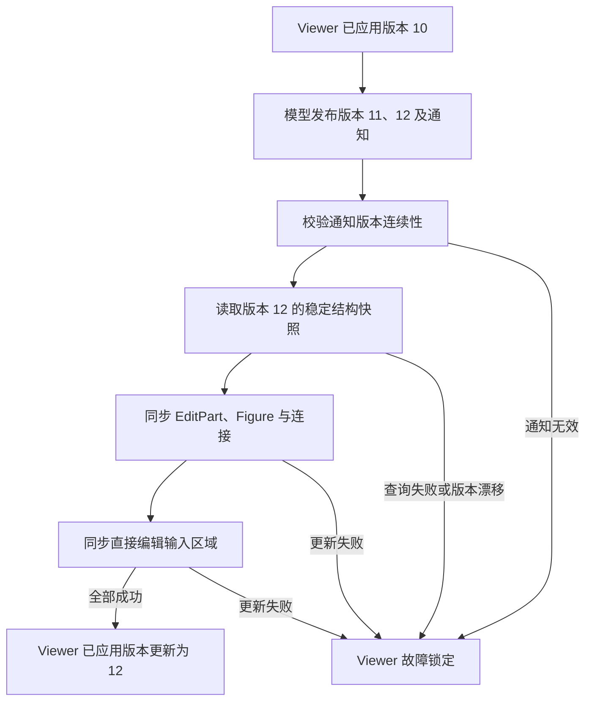

# 编辑框架中 revision 的作用与边界

类型：`reference-analysis`

本文记录编辑框架的版本语义分析。总体契约以 [Editor 架构](architecture.md) 和
[ADR-032](../../adr/adr-032-viewer-edit-session-and-drive-boundary.md) 为准；
本文解释现行机制，不新增接口或架构决策。

## revision 连接模型发布与视图同步

业务模型是应用持有的事实源，EditPart 和 Figure 是 Viewer 根据模型派生的视图。
模型变化和视图同步分成两步，期间可能积累通知，也可能发生查询、扩展回调或视图更新
失败。因此，收到变化通知并不足以证明 Viewer 已完整同步到当前模型。

模型版本（`ModelRevision`）标识模型已发布的稳定版本。Viewer 已应用版本
（`applied_revision`）记录最近一次完整同步成功的模型版本。两者使框架能够检查：
通知是否连续、结构读取是否属于同一版本，以及整个视图更新是否成功。

## 不同版本身份有不同所有者

| 名称 | 语义域 | 所有者与推进条件 |
|---|---|---|
| `ModelRevision` | 模型发布序列 | 应用 adapter 在发布模型变化时推进 |
| `applied_revision` | Viewer 的模型同步进度 | Viewer 在整个同步成功后更新 |
| `InteractionRevision` | 输入和请求序列 | EditorDomain 为输入或工具刷新分配 |
| `source_revision` | 直接编辑的模型前提 | 编辑会话保存开始时的模型版本，提交时校验 |

`applied_revision` 和直接编辑的 `source_revision` 都使用 `ModelRevision` 类型，
没有独立的版本计数器。`InteractionRevision` 是另一种类型，不能作为模型版本比较。

`ModelRevision` 与 `InteractionRevision` 都从非零值开始，通过 `next()` 前进；
数值空间耗尽时返回错误，不允许回绕。

## 模型发布后，Viewer 校验连续通知

假设 Viewer 已应用模型版本 10，模型随后发布版本 11、12。Viewer 同步按以下顺序执行：

当前 `validate_revisions` 的校验规则是：

- 第一条通知必须属于 Viewer 已应用版本的下一版本；
- 后续通知可以继续属于本批次当前版本，也可以进入紧邻的下一版本；
- 已应用过的旧版本或批次内倒退的版本触发 `StaleRevision`；
- 跳过版本触发 `RevisionGap`；
- 通知批次的最终版本必须等于 adapter 当前稳定版本；
- 没有通知且模型版本未变时，返回 `Ok(false)`；没有通知但模型版本已变时，报错。

同一模型版本可以携带多个有序事件。例如一次模型发布同时影响父节点和子节点，
两个事件可以使用相同版本。因此，模型版本不等于事件数量，也不与命令数量一一对应。
版本校验能够发现版本缺失或顺序错误，但仅凭版本不能判断同一版本内是否漏了一条
事件，或是否重复了某个事件内容。

当前同步以最终模型查询结果构建结构快照，再协调已有 Part 和 Figure；版本检查
没有将事件 payload 自动变成逐条增量更新算法。

## 结构快照必须来自同一模型版本

Viewer 分别读取 containment 和 connection。若读取子节点后模型变化，再读取连接，
两次结果可能拼成一个从未存在过的模型结构。

`ModelSnapshot::capture` 在读取前保存模型版本，在读取子节点和连接后再次比较。
版本变化时返回 `SnapshotRevisionChanged`；快照版本还必须与通知批次最终版本一致。

该检查依赖 adapter 的稳定查询契约。adapter 必须让模型变化、版本推进和通知发布
保持一致；共享模型需要提供一致的读取边界。版本计数器本身不提供锁、完整数据快照
或并发事务，也不能发现应用未发布的静默数据修改。

## Viewer 只记录完整同步成功

`applied_revision` 在子树、连接和直接编辑输入区域都同步成功后才更新。命令已经成功
修改模型，但后续 Figure 创建或连接更新失败时，模型版本可以已经前进，Viewer 已应用
版本仍保留上次成功值，Viewer 进入故障锁定状态。

保留旧版本只记录上次完整同步成功的位置。失败过程中部分已有视图可能已经变化，
不能由此推断整个内部视图仍完整保持旧版本。恢复应根据已知模型状态重建 Viewer，
不能通过手工推进已应用版本把失败同步标记为成功。

Viewer 已应用版本也不表示布局已经收敛或 GPU 已呈现对应像素。Core 的稳定 epoch、
后端 session 和 frame ID 分别描述后续阶段。

## 可恢复拒绝需要检查模型发布行为

`ViewerEditSession` 创建前先同步外部通知。命令随后获得短期模型写权限，并以
`commit`、`reject` 或 `fault` 关闭会话。

`commit` 校验通知并同步视图。`reject` 也执行同步检查，但要求结果没有模型版本
前进；若观察到合法变化，则返回 `RejectedEditChangedModel` 并故障锁定 Viewer。
非法通知同样使 Viewer 故障锁定。会话未关闭即销毁时，Viewer 也进入故障状态。

这里检查的是可观察的发布行为。若命令私自改了数据，却保持版本和通知都不变，
框架无法仅凭 revision 证明模型未变。命令实现仍必须遵守可恢复失败不修改模型的
契约。

## 直接编辑用模型版本校验草稿前提

文本直接编辑开始时，描述符和会话保存 `source_revision`。开始和提交时，
Viewer 都要求它等于当前模型版本。期间若发生外部模型发布，旧草稿提交返回
`StaleSourceRevision`，避免覆盖新的业务内容；现有契约测试确认草稿仍被保留。

当前检查采用整个模型的版本。因此，其他模型对象的变化也可能使文本会话过期。
这是当前的保守冲突策略，不代表框架已经实现属性级冲突检测或自动重基。

## 交互版本标记请求先后

`EditorDomain` 为输入和工具刷新分配 `InteractionRevision`，经 `ToolMouseEvent`
和 `RequestMetadata` 传入 Tool、Request 与 Policy。

拖拽过程中可以不断产生新的请求和预览，而模型保持不变。释放鼠标执行命令后，
模型才发布变化。因此，交互版本和模型版本必须分开。

当前交互版本提供先后身份，没有模型通知那样的通用连续性或过期拒绝校验。
不能仅凭它声称框架已经实现预览去重、异步结果淘汰或模型冲突检测。

## 撤销恢复内容，模型版本继续前进

撤销恢复过去的业务内容，但这次恢复仍是新的模型变化，应发布更大的模型版本。
若回退模型版本，Viewer 会把通知视为过期或倒退。

CommandStack 用独立的 `HistoryState` 保存当前历史位置和保存点，通过两者是否
相等判断 dirty。模型发布版本持续前进，命令历史位置则可以随 undo、redo 移动；
二者不能合并。

## GEF 对标关系

参考范围为 `org.eclipse.gef`。经典 GEF 的 `AbstractEditPart.activate` 要求子类
建立模型监听，`refresh` 调用 `refreshVisuals` 和 `refreshChildren`；
`refreshChildren` 比较模型子节点与已有 EditPart，执行新增、重排和删除。

该基础链路没有要求所有业务模型实现统一的 revision 接口。Novadraw 保留模型驱动
视图的关系，并通过 ModelAdapter 的稳定版本与有序通知，将同步连续性和失败边界
收口到 Viewer。revision 是这套显式同步协议的机制，不是所有编辑框架都必须采用的
唯一同步形式。

参考源码：
`/Users/bytedance/Documents/code/GitHub/gef-classic/org.eclipse.gef/src/org/eclipse/gef/editparts/AbstractEditPart.java`。

## 实现与验证证据

| 分析结论 | 实现入口 | 契约测试入口 |
|---|---|---|
| 模型版本及事件归属 | [model/mod.rs](../../../novadraw-editor/src/model/mod.rs) | [g1_model_contract.rs](../../../novadraw-editor/tests/g1_model_contract.rs) |
| 连续通知、同版本多事件及成功接受版本 | [viewer/projection.rs](../../../novadraw-editor/src/viewer/projection.rs) | [g2_viewer_projection_contract.rs](../../../novadraw-editor/tests/g2_viewer_projection_contract.rs) |
| 快照与会话关闭 | [viewer/mod.rs](../../../novadraw-editor/src/viewer/mod.rs) | [g4_editing_loop_contract.rs](../../../novadraw-editor/tests/g4_editing_loop_contract.rs) |
| 直接编辑过期与草稿保留 | [direct_edit.rs](../../../novadraw-editor/src/direct_edit.rs)、[viewer/mod.rs](../../../novadraw-editor/src/viewer/mod.rs) | [p2_e02_direct_text_edit_contract.rs](../../../novadraw-editor/tests/p2_e02_direct_text_edit_contract.rs) |
| 交互版本分配与传播 | [domain.rs](../../../novadraw-editor/src/domain.rs)、[request/mod.rs](../../../novadraw-editor/src/request/mod.rs) | [g4_editing_loop_contract.rs](../../../novadraw-editor/tests/g4_editing_loop_contract.rs) |
| 保存点与历史身份 | [command/mod.rs](../../../novadraw-editor/src/command/mod.rs) | [g1_command_stack_contract.rs](../../../novadraw-editor/tests/g1_command_stack_contract.rs) |

验证套件入口：`editor.tc07-viewer-boundary`、`editor.p2-e02-direct-text-edit`。
本次为文档分析记录，不把引用既有测试写成本次重新执行了编辑框架测试。

面向原理的解释见《深入理解 Novadraw》
[revision 附录](../../../book/internals/src/appendix-editor-revision.md)。
