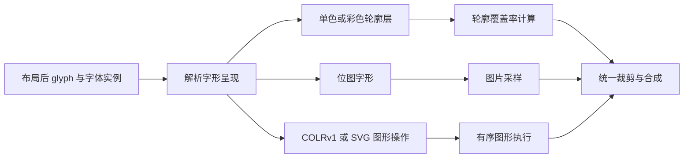

# 字形渲染算法与彩色 Emoji 字体

类型：`reference-analysis`

核对日期：2026-10-23。

范围：Evan Wallace、Will Dobbie、Eric Lengyel 的轮廓栅格化方法，以及主流
emoji 字体的彩色表示。本文记录外部事实、局限和选型建议，不定义新公共 API，
不改变执行队列，也不代表自研后端或彩色字体能力已经交付。

现行布局、轮廓与后端边界由
[ADR-025](../../adr/adr-025-unified-graphics-and-glyph-preparation.md)和
[文字与图形整合](../../design/rendering/text-graphics-integration.md)负责。

## 结论与适用范围

三种方法都消费字形轮廓，主要差异是候选几何组织、内外判断和覆盖率计算。
**建议优先研究 Lengyel 的根贡献分类和双向条带，以 Dobbie 的多方向窗口滤波
作为对照，保留 Evan 的三角形奇偶覆盖作为基础实验。**这是工程选型建议，
尚无统一条件的 GPU 基准证明性能排名。

完整彩色 emoji 需要字形呈现解析、颜色与有序合成，以及位图字形路径。
选用某种轮廓算法不会自动获得彩色字体支持。彩色矢量层可以调用同一轮廓栅格器，
位图字形则主要依赖图片解码和纹理采样。

布局先确定精确字体实例、glyph ID、advance、offset 和 cluster；栅格器不重新
执行字符映射、fallback 或 shaping。ZWJ、肤色修饰符、VS16 和旗帜序列必须由
字体选择与 shaping 正确处理，不能把一个 Unicode 码点固定视作一个 emoji glyph。

## 证据与源码入口

本地参考位于同一 Git 仓库的 `tests/font/`，核对基线为 `05ed1ecb`。
该基线标识本次读取位置，不代表算法实现已经验收。

| 方法 | 稳定源码入口 | 核对重点 |
|---|---|---|
| Evan | [blend](../../../../../../tests/font/evan_wallace/index_blend_method.html)、[stencil](../../../../../../tests/font/evan_wallace/index_stencil_method.html) | `prepareBufferDataByGlyphPath`、`buildGlyphBuffer`、`isInside`、`createPipeline` |
| Dobbie | [片段着色器](../../../../../../tests/font/will_dobbie_method/font.frag)、[顶点着色器](../../../../../../tests/font/will_dobbie_method/web.vert)、[Demo](../../../../../../tests/font/will_dobbie_method/index.html) | `fetchBezier`、`getAxisIntersections`、`updateClosestCrossing`、`integrateWindow`、atlas 加载与 draw 范围 |
| Lengyel | [原版 GLSL](../../../../../../tests/font/lengyel_method/Lengyel2017FontRendering-GlyphShader.glsl)、[本地 WGSL Demo](../../../../../../tests/font/lengyel_method/render_char.html) | 根贡献码、条带排序及提前退出；`sampleCoverage`、`sampleCoverageV`、`makeGridOnBezier` |

Evan 的原文读取被 Medium 安全验证阻挡，相关实现结论以本地源码为依据。
Dobbie 的原理与实现说明、Lengyel 的论文均已读取；外部字体资料的版本范围见
后文来源。README、原论文和本地移植行为分别记录，不能互相替代。

`font_bezier/read_char.html`是轮廓和网格实验，其中名为 `drawGlyphByGPU` 的
函数实际使用 `canvas.getContext("2d")`，不据函数名称认定为第四种 GPU 实现。

## 三种轮廓算法的共同基础

三者都需要正确的闭合轮廓、孔洞方向、字体单位和坐标变换。轮廓或预处理资产可以
跨绘制位置复用；位置、颜色、变换和裁剪属于每次绘制实例。

| 维度 | Evan Wallace | Will Dobbie | Eric Lengyel |
|---|---|---|---|
| 预处理 | 轮廓边扇形三角形、曲线控制三角形和插值坐标 | 二维网格、附近曲线索引、中心内外标记 | 水平与垂直条带、曲线索引及排序 |
| 绘制几何 | 多个三角形，数量随轮廓增长 | glyph 包围盒 | glyph 包围盒 |
| 内外判断 | 当前实现采用 even-odd 奇偶累计 | 中心种子与局部交点，依赖轮廓方向约定 | 有符号 winding 贡献，非零表示内部 |
| 曲线计算 | 插值后判断 `u² − v` | 求根、交点和切线方向 | 控制点符号分类、求根与贡献 |
| 抗锯齿 | 本地 stencil 版使用 4× MSAA | 多方向的一维窗口积分 | 两轴覆盖估计合并 |
| 成本来源 | 重复覆盖、三角形、附件与 pass | 索引读取、多方向求交、网格存储 | 条带候选读取与求交 |

轮廓分辨率无关不等于实际表示有无限精度，也不等于提供字体 hinting、
LCD 子像素合成或精确二维像素积分。

## Evan：三角形覆盖与奇偶填充

以辅助点和每条轮廓边的端点组成三角形，累计有效覆盖后取奇偶性。二次曲线额外
使用控制三角形，三个顶点的 UV 为 `(0, 0)`、`(1/2, 0)`、`(1, 1)`。
片段通过 `u² − v < 0` 保留曲线与弦之间的修正区域。

本地 stencil 版每次覆盖翻转最低位；blend 版向颜色通道增加 `1/255`，
读回后取模 2。两者采用同一曲线思路，差异在累计介质。

| 局限与所属层 | 触发条件及影响 | 处理方向 |
|---|---|---|
| 奇偶填充语义 | 同向轮廓或不同 glyph 的覆盖重叠可能被抵消，与 nonzero 不等价 | 明确填充契约，隔离字形累计；需要 nonzero 时另设计有符号累计 |
| 有限采样抗锯齿 | 小字号、细笔画和亚像素移动可能产生漏采样或离散变化 | 比较采样密度、质量与成本；单独评估小字号策略 |
| 三角形与重复覆盖 | 复杂轮廓增加几何和片段工作量，小三角形可能影响 GPU 利用率 | 缓存几何，测量真实字形集；没有基准时不指定瓶颈 |
| blend 计数格式 | 归一化 8 位附件饱和或不合适的颜色空间、量化会破坏奇偶性 | 明确格式与计数范围，评估 stencil 或其他计数表示 |
| 本地路径转换 | 只处理 `M/L/Q/Z`，未处理 `C`；`Z` 未显式补闭合边 | 统一闭合输入，按容限处理三次曲线 |

本地源码在累计与最终绘制 pipeline 中均配置 4× MSAA。README 的“只在最后
抗锯齿”与代码不同；最终 pass 无法恢复此前已经丢失的采样覆盖信息。
三次曲线和闭合输入缺口属于当前转换实现，不泛化成所有三角形字体算法的限制。

## Dobbie：二维网格与多方向窗口积分

每个网格单元保存附近曲线索引及中心内外标记。没有边界曲线的单元既可能位于
笔画内部，也可能位于外部，因此不能仅凭候选列表为空决定像素颜色。
片段到单元中心的交点用于修正中心种子。

`dFdx/dFdy`构造局部映射，使滤波窗口随旋转、拉伸和倾斜变化。当前 shader
采用 4 个方向和抛物线窗口积分；方向平均近似二维滤波。

| 局限与所属层 | 触发条件及影响 | 处理方向 |
|---|---|---|
| 有限方向近似 | 相切边界、尖角与复杂交汇可能产生方向相关误差 | 与高精度滤波参考比较，评估方向数与求交成本 |
| 局部候选完整性 | 缩小时像素窗口跨越单元或预设扩展范围，可能漏曲线 | 扩大查询、查询邻格或回退；原作者建议的小字号 atlas 回退未在 Demo 实现 |
| 原格式固定容量 | 每单元最多 8 条曲线，索引为字节；密集交汇未必能靠细分解决 | 变长 offset/count、更宽索引或回退，重新测量存储与带宽 |
| 坐标与根分类精度 | 16 位控制点量化；根接近共享端点时参数区间检查可能漏计或重复计数 | 分别验证坐标精度和拓扑分类；提高精度不自动修复分类 |
| 轮廓方向及种子 | 一般路径、方向混乱或复杂重叠不在现有材料的完整保证范围内 | 校验方向，明确路径及重叠语义，不把布尔种子视作通用 winding |
| 本地链路不完整 | 仅加载预生成 atlas/vertices/pages，目录缺少生成器；draw 限于一个 glyph | 补预处理、缓存及多字形有序合成 |

原作者明确说明索引应包含单元边界周围的滤波扩展。当前算法中的 atlas 是存储
曲线与索引的矢量数据纹理，不是普通栅格文字图片或 SDF。
原作者的“全部尺度”表述需结合实现说明中的缩小、溢出和精度边界理解。

## Lengyel：根贡献分类与双向条带

对水平射线，将二次曲线相对像素的正交坐标记为 `p₀`、`p₁`、`p₂`：

```text
a = p₀ − 2p₁ + p₂
b = p₀ − p₁
c = p₀
t₁,₂ = (b ∓ √max(b² − ac, 0)) / a
```

三个控制点为正还是非正形成 8 种状态。`0x2E74`编码两个根的贡献资格；
仍需计算根和交点，但不依赖数值 `t` 是否接近 0 或 1 来判断贡献资格。
原论文针对共享端点的漏计、重复计数和位置敏感闪烁论证分类方法。

水平与垂直条带保存影响对应射线的曲线。原版按最大坐标降序排列，剩余曲线全部
位于有效范围外时提前退出。条带不能替换为只保存当前二维单元附近边界的列表，
否则远处对 winding 有贡献的曲线可能被遗漏。

| 局限与所属层 | 触发条件及影响 | 处理方向 |
|---|---|---|
| 双轴覆盖近似 | 尖角、细笔画和各向异性需验证滤波误差；稳健内外分类不等于精确二维面积积分 | 对比水平、垂直、合并与高精度参考 |
| 条带候选成本 | 复杂轮廓可能产生较长列表，排序不能保证固定候选数量 | 统计实际列表和遍历分布，优化划分且保持完整性 |
| 二次曲线范围 | 三次转二次产生误差；位图和彩色内容不由单一轮廓覆盖表达 | 使用受检误差容限，其他表示单独处理 |
| 分类之外的实现精度 | 原分类法不修复输入量化、缺候选、单位错误或错误合成 | 对目标 GPU 表示、退化分支和有效输入测试；CPU 双精度不证明 GPU f32 |
| 本地 WGSL 移植 | 未排序、默认只用水平结果、双向公式和坐标单位偏离原版 | 先修正语义和单位，再补优化，分别验证 |

本地 `render_char.html`使用 `1×5` 与 `5×1` 条带，没有排序和提前退出。
默认 `coverageMode = 1`，虽计算两个方向，最终只使用水平结果。
双向分支 `(abs(H)+abs(V))/2` 与原版 `abs(H+V)/2` 不等价；合并前必须统一方向。

交点距离在 em 空间，像素比例却使用包围盒 UV 的 `fwidth`，单位不一致。
应对实际曲线坐标空间求导。三次曲线转换使用固定递归深度，未给出误差容限。
这些是本地实现事实，不据此否定原论文的分类论证。

## 彩色 Emoji 格式决定呈现路径

字体文件扩展名 `.ttf`、`.otf`、`.ttc`、`.woff2`不能说明彩色表示。
应检查具体 face 的字体表及版本；同一字体可能包含多种表示，运行环境对表的支持
也不同。字体项目图稿、某个构建文件和平台预装版本分别记录。

| 格式 | 数据与呈现方式 | 对轮廓算法的要求 |
|---|---|---|
| 单色轮廓 | 已定位 glyph 的轮廓与 foreground | 三者均可承担对应填充语义下的光栅化 |
| COLRv0＋CPAL | 按层序排列的 glyph 轮廓，每层一个纯色，alpha 合成 | 逐层计算覆盖率，再顺序合成 |
| COLRv1＋CPAL | Paint 有向无环图，含渐变、变换、裁剪和混合 | 只承担轮廓覆盖；需要 Paint 图执行与合成 |
| CBDT＋CBLC | 彩色位图数据与定位、尺寸信息，支持 PNG | 图片解码、尺寸选择、纹理采样与合成 |
| sbix | 标准图片格式及多个 strike 的定位信息 | 位图路径；还需遵循字体中轮廓与位图的呈现标志 |
| OpenType SVG | 字体内 SVG 描述，可含矢量和图片 | 需支持字体 SVG 规定的子集，轮廓算法只是其中一部分 |

COLRv0 层间重叠是预期合成关系。不能把所有颜色层放进同一个奇偶累计区域，
也不能合并成一个颜色或一条路径。COLRv1 的嵌套 Paint 与混合关系不能任意
展平成普通路径序列；SVG 图稿的来源也不意味着最终字体保留 `SVG ` 表。

覆盖率与颜色分开计算，再按规定的颜色空间、alpha 约定和层序合成。
渐变不是多做几次纯色填充就能完整替代的操作。位图字形的大幅放大受原图分辨率
限制，选择合适 strike 的行为需要明确。

## 主流 Emoji 字体与构建格式

以下为核对日期可确认的项目或版本，不作为所有历史及未来发行文件的统一声明。
项目 README 中旧平台兼容性说明不能直接当作当前各浏览器的支持矩阵。

| 字体或构建 | 常见用途 | 可确认的彩色格式及版本范围 | 来源 |
|---|---|---|---|
| Apple Color Emoji | macOS、iOS 系统 emoji | sbix 位图；本机 macOS 集合中 `Apple Color Emoji` 与 `.Apple Color Emoji UI` 的 `19.4d6e1` face 均检查到 sbix | 本机字体表检查；格式语义见 [sbix 规范](https://learn.microsoft.com/en-us/typography/opentype/spec/sbix) |
| Segoe UI Emoji 较早版本 | Windows 系统 emoji | COLRv0＋CPAL 分层矢量 | [Microsoft 字体演进说明](https://www.microsoft.design/articles/bringing-new-emoji-to-windows-11) |
| Segoe UI Emoji 新版 Windows 11 | 立体视觉风格 emoji | 同时包含 COLRv1、COLRv0 与单色表示的混合字体；选用哪种表示取决于应用能力 | 同上 |
| Noto Color Emoji 常见位图构建 | Android、ChromeOS、Linux 等 | 项目 README 指明 CBDT/CBLC；不据此排除其他 Noto 构建 | [Noto Emoji](https://github.com/googlefonts/noto-emoji) |
| Noto 矢量实验构建 | 渲染器与字体工具链测试 | Google color-fonts 提供 COLRv1，例如 `noto-glyf_colr_1.ttf`，另有其他实验格式 | [color-fonts](https://github.com/googlefonts/color-fonts) |
| Twemoji Mozilla | Mozilla 的 Twemoji 字体构建 | COLR/CPAL 分层轮廓 | [twemoji-colr](https://github.com/mozilla/twemoji-colr) |
| Twitter Color Emoji | 第三方可安装字体 | OpenType SVG / SVGinOT；与 Twemoji Mozilla 是不同构建 | [twemoji-color-font](https://github.com/13rac1/twemoji-color-font) |
| OpenMoji Color | 开源 emoji 图稿与字体 | 官方 font 目录提供多种构建，其中确认有 `glyf_colr_0`；需按所选文件检查 | [OpenMoji font](https://github.com/hfg-gmuend/openmoji/tree/master/font) |
| Noto Emoji 单色版 | 黑白 emoji 与可变字体 | 单色轮廓，不是彩色 Noto Color Emoji | [Noto Emoji](https://github.com/googlefonts/noto-emoji) |

本机 Apple 结果只证明该环境下的具体文件，不证明每个系统版本都使用相同表组合。
本次未枚举所有发行字体文件，也未建立当前平台支持矩阵。
Twemoji、Fluent Emoji 等 SVG/PNG 图稿库本身不是字体；转换后还需要字符映射、
GSUB 序列、度量和字形定位。

## 对自研后端的选型建议

在现行 ADR-025 边界下，彩色呈现属于未来需单独设计的真实扩展需求。
图 1 表示概念分工，不是已经存在的公共类型或已批准的新协议。



图 1：轮廓算法负责覆盖率，字形表示与有序合成决定完整彩色呈现。

多层矢量 emoji 中，Lengyel 可逐层计算 winding 和覆盖率；Dobbie 可逐层
组织网格并滤波；Evan 需要隔离各层累计及合成，且填充语义必须匹配。
三者都需要额外的颜色、层序和 Paint 处理，不按“算法支持多色”作二元判断。

建议评估组合为 Lengyel 风格轮廓光栅化、COLRv0/COLRv1 呈现执行和位图路径。
兼容既有系统字体时，sbix 与 CBDT/CBLC 都有实际输入来源；SVG 支持范围按产品
需求明确。对所有格式和外部实现使用相同的资源、错误与合成机制，不为内置字体
设特权路径，也不提前冻结闭合的公共格式枚举。

具体设计时需要确定：字体实例与变体如何固定；palette、foreground 和 Paint
变化使哪些缓存失效；位图选择如何依赖 ppem；子层 transform 和整体位置如何组合；
paint bounds 如何覆盖所有子层；unsupported 表示、损坏字体和合法空字形如何区分。
这些问题不能靠为 `GlyphOutlineProvider` 返回无类型 blob 解决。
已接受合同的所有权、缓存和提交语义直接引用现行专题，不在此复制或覆盖。

## 实验观察与后续验证

已有本地 HTML 实验使用预提取 STSong 轮廓和 JavaScript CPU 数学参考，不使用
原 GPU shader。Evan 用规则超采样；Dobbie 使用变长索引及小字号全曲线回退；
Lengyel 使用统一单位、方向、排序和双向合并。它不能复现原格式量化、固定容量、
GPU MSAA、f32 数值行为、缓存上传和生产合成。

在 100 像素范围、17° 旋转和 0.3 像素平移下，对 7 个字形的 707 个远离采样
边界的点，三个参考输出均与射线 winding 内外判定一致。该观察不证明边缘积分
精确。两个同向矩形的诊断中，Evan 清空重叠中心，Lengyel 保留填充，符合两者
填充语义；该诊断不构成 Dobbie 一般重叠路径支持证明。

自研后端推进前应分别验证：

- 共享端点、切线、退化及近线性曲线，三次转换的误差；
- 小字号、亚像素移动、旋转、非均匀缩放和跨单元滤波的候选完整性；
- 尖角、孔洞、同向重叠与跨 glyph 的合成隔离；
- COLRv0 层序、COLRv1 渐变及混合、位图定位与 strike 选择；
- 彩色与单色混排、ZWJ/VS16/肤色序列、cluster 与光标导航；
- 资源版本、palette/变体/ppem 缓存依赖，device loss 与失败处理；
- 同设备、同字形集和缓存条件下的 GPU 时间、上传量、内存及候选分布。

本文和现有 CPU 实验不是这些未来能力的验收记录。
原版 Lengyel GLSL 标注 CC BY-NC-ND 4.0，商业使用代码要求另行许可；
本地数学参考未直接嵌入该 GLSL。该事实不构成其他知识产权状态的结论。

## 原始资料

- [Evan Wallace 原文入口](https://medium.com/@evanwallace/easy-scalable-text-rendering-on-the-gpu-c3f4d782c5ac)：读取受阻，源码依据见前文。
- [Dobbie 原理](https://wdobbie.com/post/gpu-text-rendering-with-vector-textures/)与[实现说明](https://wdobbie.com/post/gpu-text-rendering-with-vector-textures-details/)：2016-01-02。
- [Lengyel 论文及补充 shader](https://jcgt.org/published/0006/02/02/)：JCGT 6(2)，31–47，2017。
- [OpenType COLR](https://learn.microsoft.com/en-us/typography/opentype/spec/colr)与[CPAL](https://learn.microsoft.com/en-us/typography/opentype/spec/cpal)：分层颜色与 Paint 图。
- [OpenType CBDT](https://learn.microsoft.com/en-us/typography/opentype/spec/cbdt)、[CBLC](https://learn.microsoft.com/en-us/typography/opentype/spec/cblc)、[sbix](https://learn.microsoft.com/en-us/typography/opentype/spec/sbix)：彩色位图及定位。
- [OpenType SVG](https://learn.microsoft.com/en-us/typography/opentype/spec/svg)：字体内 SVG 的能力与限制。
