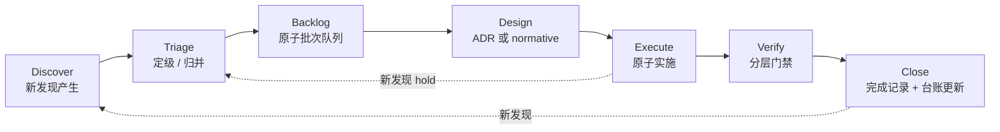

# 审计—收口持续闭环工作流

类型：`verification`

状态：`accepted`

日期：2026-10-09

## 1. 问题背景

当前已经积累了多轮审计记录（TC-01 ~ TC-14、API 复审、GEF 语义整改等），它们带来
两类反复出现的中断：

1. **一轮审计正在收口过程中，又会产生新的发现**。例如 TC-01 ~ TC-14 在 2026-10-08
   发布，TC-07 收口的过程中又揭露了 R01 Runtime 公开面与 R02 root/prelude 重复
   暴露；
2. **跨阶段修改需要滚动跟踪**。单一审计条目往往要分 2 ~ 4 个原子批次推进，
   期间会出现门禁阻断、迁移抖动与并行冲突。

现有机制已经做对的部分：

- `temporary-concept-design-audit-2026-10-08.md` 作为长期演进"台账"，用 `complete` /
  `partial` / `not_started` 跟踪每一条；
- `verification/suites.toml` 把执行命令与证据路径集中到 manifest；
- `cargo xtask check --quick` / `--full` 把门禁开销分层；
- 每条收口单独写一份 `tc0X-...-completion-*.md` 作为历史证据。

但当前流程只定义了"每一次审计 → 每一次收口"的单链条，没有定义"审计结果如何
进入执行队列、新发现如何被挂起而不中断主批次、门禁回归后如何回退"的规则。
本文档就是补齐这段。

## 2. 核心模型

工作流本身被建模为一个具有 **稳定前缀** 与 **因果单步执行** 的管线。借用项目的
"因果单步执行 + 前缀归因 + 分叉"概念，把审计发现当作有生命周期的实体，而不是
"一次性问题列表"。



六个阶段共同遵循三条不变量：

- **因果单步**：任何时刻只有一个 "正在 Execute" 的原子批次；并行只允许在
  Discover / Triage / Design 这些非写入阶段。
- **前缀锁定**：Execute 阶段期间发现的新问题 **不得** 篡改当前批次的目标与
  完成判据；它们只能作为 "hold" 项挂起到 Triage，等本批次关闭后再评估。
- **可审计**：每一次状态转移（新发现 / 定级变更 / 批次开始 / 批次关闭）都要
  在明确文件中留下 commit。

## 3. 文档与状态分工

| 文件 | 作用 | 更新时机 |
|---|---|---|
| **本次审计报告**（`reviews/<name>-YYYY-MM-DD.md`） | 一次审计时的全部发现快照 | 审计完成时写入；不再回头修改既有条目 |
| **总台账**（`reviews/temporary-concept-design-audit-2026-10-08.md`） | 跨审计的发现项状态登记 + 关联批次 | 发现项定级、状态翻转、批次关联时 |
| **收口完成记录**（`reviews/<id>-completion-YYYY-MM-DD.md`） | 一次原子批次关闭后的证据 | 批次关闭时一次写入 |
| **ADR / normative design** | 当前批次的"目标契约" | Design 阶段写入；Execute 阶段不改 |
| **`roadmap/p2-delta-backlog.md`** | 可实施批次队列 + 状态 | Triage 阶段把审计发现挂到对应 delta ID |
| **`verification/suites.toml`** | 批次毕业门禁 | Design 阶段登记新门禁；收口时不再增删 |
| **本文档** | 工作流本身 | 流程本身改变时才改 |

**关键原则**：审计报告是历史快照，不被覆盖；台账是当前真源，持续更新；完成记录
是不可变证据，一次写入。这与项目既有的"doc 分层"保持一致，不新增类型。

## 4. 阶段细则

### 4.1 Discover — 发现产生

两种输入：

- **主动审计**：周期性或里程碑驱动，产出 `reviews/<name>-YYYY-MM-DD.md`。
- **临时发现**：实施过程中偶遇；立即以列表形式追加到总台账的"3. 发现项"节的末尾，
  不等待下一轮主动审计。

Discover 阶段 **只写文档**，不改代码。

### 4.2 Triage — 定级与归并

每条发现在进入 Backlog 前必须定下三项属性：

1. **优先级**：P0 / P1 / P2（判据：是否阻塞产品定位 / API 稳定性 / 可维护性）；
2. **原子批次归属**：挂到现有 P2 delta 或新建 delta 条目；
3. **依赖关系**：是否依赖另一个尚未完成的批次。

同一类问题（例如所有"值类型未受检"）必须 **归并** 为同一个批次，避免多个批次
反复修改同一文件。

### 4.3 Backlog — 原子批次队列

`roadmap/p2-delta-backlog.md` 作为唯一队列。每个条目包含：

- `id`、`range`、`status` ∈ {`not_started`, `in_progress`, `complete`, `deferred`}；
- `dependencies`：显式列出前置批次；
- `linked_findings`：挂上来的审计发现 ID。

**执行顺序只在 Backlog 顶部单链**：同一时刻 Backlog 的 `in_progress` 条目不得
超过 1 条。这是"因果单步"在工作流层的强制：

```text
status in_progress 数 ≤ 1
```

如果需要并行推进两个独立批次，必须显式写明"同时持有两个 in_progress 需要的证据
与隔离机制"，否则默认拒绝并行执行。

### 4.4 Design — 契约先行

每个批次进入 Execute 之前必须补齐：

1. 一份新 ADR **或** 一份 `normative-design`；
2. 该批次 **冻结** 的 completion criteria（必须机器化：compile-fail、snapshot、
   suite ID）；
3. 预期影响的 crate 与公开 API 列表。

Design 阶段结束时产出一个 commit：`<batch-id> 定义目标契约与完成判据`。
此后 Execute 阶段 **不得** 修改契约；需要修改必须回到 Design 阶段。

### 4.5 Execute — 原子实施

实施期间的硬性约束：

- 任何本批次之外的"顺手修"**禁止**：发现问题就追加到台账末尾，继续当前批次；
- 门禁顺序遵循 CLAUDE.md 的"分层验证"：定向 `cargo check --lib` → 定向 suite →
  `cargo xtask check --quick` → 批次关闭前的一次 `--full`；
- 每个 commit 都应 **可独立回退**：失败即 `git revert`，不做"先糊后修"。

Execute 期间发现、但不属于当前批次的问题，被标记为 `hold`：直接追加到总台账
"3. 发现项"末尾，优先级留空，Triage 环节再定级。

### 4.6 Verify — 分层门禁

批次关闭需要通过：

- Design 阶段登记的 compile-fail / snapshot 门禁；
- `verification/suites.toml` 对应的 suite；
- `cargo xtask check --quick` 全套；
- 批次关闭前 **一次** `cargo xtask check --full`。

Full gate 阻断分两类：

- **本批次引入的回归**：必须在本批次关闭前修复；
- **既有的无关阻塞**（如并行迁移测试错误）：在完成记录的 §"验证" 显式标记，
  并在台账登记为独立 `hold`，不阻塞本批次关闭。

### 4.7 Close — 关闭与台账回填

批次关闭时必须：

1. 新建 `<id>-completion-YYYY-MM-DD.md`；
2. 把总台账对应条目改为 `complete`，并给出完成记录链接；
3. 更新 `p2-delta-backlog.md` 该条目 status；
4. 如果本批次关闭 **顺带** 关闭了其他发现（例如 Runtime facade 拆分顺带收窄了
   root），在总台账逐条翻状态，不留隐式关闭。

## 5. 推荐的仓库辅助工具

本节描述 **当前已有** 与 **建议补齐** 的工具，用来让以上流程成本尽量低。

### 5.1 已有

- `cargo xtask list` / `verify <suite-id>`：按 Backlog 挂的 suite 查门禁；
- `cargo xtask docs`：Markdown 索引与分类校验；
- `cargo xtask check --quick` / `--full`：分层门禁。

### 5.2 建议补齐（候选，尚未实现）

以下工具按"audit"子命名空间组织；本节只是提案，命令名可以在实现时再定稿。

| 候选命令 | 作用 | 实现粒度 |
|---|---|---|
| audit list | 读取总台账，输出 open / in_progress 条目 | 读 markdown 表格 |
| audit queue | 读取 p2-delta-backlog.md，输出当前 in_progress 与下一条 | 读 markdown |
| audit verify-single-inflight | 校验 Backlog in_progress 条目数 ≤ 1 | 作为 docs 的子步骤 |
| audit snapshot-api | 把 Runtime / root / prelude 的公开符号与方法计数输出到 verification/public-api/ | 已部分存在，扩充即可 |

这些命令不是前置条件，但能把"单步执行"与"前缀锁定"从约定变成机器化门禁。

## 6. 处理"审计中又产生审计"的具体规则

这是最常见的中断源，单独立规则：

1. **立即决定是否中断当前批次**。判据：
   - 新发现 **会让当前批次契约失效** → 立即暂停 Execute，回到 Design 修订契约；
   - 新发现 **只是另一处同类问题** → 不中断，加入当前批次（扩大范围需在
     Design 文档追加一行"范围扩充"说明）；
   - 其他情况 → `hold`，追加到台账末尾，不中断。
2. **不允许"隐式扩张"**：Execute 阶段的 PR 不得静默修改范围；范围变更必须
   先更新 Design 文档。
3. **挂起项必须显式归队**：Close 时若台账仍有未定级的 `hold`，必须在完成记录
   显式列出，并约定下一轮 Triage 的时间点，不留"稍后看看"。

## 7. 建议的本周行动

- 把本次 Review 的 R01 ~ R08 按本工作流 Triage，归入 `p2-delta-backlog.md`
  对应 P2-S* 或新建 delta；
- 把 Runtime facade 拆分（R01）作为下一个 `in_progress` 批次；
- 为该批次写一份独立 ADR（候选编号 ADR-033），把完成判据机器化为 symbol
  snapshot 与 compile-fail；
- 本文档作为后续审计/收口闭环的流程基线，流程本身的后续调整走 ADR。

## 8. 不作为流程的事项

- 本文档不定义运行时契约；
- 不替代 CLAUDE.md / AGENTS.md 的硬性禁忌；
- 不替代 Agent 的交互方式；
- 不要求把"所有发现"都转为代码任务，`deferred` 和 `hold` 本身是合法终态。
