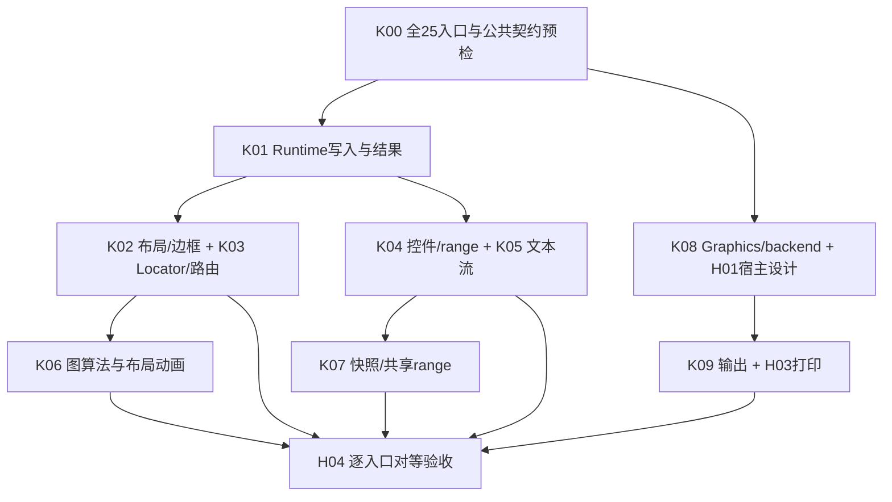

# 官方示例全量契约与实施划分

类型：`verification`

日期：2026-10-19

状态：Canvas 范围修订；按用户最新要求只推进 LightweightSystem 承载的 Draw2D 能力

## 当前范围裁定

本表保留官方源码的宿主环境描述，实施任务只取 Canvas 内的 Draw2D Figure、
布局、输入、图形、文字、资源和运行时能力。SWT Text/Combo/Scale/Group、原生
控制面板和 Printer/Dialog 不属于 Novadraw 功能建设或完成门禁。现有临时控制
工具可以保留，但不能把它升级为原生控件替代体系。

不编写、修改、编译或运行 Java 验证代码；上游源码仅供只读语义分析。
下面旧矩阵中关于 Java 运行、native 对照、pack、原生控件桥接、H03 真打印的要求
全部撤销，不因旧记录中出现这些文字而继续执行。当前任务与退出条件统一见
[Canvas Core 计划](draw2d-official-examples-core-plan.md) 和本地 Canvas 收口清单。
原始需求描述保留为来源记录，不能作为当前执行门禁。

## 范围与判断依据

完整分母是 `org.eclipse.draw2d.examples` 中 **25 个 public static main 入口**，
包括已有 complete 条目；每个入口的 helper、控件、资源、窗口及事件路径也纳入核对。
参考源码基线为 `4463d9d0ce13c19d10fbe769d29f28b7345a8cba`。
本次复查了入口与直接 helper，按方法追溯 ScrollBar、ConnectionEndpointLocator、
Thumbnail、MultiLineLabel、TextFlow、图布局及打印基础契约。

官方样例源码是唯一业务行为来源，当前完成证据来自
[移植审计](../reviews/draw2d-official-examples-parity-2026-10-16.md)，能力采用范围来自
[Draw2D 账本](../../parity/draw2d/api-coverage.md)，包归属遵循
[ADR-023](../../adr/adr-023-crate-consolidation-and-extension-boundaries.md)。
本次制定目标架构没有扫描 Novadraw Rust 实现；“现有能力”只引用上述已记录证据，
不能将未经验证的 public 调用面断言为已缺失。落地前需定向核对当前实现。

修订 1 从 TreeExample 的阻塞点提出 owned subtree 和事件期动画事务，未覆盖所有
样例，也过早选定了实现形状。修订 2 先列全量行为和责任，再从多个消费者推导
最小增量；owned subtree、receipt 和延迟领域事务均保留为待评审候选。

源码范围只包括 `org.eclipse.draw2d`、`org.eclipse.gef`。这 25 个样例及 helper
**没有 GEF import**，且所核对的行为直接由 Draw2D/SWT 提供。本次引擎缺口归入
Core 的公开契约及其扩展实现，原生控件、窗口、字体、栅格和打印归对应平台/backend。
示例控制器持有临时选中目标、配对关系和 fake typing 状态，调用 Core 完成图形操作；
这些行为不要求 EditPart、CommandStack 或业务编辑会话。

修订 2 额外推导的 Editor 消费计划已撤回。Caret 的临时高亮状态和 TextFlowLarge 的
追加输入由示例控制器持有；Core 提供受检文字几何、片段更新与绘制参数，原生 Text
自身的编辑状态由控件拥有。这不改变现行 Editor 对其业务 draft/preedit 的所有权。
后续步骤统一见 [Core 实施计划](draw2d-official-examples-core-plan.md)，不将本次样例
对等与 Editor 改进绑定。

## 对等证据必须分层

| 层次 | 判定内容 | 不能代替它的证据 |
|---|---|---|
| Figure 结构 | 图元类型、child order、真正的嵌套、layout/border、locator、资源与替换关系 | 仅截图接近；将真实 children 画进单个 Figure |
| 算法与行为 | 初值、公式、整数/float 舍入、选中、拖动、删除、布局/路由结果、取消与失败 | 只跑初始 fixture；重用本项目近似场景 |
| 宿主与控件 | SWT Canvas/Group/Text/Combo/Scale/Caret 的元素角色、输入、焦点、pack/resize、多窗口 | 用普通 Figure 假装 native Text；省略原生对照 |
| backend 与平台 | 栅格、AA、theme、字体/DPI、背景继承、打印、异步完成与退出 | Headless glyph count；GPU texture 成功但未验证 surface |

现有 2 complete / 9 in_progress / 1 not_implemented / 13 blocked 是历史业务移植
状态，本次不改写为全平台 complete。HelloWorld 和 EllipseHitting 也需要宿主和视觉
证据；完成列只能引用具体通过范围。不可复现的 Java 反射顺序、源码 bug 和平台
颜色均记录为差异，不能暗改为理想行为。

## 全部入口逐项矩阵

下表路径相对官方 `org/eclipse/draw2d/examples/`。K 为 Core 计划切片，H 为平台/
backend/宿主切片；编号是本文任务身份，不是新增 M/G/P2 milestone。
每个入口均只按官方所需行为安排 Core、扩展或宿主工作。

| 入口与源码 | 必须保留的官方结构和行为 | 剩余契约与判定 | Core / 宿主步骤 |
|---|---|---|---|
| HelloWorld · `HelloWorld.java` | 单 Label；FillLayout Shell 200×100、Canvas resize | 基础结构已验；字体/背景/尺寸与关闭路径仍需同平台核对 | K00、H01、H04 |
| EllipseHitting · `hittest/EllipseHitting.java` | 四 Ellipse、官方 preferred-size 公式、FlowLayout，进入黄/离开白 | 精确命中已验；Flow preferred size 与 400×300 resize、outline、颜色继承核对 | K00、K02、H04 |
| ConnectionAndAnchorExample · `connections/ConnectionAndAnchorExample.java` | 两 GroupBox、四 Rectangle、两 Connection、target PolygonDecoration；一个 Midpoint、两个 Endpoint Label 和 instructions；拖动重路由 | **同时**需要 owner-side/child-size EndpointLocator；u/v 默认及 override、绝对坐标到局部迁移和 Border metrics 待闭合 | K01、K02、K03、H01、H04 |
| ObstructionExample · `cg/ObstructionExample.java` | 五 Random(0) 障碍、诊断文字；左拖 abs(dx)>10 建矩形；右键成对端点；拖动重建 Path；右键删障碍、中键删端点/切 showSegs | 斜线 visibility graph 和共享拐角间距未移植；动态节点/配对 ID/Path 生命周期、map 清理未闭合；pair 删除 parent mismatch 须取证 | K01、K02、K03、H04 |
| FlowLayoutExample · `layouts/FlowLayoutExample.java` | 11 Shape 原尺寸/色，方向、stretch、主次对齐/spacing；orientation/stretch 后 resetShapes 和 shell.layout | Flow measurement/wrap/stretch 全矩阵待比较；不能只补布局 setter；SWT Group/radio/整数 Scale 未对等 | K01、K02、K04、H01、H04 |
| GridLayoutExample · `layouts/GridLayoutExample.java` | 两初始 Shape、九项循环、Add/Clear、线宽 4/1、完整 GridData 和禁用面板 | span/grab/hints/minimum、可编辑 Combo/Text、非法数字 fallback、FocusOut/Return、pack 待闭合；源码注释称 Tab 不提交，但多字段实际注册 FocusOut，须运行裁决 | K01、K02、K04、H01、H04 |
| ToolbarLayoutExample · `layouts/ToolbarLayoutExample.java` | 五 Shape、horizontal/stretch/alignment/spacing；方向切换仅 stretch 时 reset，stretch 切换总 reset | 默认方向、minimum/shrink/stretch、reset 后尺寸和控件/窗口需全矩阵验收 | K01、K02、K04、H01、H04 |
| ShapeStylesExample · `swt/ShapeStylesExample.java` | 八 axis、五 Shape、默认线宽列表；每 cell 独立 Canvas，先 X 后 Y；默认 x=width/y=line-style/width=5/Ellipse | AA ON/OFF/DEFAULT 之外，还要 **零线宽 hairline、miter 0/0.5/1、dash offset、alpha、disabled** 的 SWT 合法值裁决；整组 Canvas 重建/pack 未实现 | K01、K02、K08、H01、H02、H04 |
| InheritBackgroundExample · `swt/InheritBackgroundExample.java` | 两 Group/Canvas；Shell 背景图 + INHERIT_FORCE；orange self-paint 与 root opaque=false 的原生继承对照 | 背景源的宿主坐标、滚动相位、resize 和 alpha/clear 合成未定义；仅复制渐变到 Figure 不满足原生对照 | K07、H01、H02、H04 |
| DirectedGraphDemo · `graph/DirectedGraphDemo.java` | GraphTests 全菜单、SOUTH/EAST；Panel/XYLayout、node Label、gray edge + target decoration、vNodes bends | 16 个 fixture × 两方向；cycle/rank/weight/padding/virtual nodes/points，snapshot 替换与反射菜单顺序需验证 | K01、K03、K06、H01、H04 |
| CompoundGraphDemo · `graph/CompoundGraphDemo.java` | 10 fixture × 两方向、Tahoma；先 subgraph Figure 再 node/edge；蓝边宽=s.insets.left | 算法嵌套不等于 Figure 嵌套：官方 **subgraph visuals 平铺**，不得臆造嵌套 Figure；compound cycle、跨组边、padding/insets/vNodes 未闭合 | K01、K03、K06、H01、H04 |
| PathExample · `path/PathExample.java`、`PathFigure.java`、`ZoomFigure.java` | ScrollBar `<Zoom>`，min=0/max=200/extent=25；scale=(value+50)*0.02f；四点闭合/线宽3/45°旋转 | fill/outline **各绘制一次**旋转 zoom TextLayout；underline 1..2、selection 0..1；旋转 bounds + stroke、clip/client/preferred-size、AA、资源释放未闭合 | K02、K04、K05、K08、H01、H02、H04 |
| PrintExample · `printing/PrintExample.java` | native Print it Button + Canvas；三字体 Label、三 Shape、Draw2D Button、两节点/Connection、brazil.ico；PrintDialog、零 margin、默认 TILE | 实际 print job/page、DPI、裁剪/分页、source 背景恢复和取消/失败生命周期未闭合；屏幕预览不能替代打印 | K02、K09、H01、H03、H04 |
| ScrollPaneExample · `scrollpane/ScrollPaneExample.java`、`InternalFrame.java`、`ExampleUtil.java` | 两相同位置 InternalFrame；一个 Toolbar/两 FlowPanel/18 George Label；一个100×100；ScrollPane/GroupBox/tracksWidth、标题移动/八向resize | ScrollBar 五子节点/repeat、Border/theme、动态cursor、focus、exit/reset；不把注释掉置顶恢复成新行为 | K01、K02、K04、H01、H04 |
| ZoomExample · `zoom/ZoomExample.java`、`ZoomContainer.java` | Table/Column 两三段 UML；SVG 图标、Arial bold；ScrollBar 五节点/可换 Label thumb；value40/extent25；(value+10)*0.02f | SVG/DPI 图像 provider 和生命周期、scale/client/preferred、主题/repeat 待闭合；unused createThumbnail 不计 main 功能 | K02、K04、K08、H01、H02、H04 |
| ThumbnailExample · `thumbnail/ThumbnailExample.java` | 一棵可变 source tree、两矩形拖动；source Shell600×600/overview200×200；Thumbnail + GroupBox，保持纵横比 | **实时缩放栅格快照可以对等**；官方 Thumbnail 是 tiled image updater，并非第二 editable Figure 树；snapshot/resource/damage/source replacement/双窗口退出未定义 | K01、K02、K07、H01、H04 |
| BidiBlockExample · `text/BidiBlockExample.java` | 两 Canvas 各十 BlockFlow、LTR/RTL/inherit 和 LEFT/RIGHT/ALWAYS_LEFT/RIGHT；两棵独立内容，共享 vertical RangeModel | block direction 与相对/绝对对齐、Canvas mirror、共享 range 的 extent冲突/同步循环/寿命未闭合 | K05、K07、H01、H04 |
| CaretExample · `text/CaretExample.java`、`TestBorder.java` | 一 FlowPage/TextFlow、Tahoma20、蓝底、10px border、FlowBorder begin/end、Hit info；mouseMoved offset/trail/caret/selection | 原生 Caret+焦点、fragment 边界框、UTF-16→UTF-8/affinity 转换、**TextFlow selection 闭区间**、end offset 未完整对等 | K02、K05、H01、H04 |
| MultiLineLabelExample · `text/MultiLineLabelExample.java` | MultiLineLabel(含可聚焦 Viewport、Margin2、FlowPage/TextFlow) + 原生只读 Text 比较，600×500 | 自动 scrollbar、focus ring、mirrored方向键连续scroll、readonly accessibility/name、font mutation，原生 Text 对照未实现 | K02、K04、K05、H01、H04 |
| TextFlowExample · `text/TextFlowExample.java` | 六段：title、wrap、只按newline断行源码、nested InlineFlow/color/font、十字体baseline、right alignment | fragment font/color/继承、嵌套流、line-fragment geometry、paragraph规则未闭合；flatten text 会丢结构 | K05、H01、H04 |
| TextFlowLargeExample · `text/TextFlowLargeExample.java`、`TextFlowFactory.java` | 20 BlockFlow+20 centered字体block；每字体block 5..24共20 fragment、nested四句；首target reparent+Tooltip；只字母/空格追加 | fragment identity 与 mutation/reparent、tooltip、ALWAYS vertical bar、增量布局/性能未闭合；声明但未使用的regular/boldFont不造新样式 | K01、K04、K05、H01、H04 |
| TextSurroundingFigureExample · `text/TextSurroundingFigureExample.java` | 外LTR FlowPage；proxy1 Toolbar/三Shape、orange border；proxy2 Stack/innerRTL FlowPage；text在两侧 | FlowAdapter 的真实子树、分段占行/包围与baseline/换行/clip/hit/damage；不能换成object image或固定空格 | K01、K05、H01、H04 |
| SimpleTreeExample · `tree/SimpleTreeExample.java`、tree helpers | 四分支、root LEFT、normal/hanging、AnimatingLayer先于PageNode、Stack/Label/折页 Border、white Canvas | 行高/轮廓已初验；叶子/hanging空pane、shape边框、字体/背景/窗口resize及命中需要Java对照 | K02、K06、H01、H04 |
| TreeExample · `tree/TreeExample.java`、`Animation.java` | 19分支、完整Root/Selected组；More/Fewer/align/style/spacing、选中渐变/Label白字、doubleclickexpand、210ms reset/reverse/tracking | More Children完整子树/父样式/成功回执、Label白字及取消继承已通过定向验证；完整native面板、theme渐变、中心origin/动画连线/视口跟踪、取消/隐藏/重入待闭合 | K01、K02、K04、K06、K07、H01、H04 |
| UMLClassDiagram · `uml/UMLClassDiagram.java`、`UMLClassFigure.java`、`StickyNote.java` | 两类/三段结构、association diamond、end1/connection Label、90px便笺、whiteCanvas500×300 | EndpointLocator u=8与默认v=4、Label/border测量、DogEar、宽度驱动wrap、资源/字体等尚待对等 | K02、K03、K05、H01、H04 |
## 共享缺口与所有权

| 身份 | 需要补齐的契约 | owner 与既有增量 | 多消费者证据 | 实施性质 |
|---|---|---|---|---|
| K00 | 全入口/helper/feature/事件与平台证据 manifest | 验证工具；不进入 Runtime | 全25 | 新建验证规范 |
| K01 | 事件结果、完整 subtree/场景替换、挂载ID/binding、目标style/text/cursor写入、失败receipt与作用域清理 | Core Runtime；复用 S01/F02/S03/S06/S07，输入不变量先衔接 S08/S09 | Tree、Grid、Obstruction、graph、ShapeStyles、TextFlowLarge、InternalFrame | 有增量候选，也有已有API可直接落地；先核对 |
| K02 | layout/measurement/border/style inheritance 与 resize/reflow 的完整对等 | Core Figure/Layout/Graphics；helper样式保留扩展实现 | 两Locator示例、三layout、两tree、ScrollPane、UML、MultiLineLabel | 对照复核+定向修复；不先造新框架 |
| K03 | owner-aware Locator，斜线共享角路由，外部算法输出与 Connection 正常协议接入 | Core connection 扩展；C01/C02之后的新明确delta | ConnectionAndAnchor、UML、Obstruction、graph | Locator contract增量；路由算法可在独立实现模块/扩展包 |
| K04 | 可替换五节点ScrollBar、repeat/action/cancel、Range共享、控件输入/theme、整数Scale与Text/Combo角色 | Core仅通用输入/clock/range/幂等effect；组件库或平台adapter拥有widgets | Zoom、Path、ScrollPane、三layout、Tree、MultiLineLabel | W01及宿主组件增量；不归Editor |
| K05 | styled/nested flow、block方向、absolute/relative对齐、FlowBorder、真实inline Figure、fragment mutation、immutable查询/绘制 | Core text/layout/figure；T03与T01/T02窄扩展 | 六text、Path、UML/Print字体 | Core协议增量；临时高亮/追加由示例控制器持有，native编辑状态归控件 |
| K06 | Directed/Compound全算法，Tree布局/contour与可选lifecycle动画 | Core Layout扩展；L01/M01；算法与example业务model分离 | 两graph、两tree | 算法adapter+可替换实现，禁止Zest与固定坐标 |
| K07 | secondary live snapshot、资源epoch、共享range、多surface的source/view分离、继承背景描述 | Core只读scene/recorded output与range；backend snapshot；platform窗口 | Thumbnail、Bidi、InheritBackground、Tree tracking | 多consumer共同设计；不假定多编辑树或跨Runtime活对象迁移 |
| K08 | AA capability、hairline/低miter合法值、stroke/alpha/disabled、SVG/DPI资源、文字装饰和裁剪 | Core graphics/render/resource；具体栅格/图像provider归backend | ShapeStyles、Path、Zoom、Print | G01/G02上明确delta；不以silent fallback伪装支持 |
| K09 | scene输出快照、page region/DPI/scale/clip/tile、取消与资源生命周期 | Core输出合同+O01；printer backend和dialog归平台 | Print | 协议增量与具体输出adapter分离 |
| H01 | 原生元素、pack/resize、focus/IME/caret、主题/font、独立Canvas/窗口生命周期 | Winit/Web/目标native widget bridge 与app composition root | 全25，重点SWT对照项 | 平台计划；Winit不自动获得SWT原生控件 |
| H02 | 栅格能力、SVG/DPI、background合成和surface repair | Vello/backend+platform | ShapeStyles、Path、Zoom、InheritBackground | 实际能力采证后设计backend方案 |
| H03 | 打印对话框、Printer/job/page/完成/取消 | platform/output adapter | Print | 真实平台验收 |
| H04 | 官方与Rust的结构/事件/几何/资源/Native视觉复放 | verification runner | 全25 | 逐入口闭合 |

所有内置/外部 Figure、Layout、Router、Binding、控件扩展必须共用 typed identity、
payload trait 和 registry；不为官方样例建特权路径。是否增加独立算法/widget crate
取决于真实依赖与消费者证据，不能为了计划完整提前建空包。

## 此前漏掉的跨入口事实

ConnectionEndpointLocator 的 owner side、child preferred size 缺口影响两个入口，
不仅影响 UML；默认 uDistance=14/vDistance=4。Path 静态文本 selection 不属于编辑
session，Caret 的可变 selection 才涉及文本交互所有权。

图布局的测试分母为 DirectedGraph **16×2** 与 Compound **10×2**，并包含权重、
feedback/cycle、rank/vNode和复合约束；官方算法声明不保证每次结果相同，所以分别验证
约束与固定基线输出，不把新的确定性承诺伪称官方行为。Compound 模型嵌套而 Figure
visual平铺；TextFlowLarge 首target从page reparent到首BlockFlow；这些都要进入结构
manifest。

TextFlow 的 selection 参数是闭区间；CaretExample 传 `(offset,offset+1)`，不能
照先前审计直接断言“单字符选择”。应执行Java探针固定实际高亮，并定义UTF-16 offset、
UTF-8边界和trailing/affinity的适配，不能用clamp掩盖非边界位置。

Thumbnail 原码通过瓦片图像更新显示 source；对等目标是单一source真值、实时与aspect
ratio，不要求在overview再次挂载同一Figure或创建第二editable投影。
MultiLineLabel 还具有keyboard/focus/accessibility，不只是wrap+scrollbar。

ShapeStyles 的低miter和hairline可能与现有受检stroke范围冲突，应对合法SWT值逐项
探测，不能只识别AA缺口。原生Group/Canvas数量、editable/read-only Combo、Text
FocusOut与DefaultSelection、PrintDialog取消等均是功能分母。

## 执行依赖与阶段交付

这是依赖图，不是并行修改许可；实际仍 `in_progress ≤ 1`。Core计划按准备、基础
契约、布局/连接、widgets/text、图算法/动画、快照、输出与平台验收推进。
本次不安排Editor改进；平台不可用会保留该项未完成，
不阻塞可验证的平台无关契约。

## 关闭规则与仍待评审的决定

每个 feature 有源码方法、归属、交付包、API语义family、测试fixture、失败路径和
证据链接；每个入口有结构、事件、视觉、host四类状态。已有passed证据不能覆盖没有
执行的feature。实施步骤和退出条件统一在Core计划，不能用本文重写
M1-M10、G0-G5或既有P2状态。

需要评审的决定包括：事件期写入与结果返回的最小机制、text flow结构的Rust表示、
native控件bridge的目标平台、AA OFF/hairline的backend实现、snapshot跨surface
生命周期、graph adapter公共边界和输出target。API名字及最终crate拆分尚未冻结。
这些决定都有具体consumer和失败条件；下阶段先冻结各切片ADR再进入实现。

## 源码证据入口

以下链接均固定到同一官方基线。本报告的官方事实来自这些同源源码，未将它们
伪称多个独立来源。Novadraw状态另由移植审计、parity与ADR交叉核对。

- [全部官方入口与helper](https://github.com/eclipse-gef/gef-classic/tree/4463d9d0ce13c19d10fbe769d29f28b7345a8cba/org.eclipse.draw2d.examples/src/org/eclipse/draw2d/examples)
- [ScrollBar与可替换子图元](https://github.com/eclipse-gef/gef-classic/blob/4463d9d0ce13c19d10fbe769d29f28b7345a8cba/org.eclipse.draw2d/src/org/eclipse/draw2d/ScrollBar.java)
- [ConnectionEndpointLocator.relocate](https://github.com/eclipse-gef/gef-classic/blob/4463d9d0ce13c19d10fbe769d29f28b7345a8cba/org.eclipse.draw2d/src/org/eclipse/draw2d/ConnectionEndpointLocator.java)
- [Thumbnail source与瓦片更新](https://github.com/eclipse-gef/gef-classic/blob/4463d9d0ce13c19d10fbe769d29f28b7345a8cba/org.eclipse.draw2d/src/org/eclipse/draw2d/parts/Thumbnail.java)
- [MultiLineLabel完整控件契约](https://github.com/eclipse-gef/gef-classic/blob/4463d9d0ce13c19d10fbe769d29f28b7345a8cba/org.eclipse.draw2d/src/org/eclipse/draw2d/widgets/MultiLineLabel.java)
- [TextFlow选择闭区间与Flow绘制](https://github.com/eclipse-gef/gef-classic/blob/4463d9d0ce13c19d10fbe769d29f28b7345a8cba/org.eclipse.draw2d/src/org/eclipse/draw2d/text/TextFlow.java)
- [DirectedGraphLayout算法阶段](https://github.com/eclipse-gef/gef-classic/blob/4463d9d0ce13c19d10fbe769d29f28b7345a8cba/org.eclipse.draw2d/src/org/eclipse/draw2d/graph/DirectedGraphLayout.java)
- [CompoundDirectedGraphLayout算法阶段](https://github.com/eclipse-gef/gef-classic/blob/4463d9d0ce13c19d10fbe769d29f28b7345a8cba/org.eclipse.draw2d/src/org/eclipse/draw2d/graph/CompoundDirectedGraphLayout.java)
- [PrintFigureOperation分页和source恢复](https://github.com/eclipse-gef/gef-classic/blob/4463d9d0ce13c19d10fbe769d29f28b7345a8cba/org.eclipse.draw2d/src/org/eclipse/draw2d/PrintFigureOperation.java)
